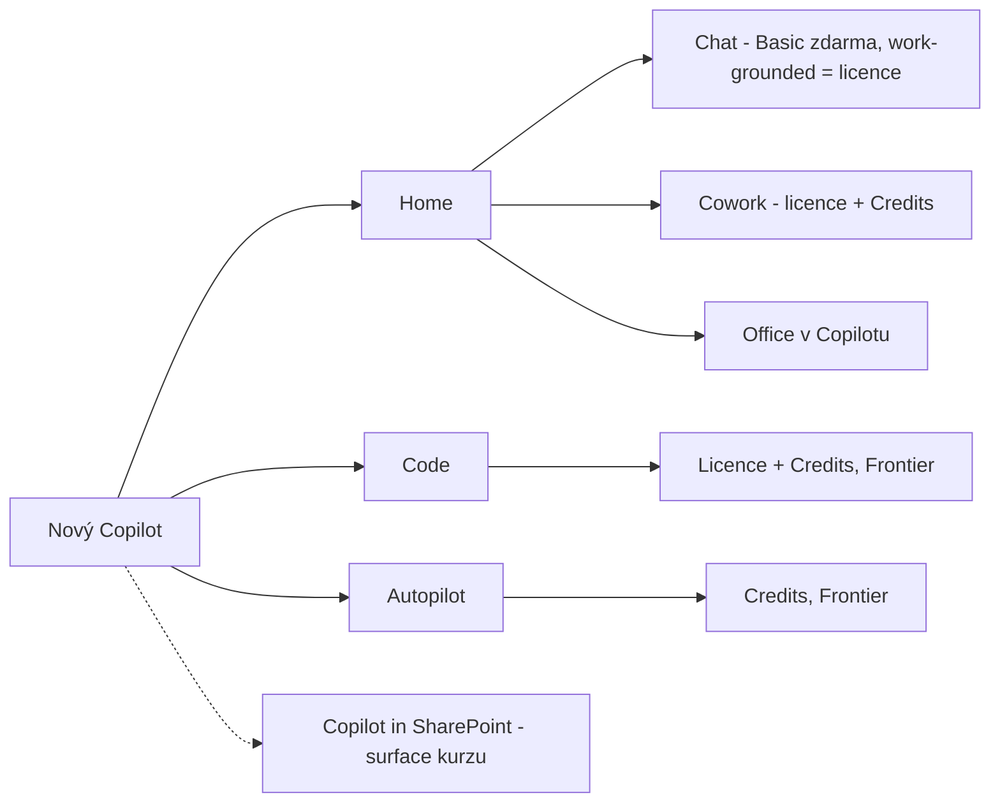
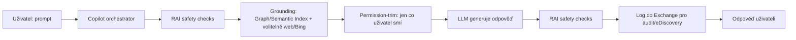

# AI landscape a pozicování Copilotu

> Typ: povinný · Den: 1 · Odhad: PM blok
> Prostředí: [`../../environment.md`](../../environment.md) · Názvosloví: [`../../GLOSSARY.md`](../../GLOSSARY.md)

## Cíle

- Zasadíte Microsoft Copilot mezi ostatní AI nástroje.
- Vysvětlíte rozdíl mezi odpovědí z webu (web-grounded) a odpovědí z dat organizace (tenant-grounded) a víte, co znamenají datové hranice.
- Znáte šest principů zodpovědné AI Microsoftu.
- Víte, kam v rodině Copilotů zapadá Copilot in SharePoint a Document processing for Microsoft 365.

## Proč začínáme mapou AI nástrojů

Uživatelé ve vaší organizaci dnes používají několik AI nástrojů vedle sebe: veřejné chatboty, Copilot Chat zdarma, placený Microsoft 365 Copilot, agenty. Na první pohled vypadají stejně — okno, do kterého se píše dotaz. Liší se ale v tom podstatném: **z jakých dat odpovídají, kam data putují a kdo za výsledek ručí**. Správce SharePointu musí tyto rozdíly umět vysvětlit, protože právě obsah SharePointu je to, z čeho Microsoft 365 Copilot čerpá.

Modul proto stavíme na jedné otázce, kterou si budete klást u každého AI nástroje v kurzu: **Odkud bere odpověď — a co smí vidět?**

## 1. Stručně: AI, LLM, generativní AI

Než se pustíme do produktů, potřebujete tři pojmy. Bez nich nepochopíte, proč se nástroje liší.

- **AI → strojové učení → generativní AI.** Strojové učení je podmnožina AI: model se neprogramuje pravidly, ale učí se vzory z tréninkových dat. Generativní AI je pak druh modelu, který tyto vzory používá k tvorbě nového obsahu — textu nebo obrazu.
- **LLM (large language model)** je jazykový model, který predikuje pravděpodobný následující token (kus slova). Z toho plyne jeho zásadní vlastnost: model „nezná pravdu", zná jen vzory. Odpověď může znít přesvědčivě a přitom být chybná. Proto potřebuje dvě pojistky — **lidskou kontrolu** výstupu a **grounding**.
- **Grounding / RAG (retrieval-augmented generation)** znamená, že se k vašemu promptu před odesláním do modelu přidají relevantní data — z webu nebo z tenantu. Model pak neodpovídá „z paměti", ale z dodaných podkladů, takže odpověď je konkrétní a aktuální.

Grounding je klíč ke zbytku modulu. Všechny rozdíly mezi veřejným chatem, Copilot Chatem a Microsoft 365 Copilotem se dají převést na otázku, *jaká data* se do promptu doplňují a *kdo smí* která data vidět.

Pro samostudium základů nabízí Microsoft [AI learning hub](https://learn.microsoft.com/en-us/training/) a modul [Responsible AI training](https://learn.microsoft.com/en-us/training/modules/embrace-responsible-ai-principles-practices/).

## 2. Zásady zodpovědné AI (Microsoft)

Protože LLM může chybovat, generovat nevhodný obsah nebo pracovat s citlivými daty, potřebuje výrobce pravidla, jak AI navrhovat a provozovat. Microsoft je má sepsaná v **Responsible AI Standard**, který stojí na šesti principech:

| Princip | Co znamená |
|---|---|
| **Fairness** (férovost) | AI zachází se všemi férově a neznevýhodňuje skupiny lidí ve srovnatelné situaci. |
| **Reliability & safety** (spolehlivost a bezpečnost) | Systém funguje tak, jak byl navržen, a bezpečně reaguje i na nečekané situace a pokusy o zneužití. |
| **Privacy & security** (soukromí a zabezpečení) | Data i modely jsou chráněné a právo jednotlivce na soukromí je zachované. |
| **Inclusiveness** (inkluzivita) | AI je navržená pro celé spektrum uživatelů. |
| **Transparency** (transparentnost) | Je zřejmé, jak a proč systém funguje, kde má limity a jak dochází k rozhodnutí. |
| **Accountability** (odpovědnost) | Za to, jak technologie funguje a co způsobí, nese odpovědnost člověk a organizace. |

Standard je rozdělený do 6 domén a 14 cílů; každý cíl se skládá z konkrétních požadavků, které musí vývojové týmy splnit ([Principles & approach](https://www.microsoft.com/en-us/ai/principles-and-approach), [What is Responsible AI](https://learn.microsoft.com/en-us/azure/machine-learning/concept-responsible-ai), [Service assurance](https://learn.microsoft.com/en-us/compliance/assurance/assurance-artificial-intelligence)).

Pro vás jako správce je podstatné, že principy nejsou jen deklarace. V Copilotu se promítají do kontrol, které běží při každém dotazu — **RAI safety checks** před odesláním promptu modelu i po vygenerování odpovědi (uvidíte je v diagramu toku dat níže). Část odpovědnosti ale zůstává na organizaci: pravidla používání AI, školení uživatelů a kontrola výstupů. Proto má readiness checklist v labu oblast *Governance*.

## 3. ChatGPT-styl vs. Microsoft Copilot — grounding a datové hranice

Tohle je nosné rozlišení celého kurzu. Veřejný chat a Microsoft 365 Copilot mohou běžet nad podobným typem modelu, ale liší se v tom, co do promptu doplňují a v jakém režimu ochrany dat běží:

| | Veřejný chat (ChatGPT-styl) / Copilot Chat (Basic) | Microsoft 365 Copilot (add-on) |
|---|---|---|
| Grounding | web (u Copilot Chat přes Bing); výjimka Outlook — viz níže | **tenant** přes Microsoft Graph, Work IQ + Semantic Index (+ volitelně web) |
| Přístup k org obsahu | ne (jen co vložíte do promptu) | ano, ale **jen co uživatel smí vidět** |
| Datová hranice | — | Microsoft 365 service boundary, EDP |
| Trénink na vašich datech | u veřejných nástrojů záleží na podmínkách | **ne** — prompty/odpovědi netrénují foundation modely |

### Ochrana dat: service boundary a EDP

Copilot i Copilot Chat běží uvnitř **Microsoft 365 service boundary** a vztahuje se na ně **enterprise data protection (EDP)**. Prompty a odpovědi **netrénují** foundation modely. To je zásadní rozdíl oproti veřejným nástrojům, kde o použití vašich dat rozhodují podmínky konkrétní služby ([Enterprise data protection](https://learn.microsoft.com/en-us/microsoft-365/copilot/enterprise-data-protection), [Privacy & protections](https://learn.microsoft.com/en-us/copilot/privacy-and-protections)).

### Permission-trimming: Copilot vidí jen to, co uživatel

Microsoft 365 Copilot grounduje odpovědi na datech tenantu, ale nikdy neobejde oprávnění. Zobrazí jen data, ke kterým má konkrétní uživatel přístup; Microsoft Graph i Semantic Index respektují hranici přístupu danou identitou uživatele. Copilot ctí také sensitivity labely z Microsoft Purview a šifrování ([Data, privacy & security](https://learn.microsoft.com/en-us/microsoft-365/copilot/microsoft-365-copilot-privacy), [Data protection architecture](https://learn.microsoft.com/en-us/microsoft-365/copilot/microsoft-365-copilot-architecture-data-protection-auditing)).

Všimněte si důsledku pro správu SharePointu: permission-trimming chrání jen tak dobře, jak dobře jsou nastavená oprávnění. Je-li web přesdílený (například odkazem pro celou organizaci), Copilot jeho obsah legitimně najde a použije v odpovědi. Copilot oversharing nevytváří, ale zviditelňuje ho. Proto se v labu ptáte, zda víte, které weby jsou přesdílené, a v D3 k tomu použijete nástroje SharePoint Advanced Management.

### Copilot Chat (Basic) a výjimka Outlooku

**Copilot Chat (Basic)** — verze zdarma — je grounded na webu přes Bing. O obsahu organizace neví nic, dokud ho uživatel sám nevloží do promptu. Jedinou výjimkou je **Outlook**: Copilot Chat v Outlooku grounduje i bez licence na poštu, kalendář, schůzky, chaty a omezenou sadu souvisejícího obsahu ([Copilot overview](https://learn.microsoft.com/en-us/copilot/overview)).

### EU datové hranice — konkrétně pro CZ/EU organizace

EDP neznamená, že všechno zpracování zůstává v EU. Microsoft se hlásí ke GDPR, **EU Data Boundary** a ISO/IEC 27018, ale z EU Data Boundary jsou aktuálně **vyňaty** dvě věci:

- **dotazy do webového vyhledávání** (přes Bing),
- **modely Anthropic**.

Naopak **OpenAI** jako subprocesor Microsoftu (od 07/2026) je **uvnitř** EU Data Boundary. Praktický dopad uvidíte u Cowork: v tenantu uvnitř EU Data Boundary nabízí **Cowork jen GPT modely** ([Enterprise data protection](https://learn.microsoft.com/en-us/microsoft-365/copilot/enterprise-data-protection), [Anthropic models](https://learn.microsoft.com/en-us/microsoft-365/copilot/connect-to-ai-subprocessor), [OpenAI subprocessor](https://learn.microsoft.com/en-us/microsoft-365/copilot/openai-subprocessor), [Cowork models](https://learn.microsoft.com/en-us/copilot/cowork/cowork-models)).

Pro EU organizaci z toho plynou dvě governance rozhodnutí: zda povolit webové vyhledávání v Copilotu a zda povolit AI subprocesory mimo EU Data Boundary ([Web search data](https://learn.microsoft.com/en-us/microsoft-365/copilot/manage-public-web-access)). Navazuje to na pravidla práce s AI z [`../onboarding/ways-of-working.md`](../onboarding/ways-of-working.md) a do readiness checklistu v labu zapíšete aspoň jeden bod právě k datovým hranicím.

## 4. Rodina Copilotů a kam zapadá SharePoint

Microsoft nabízí Copilot napříč produkty — ve Wordu, Excelu, PowerPointu, Outlooku a Teams, jako Copilot Chat a ve formě agentů ([Copilot overview](https://learn.microsoft.com/en-us/copilot/overview)). Od 25. 9. 2026 je to **„nový Copilot"** — jedna aplikace se třemi vstupy ([Introducing the new Copilot](https://blogs.microsoft.com/blog/2026/09/25/introducing-the-new-copilot-with-home-code-and-autopilot/)):

- **Home** = **Chat** (rychlé dotazy) + **Cowork** + Office (Word/Excel/PowerPoint přímo v aplikaci Copilot). Cowork je delegovaný úkol dotažený do hotového výsledku: pošle e-mail, naplánuje schůzku, vytvoří dokument — a každou akci uživatel schvaluje. Cowork je v GA ([Cowork](https://learn.microsoft.com/en-us/copilot/cowork/)).
- **Code** = popíšete aplikaci, dashboard nebo skript, Copilot ho postaví a hostuje v tenantu. Je ve Frontier preview ([Copilot Code](https://learn.microsoft.com/en-us/copilot/code/)).
- **Autopilot** (dříve Scout) = trvalý proaktivní agent s vlastní identitou (Frontier).
- **Researcher / Analyst** = vestavění agenti pro hloubkovou rešerši a analýzu dat (součást Copilot licence).

Rozdíl mezi Chatem a Cowork je rozdíl mezi *odpovědí* a *akcí*. Chat vám řekne, co v datech je; Cowork na základě dat něco udělá. Proto Cowork vyžaduje schvalování kroků uživatelem — a proto se i jinak licencuje.

Diagram ukazuje i licenční dopad: některé části pokrývá licence, jiné čerpají Copilot Credits navíc k ní. Podrobně to rozebírá modul [`../licensing/`](../licensing/README.md).

### Kam zapadá SharePoint

- **Copilot in SharePoint** je Copilot zážitek nad weby a knihovnami, včetně Skills a agentů. Je to surface, kde probíhá většina kurzu. GA rollout začal 30. 9. 2026, takže se v tenantu může objevovat postupně ([Get started](https://learn.microsoft.com/en-us/sharepoint/copilot-in-sharepoint-get-started)).
- **Document processing for Microsoft 365** není „Copilot". Je to služba pro vytěžování dokumentů, která **dodává Copilotu strukturovaná metadata** a tím zlepšuje grounding. Vztah je dělba práce: Document processing vytěžuje → Copilot se ptá nad vytěženým. Licenční model obou služeb je odlišný, viz [`../licensing/`](../licensing/README.md).

Odtud vede praktické doporučení pro celý kurz: kvalita odpovědí Copilota v SharePointu závisí na kvalitě obsahu pod ním — na oprávněních, struktuře webů a metadatech.

## Data flow (jak Copilot zpracuje dotaz)

Všechny pojmy z modulu se potkávají v jednom toku. Když uživatel položí dotaz, Copilot orchestrator nejprve provede RAI safety checks, pak doplní prompt o data z Microsoft Graph a Semantic Index (volitelně i z webu přes Bing), ořízne je podle oprávnění uživatele, předá je LLM, vygenerovanou odpověď znovu zkontroluje a interakci zaloguje do Exchange, kde je k dispozici pro audit a eDiscovery ([Architecture](https://learn.microsoft.com/en-us/microsoft-365/copilot/microsoft-365-copilot-architecture), [Data protection architecture](https://learn.microsoft.com/en-us/microsoft-365/copilot/microsoft-365-copilot-architecture-data-protection-auditing), [Service assurance](https://learn.microsoft.com/en-us/compliance/assurance/assurance-artificial-intelligence)).

Při čtení diagramu si všimněte, kde do toku vstupujete vy jako správce: oprávnění v SharePointu rozhodují o kroku *Permission-trim*, nastavení webového vyhledávání o tom, zda se v kroku *Grounding* použije Bing, a log v Exchange je to, s čím později pracujete v auditu ([Web search data](https://learn.microsoft.com/en-us/microsoft-365/copilot/manage-public-web-access)).

## Klíčové rozlišení

- **Web-grounded vs. tenant-grounded** — hlavní osa; určuje, co Copilot „ví".
- **Copilot ≠ Document processing** — Copilot se ptá, Document processing připravuje data.
- **EDP ≠ EU Data Boundary pro všechno** — web queries a Anthropic modely jsou vyňaty.
- **Chat ≠ Cowork** — Chat odpovídá, Cowork koná (a čerpá Copilot Credits navíc k licenci).

## 5. Naše prostředí (kurz)

Od běhu 2026-11 máte **Microsoft 365 Copilot licenci** a k tomu Copilot Credits (viz [`../licensing/`](../licensing/README.md)). Licence je nutná: PAYG bez licence by odemkl jen Copilot Chat nad daty tenantu a agenty, ne Copilot in SharePoint, Skills, Cowork ani Code. **Cowork a Code** si vyzkoušíte hands-on v D4 ([`../../day-4/cowork/`](../../day-4/cowork/README.md)). Autopilot je ve Frontier, v kurzu se s ním prakticky nepracuje. Detaily prostředí: [`environment.md`](../../environment.md).

## Shrnutí

- LLM odpovídá ze vzorů, ne z pravdy; grounding (RAG) doplní prompt o data z webu nebo z tenantu.
- Copilot Chat (Basic) odpovídá z webu (výjimka Outlook); Microsoft 365 Copilot z dat tenantu — vždy jen z toho, co uživatel smí vidět.
- EDP chrání prompty i odpovědi a netrénuje na nich modely, ale webové vyhledávání a modely Anthropic jsou z EU Data Boundary vyňaty.
- Copilot in SharePoint je hlavní surface kurzu; Document processing mu připravuje metadata, Copilotem sám není.
- Copilot zviditelňuje oversharing — kvalita oprávnění v SharePointu je základ bezpečného groundingu.

## Lab

[`lab-readiness-checklist.md`](lab-readiness-checklist.md) — Copilot readiness checklist a gap log s důrazem na datové hranice a governance.

## Zdroje (Microsoft)

- **Responsible AI:** [Principles & approach](https://www.microsoft.com/en-us/ai/principles-and-approach) · [What is Responsible AI](https://learn.microsoft.com/en-us/azure/machine-learning/concept-responsible-ai) · [Service assurance](https://learn.microsoft.com/en-us/compliance/assurance/assurance-artificial-intelligence) · [Training](https://learn.microsoft.com/en-us/training/modules/embrace-responsible-ai-principles-practices/) · [AI learning hub](https://learn.microsoft.com/en-us/training/)
- **Grounding a ochrana dat:** [Enterprise data protection](https://learn.microsoft.com/en-us/microsoft-365/copilot/enterprise-data-protection) · [Privacy & protections](https://learn.microsoft.com/en-us/copilot/privacy-and-protections) · [Data, privacy & security](https://learn.microsoft.com/en-us/microsoft-365/copilot/microsoft-365-copilot-privacy) · [Architecture](https://learn.microsoft.com/en-us/microsoft-365/copilot/microsoft-365-copilot-architecture) · [Data protection architecture](https://learn.microsoft.com/en-us/microsoft-365/copilot/microsoft-365-copilot-architecture-data-protection-auditing) · [Web search data](https://learn.microsoft.com/en-us/microsoft-365/copilot/manage-public-web-access)
- **Rodina Copilotů:** [Copilot overview](https://learn.microsoft.com/en-us/copilot/overview) · [Introducing the new Copilot](https://blogs.microsoft.com/blog/2026/09/25/introducing-the-new-copilot-with-home-code-and-autopilot/) · [Cowork](https://learn.microsoft.com/en-us/copilot/cowork/) · [Cowork models](https://learn.microsoft.com/en-us/copilot/cowork/cowork-models) · [Copilot Code](https://learn.microsoft.com/en-us/copilot/code/) · [Copilot in SharePoint](https://learn.microsoft.com/en-us/sharepoint/copilot-in-sharepoint-get-started)
- **AI subprocesoři:** [Anthropic models](https://learn.microsoft.com/en-us/microsoft-365/copilot/connect-to-ai-subprocessor) · [OpenAI subprocessor](https://learn.microsoft.com/en-us/microsoft-365/copilot/openai-subprocessor)

## Stav produktu / delta

> [!WARNING] Ověřit k datu běhu — stav k 2026-11.
>
> - Vyňetí Anthropic modelů z EU Data Boundary se může měnit — ověřte v dokumentu Enterprise data protection.
> - Modely za Copilotem se mění (router Auto; GPT, Anthropic, v Cowork i xAI); změny modelů nemění bezpečnostní ani compliance nastavení.
> - Copilot in SharePoint je v GA od 30. 9. 2026 (postupný rollout).
> - Nový Copilot (Home/Cowork/Code/Autopilot) — stav k 2026-10; Code a Autopilot ve Frontier. Po Ignite (17.–20. 11. 2026) ověřte znovu.
