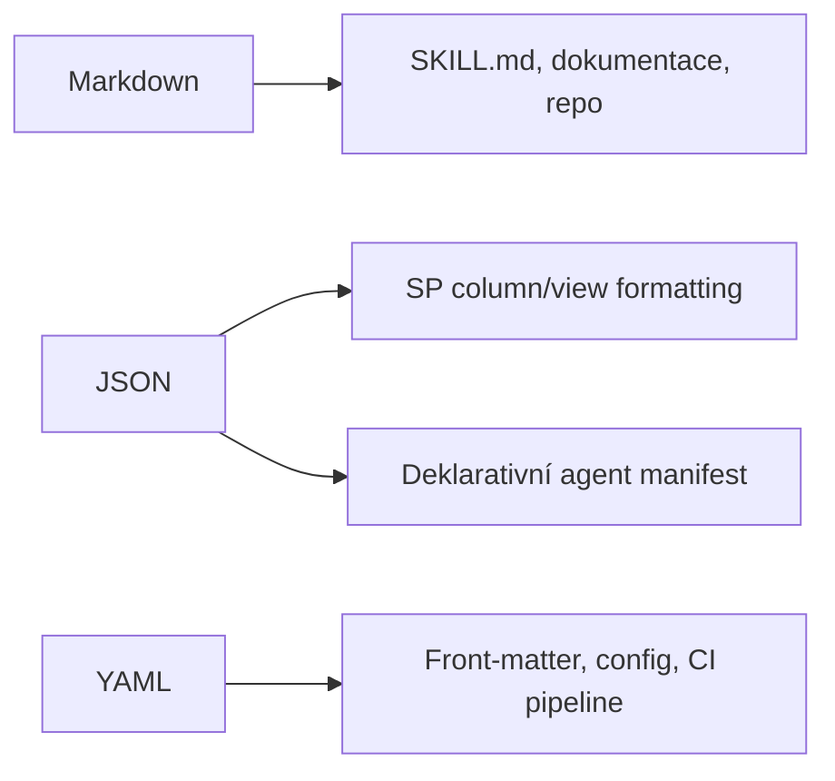

# Formáty: JSON, MD, YAML

> Typ: povinný · Den: 1 (konec AM) · Odhad: krátký blok
> Prostředí: [`../../environment.md`](../../environment.md) · Názvosloví: [`../../GLOSSARY.md`](../../GLOSSARY.md)

## Cíle

- Rozlišíte tři formáty — Markdown, JSON a YAML — a víte, **kde přesně** je v kurzu potkáte.
- Přečtete a upravíte jednoduchý JSON, Markdown i YAML soubor bez tápání.

## Proč hned na začátku

Tyto tři formáty potkáte dřív než cokoli jiného. Materiály kurzu, které právě čtete, jsou v **Markdownu**. Skills v Copilot in SharePoint jsou také Markdown. Formátování sloupců a zobrazení v SharePointu a manifest deklarativního agenta se píší v **JSON**. Konfigurační soubory a hlavičky dokumentů (front-matter) bývají v **YAML**.

Žádný z formátů není programovací jazyk — nic nevykonávají, jen popisují text nebo data. Přesto mají pravidla, která si nástroje vynucují: chybějící čárka v JSON nebo špatné odsazení v YAML znamená, že SharePoint formátování nepřijme nebo nástroj soubor nenačte. Když formáty umíte přečíst hned v první den, nebudete se u pozdějších labů zdržovat syntaxí a soustředíte se na to podstatné.

Diagram ukazuje, kam který formát v kurzu vede:



## 1. Markdown (MD)

**Co to je.** Markdown je lehké značkování obyčejného textu. Místo tlačítek „tučně" nebo „nadpis 2" píšete do textu pár znaků, které renderer (GitHub, SharePoint, Copilot) převede na formátování:

| Zápis | Význam |
|---|---|
| `#`, `##`, `###` | nadpis 1., 2., 3. úrovně |
| `-` na začátku řádku | odrážka |
| `**text**` | tučně |
| `[text](url)` | odkaz — v hranatých závorkách text, v kulatých adresa |
| \`kód\` | kód nebo název souboru v řádku |
| tři backticky \`\`\` | blok kódu (např. JSON nebo Mermaid diagram) |

**Proč existuje.** Markdown je čitelný i bez renderování — soubor otevřený v Poznámkovém bloku dává smysl stejně jako zformátovaná stránka. Proto se hodí tam, kde text čtou lidé i stroje zároveň.

**Jak se s ním v kurzu setkáte.** Celé toto repo je v Markdownu (README, laby, glosář). V den 3 budete navrhovat **Skills**: Copilot in SharePoint je ukládá jako soubor `SKILL.md` do knihovny Agent Assets na webu, takže Skill je obyčejný Markdown, který jde číst i upravovat přímo ([Skills in Copilot in SharePoint](https://learn.microsoft.com/en-us/sharepoint/copilot-in-sharepoint-skills)). Podrobnosti najdete v modulu [`../../day-3/skills/`](../../day-3/skills/). Markdownem se píší i instrukce agentů — text, kterým agentovi říkáte, jak se má chovat.

Všimněte si, že Markdown nese **obsah**, ne data: nadpisy a odrážky strukturují text pro čtenáře, ale nástroj z nich nečte hodnoty jako „den = 1".

## 2. JSON

**Co to je.** JSON (JavaScript Object Notation) je zápis strukturovaných dat. Skládá se ze dvou stavebních kamenů:

- **objekt** `{}` — sada dvojic `"klíč": hodnota` oddělených čárkami,
- **pole** `[]` — seznam hodnot oddělených čárkami.

Hodnotou může být text v uvozovkách, číslo, `true`/`false`, `null`, další objekt nebo pole. Tak vznikají libovolně hluboké vnořené struktury.

**Proč existuje.** JSON je jednoznačný a snadno strojově zpracovatelný, proto je výchozím formátem webových API a konfigurací, které čte software. Cenou za jednoznačnost je **striktní syntaxe**: klíče musí být v dvojitých uvozovkách, mezi položkami musí být čárka (a za poslední žádná) a JSON **nepovoluje komentáře**. Když vám editor hlásí chybu v souboru, který „vypadá dobře", bývá příčinou právě chybějící nebo přebytečná čárka, jednoduché uvozovky nebo komentář.

**Jak se s ním v kurzu setkáte.**

- **SharePoint column a view formatting** — vzhled sloupce nebo celého zobrazení v seznamu či knihovně popíšete JSON dokumentem; SharePoint data nemění, jen je jinak zobrazí ([Column formatting](https://learn.microsoft.com/en-us/sharepoint/dev/declarative-customization/column-formatting), [View formatting](https://learn.microsoft.com/en-us/sharepoint/dev/declarative-customization/view-formatting)).
- **Manifest deklarativního agenta** (`declarativeAgent.json`) — popis agenta, jeho instrukcí a znalostí; v den 4 ho budete upravovat v modulu [`../../day-4/agents-toolkit/`](../../day-4/agents-toolkit/) ([Build declarative agents](https://learn.microsoft.com/en-us/microsoft-365/copilot/extensibility/build-declarative-agents)).
- **API payloady** — data, která si posílají služby a skripty.

### Příklad: obarvení sloupce podle hodnoty

```json
{
  "$schema": "https://developer.microsoft.com/json-schemas/sp/v2/column-formatting.schema.json",
  "elmType": "div",
  "txtContent": "@currentField",
  "style": { "color": "=if(@currentField == 'Done', 'green', 'red')" }
}
```

Přečtěte si ho po řádcích:

- `$schema` odkazuje na schéma formátování sloupců — editor podle něj pozná, které klíče jsou povolené.
- `elmType` říká, jaký prvek se vykreslí (`div` = obecný blok).
- `txtContent` určuje zobrazený text; `@currentField` je hodnota aktuálního sloupce.
- `style` je vnořený objekt s CSS vlastnostmi. Hodnota začínající `=` je výraz: když je hodnota sloupce `Done`, text bude zelený, jinak červený.

Výrazy jako `@currentField` nebo `=if(...)` patří ke syntaxi SharePoint formátování, ne k JSON samotnému — JSON je jen obal ([Formatting syntax reference](https://learn.microsoft.com/en-us/sharepoint/dev/declarative-customization/formatting-syntax-reference)).

## 3. YAML

**Co to je.** YAML je zápis dat určený hlavně pro lidi. Popisuje stejné struktury jako JSON (objekty, seznamy, hodnoty), ale místo závorek a čárek používá **odsazení** a místo hranatých závorek pomlčky. Na rozdíl od JSON **povoluje komentáře** uvozené znakem `#`.

**Proč existuje.** Konfigurační soubory čtou a upravují lidé častěji než stroje. YAML je proto stručnější a komentáře dovolují vysvětlit přímo v souboru, proč je nastavení takové, jaké je.

**Jak se s ním v kurzu setkáte.** YAML najdete ve **front-matter** dokumentů (hlavička s metadaty na začátku Markdown souboru), v konfiguračních souborech a v definicích **CI pipeline** (GitHub Actions) v repozitáři. Projektový konfigurační soubor nástroje Microsoft 365 Agents Toolkit je také YAML.

### Příklad: front-matter s komentářem a vnořením

```yaml
# Komentář uvozuje '#' — v JSON nic takového není
title: Modul licencí
type: povinný
den: 1
lab:                     # vnořený objekt: odsazení 2 mezerami, nikdy taby
  soubor: lab-license-matrix.md
  rezim: simulace
temata:                  # seznam: položky uvozené pomlčkou
  - PAYG
  - Copilot Credits
```

Přečtěte si ho po řádcích:

- `title`, `type`, `den` jsou jednoduché dvojice `klíč: hodnota`.
- `lab:` je vnořený objekt — patří pod něj všechny následující řádky, které jsou odsazené víc než on.
- `temata:` je seznam; každá položka začíná pomlčkou.

Odsazení v YAML **nese význam**. `rezim: simulace` patří pod `lab:` jen proto, že je odsazený o dvě mezery. Kdybyste ho zarovnali na začátek řádku, stal by se samostatným klíčem dokumentu — změní se význam dat, ne jen vzhled. Odsazujte vždy mezerami, nikdy tabulátory; tabulátory YAML k odsazení nepřipouští.

## Klíčové rozlišení

- **JSON vs. YAML**: stejná data, jiný zápis. JSON je striktní a bez komentářů (API, SharePoint formatting, manifest agenta); YAML je čitelný a s komentáři (konfigurace, front-matter, pipeline).
- **Markdown** není formát dat, ale text — slouží pro obsah, ne pro konfiguraci.
- **Odsazení**: v YAML je významové; v JSON ne — tam o struktuře rozhodují závorky a čárky.

## Shrnutí

- Markdown je značkovaný text pro lidi: toto repo, Skills (`SKILL.md`) a instrukce agentů.
- JSON je striktní zápis dat bez komentářů: SharePoint column/view formatting a manifest deklarativního agenta.
- YAML popisuje stejná data jako JSON, ale odsazením a s komentáři: front-matter, konfigurace, CI pipeline.
- Nejčastější chyby: čárka nebo komentář v JSON, tabulátor nebo špatné odsazení v YAML.

## Lab

Modul nemá samostatný lab. Formáty si procvičíte v navazujících modulech: Markdown při návrhu Skillu ([`../../day-3/skills/`](../../day-3/skills/)), JSON při úpravě manifestu agenta ([`../../day-4/agents-toolkit/`](../../day-4/agents-toolkit/)).

## Zdroje (Microsoft)

- **Markdown:** [Skills in Copilot in SharePoint](https://learn.microsoft.com/en-us/sharepoint/copilot-in-sharepoint-skills)
- **JSON — SharePoint formatting:** [Column formatting](https://learn.microsoft.com/en-us/sharepoint/dev/declarative-customization/column-formatting) · [View formatting](https://learn.microsoft.com/en-us/sharepoint/dev/declarative-customization/view-formatting) · [Formatting syntax reference](https://learn.microsoft.com/en-us/sharepoint/dev/declarative-customization/formatting-syntax-reference)
- **JSON — agenti:** [Build declarative agents](https://learn.microsoft.com/en-us/microsoft-365/copilot/extensibility/build-declarative-agents)

Další zdroje (formáty samotné): [YAML (Wikipedia)](https://en.wikipedia.org/wiki/YAML) · [JSON (Wikipedia)](https://en.wikipedia.org/wiki/JSON) · [Droste effect (Wikipedia)](https://en.wikipedia.org/wiki/Droste_effect) — rekurze, jako v názvu „YAML Ain't Markup Language"

## Stav produktu / delta

- Stabilní téma bez fast-moving faktů.
- Ověřit aktuální název YAML konfiguračního souboru Microsoft 365 Agents Toolkitu, pokud se na něj odkazuje v [`../../day-4/agents-toolkit/`](../../day-4/agents-toolkit/).
