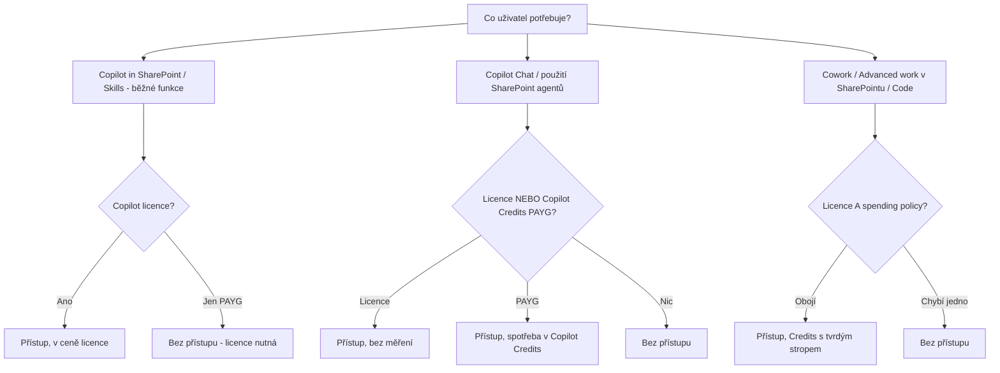

# Licenční modely a řízení nákladů

> Typ: povinný · Den: 1 · Odhad: PM blok
> Prostředí: [`../../environment.md`](../../environment.md) · Názvosloví: [`../../GLOSSARY.md`](../../GLOSSARY.md)

## Cíle

- Rozlišíte licenční vrstvy Copilota: zdarma (Basic) vs. placená licence (Premium), Business vs. Enterprise, E7.
- Odlišíte **dva PAYG modely** a u Copilot Credits rozeznáte **původní PAYG** od **usage-based billingu (Cost management)**.
- Umíte u každé funkce říct, kterou bránou uživatel projde: **licence**, **oprávnění**, **spending policy**.
- Zasadíte prostředí kurzu do licenčního obrazu.

## Proč se licencemi zabývat

Správce SharePointu dnes nerozhoduje jen o tom, *kdo vidí který web*. Rozhoduje i o tom, *kdo smí kterou AI funkci použít a kolik to bude stát*. Microsoft přitom kombinuje tři různé principy: fixní licenci na uživatele, platbu za spotřebu (pay-as-you-go, PAYG) a samostatné produkty pro správu obsahu. Kdo je nerozliší, buď zaplatí za licence, které nepotřebuje, nebo spustí službu bez stropu a o útratě se dozví až z faktury.

Modul proto stavíme na jedné otázce, kterou si budete klást u každé funkce v kurzu: **Co musí uživatel mít, aby to fungovalo — a kdo za to platí?**

## 1. Licenční vrstvy Copilota

### Zdarma vs. placená licence

Každý uživatel s Microsoft 365 předplatným má **Copilot Chat (Basic)** zdarma. Basic odpovídá z webu — neví nic o vašich dokumentech, e-mailech ani schůzkách. Plnou práci s firemními daty odemyká až licence **Microsoft 365 Copilot (Premium)**: Copilot ve Wordu, Excelu, Outlooku a Teams a chat, který vychází z dat tenantu (Microsoft Graph, Work IQ, sémantický index) ([License options](https://learn.microsoft.com/en-us/microsoft-365/copilot/microsoft-365-copilot-licensing), [Copilot Chat requirements](https://learn.microsoft.com/en-us/microsoft-365/copilot/microsoft-365-copilot-chat-requirements)).

Jakou úroveň uživatel má, pozná podle štítku v aplikaci ([Copilot Chat overview](https://learn.microsoft.com/en-us/copilot/overview)):

| Štítek | Kdo ho vidí | Co má |
|---|---|---|
| **Microsoft 365 Copilot (Premium / Pro)** | uživatel s Copilot licencí | plný zážitek, prioritní přístup |
| **Microsoft 365 Copilot (Basic)** | uživatel bez licence | standardní přístup ke Copilotu ve Wordu, Excelu, PowerPointu a OneNote |
| **Copilot Chat (Basic)** | uživatel bez licence | jen Chat, bez Copilota v aplikacích |

Jedna výjimka z pravidla „Basic = jen web": **Copilot Chat v Outlooku** pracuje i bez licence s poštou, kalendářem, schůzkami, chaty a omezenou sadou souvisejícího obsahu.

### Na jakých plánech Copilot jde koupit

Copilot licence se dokupuje k základním plánům **Business Basic / Standard / Premium**, **Apps for Business**, **Teams Essentials**, **A1–A5**, **E3/E5**, **F1/F3** a dalším. Plán **E7 (Frontier Suite)** ji už obsahuje: E7 = E5 + Copilot + Microsoft Entra Suite + Agent 365 ([License options](https://learn.microsoft.com/en-us/microsoft-365/copilot/copilot-license-options), [Compare E3/E5/E7](https://learn.microsoft.com/en-us/microsoft-365/copilot/compare-copilot-e3-e5-e7)).

**Copilot Business** (pro organizace do 300 uživatelů) nabízí podle Microsoftu „the same Microsoft Copilot capabilities" jako Enterprise verze. Rozdíl není v Copilotu samotném, ale v tom, co je pod ním — bezpečnost, compliance a Purview z podkladového plánu ([Service description](https://learn.microsoft.com/en-us/office365/servicedescriptions/office-365-platform-service-description/microsoft-365-copilot)). Researcher a Analyst jsou součástí Copilot licence.

Technické předpoklady jsou běžné: účet v Microsoft Entra ID, poštovní schránka v Exchange Online, pro některé funkce OneDrive a podporovaný kanál aktualizací Microsoft 365 Apps ([Requirements](https://learn.microsoft.com/en-us/microsoft-365/copilot/microsoft-365-copilot-requirements)).

Copilot nemusí spravovat Global Administrator. Pro správu Copilota a AI funkcí existuje role **AI Administrator** — v praxi ji používejte, abyste nerozdávali zbytečně široká oprávnění.

### Nový Copilot: co kryje licence a co Copilot Credits

Microsoft 25. 9. 2026 představil „nový Copilot" se třemi oblastmi: **Home** (Chat, **Cowork** a Office přímo v aplikaci Copilot), **Code** a **Autopilot** ([Introducing the new Copilot](https://blogs.microsoft.com/blog/2026/09/25/introducing-the-new-copilot-with-home-code-and-autopilot/)). Licenčně se tím svět rozdělil na tři patra:

1. **Zdarma (Basic)** — Copilot Chat nad webem; v Outlooku omezeně i nad daty organizace.
2. **Licence (fixní cena za uživatele)** — chat nad daty tenantu, Copilot v aplikacích Office, výběr modelu a běžné funkce Copilot in SharePoint.
3. **Copilot Credits (platba za spotřebu)** — Cowork, Code, Autopilot a *Advanced work* v SharePointu a OneDrivu. U Cowork, Code a Advanced work platí Credits **navíc k licenci, ne místo ní** ([Usage-based billing](https://learn.microsoft.com/en-us/microsoft-365/copilot/usage-based-billing-overview-copilot-credits)).

Důležitý důsledek: licence už neznamená „všechno v ceně". Uživatel s licencí může narazit na funkci, kterou smí použít jen tehdy, když ho správce zařadí do rozpočtu na spotřebu.

## 2. Dva PAYG modely (nezaměňovat)

„Pay-as-you-go" se v Microsoft 365 objevuje ve dvou zcela oddělených modelech. Mají jinou měnu, jiné nastavení i jiné služby:

| Model | Co platí | Jak se měří | Kde se nastavuje |
|---|---|---|---|
| **Document processing for Microsoft 365** (dříve Syntex) | vytěžování dokumentů, OCR, překlad, autofill, eSignature | Azure metry (za stránku / transakci) | M365 admin center + Azure subscription |
| **Copilot Credits** | Copilot Chat nad daty tenantu a agenti (i bez licence); Cowork, Advanced work v SharePointu a Code (jen **navíc** k licenci) | Copilot Credits | dvě správní plochy — viz níže |

### Document processing PAYG

Document processing zapne správce pro celou organizaci: kdokoli s Microsoft 365 licencí pak může služby používat, bez nákupu dopředu, a spotřeba se účtuje do připojené Azure subscription. Nastavit to smí **SharePoint Administrator nebo Global Administrator** ([Licensing](https://learn.microsoft.com/en-us/microsoft-365/documentprocessing/syntex-licensing), [Set up billing](https://learn.microsoft.com/en-us/microsoft-365/contentunderstanding/syntex-azure-billing), [PAYG pricing](https://learn.microsoft.com/en-us/microsoft-365/documentprocessing/syntex-pay-as-you-go-services)).

Microsoft k tomu nabízí malou bezplatnou měsíční kapacitu (řádově 100 stran autofill a 5 požadavků eSignature na tenant). Podle [promo stránky](https://learn.microsoft.com/en-us/microsoft-365/documentprocessing/promo-syntex) platí do prosince 2026, jiné stránky Microsoftu uvádějí jiné datum. Archive ani Backup nikdy nezahrnovala. V plánování na ni nespoléhejte.

### Copilot Credits

Copilot Credits jsou od 1. 9. 2025 společnou měnou agentů (dříve „messages"). Platí jednoduché pravidlo:

- Uživatel **s Copilot licencí** používá agenty v Copilot Chatu, Teams a SharePointu nad daty tenantu **bez měření spotřeby**.
- Uživatel **bez licence** je může používat jen tehdy, když organizace zapne PAYG — a každá konverzace se pak počítá v kreditech ([Copilot Studio licensing](https://learn.microsoft.com/en-us/microsoft-copilot-studio/billing-licensing), [Agents for Copilot Chat](https://learn.microsoft.com/en-us/copilot/agents)).

Pro představu o řádu: složitý dotaz nad daty tenantu stojí orientačně **~12 kreditů** (10 za grounding + 2 za generovanou odpověď). Při ceně **~$0,01 za kredit** vychází jedna taková interakce na ~$0,12 ([Billing rates](https://learn.microsoft.com/en-us/microsoft-copilot-studio/requirements-messages-management), [Credits report](https://learn.microsoft.com/en-us/microsoft-365/admin/activity-reports/microsoft-365-copilot-credits), [Capacity packs](https://learn.microsoft.com/en-us/microsoft-365/copilot/pay-as-you-go/copilot-capacity-packs)). S těmito čísly počítáte v labu.

### Dvě správní plochy Copilot Credits

Copilot Credits se dnes spravují na dvou místech, která se chovají odlišně. Rozdíl je hlavně v tom, **zda rozpočet spotřebu skutečně zastaví**:

| | Pay-as-you-go (původní) | Usage-based billing (nový) |
|---|---|---|
| Služby | Copilot Chat, SharePoint agents (`.agent`), Copilot Retrieval API | Cowork, Advanced work v SharePointu / OneDrivu, Code, Work IQ API, Copilot Managed Runtime, Teams Phone Agent; volitelně Copilot Studio |
| Kde | billing policy připojená ke službě | **Copilot → Cost management** → spending policy |
| Rozpočet | jen **e-mailová upozornění** — spotřebu nezastaví | **tvrdý strop** — po vyčerpání uživatel ztratí přístup do 1. dne dalšího měsíce |
| Přístup | připojení policy = přístup | spending policy = **přístup** (kdo v ní není, službu nepoužije) |
| Na co si dát pozor | — | volba **Auto-apply new services** je ve výchozím stavu zapnutá: nové služby se do policy přidají samy |

Zdroje: [PAYG overview](https://learn.microsoft.com/en-us/microsoft-365/copilot/pay-as-you-go/pay-as-you-go-overview), [PAYG setup](https://learn.microsoft.com/en-us/microsoft-365/copilot/pay-as-you-go/setup), [Usage-based billing](https://learn.microsoft.com/en-us/microsoft-365/copilot/usage-based-billing-overview-copilot-credits), [Spending policies](https://learn.microsoft.com/en-us/microsoft-365/copilot/usage-based-billing-manage-copilot-credits).

Prakticky: u původního PAYG pro Copilot Chat a SharePoint agenty vám rozpočet jen pošle e-mail a služba běží dál. Skutečný strop dává až **limited budget** ve spending policy v Cost management — ten ale kryje jen služby usage-based billingu. Ani rozpočet v Azure sám nic nezastaví. Přehled všech PAYG služeb najdete na stránce [Pay-as-you-go services](https://learn.microsoft.com/en-us/microsoft-365/commerce/services/pay-as-you-go-services).

## 3. Governance produkty a jejich licenční dotyk

Dřívější zastřešující značka „SharePoint Premium" už neexistuje. Rozpadla se na **samostatné produkty**, každý s vlastním licenčním modelem (viz [`GLOSSARY.md`](../../GLOSSARY.md)). Všechny je potkáte později v kurzu:

- **SharePoint Advanced Management (SAM)** — správa webů, sdílení a přístupu ve velkém (D3). Buď se kupuje jako add-on **SAM Plan 1**, nebo se funkce SAM zpřístupní SharePoint adminům automaticky, jakmile má aspoň jeden uživatel v tenantu Copilot licenci; E7 SAM obsahuje přes zahrnutý Copilot. Několik funkcí (např. omezení zakládání webů aplikacemi) vyžaduje SAM Plan 1 i tak. Spravuje SharePoint Admin nebo SAM Admin, mimo jiné přes SPO Management Shell ([Overview](https://learn.microsoft.com/en-us/sharepoint/advanced-management), [Prerequisites](https://learn.microsoft.com/en-us/sharepoint/sharepoint-advanced-management-prerequisites), [Features in Copilot licenses](https://learn.microsoft.com/en-us/sharepoint/sharepoint-advanced-management-licensing)).
- **eSignature** — elektronický podpis dokumentů přímo v SharePointu (D3). Účtuje se jako PAYG služba v rámci document processing; jako poskytovatele lze zapojit i Adobe Acrobat Sign a Docusign. Jde o *simple e-signatures* podle eIDAS (EU 910/2014), pro PDF i Word, dostupné celosvětově kromě Indonésie ([Overview](https://learn.microsoft.com/en-us/microsoft-365/documentprocessing/esignature-overview), [Setup](https://learn.microsoft.com/en-us/microsoft-365/documentprocessing/esignature-setup)).
- **Microsoft 365 Backup** — zálohování SharePointu, OneDrivu a Exchange (D3). Platí se za objem chráněných dat. Zálohy zůstávají uvnitř hranice důvěry Microsoftu a jsou neměnné — nejde je přepsat ani smazat, jen doplňovat ([Overview](https://learn.microsoft.com/en-us/microsoft-365/backup/backup-overview)).
- **Microsoft 365 Archive** — levnější „studené" úložiště pro neaktivní weby SharePointu (D3). Platíte jen za archivovaná data nad rámec kvóty tenantu. Archivovaný obsah není dostupný běžnému vyhledávání a práci uživatelů, což zlepšuje relevanci aktivního obsahu ([Overview](https://learn.microsoft.com/en-us/microsoft-365/archive/archive-overview), [Manage](https://learn.microsoft.com/en-us/microsoft-365/archive/archive-manage)).

## 4. Licence vs. permissions

Nejčastější chyba při plánování AI funkcí je zaměnit dvě různé otázky:

- **Licence** odpovídá na otázku *„má uživatel přístup k funkci?"*
- **Oprávnění (permissions)** odpovídají na otázku *„smí tuto funkci použít na tomto obsahu?"*

U služeb s platbou za spotřebu přibývá třetí brána — **spending policy**. Uživatel projde jen tehdy, když splní všechny brány, které daná funkce vyžaduje.

### Brána 1 — licence

**Copilot in SharePoint** je od 30. 9. 2026 v GA (v tenantech se objevuje postupně) a má hybridní model:

- **Běžné funkce** — dotazy nad obsahem, tvorba stránek a souborů, tvorba a správa **Skills**, Autofill metadat — jsou v ceně Copilot licence.
- **Advanced work** — práce ve velkém nad celými weby, skills v plánovaných AI automatizacích, Autofill v reálném čase, generování obrázků, analytika — vyžaduje licenci **a navíc** Copilot Credits přes spending policy.

Microsoft výslovně uvádí: „Users must have an active Microsoft 365 Copilot license" ([Copilot in SharePoint get started](https://learn.microsoft.com/en-us/sharepoint/copilot-in-sharepoint-get-started)). Copilot Credits licenci **nenahradí** — bez licence Copilot in SharePoint ani Skills nefungují. To jsme ověřili v kurzovním tenantu v 11/2026 po GA; v preview (7/2026) to ještě fungovalo i bez licence. PAYG bez licence tedy pokrývá jen **Copilot Chat a agenty**.

U agentů je obraz pestřejší:

- **Používat** Copilot Chat a SharePoint agenty lze s licencí **nebo** přes Copilot Credits PAYG.
- **Tvorba SharePoint agenta** vyžaduje Copilot licenci (ověřeno empiricky). Od poloviny 11/2026 se tvorba přesouvá do Agent Builderu ([Upgrade SharePoint agents](https://learn.microsoft.com/en-us/sharepoint/upgrade-sharepoint-agents)).
- **Postavit a nasadit agenta přes Agents Toolkit** jde i bez Copilot licence — to je dokumentované. Aby agent odpovídal z dat organizace, potřebuje uživatel licenci nebo PAYG ([Prerequisites](https://learn.microsoft.com/en-us/microsoft-365/copilot/extensibility/prerequisites)).

### Brána 2 — oprávnění v SharePointu

Licence říká, že uživatel funkci *má*; oprávnění říkají, *na čem* ji smí použít. Kdo má na webu **Edit**, může vytvořit agenta nebo Skill; kdo má **View**, může je jen spustit. SharePoint agenti jsou dnes soubory `.agent` a přístup k nim řídí oprávnění na souboru ([Manage access to agents in SharePoint](https://learn.microsoft.com/en-us/sharepoint/manage-access-agents-in-sharepoint)). A platí to i obráceně: Copilot nikdy neukáže obsah, ke kterému uživatel nemá přístup — licence oprávnění nerozšiřuje.

### Brána 3 — spending policy

U služeb usage-based billingu (Cowork, Code, Advanced work) nestačí licence ani oprávnění. Uživatel musí být zařazený ve spending policy v Cost management. Bez ní službu nepoužije, i když má licenci.

### Jak bránami projít — rozhodovací diagram

Ve všech větvích pak ještě platí brána 2: uživatel pracuje jen s obsahem, ke kterému má oprávnění.

## 5. Naše prostředí (kurz)

Studenti mají **Business Basic + Microsoft 365 Copilot licenci** (od běhu 2026-11) a k tomu Copilot Credits: PAYG pro agenty a spending policy pro Cowork, Code a Advanced work. Důvod je přímo z předchozí kapitoly — po GA pokrývá PAYG bez licence jen Copilot Chat a agenty, takže bez licence by nešly Copilot in SharePoint, Skills, Cowork ani Code. S licencí si můžete vše vyzkoušet sami, včetně tvorby SharePoint agenta.

Rozdíl „s licencí vs. jen PAYG" proto neuvidíte na vlastním účtu — projdete ho v labu na licenční matici. Všimněte si také, že kurzovní tenant používá obě plochy Copilot Credits: původní PAYG pro agenty (rozpočet jen upozorňuje) a spending policy pro Cowork a Code (rozpočet zastaví). Detaily prostředí: [`environment.md`](../../environment.md).

## 6. Související licence a služby

### Agent 365 — řídicí vrstva agentů

Agent 365 není nástroj na stavbu agentů, ale **vrstva pro jejich správu a zabezpečení** napříč tenantem: registr agentů, identita agenta, řízení přístupu a napojení na Entra, Defender, Purview a Intune. Microsoft to shrnuje heslem *Copilot = co AI umí; Agent 365 = co AI smí*.

Je v GA od 1. 5. 2026 a licencuje se **na uživatele**, ne na agenta — licenci potřebuje ten, kdo s agenty pracuje, spravuje je nebo je sponzoruje. Kupuje se samostatně za **$15/uživatel/měs.**, nebo je součástí **E7 ($99)** ([Overview](https://learn.microsoft.com/en-us/microsoft-agent-365/overview), [Licensing FAQ](https://www.microsoft.com/licensing/faqs/122), [GA blog](https://www.microsoft.com/en-us/security/blog/2026/05/01/microsoft-agent-365-now-generally-available-expands-capabilities-and-integrations/)). Podrobně v D5 [`copilot-admin`](../../day-5/copilot-admin/).

### SharePoint Storage PAYG — třetí typ PAYG

Když tenant vyčerpá úložiště, lze dokoupit **Microsoft 365 SharePoint Storage** jako PAYG (public preview od června 2026, komerční tenanty, ne EDU/GCC). Základní kvóta tenantu je 1 TB + 10 GB za každou SharePoint licenci. Po jejím překročení se blokuje zakládání webů klasickou cestou i přes PowerShell. Nastavuje SharePoint nebo Global Admin ([Add storage](https://learn.microsoft.com/en-us/microsoft-365/commerce/add-storage-space), [Plan storage](https://learn.microsoft.com/en-us/sharepoint/sharepoint-storage-planning)). Než úložiště dokoupíte, zvažte levnější cestu — přesunout neaktivní weby do [Microsoft 365 Archive](../../day-3/archive/).

### Azure subscription — společný jmenovatel PAYG

Všechny PAYG modely — document processing, Copilot Credits, eSignature, Backup, Archive i úložiště — se účtují přes **připojenou Azure subscription a resource group**. Připojení nastavuje SharePoint nebo Global Admin ([Set up billing](https://learn.microsoft.com/en-us/microsoft-365/contentunderstanding/syntex-azure-billing)). Pro organizaci to znamená: kdo spravuje Azure subscription, ten fakticky vidí a řídí náklady na AI v Microsoft 365.

### Vývojářské nástroje

Pro-code cesta ke stavbě agentů vede přes **VS Code a Microsoft 365 Agents Toolkit** (nástupce Teams Toolkitu, k dispozici i pro Visual Studio, GitHub Copilot a CLI). Toolkit založí projekt deklarativního agenta, pomáhá s manifestem, nasazuje agenta do tenantu a umí akce přes MCP ([Agents Toolkit intro](https://devblogs.microsoft.com/microsoft365dev/introducing-the-microsoft-365-agents-toolkit/), [Build declarative agents](https://learn.microsoft.com/en-us/microsoft-365/copilot/extensibility/build-declarative-agents), [MCP agents](https://devblogs.microsoft.com/microsoft365dev/build-declarative-agents-for-microsoft-365-copilot-with-mcp/)). Toolkit je zdarma a agenta jde postavit bez Copilot licence; **GitHub Copilot** jako asistent při psaní kódu má vlastní licenci. Prakticky v D4 [`agents-toolkit`](../../day-4/agents-toolkit/) a [`procode-vs-lowcode`](../../day-4/procode-vs-lowcode/).

## Klíčové rozlišení

- **Licence ≠ oprávnění ≠ spending policy.** Tři různé brány; funkce může vyžadovat jednu, dvě nebo všechny tři.
- **Dva PAYG modely.** Document processing (Azure metry) ≠ Copilot Credits. A Copilot Credits mají ještě dvě správní plochy: původní PAYG vs. usage-based billing.
- **Rozpočet ≠ strop.** U původního Copilot PAYG rozpočet jen upozorňuje; strop dává až limited budget ve spending policy.
- **„Credits nahradí licenci"** — u Cowork, Advanced work a Code ne; tam jsou Credits **navíc** k licenci.
- **„Skills jen pro E licence"** — mýtus. Rozhoduje *placená* Copilot licence bez ohledu na plán, tedy i Business.
- **„SharePoint Premium"** jako jeden produkt neexistuje — je rozdělený na samostatné produkty.

## Shrnutí

- Copilot Chat je zdarma a odpovídá z webu; práci s daty tenantu odemyká Copilot licence.
- Nové služby (Cowork, Code, Advanced work) se platí Copilot Credits **navíc** k licenci a přístup k nim řídí spending policy s tvrdým stropem.
- Bez licence funguje přes PAYG jen Copilot Chat a agenti — Copilot in SharePoint ani Skills ne.
- Document processing má vlastní PAYG přes Azure metry; Backup, Archive a úložiště jsou další samostatné metry.
- U každé funkce se ptejte: licence? oprávnění? spending policy?

## Lab

[`lab-license-matrix.md`](lab-license-matrix.md) — licenční matice funkcí kurzu a odhad nákladů pro modelovou organizaci.

## Zdroje (Microsoft)

- **Copilot licence:** [License options](https://learn.microsoft.com/en-us/microsoft-365/copilot/microsoft-365-copilot-licensing) · [License options (plány)](https://learn.microsoft.com/en-us/microsoft-365/copilot/copilot-license-options) · [Compare E3/E5/E7](https://learn.microsoft.com/en-us/microsoft-365/copilot/compare-copilot-e3-e5-e7) · [Copilot Chat overview](https://learn.microsoft.com/en-us/copilot/overview) · [Introducing the new Copilot](https://blogs.microsoft.com/blog/2026/09/25/introducing-the-new-copilot-with-home-code-and-autopilot/) · [Partner Center — říjen 2026](https://learn.microsoft.com/en-us/partner-center/announcements/2026-october) · [Minimum requirements](https://learn.microsoft.com/en-us/microsoft-365/copilot/microsoft-365-copilot-minimum-requirements) · [Requirements](https://learn.microsoft.com/en-us/microsoft-365/copilot/microsoft-365-copilot-requirements) · [Setup](https://learn.microsoft.com/en-us/microsoft-365/copilot/microsoft-365-copilot-setup) · [Chat requirements](https://learn.microsoft.com/en-us/microsoft-365/copilot/microsoft-365-copilot-chat-requirements) · [Service description](https://learn.microsoft.com/en-us/office365/servicedescriptions/office-365-platform-service-description/microsoft-365-copilot) · [Extensibility cost](https://learn.microsoft.com/en-us/microsoft-365/copilot/extensibility/cost-considerations)
- **Document processing:** [Overview](https://learn.microsoft.com/en-us/microsoft-365/documentprocessing/syntex-overview) · [Licensing](https://learn.microsoft.com/en-us/microsoft-365/documentprocessing/syntex-licensing) · [PAYG pricing](https://learn.microsoft.com/en-us/microsoft-365/documentprocessing/syntex-pay-as-you-go-services) · [Set up billing](https://learn.microsoft.com/en-us/microsoft-365/contentunderstanding/syntex-azure-billing) · [Promo](https://learn.microsoft.com/en-us/microsoft-365/documentprocessing/promo-syntex)
- **Copilot Credits:** [PAYG overview](https://learn.microsoft.com/en-us/microsoft-365/copilot/pay-as-you-go/pay-as-you-go-overview) · [PAYG setup](https://learn.microsoft.com/en-us/microsoft-365/copilot/pay-as-you-go/setup) · [Usage-based billing](https://learn.microsoft.com/en-us/microsoft-365/copilot/usage-based-billing-overview-copilot-credits) · [Spending policies](https://learn.microsoft.com/en-us/microsoft-365/copilot/usage-based-billing-manage-copilot-credits) · [Billing rates](https://learn.microsoft.com/en-us/microsoft-copilot-studio/requirements-messages-management) · [Copilot Studio licensing](https://learn.microsoft.com/en-us/microsoft-copilot-studio/billing-licensing) · [Credits report](https://learn.microsoft.com/en-us/microsoft-365/admin/activity-reports/microsoft-365-copilot-credits) · [Capacity packs](https://learn.microsoft.com/en-us/microsoft-365/copilot/pay-as-you-go/copilot-capacity-packs) · [SharePoint Embedded meters](https://learn.microsoft.com/en-us/sharepoint/dev/embedded/administration/billing/meters) · [Pay-as-you-go services](https://learn.microsoft.com/en-us/microsoft-365/commerce/services/pay-as-you-go-services)
- **Copilot in SharePoint a agenti:** [Get started](https://learn.microsoft.com/en-us/sharepoint/copilot-in-sharepoint-get-started) · [Agents access](https://learn.microsoft.com/en-us/sharepoint/manage-access-agents-in-sharepoint) · [Upgrade SharePoint agents](https://learn.microsoft.com/en-us/sharepoint/upgrade-sharepoint-agents) · [Agent prerequisites](https://learn.microsoft.com/en-us/microsoft-365/copilot/extensibility/prerequisites)
- **SAM:** [Overview](https://learn.microsoft.com/en-us/sharepoint/advanced-management) · [Prerequisites](https://learn.microsoft.com/en-us/sharepoint/sharepoint-advanced-management-prerequisites) · [Features in Copilot licenses](https://learn.microsoft.com/en-us/sharepoint/sharepoint-advanced-management-licensing)
- **eSignature, Backup, Archive:** [eSignature overview](https://learn.microsoft.com/en-us/microsoft-365/documentprocessing/esignature-overview) · [eSignature setup](https://learn.microsoft.com/en-us/microsoft-365/documentprocessing/esignature-setup) · [Backup overview](https://learn.microsoft.com/en-us/microsoft-365/backup/backup-overview) · [Backup docs](https://learn.microsoft.com/en-us/microsoft-365/backup/) · [Archive overview](https://learn.microsoft.com/en-us/microsoft-365/archive/archive-overview) · [Archive manage](https://learn.microsoft.com/en-us/microsoft-365/archive/archive-manage)
- **Agent 365:** [Overview](https://learn.microsoft.com/en-us/microsoft-agent-365/overview) · [Licensing FAQ](https://www.microsoft.com/licensing/faqs/122) · [GA blog](https://www.microsoft.com/en-us/security/blog/2026/05/01/microsoft-agent-365-now-generally-available-expands-capabilities-and-integrations/)
- **Úložiště:** [Add storage](https://learn.microsoft.com/en-us/microsoft-365/commerce/add-storage-space) · [Plan storage](https://learn.microsoft.com/en-us/sharepoint/sharepoint-storage-planning)
- **Vývojářské nástroje:** [Agents Toolkit intro](https://devblogs.microsoft.com/microsoft365dev/introducing-the-microsoft-365-agents-toolkit/) · [Build declarative agents](https://learn.microsoft.com/en-us/microsoft-365/copilot/extensibility/build-declarative-agents)

## Stav produktu / delta

> [!WARNING] Ověřit k datu běhu — stav k 2026-11.
>
> - **Ceny** (Copilot, Agent 365, SAM Plan 1, PAYG metry, $/kredit) ověřte v aktuálních cenících Microsoftu a v Copilot Credits Guide.
> - **Od 1. 12. 2026** jdou Copilot a Copilot Business koupit bez základního předplatného (nová SKU, stejná cena); nové Copilot Business přes CSP mají usage-based billing ve výchozím stavu zapnutý s limitem 4 000 kreditů/uživatel/měs. ([Partner Center — říjen 2026](https://learn.microsoft.com/en-us/partner-center/announcements/2026-october)).
> - **Služby se přesouvají** mezi původním PAYG a usage-based billingem; Code a Autopilot jsou ve Frontier preview. Po Ignite (17.–20. 11. 2026) projít znovu.
