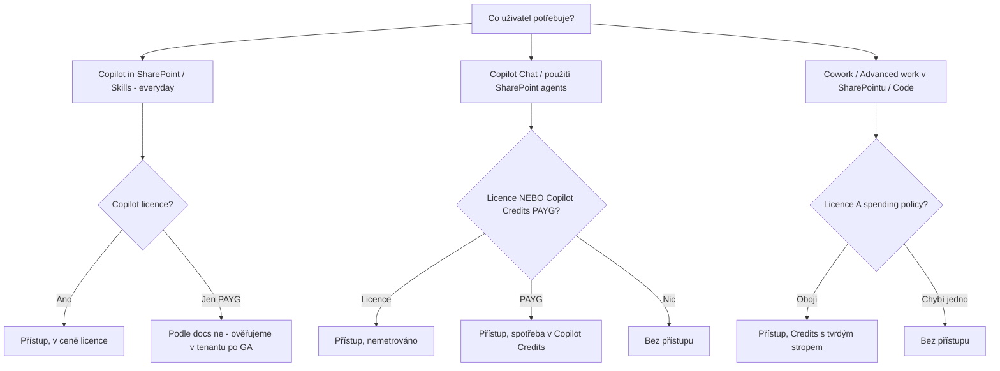

# Licenční modely a řízení nákladů

> Typ: povinný · Den: 1 · Odhad: PM blok
> Prostředí: [`../../environment.md`](../../environment.md) · Názvosloví: [`../../GLOSSARY.md`](../../GLOSSARY.md)
> Všechna tvrzení jsou ozdrojovaná odkazy na Microsoft (viz [Zdroje](#zdroje-microsoft)).

## Cíle
- Student rozliší licenční vrstvy Copilota (Chat/Basic vs. add-on/Premium; Business vs Enterprise; E7).
- Student odliší **dva PAYG modely** a ví, který co platí — a u Copilot Credits rozliší **původní PAYG** a nový **usage-based billing (Cost management)**.
- Student aplikuje princip **licence vs. permissions** (+ spending policy jako brána pro pokročilé služby).
- Student zasadí kurzovní prostředí (Business Basic + PAYG) do licenčního obrazu.

## 1. Licenční vrstvy Copilota

**Copilot Chat (Basic) je součást předplatného zdarma**, licence **Microsoft 365 Copilot (Premium)** se dokupuje. Chat je web-grounded; licence odemyká plný Copilot ve Word/Excel/Outlook/Teams a work-grounded chat přes Graph, Work IQ a semantic index ([License options](https://learn.microsoft.com/en-us/microsoft-365/copilot/microsoft-365-copilot-licensing), [Extensibility cost considerations](https://learn.microsoft.com/en-us/microsoft-365/copilot/extensibility/cost-considerations), [Copilot Chat requirements](https://learn.microsoft.com/en-us/microsoft-365/copilot/microsoft-365-copilot-chat-requirements)).

Štítky v aplikacích ([Copilot Chat overview](https://learn.microsoft.com/en-us/copilot/overview)):

| Štítek | Kdo | Co má |
|---|---|---|
| **Microsoft 365 Copilot (Premium / Pro)** | s Copilot licencí | plný zážitek, priority access |
| **Microsoft 365 Copilot (Basic)** | bez licence | standard access ke Copilotu ve Word/Excel/PowerPoint/OneNote |
| **Copilot Chat (Basic)** | bez licence | jen Chat, bez Copilota v aplikacích |

Výjimka z „Basic = jen web": **Copilot Chat v Outlooku** grounduje i bez licence na poštu, kalendář, schůzky, chaty a omezenou sadu souvisejícího obsahu ([Copilot Chat overview](https://learn.microsoft.com/en-us/copilot/overview)).

Copilot kvalifikuje na base plánech **Business Basic / Standard / Premium**, **Apps for Business**, **Teams Essentials**, **A1–A5**, **E3/E5**, **F1/F3** a dalších; **E7 (Frontier Suite)** Copilot už obsahuje ([License options](https://learn.microsoft.com/en-us/microsoft-365/copilot/copilot-license-options), [Setup](https://learn.microsoft.com/en-us/microsoft-365/copilot/microsoft-365-copilot-setup)). **E7** = E5 + Copilot + Microsoft Entra Suite + Agent 365 ([Compare E3/E5/E7](https://learn.microsoft.com/en-us/microsoft-365/copilot/compare-copilot-e3-e5-e7)).

> [!WARNING] Ověřit k datu běhu — stav k 2026-10
> Od **1. 12. 2026** jdou nové Microsoft 365 Copilot a Copilot Business licence koupit **bez base subscription** (stejná cena, nové SKU); dosavadní nabídky nesou od 16. 10. 2026 v názvu „(add-on)". U nových **Copilot Business** přes CSP bude od 1. 12. 2026 **usage-based billing default zapnutý** s limitem 4 000 kreditů/uživatel/měs. ([Partner Center — říjen 2026](https://learn.microsoft.com/en-us/partner-center/announcements/2026-october)).

Prerekvizity: Microsoft Entra ID účet, schránka na Exchange Online, pro některé funkce OneDrive, podporovaný update channel ([Requirements](https://learn.microsoft.com/en-us/microsoft-365/copilot/microsoft-365-copilot-requirements)).

**Copilot Business** (≤300 uživatelů) „provides the same Microsoft Copilot capabilities" ([License options](https://learn.microsoft.com/en-us/microsoft-365/copilot/copilot-license-options)); rozdíl je v tom, co je „pod tím" (bezpečnost, compliance, Purview) — přehled funkcí napříč plány je ve [service description](https://learn.microsoft.com/en-us/office365/servicedescriptions/office-365-platform-service-description/microsoft-365-copilot). Researcher a Analyst jsou součást Copilot licence.

### Nový Copilot: co kryje licence a co Credits
Microsoft 25. 9. 2026 představil „nový Copilot": **Home** (Chat + **Cowork** + Office přímo v aplikaci Copilot), **Code** a **Autopilot** ([Introducing the new Copilot](https://blogs.microsoft.com/blog/2026/09/25/introducing-the-new-copilot-with-home-code-and-autopilot/)). Licenční logika:

- **Zdarma (Basic)** = Copilot Chat (web-grounded; v Outlooku i omezeně org data).
- **Licence (fixní cena za uživatele)** = work-grounded Chat, Copilot ve Word/Excel/PowerPoint/Outlook/Teams, výběr modelu, everyday Copilot in SharePoint.
- **Copilot Credits (usage-based billing)** = Cowork (GA), Code (Frontier preview), Autopilot (Frontier), Advanced work v SharePointu/OneDrivu — u Cowork, Code a Advanced work **navíc k licenci**, ne místo ní ([Usage-based billing](https://learn.microsoft.com/en-us/microsoft-365/copilot/usage-based-billing-overview-copilot-credits)).

> [!IMPORTANT] Least privilege
> Copilot a AI experiences lze spravovat rolí **AI Administrator** bez Global Adminu ([Copilot Chat requirements](https://learn.microsoft.com/en-us/microsoft-365/copilot/microsoft-365-copilot-chat-requirements)).

## 2. Dva PAYG modely (nezaměňovat)

| Model | Co platí | Jak se měří | Setup |
|---|---|---|---|
| **Document processing for Microsoft 365** (ex-Syntex) | vytěžování dokumentů, OCR, překlad, autofill, eSignature | Azure metry (za stránku/transakci) | M365 admin center + Azure subscription |
| **Copilot Credits** | Copilot Chat nad tenant daty, SharePoint agents, agenti (i bez licence); Cowork, Advanced work v SharePointu, Code (jen **navíc** k licenci) | Copilot Credits (jednotka spotřeby) | dvě správní plochy — viz níže |

**Document processing PAYG**: org-wide přístup pro kohokoli s M365 licencí, bez upfront nákupu, Azure billing; k nastavení je potřeba **SharePoint Administrator nebo Global Administrator** ([Licensing](https://learn.microsoft.com/en-us/microsoft-365/documentprocessing/syntex-licensing), [Set up billing](https://learn.microsoft.com/en-us/microsoft-365/contentunderstanding/syntex-azure-billing), [PAYG pricing](https://learn.microsoft.com/en-us/microsoft-365/documentprocessing/syntex-pay-as-you-go-services)).

> [!WARNING] Ověřit k datu běhu
> Bezplatná included měsíční kapacita pro document processing (malé objemy: např. 100 stran autofill, 5 eSignature požadavků za měsíc na tenant) platí podle [promo stránky](https://learn.microsoft.com/en-us/microsoft-365/documentprocessing/promo-syntex) **do prosince 2026**; jiné MS stránky uvádějí starší datum — MS je nekonzistentní. **Nikdy** nezahrnovala Archive ani Backup. V labech na ni nespoléhat.

**Copilot Credits**: od 1. 9. 2025 je společná měna agentů „Copilot Credits" (dříve messages). Uživatel s **M365 Copilot licencí** má agenty v Copilot Chatu/Teams/SharePointu pro tenant grounding **bez metrování**; **nelicencovaný** uživatel je může používat jen přes zapnutý PAYG a spotřeba se měří ([Copilot Studio licensing](https://learn.microsoft.com/en-us/microsoft-copilot-studio/billing-licensing), [Agents for Copilot Chat](https://learn.microsoft.com/en-us/copilot/agents), [Usage-based billing](https://learn.microsoft.com/en-us/microsoft-365/copilot/usage-based-billing-overview-copilot-credits)). Orientačně **~12 kreditů** na složitý tenant-grounded dotaz (10 za grounding + 2 za generativní odpověď); při **~$0,01/kredit** to je ~$0,12 za interakci ([Billing rates](https://learn.microsoft.com/en-us/microsoft-copilot-studio/requirements-messages-management), [Credits report](https://learn.microsoft.com/en-us/microsoft-365/admin/activity-reports/microsoft-365-copilot-credits), [SharePoint Embedded meters](https://learn.microsoft.com/en-us/sharepoint/dev/embedded/administration/billing/meters), [Capacity packs](https://learn.microsoft.com/en-us/microsoft-365/copilot/pay-as-you-go/copilot-capacity-packs)).

**Dvě správní plochy Copilot Credits** (stav 2026-10):

| | Pay-as-you-go (původní) | Usage-based billing (nová) |
|---|---|---|
| Služby | Copilot Chat, SharePoint agents (`.agent`), Copilot Retrieval API | Cowork, Advanced work in SharePoint / OneDrive, Code, Work IQ API, Copilot Managed Runtime, Teams Phone Agent; volitelně Copilot Studio |
| Kde | Billing policy → připojit ke službě | **Copilot → Cost management** → spending policy |
| Rozpočet | jen **e-mailová upozornění** | **tvrdý strop** — po vyčerpání ztratí uživatel přístup do 1. dne dalšího měsíce |
| Přístup | připojení policy = přístup | spending policy = **přístup** (kdo není v policy, službu nepoužije) |
| Pozor | — | min. 2 000 kreditů/uživatel/měs.; **Auto-apply new services** default ON |

Zdroje: [PAYG overview](https://learn.microsoft.com/en-us/microsoft-365/copilot/pay-as-you-go/pay-as-you-go-overview), [Usage-based billing](https://learn.microsoft.com/en-us/microsoft-365/copilot/usage-based-billing-overview-copilot-credits), [Spending policies](https://learn.microsoft.com/en-us/microsoft-365/copilot/usage-based-billing-manage-copilot-credits).

> [!WARNING] Rozpočet ≠ strop — ale jen u původního PAYG
> U PAYG pro Copilot Chat / SharePoint agenty budget jen **posílá e-mailová upozornění, spotřebu nezastaví** ([PAYG setup](https://learn.microsoft.com/en-us/microsoft-365/copilot/pay-as-you-go/setup)). Skutečný strop dává **limited budget** ve spending policy v Cost management — ten ale pokrývá jen služby usage-based billingu. Azure budget sám nic nezastaví. Přehled všech PAYG služeb: [Pay-as-you-go services](https://learn.microsoft.com/en-us/microsoft-365/commerce/services/pay-as-you-go-services).

## 3. Governance produkty a jejich licenční dotyk

Bývalý deštník „SharePoint Premium" je rozdělen — tohle jsou **samostatné produkty** (viz `../../GLOSSARY.md`):

- **SharePoint Advanced Management (SAM)** — add-on SAM Plan 1 (cena: ověřit, MS stránka ji neuvádí); NEBO se SAM funkce zpřístupní SharePoint adminům, když má aspoň jeden uživatel Copilot licenci; E7 SAM obsahuje (přes zahrnutý Copilot). Některé funkce (restricted site creation by apps) vyžadují SAM Plan 1 i tak. Role: SharePoint Admin / SAM Admin; správa přes SPO Management Shell ([Overview](https://learn.microsoft.com/en-us/sharepoint/advanced-management), [Prerequisites](https://learn.microsoft.com/en-us/sharepoint/sharepoint-advanced-management-prerequisites), [Features in Copilot licenses](https://learn.microsoft.com/en-us/sharepoint/sharepoint-advanced-management-licensing)).
- **eSignature** — PAYG služba pod document processing; poskytovatelé Adobe Acrobat Sign a Docusign; simple e-signatures dle eIDAS (EU 910/2014); celosvětově kromě Indonésie; PDF i Word; k nastavení SharePoint/Global Admin ([Overview](https://learn.microsoft.com/en-us/microsoft-365/documentprocessing/esignature-overview), [Setup](https://learn.microsoft.com/en-us/microsoft-365/documentprocessing/esignature-setup)).
- **Microsoft 365 Backup** — samostatný produkt; SharePoint + OneDrive + Exchange; PAYG dle objemu dat; data zůstávají v Microsoft trust boundary, zálohy immutable/append-only ([Overview](https://learn.microsoft.com/en-us/microsoft-365/backup/backup-overview), [Docs](https://learn.microsoft.com/en-us/microsoft-365/backup/)).
- **Microsoft 365 Archive** — samostatný produkt; cold storage tier v SharePointu; platíš při překročení kvóty; archivovaný obsah Copilot nepoužívá (lepší relevance); role SharePoint/Global Admin ([Overview](https://learn.microsoft.com/en-us/microsoft-365/archive/archive-overview), [Manage](https://learn.microsoft.com/en-us/microsoft-365/archive/archive-manage)).

## 4. Licence vs. permissions

- **Licence** = přístup k *funkci*. **Copilot in SharePoint** má od 30. 9. 2026 GA rollout (v tenantu se může objevit postupně) v hybridním modelu: everyday funkce (dotazy, tvorba stránek/souborů, **tvorba a správa Skills**, Autofill metadata) jsou v Copilot licenci; **Advanced work** (práce ve velkém, celé weby, skills v plánovaných AI automatizacích, real-time Autofill, generování obrázků, analytika) = licence + Copilot Credits přes spending policy. MS výslovně: „Users must have an active Microsoft 365 Copilot license" ([get-started](https://learn.microsoft.com/en-us/sharepoint/copilot-in-sharepoint-get-started)).
  - **Copilot Credits PAYG Copilot licenci u Copilot in SharePoint ani Skills nenahradí** — bez licence nejedou (ověřeno v tenantu 2026-11, po GA; v preview 2026-07-17 to ještě fungovalo). PAYG bez licence = jen Copilot Chat a agenti.
  - **Tvorba a nasazení agentů přes Agents Toolkit** bez Copilot licence je **dokumentovaná** ([Prerequisites](https://learn.microsoft.com/en-us/microsoft-365/copilot/extensibility/prerequisites)); grounding na org data = licence nebo PAYG.
  - Copilot Chat a použití SharePoint agents = licence NEBO Copilot Credits PAYG. **Tvorba SharePoint agenta** vyžaduje Copilot licenci (empiricky; od pol. 11/2026 se tvorba přesouvá do Agent Builderu — [Upgrade SharePoint agents](https://learn.microsoft.com/en-us/sharepoint/upgrade-sharepoint-agents)).
- **SharePoint permissions** = *kdo funkci použije* (Edit = tvorba agenta/Skillu, View = spuštění). Agenti v SharePointu jsou zatím `.agent` soubory; oprávnění na souboru řídí přístup ([Manage access to agents in SharePoint](https://learn.microsoft.com/en-us/sharepoint/manage-access-agents-in-sharepoint)).
- **Spending policy** = třetí brána u služeb usage-based billingu (Cowork, Advanced work): licence + oprávnění nestačí, uživatel musí být v policy.

## Diagram — licenční decision flow

## 5. Naše prostředí (kurz)
Studenti mají **Business Basic + Microsoft 365 Copilot licenci** (od běhu 2026-11) + Copilot Credits (PAYG pro agenty, spending policy pro Cowork / Code / Advanced work). Důvod: po GA PAYG bez licence pokrývá jen **Copilot Chat a agenty** — Copilot in SharePoint, Skills, Cowork ani Code bez licence nejedou (ověřeno v tenantu 2026-11). S licencí jde hands-on všechno, včetně **tvorby SharePoint agenta**. Licenční lekce zůstává: srovnání „s licencí vs. jen PAYG" ukazujeme na matici, ne na studentských účtech. Původní PAYG čerpá kredity **bez tvrdého stropu** (budget alert + páteční deaktivace účtů); spending policy strop má (viz `../../environment.md`).

## 6. Doplňky, které souvisí s kurzem

### Agent 365 — řídicí vrstva agentů (ne nástroj na stavbu)
Governance/security control plane pro AI agenty napříč tenantem: registry, agent identity, access control, napojení na Entra/Defender/Purview/Intune. GA 1. 5. 2026, **per-user**, **$15/uživatel/měs** samostatně nebo součást **E7 ($99)**; agenti sami se nelicencují, licencuje se uživatel, který s nimi pracuje/spravuje/sponzoruje. Microsoft to staví jako: *Copilot = co AI umí; Agent 365 = co AI smí* ([Overview](https://learn.microsoft.com/en-us/microsoft-agent-365/overview), [Licensing FAQ](https://www.microsoft.com/licensing/faqs/122), [GA blog](https://www.microsoft.com/en-us/security/blog/2026/05/01/microsoft-agent-365-now-generally-available-expands-capabilities-and-integrations/)). Hloubkově → [`../../day-5/copilot-admin/`](../../day-5/copilot-admin/).

### SharePoint Storage PAYG (třetí typ PAYG)
**Microsoft 365 SharePoint Storage** = PAYG úložiště nad rámec kvóty tenantu (public preview od června 2026, komerční tenanty, ne EDU/GCC). Kvóta 1 TB + 10 GB / SharePoint licence; při překročení se blokuje klasické zakládání webů a přes PowerShell. Setup: SharePoint/Global Admin ([Add storage](https://learn.microsoft.com/en-us/microsoft-365/commerce/add-storage-space), [Plan storage](https://learn.microsoft.com/en-us/sharepoint/sharepoint-storage-planning)). Souvisí s [`../../day-3/archive/`](../../day-3/archive/) (levnější tier vs. dokup kvóty).

### Azure Subscription — společný jmenovatel PAYG
Všechny PAYG modely (document processing, Copilot Credits, eSignature, Backup, Archive, storage) se účtují přes **připojenou Azure subscription + resource group**; k nastavení SharePoint/Global Admin ([Set up billing](https://learn.microsoft.com/en-us/microsoft-365/contentunderstanding/syntex-azure-billing)). Pro kurz: jedna Azure subscription tenantu je prerekvizita pro všechny PAYG demo scénáře.

### Vývojářské nástroje (patří do [`day-3/procode-vs-lowcode`](../../day-4/procode-vs-lowcode/))
Pro-code cesta ke stavbě agentů: **VS Code + Microsoft 365 Agents Toolkit** (nástupce Teams Toolkitu; i pro Visual Studio, GitHub Copilot a CLI) scaffolduje deklarativní agenty, edituje manifest, provisionuje, umí akce přes MCP; **GitHub Copilot** jako AI asistent při psaní kódu ([Agents Toolkit intro](https://devblogs.microsoft.com/microsoft365dev/introducing-the-microsoft-365-agents-toolkit/), [Build declarative agents](https://learn.microsoft.com/en-us/microsoft-365/copilot/extensibility/build-declarative-agents), [MCP agents](https://devblogs.microsoft.com/microsoft365dev/build-declarative-agents-for-microsoft-365-copilot-with-mcp/)). Licenční dotyk: Agents Toolkit je zdarma a agenta jde postavit bez Copilot licence ([Prerequisites](https://learn.microsoft.com/en-us/microsoft-365/copilot/extensibility/prerequisites)); GitHub Copilot má vlastní licenci. Detail → [`../../day-4/procode-vs-lowcode/`](../../day-4/procode-vs-lowcode/).

- **„Skills jen pro E licence"** — mýtus. Gate je *placená* Copilot licence (bez ohledu na tier, i Business). Copilot Credits PAYG licenci nenahradí — bez licence Skills po GA nejedou (ověřeno 2026-11).
- **Dva PAYG** — Document processing (Azure metry) ≠ Copilot Credits. A Copilot Credits mají dvě plochy: původní PAYG vs. usage-based billing (Cost management).
- **Budget ≠ strop** u původního Copilot PAYG; v Cost management strop **existuje** (limited budget).
- **„Credits nahradí licenci"** — u Cowork, Advanced work a Code ne: tam jsou Credits **navíc** k licenci.
- **„SharePoint Premium"** jako jeden produkt — neexistuje, je rozdělený.

## Zdroje (Microsoft)
Copilot licence: [License options](https://learn.microsoft.com/en-us/microsoft-365/copilot/microsoft-365-copilot-licensing) · [License options (plány)](https://learn.microsoft.com/en-us/microsoft-365/copilot/copilot-license-options) · [Compare E3/E5/E7](https://learn.microsoft.com/en-us/microsoft-365/copilot/compare-copilot-e3-e5-e7) · [Copilot Chat overview](https://learn.microsoft.com/en-us/copilot/overview) · [Introducing the new Copilot](https://blogs.microsoft.com/blog/2026/09/25/introducing-the-new-copilot-with-home-code-and-autopilot/) · [Partner Center — říjen 2026](https://learn.microsoft.com/en-us/partner-center/announcements/2026-october) · [Minimum requirements](https://learn.microsoft.com/en-us/microsoft-365/copilot/microsoft-365-copilot-minimum-requirements) · [Requirements](https://learn.microsoft.com/en-us/microsoft-365/copilot/microsoft-365-copilot-requirements) · [Setup](https://learn.microsoft.com/en-us/microsoft-365/copilot/microsoft-365-copilot-setup) · [Chat requirements](https://learn.microsoft.com/en-us/microsoft-365/copilot/microsoft-365-copilot-chat-requirements) · [Service description](https://learn.microsoft.com/en-us/office365/servicedescriptions/office-365-platform-service-description/microsoft-365-copilot) · [Extensibility cost](https://learn.microsoft.com/en-us/microsoft-365/copilot/extensibility/cost-considerations)
Document processing PAYG: [Overview](https://learn.microsoft.com/en-us/microsoft-365/documentprocessing/syntex-overview) · [Licensing](https://learn.microsoft.com/en-us/microsoft-365/documentprocessing/syntex-licensing) · [PAYG pricing](https://learn.microsoft.com/en-us/microsoft-365/documentprocessing/syntex-pay-as-you-go-services) · [Set up billing](https://learn.microsoft.com/en-us/microsoft-365/contentunderstanding/syntex-azure-billing)
Copilot Credits: [PAYG overview](https://learn.microsoft.com/en-us/microsoft-365/copilot/pay-as-you-go/pay-as-you-go-overview) · [PAYG setup](https://learn.microsoft.com/en-us/microsoft-365/copilot/pay-as-you-go/setup) · [Usage-based billing](https://learn.microsoft.com/en-us/microsoft-365/copilot/usage-based-billing-overview-copilot-credits) · [Spending policies](https://learn.microsoft.com/en-us/microsoft-365/copilot/usage-based-billing-manage-copilot-credits) · [Copilot in SharePoint get started](https://learn.microsoft.com/en-us/sharepoint/copilot-in-sharepoint-get-started) · [Promo document processing](https://learn.microsoft.com/en-us/microsoft-365/documentprocessing/promo-syntex) · [Billing rates](https://learn.microsoft.com/en-us/microsoft-copilot-studio/requirements-messages-management) · [Copilot Studio licensing](https://learn.microsoft.com/en-us/microsoft-copilot-studio/billing-licensing) · [Credits report](https://learn.microsoft.com/en-us/microsoft-365/admin/activity-reports/microsoft-365-copilot-credits)
SAM: [Overview](https://learn.microsoft.com/en-us/sharepoint/advanced-management) · [Prerequisites](https://learn.microsoft.com/en-us/sharepoint/sharepoint-advanced-management-prerequisites) · [Features in Copilot licenses](https://learn.microsoft.com/en-us/sharepoint/sharepoint-advanced-management-licensing) · [Agents access](https://learn.microsoft.com/en-us/sharepoint/manage-access-agents-in-sharepoint)
eSignature: [Overview](https://learn.microsoft.com/en-us/microsoft-365/documentprocessing/esignature-overview) · [Setup](https://learn.microsoft.com/en-us/microsoft-365/documentprocessing/esignature-setup)
Backup: [Overview](https://learn.microsoft.com/en-us/microsoft-365/backup/backup-overview)
Archive: [Overview](https://learn.microsoft.com/en-us/microsoft-365/archive/archive-overview) · [Manage](https://learn.microsoft.com/en-us/microsoft-365/archive/archive-manage)
Agent 365: [Overview](https://learn.microsoft.com/en-us/microsoft-agent-365/overview) · [Licensing FAQ](https://www.microsoft.com/licensing/faqs/122) · [GA blog](https://www.microsoft.com/en-us/security/blog/2026/05/01/microsoft-agent-365-now-generally-available-expands-capabilities-and-integrations/)
Úložiště PAYG: [Add storage](https://learn.microsoft.com/en-us/microsoft-365/commerce/add-storage-space) · [Plan storage](https://learn.microsoft.com/en-us/sharepoint/sharepoint-storage-planning) · [Capacity packs](https://learn.microsoft.com/en-us/microsoft-365/copilot/pay-as-you-go/copilot-capacity-packs)
Vývojářské nástroje: [Agents Toolkit intro](https://devblogs.microsoft.com/microsoft365dev/introducing-the-microsoft-365-agents-toolkit/) · [Build declarative agents](https://learn.microsoft.com/en-us/microsoft-365/copilot/extensibility/build-declarative-agents) · [MCP agents](https://devblogs.microsoft.com/microsoft365dev/build-declarative-agents-for-microsoft-365-copilot-with-mcp/)

## Stav produktu / delta
> [!WARNING] Ověřit k datu běhu
> **Stav k 2026-10-31** (po Ignite 17.–20. 11. 2026 projet znovu)
>
> - Ceny (Copilot, SAM Plan 1, PAYG metry, $/kredit) — ověřit v aktuálních Microsoft cenících a v Copilot Credits Guide.
> - **Nový Copilot** (25. 9. 2026): Cowork GA, Code a Autopilot ve Frontier. Licence vs. usage-based billing — rozsah se bude měnit.
> - **Copilot in SharePoint GA** od 30. 9. 2026, hybridní model; PowerShell `KnowledgeAgentScope` vyřazen k 1. 11. 2026 → Site AI settings + RCD.
> - **Licenční delta (nejdůležitější):** v preview Copilot in SharePoint / Skills fungovaly empiricky i na PAYG bez licence (2026-07-17); **po GA license-only — ověřeno v tenantu 2026-11** (PAYG bez licence = jen Copilot Chat + agenti). Proto od běhu 2026-11 mají studenti Copilot licenci. Agents Toolkit bez licence je dokumentovaný. Tvorba SharePoint agenta vyžaduje licenci; od pol. 11/2026 jde přes Agent Builder.
> - Copilot Credits mají dvě správní plochy (PAYG vs. Cost management); služby se mezi nimi přesouvají.
> - Od 1. 12. 2026 Copilot SKU bez base subscription; Copilot Business přes CSP s UBB default ON.
