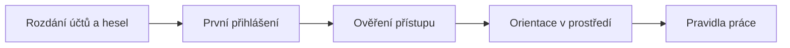

# Onboarding & pravidla práce

> Typ: povinný · Den: 1 (celé dopoledne) · Odhad: AM blok
> Prostředí: [`../../environment.md`](../../environment.md) · Názvosloví: [`../../GLOSSARY.md`](../../GLOSSARY.md)

## Cíle

- Přihlásíte se do kurzovního tenantu `spdemo.online`, zaregistrujete MFA a ověříte přístup ke svému pracovnímu prostoru.
- Porozumíte pravidlům práce a governance zásadám, na které celý kurz dál navazuje.
- Budete vědět, že AI v kurzu běží na Copilot licenci a Copilot Credits (Cowork, Code a Advanced work čerpají kredity navíc k licenci), a co to znamená pro vaše chování v učebně.

## Proč onboarding

Všechno, co v kurzu uděláte — od dotazu na Copilota po stavbu agenta — stojí na jednom předpokladu: jste přihlášení správnou identitou do správného tenantu a ta identita má správné licence a oprávnění. Když tohle neplatí, laby selžou způsobem, který vypadá jako chyba funkce, ale ve skutečnosti je to chyba přístupu. Proto první dopoledne věnujeme jen přístupu a identitě a funkce zapínáme až později. Druhou polovinou modulu jsou pravidla práce ve sdíleném tenantu, kde se AI platí za spotřebu.

## Průběh dopoledne

1. **Rozdání účtů a hesel** — každý student dostane účet `user.NN@spdemo.online` (NN = 11–30) a dočasné heslo.
2. **První přihlášení** — přes portal.office.com, případně se změnou hesla, a **registrace MFA** podle návodu [`mfa-setup.md`](mfa-setup.md). Účet `user.NN@spdemo.online` je po celý týden váš pracovní účet na počítači v učebně.
3. **Ověření přístupu** — vidíte svůj web a knihovnu a funguje vám Copilot in SharePoint (viz lab).
4. **Orientace v prostředí** — kde najdete SharePoint, kde Copilota a co znamená „Business Basic".
5. **Pravidla způsobu práce** — viz [`ways-of-working.md`](ways-of-working.md).

### Identita a vícefaktorové ověřování (MFA)

Vícefaktorové ověřování znamená, že při přihlášení kromě hesla (něco, co *víte*) prokážete identitu ještě dalším faktorem — typicky telefonem (něco, co *máte*) nebo biometrikou (něco, čím *jste*). Smysl je prostý: heslo může uniknout nebo být slabé, kdežto druhý faktor útočník snadno nezíská ani nezkopíruje. Microsoft Entra ID nabízí řadu metod; v kurzu používáme aplikaci **Microsoft Authenticator** jako hlavní a SMS jako záložní metodu ([MFA overview](https://learn.microsoft.com/en-us/entra/identity/authentication/concept-mfa-howitworks)).

V kurzovním tenantu je MFA povinné — bez registrace se ke zdrojům tenantu nedostanete. Proto ho řešíte hned při prvním přihlášení. Postup krok za krokem včetně řešení častých problémů najdete v [`mfa-setup.md`](mfa-setup.md). Jedno pravidlo si zapamatujte už teď: nikdy neschvalujte výzvu MFA, kterou jste sami nevyvolali. Opakované nevyžádané výzvy jsou známý útok, který spoléhá na to, že je oběť omylem schválí.

Kurzovní účet používejte v samostatném profilu prohlížeče Edge. Oddělíte tím kurzovní tenant od svého pracovního účtu a vyhnete se nejčastější chybě prvního dne — otevření webu pod jinou identitou, která k němu nemá přístup.

### Orientace v prostředí

Licence **Business Basic** nezahrnuje desktopové aplikace Office — všechno běží ve webovém prohlížeči. Pro tento kurz to nevadí: Copilot in SharePoint, tvorba i spouštění Skills a správa webů jsou webový zážitek. K Business Basic máte přiřazenou licenci **Microsoft 365 Copilot** a organizace má nastavené Copilot Credits. Co přesně která brána odemyká, rozebírá odpoledne modul [`licensing`](../licensing/).

Každý z vás má vlastní SharePoint web, na kterém je **Owner** — tam probíhají všechny laby na úrovni webu. Operace, které mění nastavení celého tenantu, předvádí lektor jako demo.

### Poznámka k názvosloví

Katalogový název kurzu obsahuje „SharePoint Premium". Tato značka byla Microsoftem rozdělena na samostatné produkty — **Document processing for Microsoft 365**, **SharePoint Advanced Management (SAM)**, **Microsoft 365 Backup**, **Microsoft 365 Archive** a další. V materiálech proto používáme aktuální názvy podle [`GLOSSARY.md`](../../GLOSSARY.md).

### Pravidla způsobu práce

Pravidla v [`ways-of-working.md`](ways-of-working.md) zavádějí governance nit, ke které se pozdější moduly vracejí. Shrnují čtyři oblasti:

- **Prostor a role** — pracujete na svém webu; sdílený obsah needitujete bez domluvy.
- **Datové hranice** — tenant běží v rámci **EU Data Boundary**. Copilot pro uživatele z EU drží provoz uvnitř této hranice. Výjimkou jsou modely Anthropic (Claude) jako subprocesor: jsou z EU Data Boundary vyňaté, a proto jsou pro tenanty v EU, EFTA a UK ve výchozím stavu vypnuté. Zapnout je smí jen AI Administrator nebo Global Administrator — je to konkrétní governance rozhodnutí, ne technický detail ([Copilot privacy](https://learn.microsoft.com/en-us/microsoft-365/copilot/microsoft-365-copilot-privacy), [Anthropic models](https://learn.microsoft.com/en-us/microsoft-365/copilot/connect-to-ai-subprocessor)). Podrobněji v modulu [`ai-landscape`](../ai-landscape/).
- **Přístupový princip** — Copilot zobrazí jen ten obsah organizace, ke kterému má uživatel aspoň oprávnění ke čtení. Grounding respektuje SharePoint permissions, takže Copilot ani agent nikdy nezmíní dokument, ke kterému nemáte přístup. Odvrácená strana: pokud jsou oprávnění v tenantu nastavená příliš široce, Copilot tento obsah ochotně najde ([Copilot privacy](https://learn.microsoft.com/en-us/microsoft-365/copilot/microsoft-365-copilot-privacy)).
- **Zodpovědná AI** — výstupy AI ověřujte, citlivá data neposílejte mimo tenant a respektujte sensitivity labels.

### Copilot Credits a chování v učebně

S Copilot licencí používáte běžné funkce Copilot in SharePoint, Skills a agenty bez měření spotřeby. Copilot Credits čerpají **Cowork, Code a Advanced work** — navíc k licenci, s tvrdým stropem nastaveným ve spending policy. Agenti na původním PAYG modelu pak mají rozpočet, který spotřebu nezastaví, jen upozorní. Detail obou správních ploch je v modulu [`licensing`](../licensing/).

Pro učebnu z toho plyne jednoduché pravidlo: iterujte, kdykoli vás to posouvá, ale neopakujte dotazy jen „pro efekt" a nespouštějte zbytečně opakované nebo plánované úlohy. Při dvaceti účtech se spotřeba rychle sčítá.

## Klíčové rozlišení

- **Onboarding vs. konfigurace** — v tomto modulu řešíte jen přístup a identitu. Zapínání funkcí (Site AI settings, Restricted Content Discovery, vyhledávání a zdroje) přichází až v modulu `configuration` (den 2) a jde o lektorské demo, protože mění nastavení tenantu.
- **Licence vs. permissions** — licence (Business Basic + Microsoft 365 Copilot) určuje *přístup k funkci*; role na SharePoint webu (Owner / Edit / View) určuje, *kdo co na webu smí dělat*. Licence oprávnění nerozšiřuje.

## Shrnutí

- Účet `user.NN@spdemo.online` je váš pracovní účet na celý týden; používejte ho v samostatném profilu Edge.
- MFA je v tenantu povinné; nevyžádanou výzvu ke schválení vždy zamítněte.
- Copilot vidí jen obsah, ke kterému máte oprávnění — grounding respektuje SharePoint permissions.
- Modely Anthropic jsou z EU Data Boundary vyňaté a v EU tenantech ve výchozím stavu vypnuté.
- Cowork, Code a Advanced work čerpají Copilot Credits navíc k licenci — s AI v učebně zacházejte hospodárně.

## Lab

[`lab-tenant-access.md`](lab-tenant-access.md) — přihlášení, registrace MFA, ověření vlastního webu a prvního dotazu na Copilot in SharePoint.

## Zdroje (Microsoft)

- **Identita a MFA:** [Microsoft Entra multifactor authentication overview](https://learn.microsoft.com/en-us/entra/identity/authentication/concept-mfa-howitworks)
- **Data a datové hranice:** [Data, privacy, and security for Microsoft 365 Copilot](https://learn.microsoft.com/en-us/microsoft-365/copilot/microsoft-365-copilot-privacy) · [Claude models from Anthropic in Microsoft Online Services](https://learn.microsoft.com/en-us/microsoft-365/copilot/connect-to-ai-subprocessor)
- **Copilot in SharePoint:** [Get started](https://learn.microsoft.com/en-us/sharepoint/copilot-in-sharepoint-get-started)

## Stav produktu / delta

> [!WARNING] Ověřit k datu běhu — stav k 2026-11.
>
> - Přihlašovací UI Microsoft 365 a texty výzev při registraci MFA se průběžně mění; kroky v [`mfa-setup.md`](mfa-setup.md) projděte před během.
> - Copilot in SharePoint je od 30. 9. 2026 v GA a v tenantech se objevuje postupně; ověřte dostupnost na studentských webech.
> - Ověřte stav PAYG billing policy a spending policy v tenantu.
