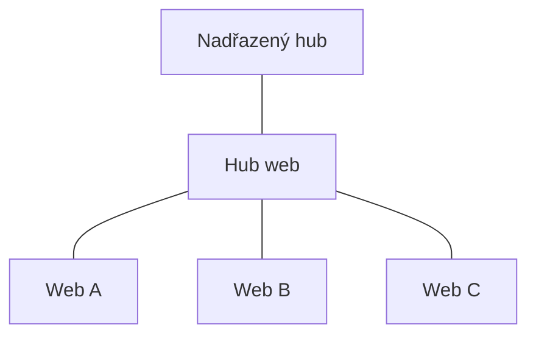

# Informační architektura SPO (volitelný)

> Typ: volitelný · Den: 1 (za SP úvodem) · Odhad: PM blok
> Prostředí: [`../../environment.md`](../../environment.md) · Názvosloví: [`../../GLOSSARY.md`](../../GLOSSARY.md)

## Cíle

- Navrhnete informační architekturu (IA) napříč weby: hub strukturu, navigaci, taxonomii a content types.
- Pochopíte, proč je IA průběžný proces, a ne jednorázový návrh.

## Proč se IA zabývat

Informační architektura je způsob, jakým obsah uspořádáte a pojmenujete a jak se v něm lidé pohybují, když potřebují něco dohledat nebo udělat. V SharePointu Online se to dřív řešilo hlavně stromem webů a podwebů. Moderní SharePoint ale staví na plochém světě samostatných webů, které propojujete huby, navigací a metadaty. Kdo to nenaplánuje, skončí u desítek webů, které na sebe nenavazují, a u knihoven, kde se dokumenty hledají jen přes složky.

Pro tento kurz má IA ještě jeden rozměr: Copilot i vyhledávání pracují s tím, co v tenantu najdou. Dobře popsaný a rozumně uspořádaný obsah jim dává lepší podklad. Modul je volitelný a samostatný — prohlubuje téma z [`sharepoint-intro`](../sharepoint-intro/) a žádný další modul kurzu na něm nestaví, takže ho můžete projít podle potřeby.

## 1. Šest vrstev moderní IA

Microsoft dělí IA v SharePointu do šesti vrstev. Každá odpovídá na jinou otázku „jak uživatel najde, co potřebuje":

- **Globální navigace** — nejvyšší úroveň napříč celým tenantem: jak jsou weby uspořádané, aby se k obsahu dalo dostat odkudkoli.
- **Hub struktura** — seskupení souvisejících webů do „rodin" (viz kapitola 2).
- **Lokální navigace webu a stránky** — jak je obsah uspořádaný uvnitř jednoho webu a na jeho stránkách.
- **Metadatová architektura** — sloupce, content types a taxonomie; ovlivňují vyhledávání, procházení i compliance a retenci (kapitola 3).
- **Vyhledávání** — druhá cesta k obsahu vedle procházení; vyhledávání těží z investic do všech ostatních vrstev.
- **Personalizace obsahu** — jak se konkrétní obsah cílí na určité uživatele a skupiny.

Vrstvy na sebe navazují. Navigace pomáhá tomu, kdo ví, kde obsah hledat; metadata a vyhledávání tomu, kdo to neví ([IA intro](https://learn.microsoft.com/en-us/sharepoint/information-architecture-modern-experience)).

## 2. Hub weby

### Plochá struktura místo podwebů

Základní princip moderního intranetu zní: **každá jednotka práce dostane vlastní site collection** — komunikační web nebo team web napojený na Microsoft 365 skupinu. Weby pak nestojí v hierarchii, ale vedle sebe a propojují je huby.

Proč ne podweby? Podweb je fyzická konstrukce, která se promítá do URL. Když se organizace přeskupí, rozbijete tím vazby v obsahu. Navíc se řada funkcí (včetně retence a klasifikace) zapíná pro celou site collection, takže se dotkne i podwebů, kde ji nechcete. Hub naproti tomu modeluje vztahy jako odkazy, ne jako vlastnictví — web jde z jednoho hubu přesunout do jiného, aniž byste cokoli rozbili ([Planning hub sites](https://learn.microsoft.com/en-us/sharepoint/planning-hub-sites)).

### Co asociace s hubem dělá

Web se do hubu přidá **asociací**. Tím:

- zdědí motiv a sdílenou navigaci hubu,
- jeho obsah se rolluje do hubu (např. novinky ve webových částech se zdrojem „všechny weby v hubu"),
- spadne do search scope hubu — uživatel pak může hledat jen v rodině souvisejících webů.

Asociace **nemění oprávnění** webu. Co se na hubu zobrazí, je security-trimmed: kdo nemá přístup k obsahu, ten ho na hubu neuvidí. Stejné pravidlo platí pro Copilot — ani hub, ani Copilot oprávnění nerozšiřují. Asociací se web také sám nepřidá do navigace hubu; o tom rozhoduje vlastník hubu ([Planning hub sites](https://learn.microsoft.com/en-us/sharepoint/planning-hub-sites)).

### Hierarchie hubů

Huby lze asociovat i mezi sebou (hub-to-hub). Vznikne tak síť hubů, která rozšiřuje vyhledávání a roll-up obsahu až do **tří úrovní asociace** ([Planning hub sites](https://learn.microsoft.com/en-us/sharepoint/planning-hub-sites)).

Typický příklad je HR: samostatné weby pro benefity, nábor nebo vzdělávání a nad nimi HR hub, který jim dá společnou navigaci, novinky a vyhledávání jen v HR obsahu.

## 3. Taxonomie a metadata

Metadata jsou vrstva, která drží IA pohromadě i uvnitř webu. Tvoří ji tři prvky:

- **Managed metadata / term store** — řízená taxonomie termínů. Místo volného textu vybírá uživatel z odsouhlaseného seznamu, takže se stejná věc všude jmenuje stejně. Term sety mohou být **globální** (pro celý tenant) nebo **lokální** (pro jednu site collection) ([Managed metadata planning](https://learn.microsoft.com/en-us/sharepoint/governance/managed-metadata-planning)).
- **Content types** — znovupoužitelná sada sloupců, chování a nastavení pro jeden druh obsahu (třeba „Smlouva" nebo „Faktura"). Přes **content type hub** je lze sdílet napříč site collections, takže stejný typ dokumentu má všude stejné sloupce ([Content type planning](https://learn.microsoft.com/en-us/sharepoint/governance/content-type-and-workflow-planning)).
- **Sloupce** — jednotlivé vlastnosti, podle kterých se v knihovně filtruje a řadí.

Metadata pohánějí navigaci, filtrování, vyhledávání i retenci a compliance. Proto je Microsoft doporučuje před hlubokým zanořováním složek — složka je fyzická konstrukce, zatímco metadata umožní pohlížet na stejný obsah z více stran ([IA intro](https://learn.microsoft.com/en-us/sharepoint/information-architecture-modern-experience)). S metadatovými sloupci se v kurzu znovu setkáte v D2 v modulu [`document-processing`](../../day-2/document-processing/), kde je vyplňuje AI.

## 4. Navigace a modely IA

Navigaci navrhujete ve třech úrovních:

- **globální** — pro celý intranet,
- **hub** — pro rodinu souvisejících webů, definuje ji vlastník hubu a sdílí ji všechny asociované weby,
- **lokální** — uvnitř jednoho webu.

Jak weby do hubů rozdělit, záleží na tom, jak organizace pracuje. Microsoft popisuje několik modelů — podle scénáře, podle úkolů nebo podle geografie — a ukazuje je na příkladech ([IA models & examples](https://learn.microsoft.com/en-us/sharepoint/information-architecture-models-examples)).

Při rozhodování narazíte na jedno omezení: web může být asociován jen k **jednomu** hubu. Pokud logicky patří do dvou rodin (např. regionální obchodní web patří k regionálnímu hubu i ke globálnímu obchodnímu), asociujte ho k jednomu a s druhým ho propojte navigačním odkazem ([Planning hub sites](https://learn.microsoft.com/en-us/sharepoint/planning-hub-sites)).

## 5. IA je průběžný proces

Optimální IA se vyvíjí. Organizace, lidé i projekty se mění a postupně se o uživatelích dozvídáte víc. IA proto neberte jako projekt s koncem: sledujte, jak lidé obsah hledají, a strukturu upravujte, aby zůstala relevantní ([IA intro](https://learn.microsoft.com/en-us/sharepoint/information-architecture-modern-experience)). Plochá struktura s huby vám to usnadňuje — web lze přeasociovat, archivovat nebo smazat bez dopadu na ostatní.

## Klíčové rozlišení

- **Hub ≠ podweb.** Hub propojuje samostatné weby odkazem; podweb je fyzicky zanořený a promítá se do URL.
- **Asociace ≠ oprávnění.** Hub sdílí motiv, navigaci a vyhledávání, ale přístup k obsahu nemění.
- **Asociace ≠ navigace.** Web v hubu není automaticky v navigaci hubu a naopak do navigace můžete dát i web mimo hub.
- **Metadata > složky** pro dohledatelnost, vyhledávání i compliance.

## Shrnutí

- IA v SharePointu tvoří šest vrstev: globální navigace, huby, lokální navigace, metadata, vyhledávání a personalizace.
- Moderní intranet je plochý: každá jednotka práce má vlastní web a weby propojují huby, ne podweby.
- Web patří jen k jednomu hubu; huby lze řetězit až do tří úrovní a další vazby řešit navigačními odkazy.
- Term store, content types a sloupce pohánějí navigaci, vyhledávání, compliance i kvalitu podkladů pro Copilot.
- IA je průběžný proces, ne jednorázový návrh.

## Lab

Návrh IA pro modelovou organizaci (weby, hub, taxonomie) — TODO doplnit zadání.

## Zdroje (Microsoft)

- **Principy IA:** [IA intro](https://learn.microsoft.com/en-us/sharepoint/information-architecture-modern-experience) · [IA models & examples](https://learn.microsoft.com/en-us/sharepoint/information-architecture-models-examples)
- **Huby:** [Planning hub sites](https://learn.microsoft.com/en-us/sharepoint/planning-hub-sites)
- **Metadata:** [Managed metadata planning](https://learn.microsoft.com/en-us/sharepoint/governance/managed-metadata-planning) · [Content type planning](https://learn.microsoft.com/en-us/sharepoint/governance/content-type-and-workflow-planning)

## Stav produktu / delta

- Stabilní téma. Vazba na Copilot: dobrá IA a metadata zlepšují grounding a relevanci odpovědí (viz [`../ai-landscape/`](../ai-landscape/)).
