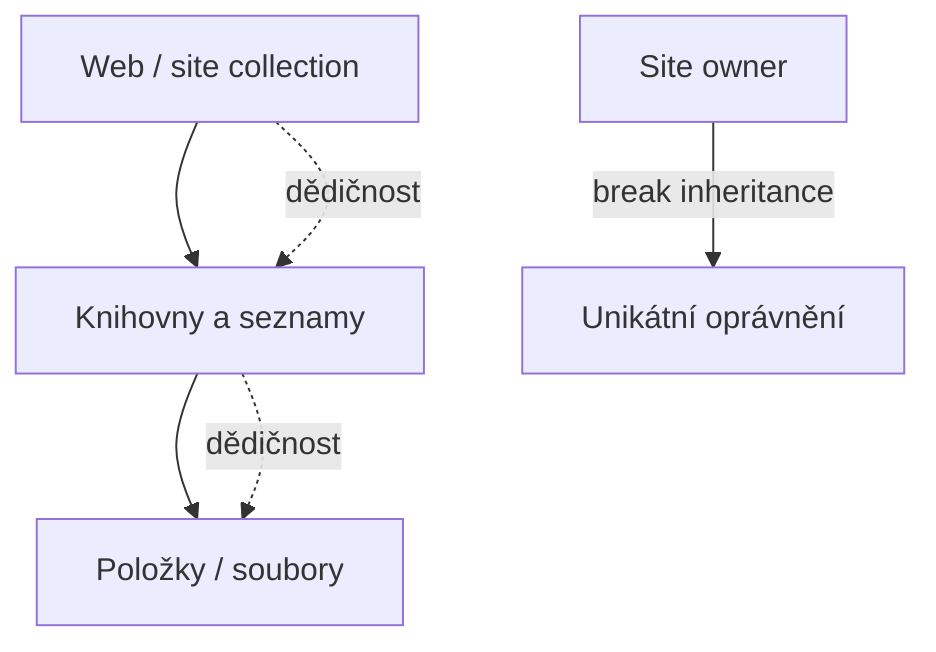

# SharePoint technologický úvod

> Typ: povinný · Den: 1 · Odhad: PM blok
> Prostředí: [`../../environment.md`](../../environment.md) · Názvosloví: [`../../GLOSSARY.md`](../../GLOSSARY.md)

## Cíle

- Porozumíte základnímu modelu SharePoint Online (SPO): weby, knihovny, oprávnění, metadata, content types a vyhledávání.
- Budete vědět, kde končí samotný SharePoint Online a kde začínají doplňkové produkty (Document processing, SAM, Backup/Archive, Copilot in SharePoint).
- Pochopíte, proč je kvalita oprávnění a metadat základem pro Copilot grounding.

## Proč začínáme u SharePointu

Celý kurz stojí na SharePointu Online. Copilot in SharePoint, Skills, agenti, Document processing i nástroje pro správu typu SAM pracují s obsahem, který leží na webech a v knihovnách. A Copilot nevidí „víc", než vidí uživatel — vidí přesně to, k čemu má uživatel oprávnění, a orientuje se podle toho, jak je obsah popsaný.

Z toho plyne jednoduchá věc: jak dobře je SharePoint uspořádaný, tak dobře bude fungovat AI nad ním. Když jsou oprávnění rozbitá a dokumenty bez metadat zapadlé v hluboko zanořených složkách, Copilot najde nesprávné věci nebo věci, které uživatel vidět neměl. Tento modul proto shrnuje stavební bloky SPO, na které se budete po zbytek týdne odvolávat.

## 1. Stavební bloky SPO

### Weby

**Web** (site) je v SharePointu základní jednotka práce — místo, kde tým nebo projekt drží svůj obsah a kde se nastavuje, kdo k němu má přístup. Moderní přístup říká: každá jednotka práce má vlastní **site collection**, buď jako **komunikační web**, nebo jako **týmový web napojený na Microsoft 365 skupinu**. Dříve obvyklé stromy podřízených webů (subwebů) se už nedoporučují. Ploché uspořádání se snáz spravuje, přesouvá i ruší a weby se pak propojují do větších celků (hub sites), aniž by se musely zanořovat do sebe ([Planning hub sites](https://learn.microsoft.com/en-us/sharepoint/planning-hub-sites)).

V kurzu máte každý vlastní web `/sites/user.NN`, na kterém jste **Owner** — postup, jak se na něj dostanete, je v labu modulu [`onboarding`](../onboarding/lab-tenant-access.md). Na tomto webu budete zakládat knihovny, zkoušet Document processing a Copilot in SharePoint.

### Knihovny a seznamy

**Seznam** je tabulka položek se sloupci — podobně jako tabulka v Excelu, jen s oprávněními, historií verzí a formuláři. **Knihovna** je speciální typ seznamu určený pro soubory: každý soubor je v ní položkou a sloupce knihovny nesou jeho metadata. Každý web má aspoň jednu knihovnu.

Tohle rozlišení má praktický dopad: cokoli platí pro seznamy (sloupce, zobrazení, dědičnost oprávnění), platí i pro knihovny. V D2 si na svém webu založíte knihovnu **Vzorky** a nad ní budete zkoušet vytěžování metadat ([`document-processing`](../../day-2/document-processing/)); v D3 na ni navážou Skills ([`skills`](../../day-3/skills/)).

### URL model SPO

Všechny weby organizace leží pod jedním hostname `https://<tenant>.sharepoint.com`. V našem prostředí je to `https://ms365x17157302.sharepoint.com`, jednotlivé weby mají cestu `/sites/<název>` (viz [`environment.md`](../../environment.md)). Z URL tedy hned poznáte, ve kterém tenantu a na kterém webu jste — hodí se to, když pracujete s více tenanty nebo když v PowerShellu zadáváte adresu webu.

## 2. Permissions model

### Úrovně oprávnění a SharePoint skupiny

Oprávnění v SharePointu se skládají ze dvou vrstev. **Permission level** (úroveň oprávnění) je pojmenovaná sada dílčích práv — například **Full Control** (vše), **Edit** (přidávat, upravovat a mazat seznamy i položky), **Contribute** (upravovat položky a dokumenty, ne seznamy) nebo **Read** (číst a stahovat). Úroveň se pak přiřazuje **SharePoint skupině**, tedy množině uživatelů se stejnými právy.

Týmový web dostane při založení tři výchozí skupiny: **Owners** (Full Control), **Members** (Edit) a **Visitors** (Read). Výchozí skupiny a úrovně pokryjí většinu běžných situací. Platí princip **least privilege** — každý dostane jen tolik práv, kolik pro svou práci potřebuje ([Understanding permission levels](https://learn.microsoft.com/en-us/sharepoint/understanding-permission-levels)).

U moderních webů se správa liší podle typu webu: **komunikační weby** spravujete přes SharePoint skupiny, **týmové weby** přes napojenou Microsoft 365 skupinu — kdo je ve skupině, má přístup k webu ([Understanding permission levels](https://learn.microsoft.com/en-us/sharepoint/understanding-permission-levels)).

### Dědičnost

Oprávnění se nastavují na webu a odtud **dědí** dolů: seznamy a knihovny přebírají oprávnění webu, položky a soubory oprávnění své knihovny. Site owner může dědičnost na knihovně nebo položce **přerušit** (break inheritance) a nastavit tam **unikátní oprávnění**.

Přerušení dědičnosti je legitimní nástroj, ale používejte ho co nejméně. Každé unikátní oprávnění je výjimka, kterou je třeba hlídat, a z webu s desítkami výjimek už nikdo nevyčte, kdo co vidí. Pozor také na to, že dědičnost přerušuje i běžné sdílení: když uživatel nasdílí dokument někomu, kdo k němu přístup neměl, SharePoint na dokumentu dědičnost automaticky zastaví ([Understanding permission levels](https://learn.microsoft.com/en-us/sharepoint/understanding-permission-levels)). Tak vzniká přesdílený obsah, aniž by to kdokoli plánoval.

## 3. Metadata, content types, search

### Sloupce a content types

**Sloupce a content types** jsou dva nejdůležitější metadatové prvky pro organizaci obsahu. Sloupec popisuje jednu vlastnost dokumentu (například typ dokumentu, protistranu nebo datum) a metadata v něm pohánějí filtrování a řazení v knihovně i **vyhledávání** ([IA intro](https://learn.microsoft.com/en-us/sharepoint/information-architecture-modern-experience)).

**Content type** jde o úroveň výš: je to znovupoužitelná sada metadat (sloupců), chování a nastavení pro určitou kategorii obsahu — například „Smlouva" se sloupci pro protistranu a datum platnosti. Jednou definovaný content type pak použijete ve více knihovnách a obsah stejného druhu je všude popsaný stejně ([Content type planning](https://learn.microsoft.com/en-us/sharepoint/governance/content-type-and-workflow-planning)).

### Managed metadata a term store

U volného textu napíše každý totéž jinak („Smlouva", „smlouvy", „SML"). **Managed metadata** to řeší řízenou taxonomií: termíny se spravují centrálně v **term store** a platí napříč tenantem, takže všichni vybírají ze stejného seznamu ([Managed metadata](https://learn.microsoft.com/en-us/sharepoint/managed-metadata)).

### Složky vs. metadata

Složky svádějí, protože je zná každý z disku. Dokument ale může být jen v jedné složce, zatímco metadat může mít libovolně mnoho — a podle každého z nich jde filtrovat. Proto preferujte metadata: hluboké zanoření složek zhoršuje dohledatelnost pro lidi i pro vyhledávání. Pro Copilot to platí dvojnásob, protože dobře popsaný obsah se snáz najde a správně zařadí.

## 4. Kde končí SPO a začínají add-ony

Tato kapitola je most do zbytku kurzu. SharePoint Online sám o sobě dává weby, knihovny, oprávnění, metadata a vyhledávání. Všechno ostatní, co v kurzu probíráte, jsou **samostatné produkty** nad ním, každý s vlastním licenčním modelem:

| Vrstva | Co to je | Kde v kurzu |
|---|---|---|
| **SharePoint Online (jádro)** | weby, knihovny, permissions, metadata, search | tento modul, [`opt-ia-spo`](../opt-ia-spo/) |
| **Document processing for Microsoft 365** | AI vytěžování obsahu (PAYG) | D2 [`document-processing`](../../day-2/document-processing/) |
| **SharePoint Advanced Management (SAM)** | governance webů/OneDrive | D3 [`advanced-management`](../../day-3/advanced-management/) |
| **Microsoft 365 Backup / Archive** | ochrana a cold storage dat | D3 [`backup`](../../day-3/backup/), [`archive`](../../day-3/archive/) |
| **Copilot in SharePoint** | AI nad weby (Skills, agenti) | D3 [`skills`](../../day-3/skills/), D4 agenti |

> [!IMPORTANT] Názvosloví
> Katalogový název kurzu zmiňuje „SharePoint Premium". Tato značka byla rozdělena na samostatné produkty z tabulky výše a jako jeden produkt už neexistuje. V materiálech používáme aktuální názvy podle [`GLOSSARY.md`](../../GLOSSARY.md).

Pro správce z toho plyne důležitý rozdíl: SharePoint Online máte s licencí Microsoft 365, ale každý add-on se zapíná a platí zvlášť. Licenční detaily probírá modul [`licensing`](../licensing/).

## Klíčové rozlišení

- **Knihovna je typ seznamu** — soubory jsou položky seznamu, sloupce jsou jejich metadata.
- **Metadata > složky** pro dohledatelnost a governance.
- **Kvalita permissions = základ Copilot groundingu**: co je přesdílené, to Copilot „vidí". Copilot zobrazí uživateli jen obsah, ke kterému má oprávnění (permission-trimming); licence ani AI oprávnění nerozšiřují. Podrobněji v modulu [`ai-landscape`](../ai-landscape/).
- **SharePoint Online ≠ add-ony** — Document processing, SAM, Backup, Archive a Copilot in SharePoint jsou samostatné produkty.

## 5. Vazba na kurz

Kvalita informační architektury a oprávnění z tohoto modulu je předpokladem pro bezpečné nasazení Copilota. Jakmile Copilot ochotně najde vše, k čemu má uživatel přístup, stává se přesdílený obsah AI problémem. V D3 proto uvidíte, jak SAM v [`advanced-management`](../../day-3/advanced-management/) oprávnění vynucuje a pomáhá přesdílení odhalit (oversharing reporty atd.). Prohloubení informační architektury najdete ve volitelném modulu [`opt-ia-spo`](../opt-ia-spo/).

## Shrnutí

- Moderní SharePoint = ploché weby (jedna jednotka práce = jedna site collection), ne stromy subwebů.
- Knihovna je seznam pro soubory; oprávnění dědí z webu na knihovny a položky a přerušení dědičnosti (i sdílením) vytváří výjimky.
- Oprávnění přidělujte přes skupiny (Owners / Members / Visitors) podle least privilege.
- Metadata, content types a managed metadata dělají obsah dohledatelným — lépe než složky.
- Copilot vidí to, co vidí uživatel: kvalita oprávnění a metadat určuje kvalitu i bezpečnost AI.

## Lab

Modul nemá samostatný lab. Stavební bloky si vyzkoušíte prakticky na svém webu `/sites/user.NN` — v labu [`onboarding`](../onboarding/lab-tenant-access.md) se na web poprvé přihlásíte a v D2 v [`document-processing`](../../day-2/document-processing/) na něm založíte knihovnu Vzorky.

## Zdroje (Microsoft)

- **Weby a informační architektura:** [Planning hub sites](https://learn.microsoft.com/en-us/sharepoint/planning-hub-sites) · [IA intro](https://learn.microsoft.com/en-us/sharepoint/information-architecture-modern-experience)
- **Oprávnění:** [Understanding permission levels](https://learn.microsoft.com/en-us/sharepoint/understanding-permission-levels)
- **Metadata:** [Content type planning](https://learn.microsoft.com/en-us/sharepoint/governance/content-type-and-workflow-planning) · [Managed metadata](https://learn.microsoft.com/en-us/sharepoint/managed-metadata)

## Stav produktu / delta

- Jádro SharePoint Online (weby, oprávnění, metadata) je stabilní.
- Názvy add-on vrstev v tabulce kapitoly 4 před během ověřte proti [`GLOSSARY.md`](../../GLOSSARY.md).
