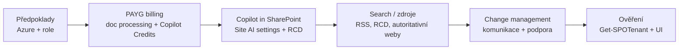

# Konfigurace krok za krokem

> Typ: povinný · Den: 2 · Odhad: PM blok
> Prostředí: [`../../environment.md`](../../environment.md) · Názvosloví: [`../../GLOSSARY.md`](../../GLOSSARY.md)

## Cíle

- Znáte pořadí kroků: předpoklady → PAYG billing → dostupnost Copilot in SharePoint → vyhledávání a zdroje → change management → ověření.
- Rozlišíte dva PAYG modely a umíte nastavit Copilot Credits billing policy (včetně toho, proč tam rozpočet není limit) i spending policy v Cost management (kde limit je).
- Umíte řídit dostupnost Copilot in SharePoint po GA (Site AI settings + RCD) a víte, že `KnowledgeAgentScope` je vyřazený.
- Odcházíte s konfiguračním runbookem (dry-run z labu) včetně kroků change managementu.

## Proč na pořadí záleží

V modulu [`licensing`](../../day-1/licensing/README.md) jste se naučili, *co* uživatel potřebuje, aby AI funkce fungovala. Tady řešíte, *v jakém pořadí* to správce v tenantu nastaví. Pořadí není libovolné: bez Azure subscription nejde zapnout žádný PAYG model, bez billingu nejsou dostupné služby placené za spotřebu a bez rozhodnutí, *kde* se Copilot nesmí objevit, pustíte AI nad weby, které na to nejsou připravené.

Modul je proto postavený jako runbook — kroky 0 až 4, za nimi ověření. Stejnou kostru pak vyplníte v labu pro fiktivní firmu.

## Krok 0 — předpoklady

Než v admin centru cokoli zapnete, potřebujete tři věci. Všechny souvisejí s tím, že Microsoft 365 nemá vlastní účtování spotřeby — veškeré PAYG metry se účtují přes Azure.

- **Azure subscription ve stejném tenantu.** Subscription z cizího tenantu použít nejde. Pokud vaše organizace spravuje Azure v jiném tenantu než Microsoft 365, je to první blokátor, který musíte vyřešit.
- **Resource group v této subscription.** Na resource group se váže meter a tečou do ní data o spotřebě. Kdo má na resource group aspoň roli *Reader*, vidí náklady v Azure Cost Management. Volbou resource group tedy zároveň rozhodujete, kdo v organizaci smí vidět útratu za AI.
- **Role.** Potřebujete roli podle služby (viz krok 1) a vždy k tomu **Owner nebo Contributor na subscription**. Jde o dvě nezávislé osy: role v Microsoft 365 sama nestačí a role v Azure taky ne. V praxi to často znamená spolupráci dvou lidí — správce Microsoft 365 a správce Azure.

## Krok 1 — PAYG billing (dva modely)

V Microsoft 365 existují dva **nezávislé** PAYG modely. Sdílejí stejné Azure napojení (subscription + resource group), ale jinak spolu nesouvisejí: mají jinou měnu, jiné služby a nastavují se na jiném místě. Nezaměňujte je (viz [glosář](../../GLOSSARY.md)).

### 1a — Document processing PAYG

Document processing PAYG odemyká služby pro práci s dokumenty: Autofill columns, OCR, překlad, eSignature a další. Na stejné napojení pak navazují i metry Backup, Archive a Storage, se kterými se setkáte ve dni 3. Nastavit ho smí SharePoint Administrator nebo Global Administrator.

Aktivace probíhá v M365 admin centru: **Setup → Billing and licenses → Activate pay-as-you-go services** → záložka **Billing** → **Document processing services**. Pozdější správa je v **Settings → Org settings → Pay-as-you-go services**. V panelu **Set up billing and turn on services** vyplníte čtyři sekce a každá znamená něco jiného:

- **Azure subscription** — přes koho tečou peníze. Proto je nutná role Owner nebo Contributor.
- **Resource group** — kam se váže meter. V Azure **Cost analysis** pak filtrem *Product* a tagem *Site* uvidíte útratu po jednotlivých webech, se zpožděním až 24 hodin.
- **Region** — kde budou uložena **usage metadata** (tenant ID, názvy webů). Jde o rozhodnutí o umístění dat, ne o výkonu. Obsah dokumentů zůstává v tenantu, region určuje jen to, kde leží záznamy o spotřebě.
- **Terms of service** — samostatné PAYG podmínky. Jde o jiný právní režim než předplatné Microsoft 365, což může vyžadovat schválení od právního nebo nákupního oddělení.

Podrobný postup popisuje Microsoft v návodu [Set up PAYG billing](https://learn.microsoft.com/en-us/microsoft-365/documentprocessing/syntex-azure-billing). Samotné služby document processing pak prakticky konfigurujete v navazujícím modulu [`document-processing`](../document-processing/).

### 1b — Copilot Credits PAYG (Copilot bez licencí)

Druhý model dává přístup ke Copilot službám uživatelům bez plné licence Microsoft 365 Copilot. Neplatí se za uživatele, ale za spotřebu v **Copilot Credits**. Pokrývá tyto služby:

- **Microsoft 365 Copilot Chat** — placené funkce, tedy grounding nad daty tenantu (bezplatný Copilot Chat odpovídá jen z webu),
- **SharePoint agents** — jen agenti ve formě souborů `.agent`,
- **Copilot Retrieval API** (preview).

Copilot Studio má vlastní PAYG, který se nastavuje zvlášť ([Overview](https://learn.microsoft.com/en-us/microsoft-365/copilot/pay-as-you-go/pay-as-you-go-overview)).

Nastavení má **dva kroky** a každý z nich znamená jiné rozhodnutí:

1. **Billing policy** (admin centrum → **Copilot → Billing & usage** → záložka **Billing policies** → *Add a billing policy*). Billing policy je účetní identita: Azure subscription, resource group, region, **uživatelé nebo skupiny**, kterým se smí spotřeba účtovat, a volitelně rozpočet. Policy odděluje *kdo platí* od *co se platí*. Proto jich můžete mít až 50 — například jednu za každé oddělení — a jednu policy můžete připojit k více službám.
2. **Připojení policy ke službě** (záložka **Pay-as-you-go services** → *Microsoft 365 Copilot Chat* nebo *SharePoint agents* → vybrat policy). **Teprve tento krok** službu uživatelům z policy zpřístupní. Samotná policy nic nezapíná. Když policy od služby odpojíte, uživatelé přístup ztratí; změna se propaguje zhruba do 2 hodin.

Postup krok za krokem najdete v návodu [Set up Copilot pay-as-you-go](https://learn.microsoft.com/en-us/microsoft-365/copilot/pay-as-you-go/setup).

Na tomto modelu si všimněte tří věcí:

- **Rozpočet není limit.** Rozpočet v billing policy jen posílá e-mailová upozornění, když útrata dosáhne určitých milníků. Strop **nevynucuje** — služba běží dál i po překročení. Tvrdý limit u této plochy neexistuje; útratu hlídáte upozorněními a v Azure Cost Management. Právě proto v labu musí komunikační plán obsahovat aspoň jednu položku o nákladech (lab, bod 3).
- **Role.** Billing policy spravuje Billing Administrator, **AI Administrator** nebo Global Administrator. Global Reader vidí nastavení jen pro čtení.
- **Ověření funkčnosti.** Uživatel bez licence zkusí agenta (například *Learning Coach*). Dotaz nad daty tenantu stojí orientačně ~12 kreditů (10 za grounding + 2 za generovanou odpověď), stejně jako v kalkulaci z modulu `licensing`. Útratu pak uvidíte v **Copilot Credits Report** ([Billing rates](https://learn.microsoft.com/en-us/microsoft-copilot-studio/requirements-messages-management), [Credits report](https://learn.microsoft.com/en-us/microsoft-365/admin/activity-reports/microsoft-365-copilot-credits)).

### 1c — Copilot Credits přes usage-based billing (Cost management)

Copilot Credits mají ještě druhou, novější správní plochu: **Copilot → Cost management** → **Configuration** → *Add spending policy*. Pokrývá jiné služby než 1b: Cowork, **Advanced work in SharePoint** a OneDrive, Code, Work IQ API a Copilot Managed Runtime; volitelně i Copilot Studio ([Usage-based billing](https://learn.microsoft.com/en-us/microsoft-365/copilot/usage-based-billing-overview-copilot-credits)).

Spending policy se skládá ze čtyř částí: **rozsah** (uživatelé a skupiny, nebo prostředí a agenti), **vybrané služby**, **limity** a způsob účtování. Od billing policy se liší ve dvou zásadních věcech:

- **Policy řídí přístup.** Kdo v policy není, službu nepoužije — i kdyby měl licenci.
- **Limited budget je tvrdý strop.** Když uživatel limit vyčerpá, ztratí přístup ke službě do 1. dne dalšího měsíce. Tady tedy rozpočet spotřebu skutečně zastaví.

Pozor na volbu **Auto-apply new services**. Ve výchozím stavu je zapnutá, takže nové služby usage-based billingu se do policy přidají samy. Pokud chcete rollout kontrolovat a nové služby schvalovat ručně, vypněte ji ([Spending policies](https://learn.microsoft.com/en-us/microsoft-365/copilot/usage-based-billing-manage-copilot-credits)).

U Cowork, Advanced work a Code Microsoft vyžaduje Copilot licenci — Copilot Credits ji nenahrazují, jen k ní přidávají spotřebu. V kurzovním tenantu mají studenti licenci (od běhu 2026-11) a spending policy pro Cowork, Code a Advanced work se reálně používá. Prakticky se s ní setkáte ve dni 4 v modulech [`cowork`](../../day-4/cowork/README.md) a [`code`](../../day-4/code/README.md).

## Krok 2 — dostupnost Copilot in SharePoint

Copilot in SharePoint je v GA rolloutu od 30. 9. 2026. Běžné funkce jsou součástí Copilot licence a nemají žádný opt-in krok — jakmile má uživatel licenci, funkce se mu objeví. „Advanced work" se platí přes Copilot Credits (krok 1c) ([Get started with Copilot in SharePoint](https://learn.microsoft.com/en-us/sharepoint/copilot-in-sharepoint-get-started)).

Během preview se dostupnost řídila tenant-wide parametrem `Set-SPOTenant -KnowledgeAgentScope` (spolu s `KnowledgeAgentSelectedSitesList` a `...Operation`). Tyto parametry jsou **vyřazené** — Microsoft stávající nastavení ctil jen do 1. 11. 2026. Ve starších návodech a skriptech na ně ještě narazíte; berte je jako historii. Dostupnost dnes řídí dvě nastavení na úrovni webu:

- **Site AI settings** (vlastník webu, *Settings → Site AI*). Vlastník webu tu volí, který agent se otevře z ikony v hlavičce (Copilot in SharePoint, nebo vlastní agent), může skrýt Copilot tlačítko pro návštěvníky webu a zapnout pro web advanced document processing.
- **Restricted Content Discovery (RCD).** Na webu s RCD se Copilot in SharePoint ani AI akce neobjeví, bez ohledu na ostatní nastavení. RCD patří do SharePoint Advanced Management, podrobně ho proberete ve dni 3 v modulu [`advanced-management`](../../day-3/advanced-management/).

Tenant-wide vypínač pro dobu po GA Microsoft nedokumentuje. Výsledek si proto skládejte ze dvou otázek: *kdo* funkci má, řídí licence; *kde* se neobjeví, řídí RCD. Site AI settings pak doladí, jak se funkce na konkrétním webu chová.

## Krok 3 — vyhledávání a zdroje

Copilot odpovídá z obsahu, který najde přes Microsoft Graph a vyhledávání. Co není v indexu nebo k čemu uživatel nemá oprávnění, Copilot nenajde. Proto je nastavení vyhledávání součástí konfigurace Copilota, ne samostatné téma.

Máte k dispozici dva typy ovladačů:

- **Vypínače viditelnosti** — Restricted SharePoint Search (RSS) a RCD omezují, co se v organizaci najde.
- **Pozitivní signál** — autoritativní obsah můžete označit parametrem `-IsAuthoritative`. Vyhledávání i Copilot pak takovým webům dávají větší váhu. Jak hodnotu přečíst skriptem, jste viděli v ranním modulu [`powershell-spo`](../powershell-spo/).

Tři ovladače na úrovni webu (Site AI settings × RCD × `IsAuthoritative`), jejich kombinace ve scénářích a nejčastější omyly podrobně vysvětluje [`explainer-copilot-controls.md`](explainer-copilot-controls.md). Přečtěte si ho před labem — budete z něj vyplňovat fázi 4 runbooku.

## Krok 4 — change management a komunikace

Technické nastavení je menší polovina rolloutu. Uživatelé, kteří nevědí, co se zapnulo a proč, funkci buď nepoužijí, nebo ji použijí špatně — a u služeb placených za spotřebu to stojí peníze.

Komunikační plán by měl odpovědět na čtyři otázky: co se zapíná, koho se to týká, co to znamená pro náklady (PAYG!) a kam hlásit problémy. Microsoft k tomu nabízí vzory v [Copilot enablement resources](https://learn.microsoft.com/en-us/microsoft-365/copilot/microsoft-365-copilot-enablement-resources), kde je postup rozdělený do pěti kroků: readiness → licence → aplikace a síť → nastavení → uvítání uživatelů a sběr zpětné vazby.

Komunikační plán se vrací i v závěrečném projektu ve dni 5 ([`capstone`](../../day-5/capstone/)), kde je součástí rollout blueprintu.

## Klíčové rozlišení

- **Licence vs. PAYG u Copilot in SharePoint.** Po GA Microsoft výslovně uvádí Copilot licenci jako prerekvizitu. Copilot Credits PAYG (krok 1b) kryje jen **Copilot Chat a SharePoint agents** — Copilot in SharePoint ani Skills bez licence nefungují. Ověřeno v kurzovním tenantu v 11/2026; v preview (7/2026) ještě fungovaly i bez licence.
- **Billing policy vs. připojení.** Policy je jen účetní identita (kdo a přes co platí). Přístup ke službě vzniká až připojením policy ke konkrétní službě. Dva kroky = dvě různá rozhodnutí.
- **Billing policy (1b) vs. spending policy (1c).** První jen účtuje a upozorňuje, druhá řídí přístup a umí tvrdý strop.
- **Zapnout vs. zpřístupnit.** Site AI settings a RCD říkají, *kde* se funkce objeví; licence a kredity říkají, *kdo* ji smí použít; oprávnění říkají, *nad čím*. Tři nezávislé vypínače.

## Naše prostředí

Konfiguraci tenantu uvidíte jako lektorské demo — mění nastavení pro celý tenant a vyžaduje admin role. Vy si mezitím v labu sestavíte runbook nanečisto a dopad nastavení ověříte jako Global Reader: v M365 admin centru (pouze pro čtení) a — pokud to umožnil ranní modul [`powershell-spo`](../powershell-spo/) — také přes `Get-SPOTenant` a `Get-SPOSite`.

## Shrnutí

- Pořadí je pevné: Azure subscription a role → PAYG billing → dostupnost → vyhledávání → komunikace → ověření.
- Document processing PAYG a Copilot Credits jsou dva oddělené modely se společným Azure napojením.
- U Copilot Credits rozlišujte billing policy (rozpočet jen upozorňuje, přístup vzniká připojením ke službě) a spending policy (řídí přístup, limited budget je tvrdý strop, pozor na Auto-apply).
- Dostupnost Copilot in SharePoint po GA řídí licence (kdo), RCD (kde ne) a Site AI settings (jak na webu); `KnowledgeAgentScope` je historie.
- Change management a komunikace nákladů jsou plnohodnotnou součástí konfigurace.

## Lab

[`lab-config-dry-run.md`](lab-config-dry-run.md) — tenant configuration dry-run (simulace).

## Zdroje (Microsoft)

- **Document processing PAYG:** [Set up pay-as-you-go billing](https://learn.microsoft.com/en-us/microsoft-365/documentprocessing/syntex-azure-billing)
- **Copilot Credits — PAYG:** [Copilot pay-as-you-go overview](https://learn.microsoft.com/en-us/microsoft-365/copilot/pay-as-you-go/pay-as-you-go-overview) · [Set up Copilot pay-as-you-go](https://learn.microsoft.com/en-us/microsoft-365/copilot/pay-as-you-go/setup) · [Billing rates](https://learn.microsoft.com/en-us/microsoft-copilot-studio/requirements-messages-management) · [Credits report](https://learn.microsoft.com/en-us/microsoft-365/admin/activity-reports/microsoft-365-copilot-credits)
- **Copilot Credits — usage-based billing:** [Usage-based billing](https://learn.microsoft.com/en-us/microsoft-365/copilot/usage-based-billing-overview-copilot-credits) · [Spending policies](https://learn.microsoft.com/en-us/microsoft-365/copilot/usage-based-billing-manage-copilot-credits)
- **Copilot in SharePoint:** [Get started with Copilot in SharePoint](https://learn.microsoft.com/en-us/sharepoint/copilot-in-sharepoint-get-started)
- **Change management:** [Copilot enablement resources](https://learn.microsoft.com/en-us/microsoft-365/copilot/microsoft-365-copilot-enablement-resources)

## Stav produktu / delta

> [!WARNING] Ověřit k datu běhu — stav k 2026-11.
>
> - **Copilot in SharePoint:** GA rollout od 30. 9. 2026; parametry `KnowledgeAgent*` Microsoft ctil jen do 1. 11. 2026, od té doby dostupnost řídí Site AI settings + RCD. Nedostupné v GCC / GCC High / DoD.
> - **Dvě plochy Copilot Credits:** PAYG (Copilot → Billing & usage; rozpočet = jen upozornění) a usage-based billing (Copilot → Cost management; tvrdý strop). Služby se mezi nimi přesouvají — po Ignite (17.–20. 11. 2026) ověřte cesty v admin centru.
> - **Cena za kredit** podle glosáře; ověřte v aktuálním ceníku Microsoftu.
