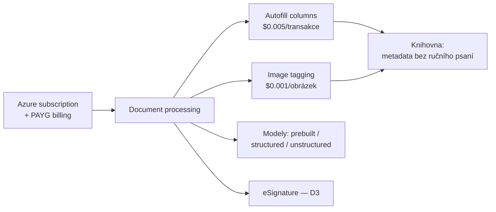

# Základy Document processing for Microsoft 365

> Typ: povinný · Den: 2 (největší blok dne) · Odhad: dlouhý PM blok — konfigurace + 2 ukázky + lab
> Prostředí: [`../../environment.md`](../../environment.md) · Názvosloví: [`../../GLOSSARY.md`](../../GLOSSARY.md)

## Cíle

- Znáte rodinu 10 služeb Document processing a rozumíte jejich čistě PAYG licencování.
- Víte, jak se služby zapínají a omezují na vybrané weby, a umíte na vlastní knihovně nastavit **autofill sloupec** a **image tagging**.
- Víte, kde náklady vznikají, v jakých jednotkách se počítají a kde je sledovat (observabilita).

## Proč Document processing

Knihovna dokumentů je jen tak užitečná, jak dobrá má metadata. Sloupce jako *Protistrana*, *Typ dokumentu* nebo *Tagy obrázku* umožňují filtrovat, třídit, vyhledávat a řídit retenci — a Copilot z nich čerpá kontext. V praxi je ale nikdo nevyplňuje: uživatel nahraje soubor a jde dál. Proto končí většina knihoven jako hromada souborů, ve které se hledá jen podle názvu.

Document processing tento problém řeší tím, že metadata vyplní AI z obsahu dokumentu nebo obrázku — tady uvidíte, jak metadata získat bez ručního psaní. (Proč metadata doporučujeme před zanořováním složek, rozebírá podrobněji volitelný modul [`opt-ia-spo`](../../day-1/opt-ia-spo/).) Zároveň je to první služba kurzu, která se platí čistě za spotřebu — každý zpracovaný dokument stojí peníze, a proto se naučíte i to, kde náklady sledovat.

## Výklad

### Co rodina obsahuje

**Document processing for Microsoft 365** je dnešní název content-AI služeb, které se dříve prodávaly jako Syntex a později pod značkou SharePoint Premium (ta už jako jeden produkt neexistuje, viz [`GLOSSARY.md`](../../GLOSSARY.md)). Dokumentace se přesunula pod `learn.microsoft.com/.../documentprocessing/`, ale adresy stránek stále obsahují slovo „syntex" (např. `syntex-overview`) — nenechte se tím zmást, jde o tentýž produkt.

Rodina má 10 služeb: autofill columns, document translation, eSignature, OCR, content assembly, image tagging, taxonomy tagging a tři skupiny modelů — prebuilt, structured & freeform a unstructured ([Overview](https://learn.microsoft.com/en-us/microsoft-365/documentprocessing/syntex-overview)). V tomto modulu se podrobně věnujeme dvěma z nich: **autofill columns** (AI vyplní sloupec u dokumentů) a **image tagging** (AI otaguje obrázky). eSignature má vlastní modul v D3 [`esignature`](../../day-3/esignature/).

Licenčně jde o **čistý PAYG**: žádná licence na uživatele, žádný závazek dopředu, platí se jen skutečné použití přes připojenou Azure subscription. Jedna výjimka stojí za zapamatování: **structured a freeform modely jsou modely AI Builderu** z Power Platform. Nejdřív čerpají AI Builder kredity přidělené environmentu a teprve po jejich vyčerpání jde zpracování na M365 PAYG metr $0,05 za stránku. Rozdíly mezi typy modelů — kde se tvoří, kde běží, jak se účtují a jaké jazyky podporují — najdete v doplňku [`comparison-models.md`](comparison-models.md).

Diagram čtěte zleva doprava: bez připojené Azure subscription nefunguje žádná služba; jakmile je připojená, každá služba má vlastní metr a výsledkem autofillu i image taggingu jsou vyplněná metadata v knihovně.

### Konfigurace služeb

Document processing zapíná správce tenantu — **SharePoint Administrator nebo Global Administrator**. Nejdřív se propojí PAYG billing s Azure subscription a resource group (podrobně v D2 [`configuration`](../configuration/)). Samotné služby se pak spravují v M365 admin center v cestě **Settings → Org settings → Pay-as-you-go services → Settings → Document & image services** ([Set up](https://learn.microsoft.com/en-us/microsoft-365/documentprocessing/set-up-microsoft-syntex), [Autofill setup](https://learn.microsoft.com/en-us/microsoft-365/documentprocessing/autofill-setup), [Image tagging setup](https://learn.microsoft.com/en-us/microsoft-365/documentprocessing/image-tagging-setup)).

Klíčová vlastnost výchozího stavu: po propojení PAYG jsou autofill i image tagging **automaticky zapnuté pro všechny weby** — spotřeba tak může vzniknout na kterémkoli webu, kde někdo službu v knihovně nastaví. Rozsah se dá u každé služby zvlášť omezit na **All sites**, **Selected sites** (nejvýš 100 webů, lze nahrát i CSV) nebo **No sites**. V reálné organizaci proto doporučujeme po propojení PAYG rozsah hned zúžit na weby, kde má služba smysl, a rozšiřovat ho podle potřeby.

V kurzu je konfigurace nastavená předem a rozsah zahrnuje vaše studentské weby. Vy ji sami neměníte — v labu ověříte, že se služby na vašem webu nabízejí.

### Autofill columns

**Autofill sloupec** je běžný sloupec knihovny (např. jeden řádek textu, číslo, datum nebo volba), ke kterému připojíte prompt. AI přečte obsah dokumentu a podle promptu do sloupce zapíše výsledek — vytáhne údaj (název protistrany, datum, částku) nebo shrne obsah ([Autofill setup](https://learn.microsoft.com/en-us/microsoft-365/documentprocessing/autofill-setup), [Create an autofill column](https://learn.microsoft.com/en-us/microsoft-365/documentprocessing/autofill)).

Jak to funguje v praxi:

1. Při zakládání sloupce v panelu *Vytvořit sloupec* vyplníte v sekci **Autofill** prompt a otestujete ho na jednom souboru.
2. Nově nahrané dokumenty se zpracují samy. Dokumenty, které už v knihovně byly, je potřeba spustit ručně: označit je a zvolit **⋯ → Autofill**.
3. Vyplněnou hodnotu můžete kdykoli přepsat — AI navrhuje, člověk má poslední slovo.

Kvalita výsledku stojí na promptu. Dobrý prompt sloupce má stejnou anatomii, jakou znáte z dopoledního modulu [`prompting-fundamentals`](../prompting-fundamentals/): **cíl** (co vytáhnout), **očekávání** (v jakém formátu) a **pravidlo pro chybějící údaj** (co vrátit, když v dokumentu nic není). Bez třetí části si model u dokumentu bez protistrany „něco vymyslí".

Autofill se účtuje **za transakci** ($0,005). Transakcí je jedna stránka u souborů Word, PDF a TIFF, jeden list u Excelu, jeden snímek u PowerPointu a jeden soubor u ostatních typů; podle ceníku je cena stejná pro jeden i více promptů na stránku ([PAYG pricing](https://learn.microsoft.com/en-us/microsoft-365/documentprocessing/syntex-pay-as-you-go-services)). Desetistránková smlouva je tedy deset transakcí, ne jedna.

### Autofill a Copilot in SharePoint — stejná funkce, dvě cesty účtování

Autofill dnes existuje i jako součást **Copilot in SharePoint** (GA rollout od 30. 9. 2026). Tam platí hybridní model ([Copilot in SharePoint](https://learn.microsoft.com/en-us/sharepoint/copilot-in-sharepoint-get-started)):

- **Use Autofill metadata** patří mezi běžné funkce a je v ceně Copilot licence.
- **Real-time / site-wide autofill** patří do *Advanced work* — vyžaduje licenci a navíc Copilot Credits přes spending policy; u site-wide režimu musí být usage-based billing povolený i pro daný web.

Bez Copilot licence vede k autofillu jen cesta přes Document processing PAYG. Tady se poprvé v praxi dotknete nosného rozlišení kurzu: **Document processing PAYG ≠ Copilot Credits**. Jde o stejnou funkci, ale za jednu cestu platí Azure metr podle stránek, za druhou buď licence, nebo Copilot Credits.

### Image tagging

**Image tagging** automaticky přiřazuje obrázkům v knihovně popisná klíčová slova do sloupce spravovaných metadat **Image Tags** ([Image tagging setup](https://learn.microsoft.com/en-us/microsoft-365/documentprocessing/image-tagging-setup), [Enhanced image tagging](https://learn.microsoft.com/en-us/microsoft-365/documentprocessing/image-tagging)). Tagy jsou běžná metadata: dají se podle nich filtrovat a třídit zobrazení knihovny, najde je vyhledávání a Copilot je může použít jako kontext (grounding).

Na rozdíl od autofillu, který se vztahuje ke sloupci, se image tagging zapíná **na celé knihovně**: v knihovně zvolíte **Automatizovat → Enable image tagger** a do knihovny přibude sloupec Image Tags. Zpracují se jen obrázky nahrané **po** zapnutí. Tagy se neobjeví okamžitě, ale za 5 minut až 24 hodin. Sloupec je editovatelný, takže chybný tag můžete smazat.

Pro náklady je podstatné, že **účtuje se jen na knihovnách, kde je tagger zapnutý** ($0,001 za obrázek). To, že je služba po propojení PAYG „zapnutá pro všechny weby", znamená jen to, že se v knihovnách nabízí; peníze začne stát až aktivací na konkrétní knihovně ([PAYG pricing](https://learn.microsoft.com/en-us/microsoft-365/documentprocessing/syntex-pay-as-you-go-services)).

### Náklady a observabilita

Každá služba má vlastní sazbu a vlastní jednotku ([PAYG pricing](https://learn.microsoft.com/en-us/microsoft-365/documentprocessing/syntex-pay-as-you-go-services)):

| Služba | Sazba (USD) | Jednotka |
|---|---|---|
| Autofill columns | $0.005 | transakce (stránka / list / snímek / soubor) |
| Image tagging | $0.001 | obrázek |
| Unstructured model | $0.005 | transakce |
| Prebuilt model | $0.01 | transakce |
| Structured / freeform model | $0.05 | stránka (po vyčerpání AI Builder kreditů) |
| eSignature | $2 | požadavek na podpis |

Spotřebu sledujete v **Microsoft Cost Management for Azure** nad resource group, kterou správce zadal při propojení PAYG; potřebujete na ni aspoň čtecí přístup. V Cost analysis lze filtrovat podle produktu a podle tagu *Site*, takže uvidíte, který web kolik spotřeboval. Počítejte se zpožděním: data se v Cost Management objeví až do 24 hodin ([Set up billing](https://learn.microsoft.com/en-us/microsoft-365/contentunderstanding/syntex-azure-billing)). Odhad dopředu vám dá [SharePoint cost calculator](https://aka.ms/SharePoint/PAYG-Calculator).

Microsoft k PAYG nabízí také omezenou měsíční kapacitu zdarma pro vybrané služby. Její rozsah a platnost se mění, proto ji najdete v sekci *Stav produktu / delta* a v rozpočtu na ni nespoléhejte. Navazující téma — jak náklady a provoz AI služeb hlídat dlouhodobě — rozvíjí D5 [`monitoring`](../../day-5/monitoring/).

## Klíčové rozlišení

- **Document processing PAYG ≠ Copilot Credits** — nosné rozlišení celého kurzu (glosář). Document processing platí za dokumenty, stránky, obrázky a transakce přes Azure metry; Copilot Credits platí za AI práci Copilota a agentů. U autofillu se obě cesty potkávají u stejné funkce.
- **Autofill vs. modely**: autofill = prompt na úrovni sloupce, nastavení za pár minut; structured/unstructured modely = trénovaný extraktor pro opakované typy dokumentů. Začínejte autofillem, model zvažte až ve chvíli, kdy sloupců a pravidel přibývá.
- **Zapnuto vs. účtováno**: služby jsou po PAYG setupu „zapnuté" na všech webech, ale image tagging se účtuje až aktivací na knihovně — rozdíl mezi dostupností a spotřebou.
- **Licence vs. permissions**: Document processing nepotřebuje licenci na uživatele, o tom, kdo smí v knihovně autofill sloupec nebo image tagger nastavit, rozhodují oprávnění v SharePointu — v labu to děláte jako Owner svého webu.

## Naše prostředí

Document processing PAYG je v kurzovním tenantu aktivní a rozsah služeb zahrnuje studentské weby. Konfiguraci a obě služby uvidíte nejprve předvedené, pak totéž zopakujete na knihovně **Vzorky** na svém webu `/sites/user.NN`. Protože každý dokument i obrázek stojí peníze, pracuje lab záměrně s malým vzorkem: 3 dokumenty a 3 obrázky.

Od běhu 2026-11 máte zároveň Microsoft 365 Copilot licenci (viz D1 [`licensing`](../../day-1/licensing/)). V tenantu jsou tedy k dispozici obě cesty k autofillu — Document processing PAYG i Copilot in SharePoint. Kterou cestou se autofill na vašem webu skutečně zaúčtuje, je potřeba ověřit v tenantu (viz *Stav produktu / delta*). Knihovnu Vzorky budete dál používat v D3 [`skills`](../../day-3/skills/) a D4 [`cowork`](../../day-4/cowork/).

## Shrnutí

- Document processing je rodina 10 content-AI služeb (ex-Syntex) placená čistě za spotřebu přes Azure subscription; structured/freeform modely navíc čerpají AI Builder kredity.
- Po propojení PAYG jsou autofill i image tagging zapnuté na všech webech; správce může rozsah zúžit na vybrané weby (max. 100) nebo vypnout.
- Autofill sloupec vyplní metadata podle promptu a účtuje se za stránku; image tagging taguje obrázky a účtuje se jen na knihovnách, kde je zapnutý.
- Autofill existuje i v Copilot in SharePoint — stejná funkce, ale účtování přes licenci nebo Copilot Credits, ne přes Document processing PAYG.
- Spotřebu sledujete v Azure Cost Management nad resource group, se zpožděním až 24 hodin.

## Lab

[`lab-sample-library.md`](lab-sample-library.md) — ukázková knihovna Vzorky: autofill sloupec, image tagging a odhad nákladů labu.

## Zdroje (Microsoft)

- **Rodina a nastavení:** [Overview of document processing](https://learn.microsoft.com/en-us/microsoft-365/documentprocessing/syntex-overview) · [Set up pay-as-you-go services](https://learn.microsoft.com/en-us/microsoft-365/documentprocessing/set-up-microsoft-syntex) · [Set up billing](https://learn.microsoft.com/en-us/microsoft-365/contentunderstanding/syntex-azure-billing)
- **Autofill:** [Autofill columns — setup](https://learn.microsoft.com/en-us/microsoft-365/documentprocessing/autofill-setup) · [Create an autofill column](https://learn.microsoft.com/en-us/microsoft-365/documentprocessing/autofill) · [Overview of autofill columns](https://learn.microsoft.com/en-us/microsoft-365/documentprocessing/autofill-overview) · [Copilot in SharePoint — get started](https://learn.microsoft.com/en-us/sharepoint/copilot-in-sharepoint-get-started)
- **Image tagging:** [Enhanced image tagging — setup](https://learn.microsoft.com/en-us/microsoft-365/documentprocessing/image-tagging-setup) · [Find and manage images](https://learn.microsoft.com/en-us/microsoft-365/documentprocessing/image-tagging) · [Image tagging overview](https://learn.microsoft.com/en-us/microsoft-365/documentprocessing/image-tagging-overview)
- **Náklady:** [PAYG pricing](https://learn.microsoft.com/en-us/microsoft-365/documentprocessing/syntex-pay-as-you-go-services) · [SharePoint cost calculator](https://aka.ms/SharePoint/PAYG-Calculator) · [Promo — kapacita zdarma](https://learn.microsoft.com/en-us/microsoft-365/documentprocessing/promo-syntex)

## Stav produktu / delta

> [!WARNING] Ověřit k datu běhu — stav k 2026-11.
>
> - **Kapacita zdarma:** [promo stránka](https://learn.microsoft.com/en-us/microsoft-365/documentprocessing/promo-syntex) uvádí platnost **do prosince 2026** (mj. 100 stran měsíčně sdílených mezi autofill a unstructured, 2 500 obrázků image tagging, na tenant), [ceník](https://learn.microsoft.com/en-us/microsoft-365/documentprocessing/syntex-pay-as-you-go-services) stále **do června 2026** — Microsoft si odporuje. V Cost Management ověřte, zda se ukázky a lab reálně účtují.
> - **Autofill v Copilot in SharePoint:** běžný autofill v Copilot licenci, real-time / site-wide přes Copilot Credits. Stránka *Autofill setup* ještě nese poznámku z preview (Knowledge Agent). Kterou cestou se autofill účtuje v kurzovním tenantu, kde studenti mají Copilot licenci, ověřit.
> - **AI Builder kredity** (structured/freeform modely): od 1. 11. 2026 skončil prodej add-onů a seeded kreditů v nových licencích; stávající kredity platí do konce termínu, pak PAYG metr / Copilot Credits — detail v [`comparison-models.md`](comparison-models.md).
> - **Ceny** průběžně revidovat proti pricing stránce; docs jedou pod `/documentprocessing/`, staré `/syntex/` URL přesměrovávají.
