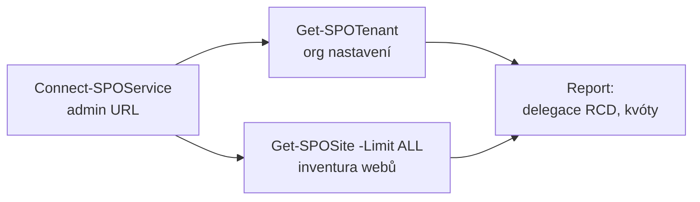

# SharePoint PowerShell (SPO Management Shell)

> Typ: povinný · Den: 2 · Odhad: AM blok · Varianta B: studenti píšou skripty
> Prostředí: [`../../environment.md`](../../environment.md) · Názvosloví: [`../../GLOSSARY.md`](../../GLOSSARY.md)

## Cíle

- Nainstalujete a připojíte **SPO Management Shell** a přečtete stav tenantu přes `Get-*` cmdlety.
- Napíšete krátký reportovací skript: seznam webů a vlastnosti, které jsou důležité pro AI governance.
- Vysvětlíte, které operace jsou tenant-wide a proč je v kurzu spouští jen lektor.

## Proč PowerShell

Centrum pro správu SharePointu je dobré na jednotlivé zásahy: otevřete web, změníte nastavení, hotovo. Jakmile ale potřebujete odpověď pro celý tenant — *které weby existují, kdo je vlastní, kolik zabírají, kde je Copilot vyřazený* — klikání přestává stačit. Microsoft sám doporučuje PowerShell tam, kde spravujete hodně webů nebo uživatelů najednou, a uvádí ho jako efektivní nástroj pro dávkové operace ([Intro to SPO Management Shell](https://learn.microsoft.com/en-us/powershell/sharepoint/sharepoint-online/introduction-sharepoint-online-management-shell)).

Pro správce AI funkcí to má ještě jeden rozměr. Copilot pracuje s obsahem napříč weby, takže governance otázky jsou z principu tenant-wide. Skript, který stav jednou přečte a uloží do CSV, je opakovatelný a porovnatelný v čase. Přesně takový skript v tomto modulu napíšete — a ráno připravený výstup pak odpoledne využijete v modulu [`configuration`](../configuration/).

## Modul a připojení

### Co je SPO Management Shell

SPO Management Shell je PowerShell modul **`Microsoft.Online.SharePoint.PowerShell`** pro správu SharePointu na úrovni organizace i jednotlivých webů. Všechny jeho cmdlety mají v podstatném jménu předponu `SPO` — `Get-SPOSite`, `Set-SPOTenant` a podobně ([Intro to SPO Management Shell](https://learn.microsoft.com/en-us/powershell/sharepoint/sharepoint-online/introduction-sharepoint-online-management-shell)).

Pro aktuálního uživatele bez administrátorských práv na počítači ho nainstalujete takto:

```powershell
Install-Module -Name Microsoft.Online.SharePoint.PowerShell -Scope CurrentUser
```

Modul se vyvíjí spolu se službou a nové vlastnosti (včetně těch souvisejících s Copilotem) přibývají jen v novějších verzích. Proto ho před prací aktualizujte příkazem `Update-Module` ([Get started](https://learn.microsoft.com/en-us/powershell/sharepoint/sharepoint-online/connect-sharepoint-online)).

### Import v PowerShellu 7

V kurzu pracujete v PowerShellu 7 (`pwsh`). Aktuální verze modulu v něm běží nativně, stačí ji načíst:

```powershell
Import-Module Microsoft.Online.SharePoint.PowerShell
```

Tento řádek je ve skriptu **povinný**, ne kosmetický. Manifest modulu exportuje cmdlety zástupným znakem (`CmdletsToExport = *`) a automatické načítání modulů v PowerShellu funguje jen s výslovně vyjmenovanými exporty. Bez explicitního importu proto skončí `Connect-SPOService` chybou „not recognized" — i s aktuální verzí modulu.

Stránka Microsoftu *Get started* dosud uvádí pro PowerShell 7 import s parametrem `-UseWindowsPowerShell`. To platilo pro starší verze modulu. Pokud vám import v `pwsh` spadne na chybě kompatibility, máte v počítači starou verzi — aktualizujte modul a otevřete nové okno ([Get started](https://learn.microsoft.com/en-us/powershell/sharepoint/sharepoint-online/connect-sharepoint-online)).

### Připojení na admin URL

SPO Management Shell se připojuje k **admin endpointu tenantu** (adresa s příponou `-admin`), ne k jednotlivému webu:

```powershell
Connect-SPOService -Url https://<tenant>-admin.sharepoint.com
```

Bez dalších parametrů se otevře interaktivní přihlašovací okno, které zvládne i vícefaktorové ověření (MFA) ([Get started](https://learn.microsoft.com/en-us/powershell/sharepoint/sharepoint-online/connect-sharepoint-online)). Konkrétní adresu kurzovního tenantu najdete v labu.

### Potřebná role

Dokumentace vyžaduje pro práci s cmdlety roli **SharePoint Administrator**. U `Get-SPOSite` navíc uvádí, že uživatel má být i správcem kolekce webů ([Intro to SPO Management Shell](https://learn.microsoft.com/en-us/powershell/sharepoint/sharepoint-online/introduction-sharepoint-online-management-shell), [Get-SPOSite](https://learn.microsoft.com/en-us/powershell/module/microsoft.online.sharepoint.powershell/get-sposite?view=sharepoint-ps)). Jiné role dokumentace jako dostačující neuvádí. Co to znamená pro kurz, popisuje sekce *Naše prostředí*.

## Čtení stavu tenantu

Reportovací skript stojí na dvou cmdletech: jeden čte nastavení organizace, druhý seznam webů. Výstupy obou spojíte do jednoho reportu.



### Get-SPOTenant — nastavení organizace

`Get-SPOTenant` nemá žádné parametry a vrací vlastnosti na úrovni organizace, například kvóty úložiště `StorageQuota` a `StorageQuotaAllocated` ([Get-SPOTenant](https://learn.microsoft.com/en-us/powershell/module/microsoft.online.sharepoint.powershell/get-spotenant?view=sharepoint-ps)).

Pro AI governance je klíčová vlastnost **`DelegateRestrictedContentDiscoverabilityManagement`**. Říká, zda smí vlastníci webů sami zapínat **Restricted Content Discovery (RCD)** — nastavení, které web vyřadí z Copilotu. Jinými slovy: rozhoduje o tom, *kdo* určuje, co Copilot „nevidí" — jen správce, nebo i vlastník webu. Hodnota se nastavuje cmdletem `Set-SPOTenant` ([Set-SPOTenant](https://learn.microsoft.com/en-us/powershell/module/microsoft.online.sharepoint.powershell/set-spotenant?view=sharepoint-ps)). Na tuto hodnotu odpoledne navážete v modulu [`configuration`](../configuration/).

Ve starších materiálech a skriptech narazíte na vlastnost `KnowledgeAgentScope`. Sloužila k zapínání Copilot in SharePoint během preview. Microsoft ji spolu s `KnowledgeAgentSelectedSitesList` a `KnowledgeAgentSelectedSitesListOperation` při přechodu do GA vyřadil a dřívější nastavení ctil jen do 1. 11. 2026. Dostupnost Copilot in SharePoint dnes řídí **Site AI settings** (panel vlastníka webu) a **RCD** ([Get started with Copilot in SharePoint](https://learn.microsoft.com/en-us/sharepoint/copilot-in-sharepoint-get-started)).

### Get-SPOSite — inventura webů

`Get-SPOSite` vrací kolekce webů. Parametr `-Limit` má výchozí hodnotu **200**; pro úplný výpis použijte `-Limit ALL` ([Get-SPOSite](https://learn.microsoft.com/en-us/powershell/module/microsoft.online.sharepoint.powershell/get-sposite?view=sharepoint-ps)).

Všimněte si důležité pasti. Když použijete `-Limit` nebo `-Filter`, řada vlastností webu **se nenačte a vrátí výchozí hodnotu** — mimo jiné `SharingCapability` nebo `SensitivityLabel`. Hromadný výpis tedy může vypadat úplně, a přitom ukazovat nepravdivé hodnoty. Pro tyto vlastnosti čtěte web jednotlivě přes `Get-SPOSite -Identity <url>`. V produkci je to častý zdroj chybných reportů ([Get-SPOSite](https://learn.microsoft.com/en-us/powershell/module/microsoft.online.sharepoint.powershell/get-sposite?view=sharepoint-ps)).

### IsAuthoritative — „oficiální" weby

Novější vlastnost webu **`IsAuthoritative`** dává Microsoft Search, Copilotu a dalším AI agentům signál, že obsah webu je oficiální, důvěryhodný a ověřený. `Get-SPOSite` umí takové weby vyfiltrovat parametrem `-IsAuthoritative` nebo serverovým filtrem `-Filter { IsAuthoritative -eq true }` ([Get-SPOSite](https://learn.microsoft.com/en-us/powershell/module/microsoft.online.sharepoint.powershell/get-sposite?view=sharepoint-ps)). V labu ji přidáte jako rozšíření reportu a v navazujícím návodu ji zkombinujete s RCD.

## Set-* = tenant-wide

Cmdlety `Get-*` jen čtou — můžete je spouštět opakovaně a souběžně, nic nerozbijí. Cmdlety `Set-*` zapisují. A `Set-SPOTenant` mění nastavení **celé organizace**: v kurzovním tenantu by jedna změna zasáhla všech 20 studentů najednou. Proto v kurzu zapisuje do tenantu jen lektor jako demo; vy čtete a píšete skripty.

Ze stejného důvodu se reportovací skript píše tak, aby *nejdřív* šel spustit jen se čtením. Žádný `Set-*` v inventuře nemá co dělat — a kontrola labu to ověřuje.

## Klíčové rozlišení

- **SPO Management Shell vs. PnP.PowerShell.** Kurz pracuje s modulem SPO: pokrývá správu tenantu, SAM včetně RCD i `IsAuthoritative`. PnP.PowerShell je komunitní nástroj zaměřený hlavně na obsah webů a pro rozsah kurzu ho nepotřebujete (viz [`GLOSSARY.md`](../../GLOSSARY.md)).
- **Get vs. Set.** Čtení je bezpečné a paralelní; zápis je tenant-wide a v kurzu výhradně lektorský.
- **Hromadný vs. jednotlivý výpis.** `Get-SPOSite -Limit ALL` je rychlý přehled; přesné hodnoty sdílení a štítků dává jen dotaz na konkrétní web.

## Naše prostředí

Kurzovní tenant má 20 studentských účtů (viz [`environment.md`](../../environment.md)). Dokumentovanou roli SharePoint Administrator studenti nemají, a proto v tomto modulu platí **varianta B**: skripty píšete celé sami a jejich spuštění proběhne v režimu, který vyhlásí lektor — buď běh pod vlastním účtem, nebo běh vybraných skriptů na projektoru. Výsledek je pro vás stejný: hotový skript a výstup, nad kterým odpovídáte na otázky labu.

## Shrnutí

- SPO Management Shell (`Microsoft.Online.SharePoint.PowerShell`) spravuje SharePoint na úrovni tenantu i webů; připojuje se na admin URL.
- V PowerShellu 7 je explicitní `Import-Module` povinný; modul udržujte aktuální.
- `Get-SPOTenant` čte nastavení organizace (mimo jiné delegaci RCD), `Get-SPOSite -Limit ALL` seznam webů — s `-Limit`/`-Filter` ale část vlastností vrací výchozí hodnoty.
- `KnowledgeAgentScope` je vyřazený; dostupnost Copilot in SharePoint řídí Site AI settings a RCD.
- `Set-SPOTenant` je tenant-wide — v kurzu ho spouští jen lektor.

## Lab

[`lab-spo-scripting.md`](lab-spo-scripting.md) — inventura tenantu skriptem.

Navazující návod: [`guide-copilot-inventory.md`](guide-copilot-inventory.md) — inventarizace nastavení Copilot in SharePoint (RCD + `IsAuthoritative` → efektivní dostupnost a governance konflikty per web).

## Zdroje (Microsoft)

- **Modul a připojení:** [Get started with SPO Management Shell](https://learn.microsoft.com/en-us/powershell/sharepoint/sharepoint-online/connect-sharepoint-online) · [Intro to SPO Management Shell](https://learn.microsoft.com/en-us/powershell/sharepoint/sharepoint-online/introduction-sharepoint-online-management-shell)
- **Cmdlety:** [Cmdlet reference](https://learn.microsoft.com/en-us/powershell/module/microsoft.online.sharepoint.powershell/?view=sharepoint-ps) · [Get-SPOSite](https://learn.microsoft.com/en-us/powershell/module/microsoft.online.sharepoint.powershell/get-sposite?view=sharepoint-ps) · [Get-SPOTenant](https://learn.microsoft.com/en-us/powershell/module/microsoft.online.sharepoint.powershell/get-spotenant?view=sharepoint-ps) · [Set-SPOTenant](https://learn.microsoft.com/en-us/powershell/module/microsoft.online.sharepoint.powershell/set-spotenant?view=sharepoint-ps)
- **Copilot in SharePoint:** [Get started with Copilot in SharePoint](https://learn.microsoft.com/en-us/sharepoint/copilot-in-sharepoint-get-started)

## Stav produktu / delta

> [!WARNING] Ověřit k datu běhu — stav k 2026-11.
>
> - Funkce související s Copilotem vyžadují modul **16.0.26615.12013** nebo novější — před kurzem aktualizovat na aktuální verzi z PowerShell Gallery ([Get started with Copilot in SharePoint](https://learn.microsoft.com/en-us/sharepoint/copilot-in-sharepoint-get-started)).
> - Copilot in SharePoint je od 30. 9. 2026 v **GA rolloutu**; preview parametry `KnowledgeAgent*` byly ctěny do 1. 11. 2026. Reference `Set-SPOTenant` je k 2026-11 stále uvádí.
> - Stránka *Get started* stále doporučuje pro PowerShell 7 `-UseWindowsPowerShell`, aktuální verze modulu ho nepotřebují.
