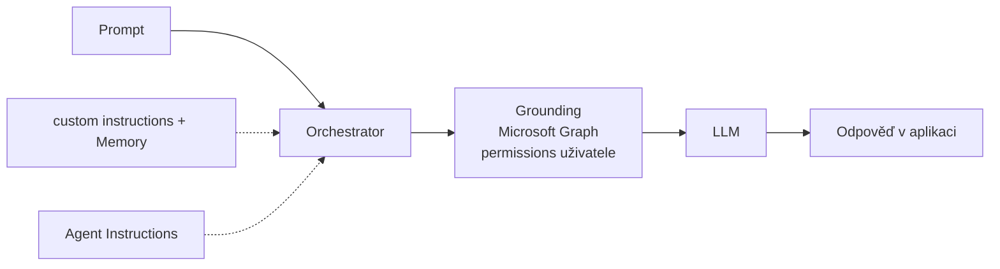

# Základy promptování a agentní anatomie

> Typ: povinný · Den: 2 (otvírák) · Odhad: AM blok
> Prostředí: viz [`../../environment.md`](../../environment.md) · Názvosloví: [`../../GLOSSARY.md`](../../GLOSSARY.md)

## Cíle

- Napíšete prompt se čtyřmi částmi (cíl, kontext, očekávání, zdroj) a umíte ho iterovat.
- Vysvětlíte roli Orchestratoru: co se s promptem děje mezi odesláním a odpovědí.
- Rozlišíte pojmy **Prompt · Orchestrator · Context · custom instructions · Memory · Agent Instructions** a víte, kdo kterou vrstvu nastavuje.

## Proč začínat promptem

Všechno, co v dalších dnech uvidíte — Copilot in SharePoint, Skills, Cowork, agenty v Agent Builderu i v Agents Toolkitu — stojí na stejném principu: někdo napíše text, Copilot ho doplní o data z tenantu a jazykový model z toho sestaví odpověď. Rozdíl mezi nástroji je hlavně v tom, **kdo** ten text píše a **jak dlouho** platí. Jednou je to váš jednorázový dotaz, jindy trvalé nastavení vašeho profilu, jindy instrukce, které tvůrce agenta napsal pro všechny jeho uživatele.

Kdo tyto vrstvy nerozliší, hledá chybu na špatném místě: přepisuje prompt, když problém je v instrukcích agenta, nebo se diví, proč si Copilot „pamatuje" něco, co v konverzaci nezaznělo. Modul proto má dvě poloviny — nejdřív řemeslo (jak napsat dobrý prompt), pak anatomii (co se s ním děje a co dalšího do odpovědi mluví).

## 1. Anatomie promptu

Microsoft popisuje dobrý prompt čtyřmi částmi. Povinný je jen **cíl** — ostatní části odpověď zpřesňují ([Writing prompts](https://support.microsoft.com/en-us/microsoft-365-copilot/get-started-writing-prompts-in-microsoft-365-copilot)):

| Část | Otázka | Příklad |
|---|---|---|
| **Cíl** | Co chci? | „Shrň reklamační proces…" |
| **Kontext** | Proč a pro koho? | „…pro nového kolegu na helpdesku…" |
| **Očekávání** | Jak má vypadat výstup? | „…jako 5 odrážek česky…" |
| **Zdroj** | Odkud čerpat? | „…z dokumentů v této knihovně." |

Proč na každé části záleží:

- **Cíl** říká, jaký úkon chcete — shrnout, porovnat, navrhnout, vytáhnout. Bez něj model hádá.
- **Kontext** mění tón a hloubku. Shrnutí pro vedení vypadá jinak než pro nováčka, i když vychází ze stejných dokumentů.
- **Očekávání** určuje tvar výstupu: formát (tabulka, odrážky), délku, jazyk. Právě tady je nejrychlejší zisk — „tabulka, max. 5 řádků" se dá na výstupu snadno zkontrolovat.
- **Zdroj** zužuje, odkud Copilot čerpá. „Jen z dokumentů v této knihovně" omezí riziko, že odpověď smíchá váš obsah s něčím jiným.

Promptování je **iterace**. První odpověď je začátek konverzace, ne konec: navazujícím promptem výstup zkrátíte, přeformátujete nebo doplníte o citace. Microsoft s takovým dialogem výslovně počítá. Stejně tak upozorňuje, že odpověď může obsahovat nesprávný obsah, a výstupy je proto potřeba ověřovat ([Writing prompts](https://support.microsoft.com/en-us/microsoft-365-copilot/get-started-writing-prompts-in-microsoft-365-copilot)).

V labu si to vyzkoušíte na vlastním webu: stejnou potřebu napíšete třikrát — holý cíl, plná anatomie, iterace — a zapíšete, co konkrétně se ve výstupu změnilo. Inspiraci pro další prompty najdete v [Prompt Gallery](https://adoption.microsoft.com/en-us/copilot/prompt-gallery/).

## 2. Orchestrator — co se děje s promptem

Když prompt odešlete, nejde rovnou do jazykového modelu. Mezi vámi a modelem stojí **Orchestrator** — řídicí vrstva, která rozhodne, jaká data k dotazu dohledat, sestaví z nich obohacený prompt, předá ho modelu a výsledek vrátí do aplikace:

Postup krok za krokem:

1. **Prompt** — váš text, plus kontext aplikace (např. web, na kterém máte otevřený panel Copilot).
2. **Grounding přes Microsoft Graph** — Orchestrator dohledá v tenantu relevantní obsah. Vidí přitom jen to, na co má uživatel oprávnění (RBAC): grounding je *permissions-trimmed*.
3. **LLM** — model dostane obohacený prompt a vygeneruje odpověď.
4. **Odpověď v aplikaci** — výsledek se vrátí tam, kde jste se ptali.

Celé zpracování probíhá uvnitř **Microsoft 365 service boundary** a respektuje Conditional Access i MFA ([Copilot architecture](https://learn.microsoft.com/en-us/microsoft-365/copilot/microsoft-365-copilot-architecture), [Data protection architecture](https://learn.microsoft.com/en-us/copilot/plan/architecture-data-protection-auditing)).

Přerušované šipky v diagramu ukazují, že do Orchestratoru vstupuje víc než jen váš prompt: custom instructions, Memory a u agentů i Agent Instructions. Těm se věnuje další kapitola.

Pro správce je klíčový krok 2. Copilot nerozšiřuje oprávnění — pokud uživatel dokument nevidí v SharePointu, neuvidí ho ani v odpovědi. Platí to i obráceně: když je obsah přesdílený, Copilot ho najde. Datové hranice a grounding jste probírali v D1 [`ai-landscape`](../../day-1/ai-landscape/README.md); v labu si permission-trimming ověříte sami dotazem na web spolužáka, ke kterému nemáte přístup.

## 3. Vrstvy instrukcí — kdo mluví do odpovědi

Odpověď Copilota neovlivňuje jen to, co právě napíšete. Do Orchestratoru vstupuje několik vrstev textu, které se liší tím, kdo je nastavuje, jak dlouho platí a kde jsou uložené:

| Vrstva | Kdo nastavuje | Trvání | Kde |
|---|---|---|---|
| **Prompt** | uživatel | jedna otázka | chat |
| **Context** | konverzace + grounding | jedna session | context window |
| **custom instructions** | uživatel | trvale (jeho profil) | Copilot nastavení (**Settings > Personalization**); uložené spolu s Memory v mailboxu |
| **Memory** | Copilot (odvozené) + uživatel | trvale | skrytá složka v Exchange mailboxu |
| **Agent Instructions** | tvůrce agenta | život agenta | manifest agenta (max 8 000 znaků) |

### Prompt a Context

**Prompt** je jedna otázka. **Context** je všechno, co model v dané konverzaci „má před sebou": předchozí otázky a odpovědi a obsah dohledaný groundingem. Proto funguje iterace — follow-up prompt „zkrať to na 10 slov" dává smysl jen díky tomu, že předchozí odpověď je v kontextu. Když konverzaci ukončíte, kontext zmizí.

### custom instructions a Memory

**custom instructions** si nastavuje uživatel sám pro sebe: například „odpovídej česky a stručně". Platí trvale pro všechny jeho konverzace.

**Memory** jsou trvalé poznámky o uživateli napříč konverzacemi. Část si uživatel uloží sám, část Copilot odvodí z historie chatu. Microsoft k ní uvádí několik faktů, které jsou pro správce podstatné ([Manage personalization & memory](https://learn.microsoft.com/en-us/microsoft-365/copilot/copilot-personalization-memory)):

- Memory a personalizace jsou **preview** (Frontier program) a chování se může měnit.
- Fungují i pro Copilot Chat **bez** plné Copilot licence.
- Paměť — uložené vzpomínky, detaily z historie chatu i custom instructions — leží ve **skryté složce Exchange mailboxu** uživatele, a dědí tak ochrany mailboxu, například Customer Lockbox a šifrování v klidu.
- Admin ovladač **Enhanced personalization** je ve výchozím stavu **zapnutý**. Správce ho může vypnout pro uživatele nebo celý tenant.
- **Retenční politiky a štítky Purview** se na paměť **nevztahují** a akce s pamětí **negenerují záznamy v auditu**. Uložené a odvozené vzpomínky ale správce přes eDiscovery dohledá a ve spojení s Microsoft Graph Explorerem i smaže; custom instructions dohledatelné zatím nejsou.

Z pohledu governance je to důležitý detail: Memory je trvalá vrstva, kterou běžná retence nezachytí. K monitoringu a auditu se vrátíte v D5.

### Agent Instructions

**Agent Instructions** píše tvůrce agenta a platí pro všechny jeho uživatele po celý život agenta. Jsou součástí manifestu a mají limit 8 000 znaků. Microsoft doporučuje strukturu **purpose → guidelines → skills** ([Declarative agent instructions](https://learn.microsoft.com/en-us/microsoft-365/copilot/extensibility/declarative-agent-instructions)):

- **Purpose** — k čemu agent je.
- **Guidelines** — obecné pokyny, tón a omezení.
- **Skills** — schopnosti agenta. Skills jsou samostatná součást agenta s vlastními instrukcemi; v Agent Instructions se na ně odkazujete jen obecně a jejich kroky nepřepisujete.

Instrukce se píší v **Markdownu** — nadpisy, odrážky a tučné zvýraznění pomáhají modelu pochopit strukturu a pořadí kroků. Tady se vám hodí formáty z D1 [`formats`](../../day-1/formats/README.md).

Jedno pravidlo je bezpečnostní: **instrukce nikdy nedávejte do knowledge zdrojů** (např. do dokumentu v SharePointu, abyste obešli limit 8 000 znaků). Obsah knowledge zdrojů platforma nepovažuje za důvěryhodné instrukce, ale prověřuje ho kvůli riziku **cross-prompt injection (XPIA)** — direktivy z něj mohou být za běhu zablokované nebo oříznuté. Navíc by chování agenta mohl změnit kdokoli, kdo smí dokument editovat. Knowledge slouží k doložení faktů, ne k řízení agenta ([Declarative agent instructions](https://learn.microsoft.com/en-us/microsoft-365/copilot/extensibility/declarative-agent-instructions)).

Tuto tabulku vrstev uvidíte znovu v D4 [`copilot-agents`](../../day-4/copilot-agents/README.md), kde budete instrukce agenta navrhovat.

## Klíčové rozlišení

- **Context vs. Memory**: context je pracovní paměť jedné konverzace a po jejím skončení zmizí; Memory jsou trvalé poznámky o uživateli napříč konverzacemi.
- **custom instructions vs. Agent Instructions**: první říkají „jak mluvit se MNOU" (uživatel je nastavuje sobě), druhé „jak se chová AGENT" (tvůrce je nastavuje všem uživatelům agenta).
- **Grounding vs. context**: grounding je to, co Orchestrator *dohledá* v tenantu (permissions-trimmed); context je to, co už *je* v konverzaci.

## Naše prostředí

Lab běží živě nad Copilot in SharePoint na vašem vlastním webu — máte Copilot licenci, takže běžné funkce Copilot in SharePoint jsou v ceně. Přesto iterujte promyšleně, ne donekonečna. Stejný návyk se vám vyplatí u Cowork a Advanced work, kde každá iterace čerpá Copilot Credits.

## Shrnutí

- Dobrý prompt má cíl, kontext, očekávání a zdroj; povinný je jen cíl a první odpověď je začátek iterace.
- Orchestrator doplní prompt o data z Microsoft Graph — jen ta, ke kterým má uživatel oprávnění — a teprve pak volá model.
- Do odpovědi mluví víc vrstev: prompt, context, custom instructions, Memory a u agentů Agent Instructions; každou nastavuje někdo jiný a platí jinak dlouho.
- Memory je trvalá, uložená v mailboxu, a Purview retence ani audit se na ni nevztahují.
- Agent Instructions patří do manifestu (purpose → guidelines → skills), nikdy do knowledge zdrojů — riziko XPIA.

## Lab

[`lab-prompt-anatomy.md`](lab-prompt-anatomy.md) — anatomie promptu nad vlastním obsahem: tři verze stejného promptu a test hranice oprávnění.

## Zdroje (Microsoft)

- **Psaní promptů:** [Get started writing prompts](https://support.microsoft.com/en-us/microsoft-365-copilot/get-started-writing-prompts-in-microsoft-365-copilot) · [Prompt Gallery](https://adoption.microsoft.com/en-us/copilot/prompt-gallery/)
- **Jak Copilot funguje:** [How does Microsoft 365 Copilot work?](https://learn.microsoft.com/en-us/microsoft-365/copilot/microsoft-365-copilot-architecture) · [Copilot Chat overview](https://learn.microsoft.com/en-us/copilot/overview) · [Data protection architecture](https://learn.microsoft.com/en-us/copilot/plan/architecture-data-protection-auditing)
- **Memory a personalizace:** [Manage Copilot personalization and memory](https://learn.microsoft.com/en-us/microsoft-365/copilot/copilot-personalization-memory)
- **Instrukce agentů:** [Write effective instructions for declarative agents](https://learn.microsoft.com/en-us/microsoft-365/copilot/extensibility/declarative-agent-instructions)

## Stav produktu / delta

> [!WARNING] Ověřit k datu běhu — stav k 2026-11.
>
> - **Memory a personalizace** jsou preview (Frontier); chování i správcovské ovladače se mohou měnit.
> - **Výběr modelu:** Copilot Chat ve výchozím režimu **Auto** vybírá model routerem v reálném čase; dále nabízí **Quick response** a **Think deeper** a volby se mění s novými modely ([Copilot Chat overview](https://learn.microsoft.com/en-us/copilot/overview)). Konkrétní model pod odpovědí se tak mění bez upozornění.
> - **Přechody modelů** podle Microsoftu mohou změnit, jak agent instrukce chápe, hlavně u strukturovaných postupů krok za krokem. Pro rychlou stabilizaci MS doporučuje hlavičku vynucující doslovné provádění. Vzory psaní instrukcí průběžně revidujte podle [Declarative agent instructions](https://learn.microsoft.com/en-us/microsoft-365/copilot/extensibility/declarative-agent-instructions).
