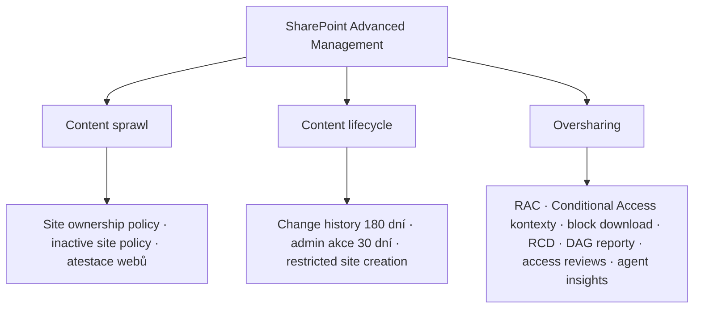

# SharePoint Advanced Management (SAM)

> Typ: povinný · Den: 3 · Odhad: AM/PM blok
> Prostředí: [`../../environment.md`](../../environment.md) · Názvosloví: [`../../GLOSSARY.md`](../../GLOSSARY.md)

## Cíle

- Zařadíte SAM jako **SharePoint vrstvu správy** (weby, obsah, sdílení) v mapě nástrojů pro správu.
- Znáte tři pilíře SAM a umíte pro konkrétní governance problém vybrat vhodnou politiku nebo report.
- Víte, jak se SAM licencuje a proč se o něm mluví jako o „přípravě tenantu na Copilot".

## Proč SAM řešit před Copilotem

Copilot respektuje oprávnění: uživateli ukáže jen obsah, ke kterému má přístup. To zní bezpečně, ale má to háček. V běžném tenantu je spousta obsahu přesdílená — web otevřený celé organizaci, zapomenutý odkaz „kdokoli s odkazem", knihovna sdílená skupině *Everyone except external users*. Dokud se k takovému obsahu dostal jen ten, kdo věděl, kde hledat, problém nebyl vidět. Copilot ale prohledává všechno, k čemu uživatel přístup má, a přesdílený obsah ochotně najde a shrne. **Oversharing se tak stává AI problémem.**

Proto už modul [`sharepoint-intro`](../../day-1/sharepoint-intro/README.md) zdůrazňoval, že kvalita oprávnění je předpokladem bezpečného nasazení Copilota. SharePoint Advanced Management je hlavní nástroj Microsoftu, jak přesdílení v SharePointu a OneDrivu najít a srovnat před rolloutem: reporty ukážou, kde je obsah otevřený příliš široce, a politiky pak přístup nebo viditelnost pro AI omezí. Tato nit pokračuje v D5 modulem [`copilot-admin`](../../day-5/copilot-admin/README.md).

## Tři pilíře SAM

SAM poskytuje správcům governance nástroje pro SharePoint a OneDrive a Microsoft je dělí do tří pilířů: **správa rozrůstání obsahu** (content sprawl), **správa životního cyklu obsahu** (content lifecycle) a **prevence přesdílení** (oversharing). Spravuje se primárně ze SharePoint admin centra; pomocníkem správce je navíc **SharePoint Admin Agent** ([SAM overview](https://learn.microsoft.com/en-us/sharepoint/advanced-management)).

### Content sprawl — weby bez vlastníka a bez života

Tenanty rostou rychleji, než je kdo stihne uklízet: weby po skončených projektech, týmy bez vlastníka, duplicitní obsah. Takový obsah zabírá úložiště a zhoršuje relevanci odpovědí Copilota i agentů, protože ti mohou čerpat ze zastaralých dokumentů. SAM na to má tři politiky:

- **Site ownership policy** — určuje, kdo má za web odpovídat, nastaví minimální počet vlastníků a automaticky upozorní, když web kritéria nesplňuje.
- **Inactive site policy** — najde neaktivní weby a e-mailem upozorní jejich vlastníky.
- **Atestace webů** — vlastníci nebo správci webu pravidelně potvrzují, že údaje o webu sedí: zda je web ještě potřeba, kdo ho vlastní, kdo je členem a jaká má oprávnění a nastavení sdílení.

Všechny tři politiky lze spustit v **simulačním režimu** i v **aktivním režimu** ([SAM features in Copilot licenses](https://learn.microsoft.com/en-us/sharepoint/sharepoint-advanced-management-features-copilot-license)). Simulace vám nejdřív ukáže, které weby by politika zasáhla, aniž by kohokoli obtěžovala e-maily. Teprve když výsledek dává smysl, přepnete politiku do aktivního režimu.

### Content lifecycle — kdo co změnil

Druhý pilíř dává správcům dohledatelnost změn v konfiguraci SharePointu:

- **Katalog webů** (catalog management) — seskupí weby do logických kategorií podle regionů, oddělení, uživatelů, informačních bariér nebo vlastních vlastností.
- **Change history reporty** — sledují změny jednotlivých webů a nastavení organizace **za posledních 180 dní**.
- **Nedávné admin akce** — přehled změn vlastností webu provedených správci (přejmenování, smazání, změna kvóty) **za posledních 30 dní**.
- **Restricted site creation by apps** — určuje, které aplikace třetích stran smějí v organizaci zakládat SharePoint weby.

Všimněte si časových oken. Change history a admin akce jsou provozní nástroj pro rychlou odpověď na otázku „kdo to včera přenastavil", nikoli plnohodnotný audit. Ten patří do Purview a vrátíte se k němu v D5 modulu [`monitoring`](../../day-5/monitoring/).

### Oversharing — nejdůležitější pilíř pro Copilot

Třetí pilíř je vrstvený: nejdřív zjistíte, kde je obsah přesdílený, a pak ho omezíte. Nejprve tedy **reporty**:

- **DAG reporty** (data access governance) ukazují weby, které mohou obsahovat přesdílený nebo citlivý obsah. Patří sem report stavu oprávnění (permission state) pro weby, OneDrive i soubory, report webů dostupných konkrétnímu uživateli, report **sdílecích odkazů** (weby s nejvíce nově vytvořenými odkazy **za posledních 28 dní**) a **EEEU insights** (položky a skupiny sdílené *Everyone except external users* za posledních 28 dní). Report nad sensitivity labels vyžaduje navíc E5.
- **Site access reviews** — z DAG reportu delegujete kontrolu přesdíleného webu na jeho vlastníka. Správce nemusí znát obsah každého webu; rozhodnutí udělá ten, kdo obsahu rozumí.
- **Porovnání politik webů** — vyberete jeden nebo více webů jako vzor a pomocí AI je porovnáte **až s 10 000 cílovými weby**. Najdete tak weby s podobným obsahem, ale odlišným nastavením zabezpečení.
- **Agent insights a agent access insights** — reporty o agentech vytvořených v SharePointu a OneDrivu a o tom, jak agenti s obsahem pracují. SAM se tím rozšiřuje i na governance agentů nad SharePointem.

Na zjištění pak navazují **politiky**:

- **Restricted Access Control (RAC)** — přístup k webu SharePointu nebo OneDrivu dostanou jen členové určených security groups. Kdo ve skupině není, na web se nedostane, i kdyby měl oprávnění nebo odkaz.
- **Restricted Content Discovery (RCD)** — web zůstává přístupný, ale jeho obsah se neobjevuje ve vyhledávání ani v Copilotu, pokud s ním uživatel nedávno nepracoval. Lidé, kteří na webu pracují, ho používají dál; Copilot a vyhledávání z něj ale pro ostatní necitují.
- **Conditional Access přes authentication context** — připojí politiku podmíněného přístupu z Microsoft Entra ke konkrétnímu webu (např. přísnější podmínky přihlášení pro citlivý web).
- **Block download** — zablokuje stahování souborů z webů SharePointu a OneDrivu a záznamů schůzek Teams.

Zdroje k pilířům: [SAM overview](https://learn.microsoft.com/en-us/sharepoint/advanced-management), [SAM features in Copilot licenses](https://learn.microsoft.com/en-us/sharepoint/sharepoint-advanced-management-features-copilot-license).

## Licencování

SAM není jeden SKU, ale sada funkcí se **dvěma odemykacími cestami** ([SAM features in Copilot licenses](https://learn.microsoft.com/en-us/sharepoint/sharepoint-advanced-management-features-copilot-license), [Prerequisites](https://learn.microsoft.com/en-us/sharepoint/sharepoint-advanced-management-prerequisites)):

- **SAM Plan 1 add-on** — samostatná per-user licence. Je to cesta pro organizace, které Copilot nenasazují, ale governance webů potřebují. Cenu Microsoft na stránce neuvádí (viz D1 [`licensing`](../../day-1/licensing/README.md)).
- **Copilot licence** — jakmile má v tenantu aspoň jeden uživatel přiřazenou licenci Microsoft 365 Copilot, získají SharePoint administrátoři přístup k funkcím SAM pro celý tenant. Totéž platí pro **E7**, protože E7 Copilot obsahuje. Sada funkcí je stejná jako u Plan 1 s jedinou dokumentovanou výjimkou: **restricted site creation by apps** vyžaduje Plan 1 i tak.

Pozor na zkratku „SAM zdarma s Copilotem". Copilot licence je dražší než Plan 1 a odemčení SAM je její vedlejší efekt, ne dárek. Logika Microsoftu je jiná: kdo nasazuje Copilot, potřebuje srovnat přesdílení, a proto s Copilotem dostává i nástroje, jak to udělat.

Pro správu SAM existuje role **SharePoint Advanced Management Administrator**. SAM tak jde delegovat bez plné role SharePoint Administrator ([Prerequisites](https://learn.microsoft.com/en-us/sharepoint/sharepoint-advanced-management-prerequisites)). Je to stejný princip nejmenších oprávnění, jaký znáte z role AI Administrator v D1.

## Klíčové rozlišení

- **RAC = přístup, RCD = viditelnost pro AI.** RAC bere lidem *přístup*; RCD bere Copilotu a vyhledávání *viditelnost*, ale lidé, kteří s webem pracují, se dostanou dál. Pro „tajné, ale používané" weby je správně RCD, pro „nikdo tam nemá co dělat" RAC.
- **SAM vs. Purview.** SAM řídí *weby a sdílení* (SharePoint vrstva); Purview řídí *data a compliance* (labely, retence, audit). Doplňují se, nenahrazují. I proto change history (180 dní) a admin akce (30 dní) nejsou náhradou auditu.
- **Licence vs. permissions.** SAM licence odemyká funkce správci; na obsah webů tím správce žádná práva nezískává.

## Naše prostředí

Kurzovní tenant má přiřazené licence Microsoft 365 Copilot (studenti je mají od běhu 2026-11, viz [`environment.md`](../../environment.md)), takže funkce SAM jsou v tenantu odemčené. Licence ale neznamená oprávnění: politiky SAM mají dopad na celý tenant, proto je aplikuje lektor jako SharePoint administrátor. Vy jako Global Reader procházíte SharePoint admin centrum jen pro čtení a ověřujete výsledek.

V labu si projdete celý životní cyklus politiky: přečtete DAG report sdílecích odkazů, sledujete aplikaci inactive site policy nebo RCD na testovacím webu, najdete politiku v admin centru a popíšete její dopad. Pokud to umožnil modul [`powershell-spo`](../../day-2/powershell-spo/) z D2, spustíte znovu inventuru `copilot-inventory.ps1`: u webu s RCD se `RestrictedContentDiscovery` překlopí na `True` a `CopilotAvailable` na `False`. RCD se propisuje se zpožděním, proto není nástrojem okamžité reakce na incident. Nakonec pro svůj web rozhodnete mezi RAC, RCD a ničím.

## Shrnutí

- SAM je SharePoint vrstva správy se třemi pilíři: content sprawl, content lifecycle a oversharing.
- Pro Copilot je klíčový oversharing: nejdřív DAG reporty a access reviews, pak RAC nebo RCD.
- RAC omezuje přístup lidem, RCD jen viditelnost obsahu pro Copilot a vyhledávání.
- SAM odemyká buď Plan 1 add-on, nebo jedna přiřazená Copilot licence v tenantu; restricted site creation by apps vyžaduje Plan 1 vždy.
- SAM licence nedává správci práva na obsah webů a SAM nenahrazuje audit v Purview.

## Lab

[`lab-sam-policies.md`](lab-sam-policies.md) — aplikace a ověření politik, čtení DAG reportu a rozhodnutí RAC / RCD / nic pro váš web.

## Zdroje (Microsoft)

- **Přehled a pilíře:** [SharePoint Advanced Management overview](https://learn.microsoft.com/en-us/sharepoint/advanced-management)
- **Licencování a role:** [SAM features in Copilot licenses](https://learn.microsoft.com/en-us/sharepoint/sharepoint-advanced-management-features-copilot-license) · [SAM prerequisites](https://learn.microsoft.com/en-us/sharepoint/sharepoint-advanced-management-prerequisites)

## Stav produktu / delta

> [!WARNING] Ověřit k datu běhu — stav k 2026-11.
>
> - **Odemčení SAM přes Copilot licenci** ověřte v tenantu před každým během.
> - **Sada funkcí roste po měsících** — overview aktualizovaná 2026-10 přidala agent insights, agent access insights a SharePoint Admin Agent.
> - **Cena SAM Plan 1** — ověřit v ceníku Microsoftu.
> - Stará URL `sharepoint-advanced-management-licensing` přesměrovává na *features-copilot-license*.
