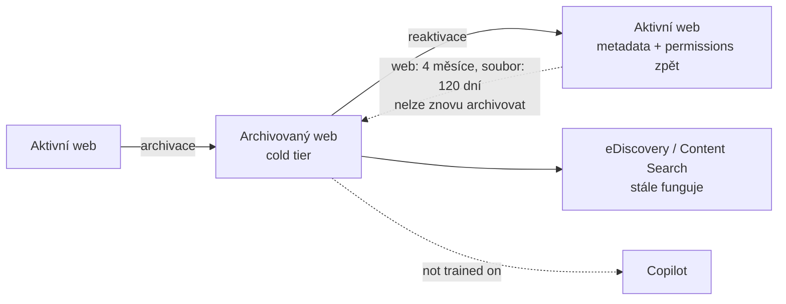

# Microsoft 365 Archive

> Typ: povinný · Den: 3 · Odhad: kratší PM blok
> Prostředí: viz [`../../environment.md`](../../environment.md) · Názvosloví: [`../../GLOSSARY.md`](../../GLOSSARY.md)

## Cíle

- Navrhnete strategii pro „studená" data: co archivovat a co to udělá s přístupem uživatelů a s náklady.
- Rozlišíte, jak archiv spolupracuje s retencí, eDiscovery, vyhledáváním a Copilotem.
- Spočítáte, kdy je archiv zdarma a kdy se za něj platí.

## Proč archivovat

Každý tenant časem nasbírá weby, na které už nikdo nesahá: ukončené projekty, staré intranety, týmy, které se rozpadly. Smazat je většinou nejde — obsah je potřeba uchovat kvůli retenci, auditu nebo pro případ, že ho někdo za rok bude hledat. Zároveň ale zabírají úložiště tenantu, a když dojde kvóta, platí se za další kapacitu.

Microsoft 365 Archive tenhle rozpor řeší třetí cestou: obsah zůstane v SharePointu, ale přesune se do levnějšího „studeného" úložiště. Nemusíte ho exportovat jinam ani stavět vlastní archivní řešení. Microsoft uvádí, že uchování neaktivních dat přímo v SharePointu zjednodušuje vyhledávání, zabezpečení, compliance a správu životního cyklu dat ([Archive overview](https://learn.microsoft.com/en-us/microsoft-365/archive/archive-overview)).

## Výklad

### Co Archive dělá

**Microsoft 365 Archive** je cold storage pro **neaktivní weby SharePointu**. Archivovat lze celý web, nebo jednotlivé soubory na webech, které se jinak dál používají (file-level archive). OneDrive se do archivu dostává jen u **nelicencovaných** účtů — a to tak, že je tam přesune služba OneDrive sama, ne správce ([Archive overview](https://learn.microsoft.com/en-us/microsoft-365/archive/archive-overview), [Manage](https://learn.microsoft.com/en-us/microsoft-365/archive/archive-manage)).

Archivace celého webu je rozhodnutí správce. Pro soubory na živých webech existuje automatická cesta: **inactive files policies v SharePoint Advanced Management (SAM)** archivují soubory podle data posledního přístupu člověka, aniž by archivovaly celý web. Tyto politiky jsou v preview a zatím se nastavují jen přes PowerShell ([Manage](https://learn.microsoft.com/en-us/microsoft-365/archive/archive-manage)).

### Co se s archivovaným obsahem děje

Když web archivujete, přesune se do chladnější vrstvy úložiště a přestane se započítávat do aktivní kvóty tenantu. Archivuje se všechno: knihovny dokumentů se složkami a soubory, seznamy i jejich data, oprávnění a veškerá metadata. Pro uživatele to má čtyři důsledky:

- **Obsah není přímo přístupný** nikomu. Uživatel archivovaný web neotevře, dokud ho správce nereaktivuje. Proto Microsoft doporučuje vlastníky a uživatele předem upozornit.
- **Vyhledávání funguje dál.** Microsoft uvádí, že plnotextové vyhledávání funguje v Purview Content Search, v eDiscovery i v **běžném uživatelském vyhledávání**. Content Search a eDiscovery umí archivovaný obsah i přímo exportovat, jen to může trvat déle. Compliance tedy archivací nekončí.
- **Copilot:** Microsoft uvádí jako výhodu archivu, že „**Copilot is not trained on archived content**, maximizing response relevancy". Víc k tomu dokumentace neříká — zda se archivovaný obsah může objevit v odpovědi Copilota, Microsoft výslovně neuvádí. Neslibujte proto víc, než říká citovaná věta, a chování si ověřte v tenantu.
- **Reaktivace je bezztrátová.** Reaktivovaný web se vrátí do stavu před archivací včetně oprávnění, seznamů, stránek, souborů a metadat. Výjimkou je jen obsah, který mezitím vypršel z koše nebo ho smazala retenční politika.

Zdroje: [Archive overview](https://learn.microsoft.com/en-us/microsoft-365/archive/archive-overview), [Manage](https://learn.microsoft.com/en-us/microsoft-365/archive/archive-manage).

Celý životní cyklus webu v archivu ukazuje diagram. Všimněte si šipky zpět do archivu: reaktivovaný obsah nejde hned znovu archivovat.

### Náklady

Archiv se platí za objem uloženého obsahu: **$0.05/GB/měsíc**. Klíčové je ale pravidlo, kdy se platit začíná. Metr běží **jen tehdy, když aktivní a archivovaná data dohromady překročí licencovanou kvótu úložiště SharePointu** tenantu. Dokud se obojí vejde do kvóty, archiv nic nestojí ([Archive pricing](https://learn.microsoft.com/en-us/microsoft-365/archive/archive-pricing)).

Z toho plyne častý omyl: archivací se data nezmenší, jen se přesunou do levnější vrstvy. Pokud je tenant nad kvótou, archiv vám ušetří rozdíl mezi cenou za archiv a cenou dokoupeného standardního úložiště — ale archivovaná data se pořád sčítají s aktivními. Přesně s tímhle výpočtem pracujete v labu.

K reaktivaci platí:

- **Reaktivační poplatek pro SharePoint byl 31. 3. 2025 zrušen.** Reaktivace je zdarma, ale reaktivovaný web nejde **4 měsíce** znovu archivovat a reaktivovaný soubor **120 dní**. Zámek brání tomu, aby se obsah přelíval tam a zpět.
- **Výjimka:** nelicencované účty OneDrivu platí reaktivaci dál, a to za každý reaktivovaný GB.

Když Archive nebo jeho billing vypnete, archivovaný obsah zůstane archivovaný a dá se dál reaktivovat. Nové archivace se zablokují a archivovaný obsah se do té doby počítá jako aktivní úložiště ([Archive pricing](https://learn.microsoft.com/en-us/microsoft-365/archive/archive-pricing)).

### Nastavení

Archive je PAYG služba a účtuje se přes připojenou Azure subscription — stejný princip, jaký znáte z modulu [`licensing`](../../day-1/licensing/README.md). Nastavení má čtyři kroky:

1. Založit Azure subscription a resource group.
2. V Microsoft 365 admin centru nastavit pay-as-you-go billing.
3. Zapnout Archive: **Settings → Org settings → Pay-as-you-go services → Settings → Storage services → Archive**.
4. Archivovat weby ze **SharePoint admin centra** (stránka **Active sites**; archivované weby pak najdete na stránce **Archived sites**).

Nastavit Archive i archivovat weby smí **SharePoint Administrator** nebo **Global Administrator**. Microsoft doporučuje role s nejmenšími oprávněními, tedy SharePoint Administratora ([Setup](https://learn.microsoft.com/en-us/microsoft-365/archive/archive-setup), [Manage](https://learn.microsoft.com/en-us/microsoft-365/archive/archive-manage)).

Přirozeným vstupem pro archivaci je **inactive site policy** ze SAM, kterou znáte z modulu [`advanced-management`](../advanced-management/README.md): politika najde weby bez aktivity a upozorní vlastníky, Archive je pak uklidí. Druhým zdrojem kandidátů je inventura webů z PowerShell labu v D2 ([`powershell-spo`](../../day-2/powershell-spo/)).

## Klíčové rozlišení

- **Archive vs. Backup.** Archiv je levnější *místo* pro data, která se nepoužívají — pořád je to ale jediná kopie. Backup je *druhá kopie* pro obnovu (modul [`backup`](../backup/README.md)). Při plánování proto zvažte, zda mají kritické archivované weby zůstat i v backup policy.
- **Archive vs. retence.** Retence rozhoduje, *kdy smí obsah zaniknout*; archiv rozhoduje, *kolik stojí jeho skladování*. Retenční politiky a štítky platí i pro archivovaný obsah a retenční hold jde nastavit, aniž byste obsah reaktivovali. Retence proto není důvod web z archivace vyjmout ([Compliance](https://learn.microsoft.com/en-us/microsoft-365/archive/archive-compliance)).
- **Archive vs. RCD.** **Restricted Content Discovery (RCD)** ze SAM je cílený nástroj pro web, který zůstává aktivní a lidé ho používají, jen ho nemá groundovat Copilot ani vyhledávání. Archiv je rozhodnutí o životním cyklu a nákladech webu, který se už nepoužívá. Ke Copilotu u archivu máte od Microsoftu jen větu „not trained on archived content"; uživatelské vyhledávání archivovaný obsah dál najde. Když potřebujete jistotu, že Copilot obsah aktivního webu necituje, je správný nástroj RCD.

## Naše prostředí

Archivace a reaktivace webu jsou v kurzu **instruktorské demo** ze SharePoint admin centra. Vy si v labu navrhnete archivační plán pro modelovou kolekci webů.

## Shrnutí

- Microsoft 365 Archive přesouvá neaktivní weby (a soubory) SharePointu do levnější vrstvy; obsah zůstává v tenantu a reaktivace je bezztrátová.
- Archivovaný obsah není přímo přístupný, ale dohledáte ho v eDiscovery, Content Search i v uživatelském vyhledávání; retence platí dál.
- Ke Copilotu Microsoft uvádí jen „not trained on archived content" — víc neslibujte.
- Platí se $0.05/GB/měsíc, ale jen když aktivní + archivovaná data přesáhnou kvótu tenantu; reaktivace SharePointu je zdarma, s 4měsíčním zámkem.
- Archiv není záloha a nenahrazuje RCD.

## Lab

[`lab-archive-plan.md`](lab-archive-plan.md) — plán archivace pro kolekci webů: kandidáti, výpočet nákladů podle pravidla kvóty a reaktivační pravidlo.

## Zdroje (Microsoft)

- **Produkt a správa:** [Microsoft 365 Archive overview](https://learn.microsoft.com/en-us/microsoft-365/archive/archive-overview) · [Manage](https://learn.microsoft.com/en-us/microsoft-365/archive/archive-manage) · [Setup](https://learn.microsoft.com/en-us/microsoft-365/archive/archive-setup)
- **Náklady:** [Pricing](https://learn.microsoft.com/en-us/microsoft-365/archive/archive-pricing)
- **Compliance:** [Compliance features](https://learn.microsoft.com/en-us/microsoft-365/archive/archive-compliance)

## Stav produktu / delta

> [!WARNING] Ověřit k datu běhu — stav k 2026-11.
>
> - **File-level archive:** stránky Archive ho k 2026-10 už neoznačují jako preview, ale uvádějí omezenou kompatibilitu aplikací (Word a PowerPoint pro web, mobilní aplikace, synchronizace na macOS) a typy souborů, které archivovat nejde (OneNote, stránky, SharePoint agenti). Stav ověřte.
> - **SAM inactive files policies** jsou v preview a nastavují se přes PowerShell. Site Archive je dostupný i v GCC.
> - **Cenu** $0.05/GB/měsíc a pravidlo „zdarma do kvóty" ověřte proti stránce Pricing.
> - **Copilot a archiv:** Microsoft uvádí jen „not trained on archived content". Zda se archivovaný obsah nedostane do odpovědí Copilota, ověřte v tenantu.
