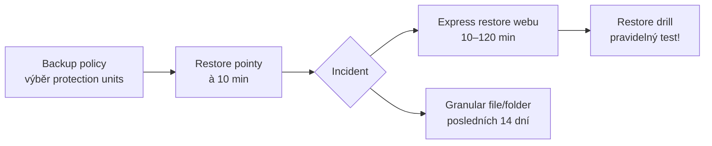

# Microsoft 365 Backup

> Typ: povinný · Den: 3 · Odhad: PM blok (po SAM)
> Prostředí: [`../../environment.md`](../../environment.md) · Názvosloví: [`../../GLOSSARY.md`](../../GLOSSARY.md)

## Cíle

- Znáte rozsah Microsoft 365 Backup (SharePoint, OneDrive, Exchange) a umíte pracovat s jeho čísly RPO a RTO.
- Umíte navrhnout plán obnovy včetně měřitelné testovací kadence (drilu).
- Víte, jak se Backup platí a proč se nepřekrývá s retencí v Purview.

## Proč řešit zálohy, když má SharePoint koš a verze

SharePoint, OneDrive i Exchange mají vestavěnou ochranu: koš, verzování a redundantní kopie dat v datových centrech Microsoftu. Ta ale řeší jiné problémy. Koš a verze vrátí jeden smazaný nebo pokažený soubor. Redundance vás ochrání před výpadkem hardwaru. Ani jedno vás neochrání před situací, kdy útočník nebo chybný skript během pár minut přepíše tisíce souborů na desítkách webů — tehdy je „poškozená" verze ta nejnovější a koš je prázdný, protože nic smazáno nebylo.

Na tento scénář — ransomware, hromadné přepsání nebo smazání, ať úmyslné, nebo omylem — míří **Microsoft 365 Backup**. Jeho hodnota není v tom, že zálohuje, ale v tom, jak **rychle umí vrátit velké objemy dat** do zdravého stavu ([Backup overview](https://learn.microsoft.com/en-us/microsoft-365/backup/backup-overview)). Přesně takový incident řešíte v labu: škodlivý skript přepsal obsah dvou kritických webů a koš nestačil.

## Výklad

### Co chrání a kde data žijí

Microsoft 365 Backup je samostatný produkt v GA, který zálohuje **SharePoint weby, OneDrive účty a Exchange mailboxy** — všechny, nebo jen vybrané. Jednotlivým zálohovaným objektům (web, OneDrive účet, mailbox) Microsoft říká **protection units**; vybíráte je v **backup policy**. Backup je dostupný i pro organizace v GCC ([Backup overview](https://learn.microsoft.com/en-us/microsoft-365/backup/backup-overview), [Setup](https://learn.microsoft.com/en-us/microsoft-365/backup/backup-setup)).

Klíčová architektonická vlastnost: zálohy vznikají **uvnitř datové hranice (trust boundary) Microsoft 365** a respektují data residency tenantu. Data hranici neopouštějí; do Azure odchází jen omezená metadata (např. ID tenantu a webů) pro účely billingu ([Backup overview](https://learn.microsoft.com/en-us/microsoft-365/backup/backup-overview)). Pro vás to znamená, že zavedení Backupu nevytváří novou kopii dat mimo tenant — datová suverenita zůstává zachovaná, což je u compliance posouzení dobrá zpráva.

Druhou vlastností je **append-only úložiště**: služba umí do zálohy jen přidávat nové bloky, nikdy nepřepsat staré. Útočník, který získá přístup k živým datům, tak nemůže zpětně „otrávit" starší restore pointy. Smazání záloh ale zablokované není — organizace musí mít možnost Backup opustit (offboarding), mimo jiné kvůli GDPR. Proti nechtěnému smazání proto existují dvě pojistky: **90denní ochranná lhůta** po offboardingu, během níž lze zálohy ještě obnovit, a **e-mailové notifikace více adminům** při potenciálně škodlivých akcích, jako je vypnutí Backupu nebo odebrání objektů z policy ([Backup overview](https://learn.microsoft.com/en-us/microsoft-365/backup/backup-overview), [Setup](https://learn.microsoft.com/en-us/microsoft-365/backup/backup-setup)).

### RPO / RTO

Dvě zkratky, se kterými budete v labu počítat:

- **RPO (recovery point objective)** — jak blízko před incidentem leží poslední použitelný restore point, tedy kolik dat nejvýš ztratíte.
- **RTO (recovery time objective)** — jak dlouho obnova trvá, tedy jak dlouho je provoz omezený.

| Parametr | SharePoint / OneDrive | Exchange |
|---|---|---|
| Restore pointy | à 10 min po dobu 2 týdnů, pak týdenní po celé okno obnovy | à 10 min po dobu 52 týdnů |
| Okno obnovy (recovery window) | nastavitelné v backup policy: 3 nebo 6 měsíců, nebo 1–10 celých let (stávající policy default 1 rok) | nastavitelné: 3 nebo 6 měsíců, 1 nebo 2 roky (default 1 rok) |
| RTO | 1–3 TiB/h (medián, hromadná obnova); express restore jednoho webu 10–120 min | 100–500 položek/mailbox/min |

Zdroj tabulky: [Backup overview](https://learn.microsoft.com/en-us/microsoft-365/backup/backup-overview).

Desetiminutové restore pointy znamenají, že při incidentu odhaleném do dvou týdnů ztratíte nejvýš deset minut práce — v labu proto hledáte poslední bod těsně před časem útoku. Starší incidenty už obnovíte jen k týdennímu bodu. Hodnoty RTO jsou mediány z benchmarků Microsoftu; nejrychlejší obnovu webu nebo OneDrivu dává tzv. **express restore point**, který vám nabídne průvodce obnovou, a obnova na stejnou URL ([Backup overview](https://learn.microsoft.com/en-us/microsoft-365/backup/backup-overview)).

**Granularita obnovy** se liší podle workloadu:

- **SharePoint a OneDrive** — obnova celého webu nebo účtu je **rollback**: web se vrátí do stavu v daném okamžiku a přepíše se veškerý obsah i metadata změněné od té doby. Proto v labu musíte vyřešit, jak dohledáte legitimní změny provedené po incidentu.
- **Vybrané soubory a složky** lze obnovit jen z restore pointů za **posledních 14 dní**. Dokumentace uvádí i obnovu verze souboru, která soubor vrátí do dřívějšího stavu a zachová předchozí verze.
- **Exchange** obnovuje jednotlivé položky (pošta, kontakty, kalendář, úkoly) nebo celý mailbox; vrací jen změněné a smazané položky.

Zdroj: [Backup overview](https://learn.microsoft.com/en-us/microsoft-365/backup/backup-overview).

Backup má **škálovací limity**, které platí pro každý workload zvlášť: nejvýš 1 000 000 položek, 100 backup policies a 100 000 položek v jedné policy. Kdo potřebuje víc, řeší to přímo s Microsoftem ([Backup overview](https://learn.microsoft.com/en-us/microsoft-365/backup/backup-overview)).

### Setup a role

Backup je služba s platbou za spotřebu (PAYG), takže první krok je billing: potřebujete **Azure subscription** (s rolí Owner nebo Contributor), resource group a region. Noví zákazníci nastavují PAYG v uzlu **Billing** v Microsoft 365 admin center; stávající zákazníci mají billing ve Setup a mohou ho do nového prostředí migrovat. Teprve pak v **Settings → Microsoft 365 Backup** vytvoříte backup policies ([Setup](https://learn.microsoft.com/en-us/microsoft-365/backup/backup-setup)). Jde o stejné Azure „potrubí", jaké znáte z document processing — ale Backup je samostatný produkt se samostatným metrem (viz [`GLOSSARY.md`](../../GLOSSARY.md)).

Zapnout Backup smí **SharePoint Administrator** nebo **Global Administrator**. Pro každodenní provoz rozhoduje role, protože určuje, které workloady admin spravuje:

| Role | OneDrive | SharePoint | Exchange |
|---|---|---|---|
| Global Administrator | ✓ | ✓ | ✓ |
| SharePoint Administrator | ✓ | ✓ | |
| Exchange Administrator | | | ✓ |
| Microsoft 365 Backup Administrator | ✓ | ✓ | ✓ |

Zdroj: [Setup](https://learn.microsoft.com/en-us/microsoft-365/backup/backup-setup).

Vyhrazená role **Microsoft 365 Backup Administrator** pokryje všechny tři workloady, aniž by dávala další práva nad SharePointem či Exchange — to je least privilege v praxi. V labu proto určujete, kdo tuto roli dostane (roli, ne jméno). Koncoví uživatelé zálohy ani obnovy spouštět nemohou.

### Cena

Backup stojí **$0.15 za GiB chráněného obsahu měsíčně; obnovy jsou zdarma**. Žádné další poplatky za Azure úložiště nebo API nevznikají — Azure slouží jen jako platební kanál ([Pricing](https://learn.microsoft.com/en-us/microsoft-365/backup/backup-pricing)).

Účtovaná velikost se skládá ze dvou částí:

1. **Živý obsah** chráněných objektů — velikost webů a OneDrivů podle reportů využití (včetně koše 1. stupně) a velikost mailboxů včetně online archivu.
2. **Smazaná a verzovaná data držená pro obnovu** — obsah koše 2. stupně a smazané a verzované položky v mailboxech.

Z toho plyne praktický důsledek: když na chráněném webu smažete polovinu obsahu, účet hned neklesne. Smazaná data se drží v záloze a platíte za ně, dokud neuplyne nastavené okno obnovy. **Delší okno obnovy tedy znamená víc účtovaných dat.** Frekvence restore pointů naopak cenu podstatně neovlivňuje ([Pricing](https://learn.microsoft.com/en-us/microsoft-365/backup/backup-pricing)).

V labu počítáte zjednodušeně: GiB × $0.15 = $/měsíc. Pro reálný odhad nabízí Microsoft excelovou kalkulačku ([Backup pricing calculator](https://aka.ms/M365BackupCalculator)).

## Klíčové rozlišení

- **Backup vs. retence (Purview).** Retence řídí *životní cyklus obsahu* — co se musí jak dlouho uchovat a kdy smazat (compliance). Backup řídí *obnovitelnost* — jak rychle se vrátíte do zdravého stavu (provoz). Retenční a mazací politiky Purview okno obnovy záloh **neovlivňují**; jsou to nezávislé systémy.
- **Backup vs. koš a verze.** Koš a verzování chrání před drobnými chybami jednotlivců. Backup chrání před hromadnou ztrátou (ransomware, škodlivý skript), tedy před scénářem, kdy koš nepomůže, protože obsah byl přepsán, ne smazán.
- **Plán bez drilu není plán.** Čísla RTO platí, jen když obnovu někdo pravidelně zkouší a měří. Proto lab končí testovací kadencí.
- **Microsoft 365 Backup ≠ „SharePoint backup" ≠ Azure Backup.** Produkt kryje i OneDrive a Exchange a s Azure Backup nemá nic společného.

## Naše prostředí

Zapnutí Backupu a obnova jsou operace na úrovni celého tenantu s platbou za spotřebu, proto je v kurzu uvidíte jako **instruktorské demo**. Vy sami děláte posture review a restore plán v labu.

## Shrnutí

- Microsoft 365 Backup chrání SharePoint, OneDrive a Exchange před hromadnou ztrátou; zálohy zůstávají uvnitř hranice Microsoft 365 a jsou append-only.
- Restore pointy à 10 minut (u SharePointu a OneDrivu po dva týdny) určují RPO; express restore webu trvá 10–120 minut.
- Obnova celého webu je rollback — přepíše i legitimní změny po zvoleném bodu.
- Cena $0.15/GiB/měsíc chráněného obsahu, obnovy zdarma; delší okno obnovy zvyšuje účtovaný objem.
- Backup ≠ retence: retence řeší compliance, backup obnovitelnost. Bez pravidelného drilu nemáte ověřené RTO.

## Lab

[`lab-backup-restore.md`](lab-backup-restore.md) — backup posture review a restore drill.

## Zdroje (Microsoft)

- **Produkt a architektura:** [Microsoft 365 Backup overview](https://learn.microsoft.com/en-us/microsoft-365/backup/backup-overview)
- **Nastavení a role:** [Setup](https://learn.microsoft.com/en-us/microsoft-365/backup/backup-setup)
- **Cena:** [Pricing](https://learn.microsoft.com/en-us/microsoft-365/backup/backup-pricing) · [Backup pricing calculator](https://aka.ms/M365BackupCalculator)

## Stav produktu / delta

> [!WARNING] Ověřit k datu běhu — stav k 2026-11.
>
> - **Obnova souborů/složek a verzí souborů:** dokumentace ji k 11/2026 uvádí jako funkci (soubory a složky jen z posledních 14 dní), dřívější „public preview" / „coming soon" už nezmiňuje — ověřit, zda je GA.
> - **Okno obnovy** je nastavitelné (SharePoint/OneDrive až 10 let, Exchange až 2 roky); delší okno = víc účtovaných dat.
> - **Billing:** noví zákazníci nastavují PAYG v uzlu Billing, stávající migrují ze Setup — ověřit, kde je to v tenantu.
> - **Cena** $0.15/GiB/měsíc — ověřit proti pricing stránce.
