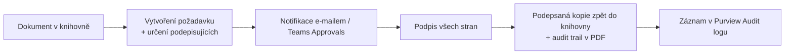

# Scénáře eSignature

> Typ: povinný · Den: 3 (otvírák) · Odhad: AM blok
> Prostředí: viz [`../../environment.md`](../../environment.md) · Názvosloví: [`../../GLOSSARY.md`](../../GLOSSARY.md)

## Cíle

- Zasadíte SharePoint eSignature do rodiny Document processing a víte, kdy sáhnout po partnerském poskytovateli (Adobe Acrobat Sign, Docusign).
- Znáte úrovně elektronického podpisu podle **eIDAS** (SES/AES/QES), víte, že SharePoint eSignature je SES, a umíte z toho odvodit výběr nástroje.
- Rozumíte podpisovému procesu od schválení po podpis, včetně auditu a vazby na retenci.
- Víte, jak se eSignature platí (PAYG) a kdo ho zapíná.

## Proč se podpisem zabývat

Podpis je bod, ve kterém se dokument mění z pracovního souboru na závazný záznam. Dokud se smlouvy tisknou, podepisují a skenují, vzniká mimo SharePoint papírová stopa, kterou nikdo neřídí: nevíte, kdo co kdy podepsal, kde je originál a jak dlouho se má držet. Elektronický podpis přímo v knihovně tento zlom odstraňuje — dokument zůstává pod stejnými oprávněními, retencí a auditem jako zbytek obsahu.

Pro správce z toho plynou tři otázky, které modul postupně zodpoví: **Jaký nástroj** (nativní služba Microsoftu, nebo partner)? **Jak silný podpis** daný dokument potřebuje? A **co se děje s dokumentem a stopou** po podpisu?

## Výklad

### Co to je a kdo podepisuje

**SharePoint eSignature** je služba pro elektronické podepisování dokumentů přímo v SharePointu. Produktově patří pod **Document processing for Microsoft 365** — stejnou rodinu, ze které jste v D2 poznali autofill columns a image tagging — v uživatelském rozhraní ale stále nese název „SharePoint eSignature" (viz glosář). Podepsat jde dokument ve formátu **PDF i Word**. Podpis z Wordu je dostupný jen uživatelům na kanálech Microsoft 365 Beta, Current a Monthly Enterprise; správce ho navíc musí zapnout zvlášť ([Overview of eSignature](https://learn.microsoft.com/en-us/microsoft-365/documentprocessing/esignature-overview), [Set up eSignature](https://learn.microsoft.com/en-us/microsoft-365/documentprocessing/esignature-setup)).

Kdo smí požadavek vytvořit, neurčuje licence, ale oprávnění: služba vytváří pro podepisující odkaz pro sdílení, a proto musí mít žadatel k dokumentu **oprávnění upravovat a sdílet**. Podepsaná kopie se uloží do **původní složky** dokumentu, takže žadatel potřebuje k této složce právo zápisu i v okamžiku dokončení. Když mu ho mezitím někdo odebere nebo složku smaže, služba kopii uložit nemusí ([Overview](https://learn.microsoft.com/en-us/microsoft-365/documentprocessing/esignature-overview), [Set up eSignature](https://learn.microsoft.com/en-us/microsoft-365/documentprocessing/esignature-setup)).

Podepisující mohou být uvnitř i vně organizace. **Externí podepisující** vstupuje do tenantu jako **host přes Microsoft Entra B2B**. Pokud v tenantu ještě hostem není, musí být zapnutá integrace Microsoft Entra B2B pro SharePoint a OneDrive a sdílení s hosty. Toto rozhodnutí patří do bezpečnostního posouzení — zapnutím eSignature pro externisty zároveň otevíráte cestu novým hostům ([Set up eSignature](https://learn.microsoft.com/en-us/microsoft-365/documentprocessing/esignature-setup)).

Vedle nativní služby jsou integrovaní dva **partnerští poskytovatelé: Adobe Acrobat Sign a Docusign eSignature**. Požadavek spustíte ze SharePointu, podpisový proces a notifikace ale řídí poskytovatel; podepsaná kopie se pak automaticky vrátí do SharePointu. Dříve se ukládala do složky `Apps\Signed documents\<poskytovatel>`, od rolloutu v září až listopadu 2025 se ukládá zpět do **původní složky** dokumentu. Integrace s partnery funguje **jen nad PDF** ([Overview](https://learn.microsoft.com/en-us/microsoft-365/documentprocessing/esignature-overview), [Set up eSignature](https://learn.microsoft.com/en-us/microsoft-365/documentprocessing/esignature-setup)).

### Flow podpisu

Diagram ukazuje životní cyklus jednoho požadavku. Všimněte si, že dokument celou dobu neopouští SharePoint: podepisuje se pracovní kopie a výsledek se vrací do knihovny, ze které vyšel.

Po vytvoření požadavku služba pořídí **pracovní kopii** dokumentu a tu rozešle podepisujícím. Podpis se do pracovní kopie vepíše až ve chvíli, kdy podepíšou všichni — do té doby se dokument tváří jako nepodepsaný, i když už některá strana podepsala. Výsledkem je podepsaná kopie v původní složce a digitální audit trail, kterým lze ověřit pravost dokumentu a průběh transakce ([Overview](https://learn.microsoft.com/en-us/microsoft-365/documentprocessing/esignature-overview), [Set up eSignature](https://learn.microsoft.com/en-us/microsoft-365/documentprocessing/esignature-setup)).

### Právní rámec — eIDAS (nařízení EU č. 910/2014)

Technicky vypadají všechny elektronické podpisy podobně: jméno, datum, nějaký certifikát o dokončení. Právně se ale dělí do tří úrovní, které definuje nařízení eIDAS. Microsoft výslovně uvádí, že **SharePoint eSignature používá tu nejnižší**: *„The eSignature service uses **simple electronic signatures** as defined under applicable law including, but not limited to, the Regulation (EU) No 910/2014 (the eIDAS Regulation)"*. Zda vám tato úroveň stačí, máte podle Microsoftu posoudit sami a přečíst si podmínky služby ([Overview — Legal considerations](https://learn.microsoft.com/en-us/microsoft-365/documentprocessing/esignature-overview), [eSignature terms of service](https://learn.microsoft.com/en-us/legal/microsoft-365/esignature-terms-of-service)).

| Úroveň | eIDAS | Co vyžaduje | Kdo to umí |
| --- | --- | --- | --- |
| **SES** — prostý el. podpis | čl. 3(10) | data připojená k dokumentu (klik, nakreslený podpis) | **SharePoint eSignature** |
| **AES** — zaručený el. podpis | čl. 26 | jednoznačná vazba na podepisujícího, identifikace, výhradní kontrola, zjistitelnost změn | partnerský provider (Adobe/Docusign) |
| **QES** — kvalifikovaný el. podpis | čl. 3(12) | AES + kvalifikovaný certifikát + kvalifikovaný prostředek (QSCD); **právní účinek vlastnoručního podpisu v celé EU** (čl. 25(2)) | partnerský provider + kvalifikovaný poskytovatel (TSP) |

Tabulku čtěte zdola nahoru jako rostoucí důkazní sílu. Nejnižší úroveň přitom neznamená „neplatný podpis": čl. 25(1) zakazuje upřít podpisu právní účinky jen proto, že je elektronický. Důkazní síla SES se ale posuzuje případ od případu. Pro běžné obchodní dokumenty — objednávky, interní schválení, NDA podle posouzení rizik — SES typicky stačí.

V České republice k tomu přistupuje zákon č. 297/2016 Sb.: pro právní jednání vůči veřejnoprávním podepisujícím je nutný **uznávaný elektronický podpis** (AES s kvalifikovaným certifikátem, nebo QES). Tam SharePoint eSignature nestačí a nastupuje poskytovatel s podporou QES.

Z toho plyne rozhodovací pravidlo do praxe: **úroveň podpisu určuje právník podle typu dokumentu, ne IT podle dostupné technologie**. IT pak k požadované úrovni vybírá nástroj — nativní SES, nebo partnera.

### Souhra se schvalováním (Approvals)

Schválení a podpis se v praxi často zaměňují, přitom odpovídají na jiné otázky. **Approvals** odpovídá na „smíme to udělat?" — je to interní souhlas s postupem. **eSignature** odpovídá na „stvrzujeme to" — vzniká podepsaný dokument s audit trailem. Logické pořadí je proto vždy *schválit → podepsat*, nikdy obráceně.

Obě věci se potkávají v aplikaci **Approvals v Microsoft Teams**. Požadavky nativního eSignature v ní lze sledovat, takže žadatel i schvalovatel vidí stav podpisu vedle běžných schválení ([Overview — release notes](https://learn.microsoft.com/en-us/microsoft-365/documentprocessing/esignature-overview)). Aplikace Approvals navíc umí vlastní schválení s elektronickým podpisem přes Adobe Sign a DocuSign. K tomu potřebujete licenci daného poskytovatele, správce poskytovatele zapíná a vypíná v Teams admin center a takto vytvořené podpisové požadavky se ukládají v cloudu poskytovatele, ne ve vašem tenantu ([Manage the Approvals app](https://learn.microsoft.com/en-us/microsoftteams/approval-admin)). Pro organizace, které hlídají, kde data leží, je to podstatný rozdíl oproti nativní službě.

Automatizovaný vzor *schválit → podepsat* v Power Automate vypadá takto: konektor Approvals získá souhlas s postupem, po schválení konektor Adobe nebo Docusign odešle dokument k podpisu (nebo ho uživatel odešle ručně nativním eSignature), podepsaná kopie se vrátí do knihovny a dostane retenční popisek. Power Automate konektor pro *nativní* SharePoint eSignature Microsoft nedokumentuje, automatizace samotného podpisového kroku proto vede přes partnerské konektory (stav ověřte, viz delta). Na tento vzor navazuje v D4 modul [`power-automate-invoices`](../../day-4/power-automate-invoices/).

### Governance, audit, retence

Podepsaný dokument je záznam, který budete jednou dohledávat — při sporu, auditu nebo kontrole. Proto je důležité vědět, kde po sobě služba nechává stopu:

- **Audit:** aktivity eSignature se zapisují do **Purview Audit logu**. Najdete je vyhledáním `eSignature*` v poli *Activities - operation names*; logují se mimo jiné vytvoření, odeslání, zrušení, odmítnutí a dokončení požadavku, zobrazení, podpis a stažení dokumentu příjemcem ([Overview — Purview integration](https://learn.microsoft.com/en-us/microsoft-365/documentprocessing/esignature-overview)). Na práci s auditem navazuje D5 [`monitoring`](../../day-5/monitoring/).
- **Pracovní kopie:** žije ve skryté knihovně dokumentů a drží se **pět let, nebo podle retenční politiky**, kterou nastavil správce SharePointu či tenantu.
- **Odkazy v e-mailech:** jakmile požadavek skončí (dokončen, zrušen, odmítnut), mají příjemci **30 dní** na zobrazení a stažení dokumentu, pak odkaz expiruje. Při zrušení ztrácejí přístup okamžitě.
- **Sensitivity label webu:** leží-li dokument na webu s popiskem citlivosti, může popisek zablokovat požadavky na externí podepisující. Řešením je povolit v popisku sdílení mimo organizaci, nebo dokument přesunout na web s takovým popiskem.

Zdroj pro poslední tři body: [Set up eSignature — Document storage and retention, External recipients](https://learn.microsoft.com/en-us/microsoft-365/documentprocessing/esignature-setup).

### Licencování a zapnutí

eSignature nemá licenci na uživatele — jde **jen o PAYG** a vyžaduje propojenou Azure subscription. Platí se v modelu **Document processing PAYG** (Azure metry), ne v Copilot Credits; oba modely znáte z D1 a glosáře. Účtuje se podle typu a počtu transakcí ([Overview — Licensing](https://learn.microsoft.com/en-us/microsoft-365/documentprocessing/esignature-overview), [PAYG pricing](https://learn.microsoft.com/en-us/microsoft-365/documentprocessing/syntex-pay-as-you-go-services)).

Službu zapíná **SharePoint Administrator nebo Global Administrator** v Microsoft 365 admin center: *Settings → Org settings → Pay-as-you-go services*, záložka *Settings*, skupina *Document & image services* → *eSignature*. Na stejném panelu správce vybírá partnerské poskytovatele, povoluje podpis z Wordu a určuje rozsah: **všechny weby, nebo vybrané weby (nejvýš 100)**. Plně funkční je služba do 24 hodin od zapnutí ([Set up eSignature](https://learn.microsoft.com/en-us/microsoft-365/documentprocessing/esignature-setup)).

## Klíčové rozlišení

- **eSignature vs. Approvals:** Approvals (Teams, Power Automate) = souhlas s postupem; eSignature = právně relevantní podpis dokumentu s audit trailem. Často se kombinují, vždy v pořadí schválit → podepsat.
- **Microsoft vs. partnerský poskytovatel:** nativní eSignature se účtuje v Document processing PAYG za transakci. Za požadavky přes Adobe nebo Docusign Microsoft nic neúčtuje, PAYG ale musí být nastavené i tak — platíte licenci poskytovatele ([Set up eSignature](https://learn.microsoft.com/en-us/microsoft-365/documentprocessing/esignature-setup)). **Poskytovatele potřebujete**, když dokument vyžaduje AES nebo QES, když podepisujete vůči veřejné správě (v ČR uznávaný podpis), nebo když potřebujete pokročilé workflow poskytovatele. Integrace partnerů v SharePointu jede **jen nad PDF**, nativní eSignature umí i Word.
- **SES vs. AES/QES:** podpisy vypadají podobně (audit trail, certifikát o dokončení), právně jde ale o tři různé kategorie. Audit trail SES není kvalifikovaný certifikát QES.
- **Licence vs. oprávnění:** PAYG rozhoduje, zda služba v tenantu běží a na kterých webech; oprávnění upravovat a sdílet dokument rozhoduje, kdo z uživatelů požadavek vytvoří.

## Naše prostředí

Kurzovní tenant má PAYG nastavené (viz [`environment.md`](../../environment.md)). Zapnutí eSignature je správcovská operace, a proto ho uvidíte jako instruktorské demo; podpisový proces si sami projdete v simulaci v labu. Studentské účty pracují s Office na webu, podpis z Wordu (vyžaduje desktopový Word na podporovaném kanálu) proto v kurzu nevyzkoušíte — ukázky běží nad PDF.

## Shrnutí

- SharePoint eSignature je PAYG služba rodiny Document processing (účtování přes Azure subscription, ne Copilot Credits); zapíná ji SharePoint nebo Global Administrator pro všechny weby nebo nejvýš 100 vybraných.
- Nativní služba podepisuje PDF i Word; Adobe Acrobat Sign a Docusign jsou integrované jen nad PDF, Microsoft za ně neúčtuje, platíte licenci poskytovatele.
- Podle eIDAS jde o prostý elektronický podpis (SES); kde je potřeba AES/QES nebo uznávaný podpis vůči veřejné správě, nastupuje partner. Úroveň určuje právník, nástroj IT.
- Approvals je souhlas, eSignature je podpis — pořadí schválit → podepsat.
- Externí podepisující vstupuje jako Entra B2B host; stopu najdete v Purview Audit (`eSignature*`), pracovní kopie se drží pět let nebo podle retenční politiky.

## Lab

Viz [`lab-esignature-flow.md`](lab-esignature-flow.md) — eSignature schvalovací flow (simulace).

## Zdroje (Microsoft)

- **Služba a nastavení:** [Overview of eSignature](https://learn.microsoft.com/en-us/microsoft-365/documentprocessing/esignature-overview) · [Set up eSignature](https://learn.microsoft.com/en-us/microsoft-365/documentprocessing/esignature-setup) · [eSignature terms of service](https://learn.microsoft.com/en-us/legal/microsoft-365/esignature-terms-of-service)
- **Schvalování:** [Manage the Approvals app in Microsoft Teams](https://learn.microsoft.com/en-us/microsoftteams/approval-admin)
- **Náklady:** [PAYG pricing](https://learn.microsoft.com/en-us/microsoft-365/documentprocessing/syntex-pay-as-you-go-services) · [Promo — kapacita zdarma](https://learn.microsoft.com/en-us/microsoft-365/documentprocessing/promo-syntex)
- **Právní rámec (mimo Microsoft):** [Nařízení (EU) č. 910/2014 — eIDAS (EUR-Lex)](https://eur-lex.europa.eu/legal-content/CS/TXT/?uri=CELEX%3A32014R0910)

## Stav produktu / delta

> [!WARNING] Ověřit k datu běhu — stav k 2026-11.
>
> - **Kapacita zdarma (až 5 požadavků měsíčně):** [promo stránka](https://learn.microsoft.com/en-us/microsoft-365/documentprocessing/promo-syntex) uvádí platnost **do prosince 2026**, [ceník](https://learn.microsoft.com/en-us/microsoft-365/documentprocessing/syntex-pay-as-you-go-services) i [Overview](https://learn.microsoft.com/en-us/microsoft-365/documentprocessing/esignature-overview) **do června 2026** — Microsoft si odporuje. V tenantu ověřte, zda se demo požadavky účtují.
> - **Poskytovatelé a konektory:** seznam partnerů (Adobe, Docusign) se může rozšířit; zda nativní eSignature nezískal Power Automate konektor, ověřte v galerii konektorů.
> - **eIDAS 2.0** (nařízení (EU) 2024/1183, EUDI Wallet) postupně nabíhá — úrovně SES/AES/QES zůstávají, přibývá peněženka jako podpisový prostředek; zkontrolujte, zda Microsoft nebo poskytovatelé neohlásili podporu.
> - Dokumentace se přestěhovala z `/syntex/` na `/documentprocessing/`, staré URL přesměrovávají.
