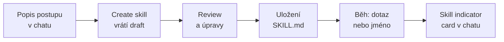

# Skills — rozšíření Copilot in SharePoint

> Typ: povinný · Den: 3 (závěr) · Odhad: PM blok
> Prostředí: viz [`../../environment.md`](../../environment.md) · Názvosloví: [`../../GLOSSARY.md`](../../GLOSSARY.md)

## Cíle

- Rozlišíte, co Skill **je a není** — oproti agentovi i oproti jednorázovému promptu — a poznáte, kdy se vyplatí ho vytvořit.
- Znáte anatomii `SKILL.md`, umíte Skill navrhnout a zrevidovat cizí návrh.
- Projdete celý cyklus: tvorba v chatu → review draftu → uložení → běh se skill indicator kartou → soubor v knihovně Agent Assets.
- Rozumíte governance Skills (žádný admin vypínač, řízení přes oprávnění na souborech) a licenční bráně.

## Proč Skills

Copilot in SharePoint odpovídá na to, co mu právě napíšete. Když stejný postup — třeba kontrolu smluv podle firemního checklistu — zadáváte potřetí, začnou se výsledky lišit podle toho, jak přesně jste prompt zrovna formulovali. A kolega, který postup nezná, ho zopakuje ještě jinak. Skills tenhle problém řeší: postup jednou popíšete, uložíte a Copilot ho pak provádí pokaždé stejně, pro každého, kdo na webu pracuje.

Pro správce je podstatné, že Skill není nová služba ani nová aplikace. Je to obyčejný Markdown soubor uložený v SharePointu — a tak se také spravuje.

## Výklad

### Co je Skill

**Skill** je opakovatelný vícekrokový postup uložený jako znovupoužitelný asset (reusable asset). Copilot in SharePoint ho načte sám, když dotaz odpovídá účelu Skillu, nebo ho zavoláte explicitně jménem. Do Skillu se ukládají pravidla specifická pro organizaci — standardy dokumentů, review checklisty, postup aktualizace sdíleného listu — takže Copilot pracuje **konzistentně**, ne podle toho, jak se zrovna povedl jednorázový prompt ([Skills](https://learn.microsoft.com/en-us/sharepoint/copilot-in-sharepoint-skills)).

Tvorba ani běh nevyžadují žádné programování:

- **Tvorba** probíhá **přirozeným jazykem v chatu**. Popíšete workflow — kroky, vstupy, očekávaný výstup — a vestavěná schopnost **Create skill** vám vrátí draft definice. Draft zrevidujete, případně necháte upravit, a potvrdíte uložení.
- **Běh** spustíte buď dotazem, který odpovídá účelu Skillu (Copilot ho načte automaticky), nebo explicitně, například „Run *název* on the selected documents". Že se Skill opravdu načetl, potvrzuje v chatu **skill indicator card**.

### Tři druhy Skills

Skills se liší tím, kdo je vlastní, kde jsou uložené a kde jsou dostupné ([Skills](https://learn.microsoft.com/en-us/sharepoint/copilot-in-sharepoint-skills)):

| | **Site skill** | **Personal skill** | **Built-in skill** |
|---|---|---|---|
| Vlastník | admin webu | uživatel | Microsoft |
| Úložiště | knihovna **Agent Assets** webu | **OneDrive** uživatele | součást produktu (needitovatelné) |
| Dostupnost | jen na daném webu | vlastníkovi napříč weby | všem; seznam přes `/skills` v chatu |

**Site skill** je vhodný pro postup, který mají všichni na webu dělat stejně — týmová pravidla review, sdílené standardy dokumentů, aktualizace společného listu. Právě takový Skill vytvoříte v labu. **Personal skill** zachycuje váš osobní způsob práce (vlastní checklist, preferované formátování) a chodí s vámi po všech webech. Přenositelnost ale **nepřenáší oprávnění**: personal skill pracuje jen s obsahem, ke kterému má uživatel přístup. **Built-in skills** dodává Microsoft — pomáhají Skills vytvářet, kontrolovat a vylepšovat a upravit je nejde; můžete je jen doplnit vlastními.

### Jeden formát, víc hostitelů

Formát `SKILL.md` není vázaný jen na SharePoint. Stejný princip potkáte ve čtvrtém dni: Skills lze připojit k agentovi v **Agent Builderu** (preview, nejvýš 8 na agenta), odkazovat z manifestu deklarativního agenta ve schématu 1.9 (`agent_skills`) a rozšiřovat jimi **Cowork** (až 50 vlastních skills) ([Agent Builder — skills](https://learn.microsoft.com/en-us/microsoft-365/copilot/extensibility/agent-builder-add-skills), [Manifest 1.9](https://learn.microsoft.com/en-us/microsoft-365/copilot/extensibility/declarative-agent-manifest-1.9), [Cowork overview](https://learn.microsoft.com/en-us/copilot/cowork/)). Chování a limity se podle hostitele liší; tento modul se věnuje Copilot in SharePoint. Dovednost napsat dobrý `SKILL.md` je ale přenositelná.

### Co Skill umí a neumí

Skill nepřidává Copilotu nové schopnosti — **řetězí ty vestavěné**. Copilot in SharePoint umí porozumět obsahu a shrnout ho, organizovat soubory a složky a pracovat se seznamy. Skill z těchto stavebních kamenů skládá posloupnost kroků. Typický příklad z dokumentace: „zvaliduj smlouvy a nevalidní zapiš do listu Invalid Contracts" — tedy čtení obsahu, vyhodnocení podle pravidla a zápis do listu.

Co Skill **neumí**: připojit se k externímu systému, spustit vlastní kód, ani **překročit oprávnění uživatele**. Skill nerozšiřuje přístup ani schopnosti nad rámec Copilot in SharePoint ([Skills](https://learn.microsoft.com/en-us/sharepoint/copilot-in-sharepoint-skills)). Jakmile potřebujete poslat e-mail, zavolat API nebo pracovat se systémem mimo SharePoint, potřebujete agenta nebo flow — k oběma se dostanete ve čtvrtém dni. V labu si tuto hranici vyzkoušíte v kroku „Kontrola omezení".

### Kde Skill žije — SKILL.md

Site skill je uložený v knihovně **Agent Assets** na webu, v cestě `/Agent Assets/Skills/<název>/SKILL.md`. Knihovnu nemusíte zakládat ani aktivovat — vznikne automaticky s prvním site skillem ([Skills](https://learn.microsoft.com/en-us/sharepoint/copilot-in-sharepoint-skills)).

`SKILL.md` je obyčejný **Markdown** — tedy formát, který znáte z D1 [`formats`](../../day-1/formats/). Skill obvykle vytváříte a upravujete v chatu, ale soubor jde otevřít a editovat i přímo. Pokud ho upravujete ručně, zachovejte jeho strukturu, aby ho Copilot dál dokázal interpretovat.

### Governance a oprávnění

Skills jsou nativní schopnost Copilot in SharePoint, a proto **nemají žádný samostatný admin vypínač** — v admin centru je nenajdete. Knihovnu Agent Assets vytváří a spravuje produkt a **nejde smazat** ([Skills](https://learn.microsoft.com/en-us/sharepoint/copilot-in-sharepoint-skills)).

Řízení proto probíhá stejně jako u jakéhokoli jiného obsahu v SharePointu — **standardní file governance**: oprávnění, retence, sensitivity labels, audit. Výchozí model je jednoduchý:

- **Edit** na webu = můžete vytvořit site skill.
- **View** na webu = můžete site skill spustit.

Pokud potřebujete přísnější model (například aby Skills vytvářel jen vlastník webu), přerušíte dědičnost oprávnění na knihovně Agent Assets a nastavíte jí vlastní oprávnění. Personal skills se řídí politikami OneDrivu.

### Licenční brána

Skills běží všude tam, kde je dostupný **Copilot in SharePoint**. Ten je od 30. 9. 2026 v GA a Microsoft u něj výslovně uvádí aktivní Microsoft 365 Copilot licenci jako prerekvizitu ([Get started](https://learn.microsoft.com/en-us/sharepoint/copilot-in-sharepoint-get-started)). Licenční model je hybridní:

- **Tvorba a správa Skills** jsou v ceně Copilot licence.
- **Skills v plánovaných AI automatizacích** a práce ve velkém spadají do „Advanced work" a čerpají navíc **Copilot Credits** přes spending policy.

V preview (2026-07-17) Skills fungovaly i na PAYG bez licence; po GA už ne — to jsme ověřili v kurzovním tenantu v 2026-11. Copilot Credits licenci **nenahradí**. Celý licenční obraz najdete v D1 [`licensing`](../../day-1/licensing/).

### Jak se Skills aktivují

Skills se samostatně nezapínají. K tomu, aby uživatel Skill vytvořil nebo spustil, musí projít dvěma branami:

1. **Licence** — Microsoft 365 Copilot licence. PAYG po GA nestačí.
2. **Dostupnost Copilot in SharePoint na webu** — řídí ji dvě nastavení:
   - **Site AI settings** nastavuje vlastník webu: který agent se otevře z ikony v hlavičce webu, zda se tlačítko Copilot skryje návštěvníkům (visitors) a zda je zapnuté advanced document processing.
   - **Restricted Content Discovery (RCD)** web z Copilotu vyřadí a přebíjí ostatní nastavení. Inventuru RCD skriptem najdete v D2 [`../../day-2/powershell-spo/guide-copilot-inventory.md`](../../day-2/powershell-spo/guide-copilot-inventory.md).

Na úrovni webu neexistuje žádná „site collection feature", kterou by bylo třeba aktivovat — Agent Assets se aktivuje samo s prvním site skillem.

Do 1. 11. 2026 se dostupnost Copilot in SharePoint (a tedy i Skills) řídila tenant-wide parametrem `Set-SPOTenant -KnowledgeAgentScope`. Při GA ho Microsoft vyřadil; dnes rozhodují Site AI settings a RCD ([Get started](https://learn.microsoft.com/en-us/sharepoint/copilot-in-sharepoint-get-started)). Pokud parametr najdete ve starších návodech nebo skriptech, je zastaralý.

### Na jakém modelu Skills běží

Copilot in SharePoint — a tedy i Skills — běží na **reasoning modelu od OpenAI spravovaném Microsoftem**; model se nekonfiguruje ([Get started — models](https://learn.microsoft.com/en-us/sharepoint/copilot-in-sharepoint-get-started#models)). Skills proto **nezávisí na Anthropicu** — Claude se v této cestě aktuálně nepoužívá. Pokud zákazník řeší AI subprocesory nebo EU Data Boundary, podrobnosti najdete v [`../../day-5/copilot-admin/explainer-ai-subprocessors.md`](../../day-5/copilot-admin/explainer-ai-subprocessors.md).

### Kontext webu — SHAREPOINT.md (doporučení)

Skill popisuje *postup*. Copilot ale pro kvalitní odpovědi potřebuje i *kontext webu* — k čemu web slouží, jaké má knihovny, jaké konvence pojmenování používá a jaká pravidla pro AI platí. Komunitní praxe proto doporučuje jeden soubor `SHAREPOINT.md` v **kořeni knihovny Agent Assets**. Načítá se do každého chatu na webu a Skills ho dědí. Je to obdoba souborů `AGENTS.md` nebo `CLAUDE.md`, které vývojáři dávají do repozitářů kódu: levná páka na kvalitu odpovědí, zvlášť když ho udržujete konzistentní napříč weby.

Pozor: **`SHAREPOINT.md` není k 2026-10 dokumentován na Microsoft Learn** — oficiálně je popsaný jen `SKILL.md`. Jde o komunitní pattern a jeho chování si před produkčním nasazením ověřte. Šablonu, umístění a úskalí najdete v [`explainer-sharepoint-md.md`](explainer-sharepoint-md.md).

### Tip: `--agenttools` — co agent na webu umí

Když chcete vědět, co může Skill na konkrétním webu nebo v knihovně řetězit, napište do chatu Copilot in SharePoint `--agenttools`. Vypíše se seznam všech nástrojů (tools), které má agent na daném místě k dispozici, seskupený do kategorií (docAssist, Creation, Deletion, Automation & Rules…) — například `create_file`, `create_folder`, `create_form`, `delete_field`, `delete_list`. Seznam je jen pro čtení.

Berte to jako tip, ne jako stabilní rozhraní: `--agenttools` ani další příkazy začínající `--` **nejsou dokumentované na Microsoft Learn**. Jde o pomůcku v preview a sama hláška v UI upozorňuje, že se nástroje v čase mění.

Nejblíž oficiálnímu katalogu schopností je reference **Work IQ SharePoint** — MCP server pro Copilot Studio s nástroji jako `findSite`, `createSmallTextFile`, `createFolder`, `createList`, `createColumn`, `shareFileOrFolder` nebo `setSensitivityLabelOnFile` ([Work IQ SharePoint reference (preview)](https://learn.microsoft.com/en-us/microsoft-copilot-studio/mcp-sharepoint-work-iq)). Jde ale o **jinou plochu** (Copilot Studio MCP) s **jinými názvy** než `--agenttools`, takže ji čtěte jako přehled schopností, ne jako dokumentaci toho příkazu. Je v preview a názvy se mohou měnit.

## Klíčové rozlišení

- **Skill vs. agent**: Skill je uložený *postup* uvnitř Copilot in SharePoint — bez vlastní persony, knowledge a akcí. Agent je samostatná *persona* s instrukcemi, knowledge a případně akcemi. Mapu cest tvorby agentů najdete v [`../../day-4/copilot-agents/`](../../day-4/copilot-agents/).
- **Skill vs. prompt**: prompt je jednorázový a osobní; Skill je uložený, sdílený (ke spuštění stačí View) a konzistentní. „Dobrý prompt, který píšete potřetí" je kandidát na Skill — a pravidla anatomie promptu z D2 platí i pro popis Skillu.
- **Licence vs. permissions** (vzor z D1): licence otvírá funkci (Copilot in SharePoint), oprávnění řídí tvorbu a běh (Edit / View). Brány jsou **dvě za sebou** a projít musíte oběma.

## Naše prostředí

- Od běhu 2026-11 máte **Copilot licenci**, takže Skill **navrhnete, vytvoříte i spustíte sami** — na svém webu nad knihovnou Vzorky z D2. `SKILL.md` je jen Markdown, psát ho umíte od D1.
- Bez licence (jen PAYG) by Skills po GA nefungovaly (ověřeno 2026-11; v preview 2026-07-17 ještě fungovaly). Kdyby se vám licence nepropsala, lab má záložní režim — viz sekce *Fallback* v labu.
- **Plánované skills** (scheduled AI automations) jsou Advanced work a čerpají Copilot Credits přes spending policy. V labu je nezakládejte.

## Shrnutí

- Skill je uložený vícekrokový postup v `SKILL.md`, který Copilot in SharePoint provádí konzistentně; tvoří se přirozeným jazykem v chatu.
- Site skill žije v knihovně Agent Assets daného webu, personal skill v OneDrivu uživatele, built-in skills dodává Microsoft.
- Skill jen řetězí vestavěné schopnosti Copilot in SharePoint — žádné externí systémy, žádný kód, žádné rozšíření oprávnění.
- Skills nemají admin vypínač; řídí se oprávněními na souborech (Edit = tvorba, View = běh) a dostupností Copilot in SharePoint (licence, Site AI settings, RCD).
- Po GA vyžadují Copilot licenci; plánované spouštění čerpá navíc Copilot Credits.

## Lab

Viz [`lab-skill-design.md`](lab-skill-design.md) — návrh a review `SKILL.md`, tvorba site skillu a jeho spuštění nad dokumenty.

## Zdroje (Microsoft)

- **Skills v Copilot in SharePoint:** [Extend Copilot in SharePoint with skills](https://learn.microsoft.com/en-us/sharepoint/copilot-in-sharepoint-skills)
- **Dostupnost, licence a model:** [Get started with Copilot in SharePoint](https://learn.microsoft.com/en-us/sharepoint/copilot-in-sharepoint-get-started) · [Get started — models](https://learn.microsoft.com/en-us/sharepoint/copilot-in-sharepoint-get-started#models)
- **Skills v dalších hostitelích:** [Agent Builder — skills](https://learn.microsoft.com/en-us/microsoft-365/copilot/extensibility/agent-builder-add-skills) · [Declarative agent manifest 1.9](https://learn.microsoft.com/en-us/microsoft-365/copilot/extensibility/declarative-agent-manifest-1.9) · [Cowork overview](https://learn.microsoft.com/en-us/copilot/cowork/)
- **Katalog schopností:** [Work IQ SharePoint reference (preview)](https://learn.microsoft.com/en-us/microsoft-copilot-studio/mcp-sharepoint-work-iq)

## Stav produktu / delta

> [!WARNING] Ověřit k datu běhu — stav k 2026-11.
>
> - Copilot in SharePoint (vč. Skills) má GA rollout od 30. 9. 2026; přibyly personal a built-in skills (`/skills`). Chování (auto-load, indicator card, formát `SKILL.md`) se může měnit — před během projít docs (ms.date 2026-09-28).
> - **Licence:** po GA license-only; preview nález „PAYG funguje" (2026-07-17) po GA neplatí (ověřeno v tenantu 2026-11). Skills v plánovaných automatizacích čerpají Copilot Credits.
> - `KnowledgeAgentScope` vyřazen k 1. 11. 2026. Skills jsou v SharePointu dostupné jen v first-party Copilot in SharePoint experience.
> - `SHAREPOINT.md` a `--agenttools` zatím nejsou na Microsoft Learn — ověřit, zda je Microsoft nezdokumentoval nebo nezměnil.
