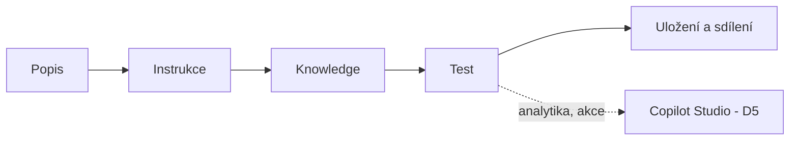

# Agent Builder

> Typ: povinný · Den: 4 · Odhad: krátký blok · Kdo staví: **studenti hands-on**
> Prostředí: viz [`../../environment.md`](../../environment.md) · Názvosloví: [`../../GLOSSARY.md`](../../GLOSSARY.md)
> Kontext: deklarativní agent, mapa cest a srovnání → [`../copilot-agents/`](../copilot-agents/README.md)

## Cíle

- Vysvětlíte, co je Agent Builder a jak souvisí s deklarativním agentem a s Copilot Studiem.
- Postavíte deklarativního agenta přímo v Microsoft 365 Copilot: popis → instrukce → knowledge → test → uložení.
- Rozpoznáte strop Builderu (limity knowledge, žádná analytika, žádné akce) a víte, kdy přejít do Copilot Studia.
- Rozlišíte, kdo smí agenta vytvořit (licence), co agent uživateli ukáže (oprávnění) a komu je agent dostupný (distribuce).

## Proč Agent Builder

Z úvodního bloku [`copilot-agents`](../copilot-agents/README.md) víte, že deklarativní agent je kombinace **instrukcí, knowledge a případně akcí**, která běží na orchestrátoru Microsoft 365 Copilot. Cest, jak takového agenta postavit, je několik. Agent Builder je z nich nejkratší: agenta vytvoří **koncový uživatel** přímo v aplikaci, kterou stejně používá, bez vývojového prostředí a bez opuštění appky. Jednoduchý agent tak vznikne za pár minut.

Za tuto nulovou bariéru se platí stropem. Builder dobře odpovídá na otázky nad vybranými zdroji, ale nepočítá nad daty a nic nevykonává v jiných systémech. Modul je o tom, abyste strop znali dřív, než na něj narazíte — a uměli uživateli říct, kdy mu Builder stačí a kdy potřebuje Copilot Studio.

## Co to je a jak funguje

Agent Builder je lightweight nástroj pro tvorbu deklarativního agenta **přímo v Microsoft 365 Copilot appce** — na webu a v Teams desktop, ne na mobilu. Jeho backendem je Copilot Studio: agenta postaveného v Builderu lze později zkopírovat do Copilot Studia a tam rozšířit ([Agent Builder](https://learn.microsoft.com/en-us/microsoft-365/copilot/extensibility/agent-builder)).

Agenta skládáte v pevném pořadí kroků:

- **Popis** říká, co agent dělá a pro koho. Nejde o kosmetiku: podle popisů orchestrace vybírá, kterého agenta použít, takže na něm závisí kvalita (viz [`copilot-agents`](../copilot-agents/README.md)).
- **Instrukce** určují chování — účel, pravidla, tón, co dělat, když odpověď ve zdrojích není. Stavíte na anatomii instrukcí z D2 (prompting-fundamentals). Instrukce nejsou místo pro obsah: směrnici nebo seznam zaměstnanců do nich nevkládejte, patří do knowledge.
- **Knowledge** jsou zdroje, ze kterých agent odpovídá — SharePoint list, soubory, složky, weby. Podrobnosti a limity jsou v další sekci.
- **Test** probíhá přímo v Builderu: agentovi položíte připravené dotazy a podle výsledku upravíte popis nebo instrukce. Proto lab začíná evaluačním plánem, ne stavbou.
- **Uložení a sdílení** — agent se objeví v seznamu vašich agentů; komu je dostupný, rozhodujete sdílením (viz *Kdo / licence / distribuce*).

## Knowledge a strop

### Co lze připojit

K agentovi připojíte **jeden SharePoint list** (do 20 000 položek a 50 MB; přílohy položek se neindexují) a k tomu soubory, složky nebo weby — dohromady nejvýš 100 ([Agent Builder — knowledge](https://learn.microsoft.com/en-us/microsoft-365/copilot/extensibility/agent-builder-add-knowledge)). Všimněte si, že list se přidává samostatně: když připojíte celý web, jeho listy tím agent nezíská. V HR scénáři proto přidáváte list **Zaměstnanci** zvlášť a vedle něj knihovny **Certifikáty** a **Smlouvy**.

K agentovi lze připojit také **Skills** (`SKILL.md`), nejvýš 8 a zatím v preview. Jde o stejný formát, jaký znáte ze Skills v Copilot in SharePoint (D3) — dovednost napsat dobrý `SKILL.md` je přenositelná ([Agent Builder — skills](https://learn.microsoft.com/en-us/microsoft-365/copilot/extensibility/agent-builder-add-skills)).

Některé zdroje závisí na licenci uživatele. Uživatelé na PAYG bez Copilot licence nemají k dispozici knowledge zdroje Email, People, Teams messages a Teams meetings ([Prerequisites](https://learn.microsoft.com/en-us/microsoft-365/copilot/extensibility/prerequisites)). Na vašem kurzovním účtu s licencí fungují; u zákazníka, kde část uživatelů jede jen na PAYG, by ale tyto zdroje u nich tiše chyběly.

### Bez analytiky

Builder zdroje umí jen **prioritizovat**, ne agregovat nebo filtrovat. Agent vyhledá ve zdrojích relevantní obsah a z něj sestaví odpověď; neprojde ale systematicky všechny řádky listu a nespočítá výsledek. Přepínač **Only use specified sources** jen říká, odkud má agent čerpat přednostně — úplný výčet negarantuje.

Prakticky to znamená, že dotazy typu „kolik / kdo / kdy" dopadnou nespolehlivě. V labu si to ověříte na dotazu *„Komu propadá certifikát do 30 dnů?"*: agent vrátí neúplný nebo nepřesný seznam a vy ho porovnáte se skutečným stavem v listu. Dopoledne stejnou otázku zvládl dashboard v [`code`](../code/README.md) jako **aplikace**; jako **agent** ji zkusíte v Copilot Studiu (D5) — agregace nad listy tam Microsoft dokumentuje pro GitHub Copilot harness, lab na standardním harnessu je experiment. Neúspěch tohoto testu tedy není chyba labu, ale ukázka stropu.

### Bez akcí do externích služeb

Builder neumí akce — nezapíše položku, nepošle požadavek do jiného systému, nespustí workflow. Pro akce, konektory a workflow Microsoft doporučuje agenta zkopírovat do Copilot Studia („copy the agent to Copilot Studio") a pokračovat tam ([Agent Builder](https://learn.microsoft.com/en-us/microsoft-365/copilot/extensibility/agent-builder)).

## Kdo / licence / distribuce

**Kdo tvoří.** Builder je nástroj koncového uživatele. K tvorbě potřebuje uživatel Microsoft 365 Copilot licenci, **nebo** musí být v tenantu nastavený PAYG pro Copilot Studio ([Prerequisites](https://learn.microsoft.com/en-us/microsoft-365/copilot/extensibility/prerequisites)). Studenti kurzu mají od běhu 2026-11 Copilot licenci, takže agenta staví sami.

**Komu je agent dostupný.** Agenta můžete sdílet s konkrétními lidmi, nebo ho nabídnout do **org katalogu** — žádost jde přes Requests ke správci, který ji schválí nebo zamítne. Do veřejného **marketplace** se z Builderu nepublikuje. Pozor na jednu past: když sdílíte agenta, který má jako knowledge přímo vložené soubory, sdílíte s ním i jejich obsah.

**Co agent ukáže.** Licence rozhoduje, kdo agenta smí vytvořit; oprávnění v SharePointu rozhodují, co z připojených zdrojů agent konkrétnímu uživateli ukáže. Agent nikdy nezobrazí obsah, ke kterému uživatel sám nemá přístup — to si v labu ověříte testem hranice práv.

**Vztah k SharePoint agentům.** Od poloviny 11/2026 vede do Agent Builderu i tlačítko „Create agent" na SharePoint webu. Agent Builder tak nahrazuje dosavadní SharePoint agenty (soubory `.agent`); stávající `.agent` soubory přestanou odpovídat po 03/2027 ([Upgrade SharePoint agents](https://learn.microsoft.com/en-us/sharepoint/upgrade-sharepoint-agents)). Legacy cestu a čtyři cesty upgradu najdete ve volitelném bloku [`opt-sharepoint-agents`](../opt-sharepoint-agents/README.md); pro tento modul ho nepotřebujete.

## Klíčové rozlišení

- **Agent Builder vs. Copilot Studio** — stejný typ agenta, jiný strop. Builder = otázky a odpovědi nad vybranými zdroji; Copilot Studio = analytika, akce, konektory, workflow.
- **Prioritizace ≠ filtrování.** *Only use specified sources* určuje, odkud agent čerpá, ne že projde všechna data.
- **Instrukce ≠ knowledge.** Instrukce řídí chování, obsah patří do zdrojů.
- **Licence ≠ oprávnění ≠ sdílení.** Licence = kdo agenta vytvoří; oprávnění = co agent uživateli ukáže; sdílení = komu je agent dostupný (a se vloženými soubory i jejich obsah).
- **Agent Builder ≠ SharePoint agents (`.agent`).** `.agent` je legacy cesta, kterou Builder nahrazuje.

## Naše prostředí

Pracujete pod svým účtem `user.NN` s Copilot licencí a stavíte agenta **HR Asistent NN** nad HR webem kurzu: list **Zaměstnanci** a knihovny **Certifikáty** a **Smlouvy**. Všichni stavíte nad stejnými fiktivními daty, číslo v názvu odliší vašeho agenta. Scénář a datový model popisuje [`scenario-hr-agent.md`](../copilot-agents/scenario-hr-agent.md), srovnání Builderu s ostatními cestami [`comparison-agent-paths.md`](../copilot-agents/comparison-agent-paths.md). S licencí agent v Copilotu kredity nečerpá; u uživatelů na PAYG by každý testovací dotaz stál Copilot Credits.

## Shrnutí

- Agent Builder staví deklarativního agenta přímo v Microsoft 365 Copilot (web, Teams desktop) v krocích popis → instrukce → knowledge → test; backendem je Copilot Studio.
- Knowledge: jeden SharePoint list (20 000 položek / 50 MB) plus až 100 souborů, složek nebo webů; Skills v preview, nejvýš 8.
- Builder zdroje jen prioritizuje — neagreguje, nefiltruje a neumí akce. Pro analytiku a akce přejděte do Copilot Studia (D5).
- Tvorba vyžaduje Copilot licenci nebo PAYG pro Copilot Studio; distribuce = sdílení a org katalog, ne marketplace.
- Od poloviny 11/2026 nahrazuje Builder tvorbu SharePoint agentů (`.agent`).

## Lab

[`lab-agent-builder.md`](lab-agent-builder.md) — HR Asistent hands-on: evaluační plán, stavba agenta, testy a jedna iterace.

## Zdroje (Microsoft)

- **Agent Builder:** [Agent Builder](https://learn.microsoft.com/en-us/microsoft-365/copilot/extensibility/agent-builder) · [Agent Builder — knowledge](https://learn.microsoft.com/en-us/microsoft-365/copilot/extensibility/agent-builder-add-knowledge) · [Agent Builder — skills](https://learn.microsoft.com/en-us/microsoft-365/copilot/extensibility/agent-builder-add-skills)
- **Licence:** [Agent capabilities & licensing](https://learn.microsoft.com/en-us/microsoft-365/copilot/extensibility/prerequisites)
- **SharePoint agents:** [Upgrade SharePoint agents](https://learn.microsoft.com/en-us/sharepoint/upgrade-sharepoint-agents)

## Stav produktu / delta

> [!WARNING] Ověřit k datu běhu — stav k 2026-11.
>
> - **UI labely** Builderu se mění (New agent, Configure, Create…).
> - **Skills v Builderu** jsou v preview.
> - **Od poloviny 11/2026** přebírá Builder tvorbu SharePoint agentů — po Ignite (17.–20. 11. 2026) projít znovu.
