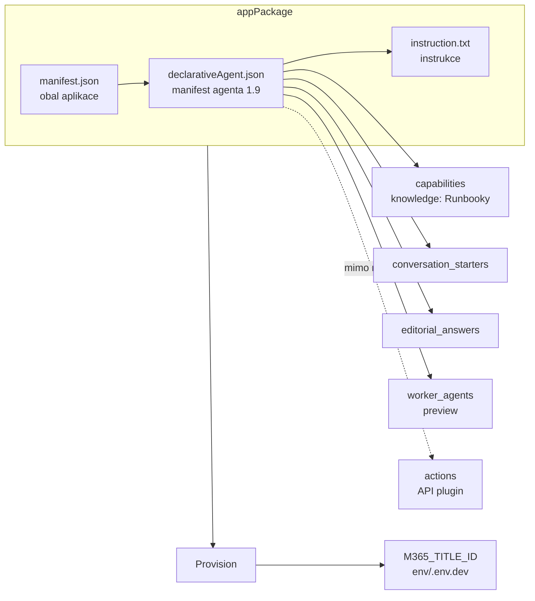
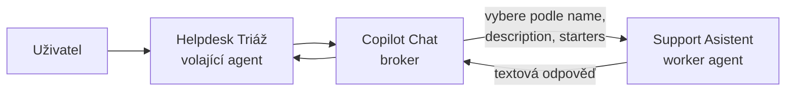

# Microsoft 365 Agents Toolkit

> Typ: povinný · Den: 4 · Odhad: krátký blok · Publikum: **správci**
> Prostředí: viz [`../../environment.md`](../../environment.md) · Názvosloví: [`../../GLOSSARY.md`](../../GLOSSARY.md)
> Kontext: deklarativní agent, mapa cest a srovnání → [`../copilot-agents/`](../copilot-agents/README.md)

## Cíle

- Vysvětlíte, co je deklarativní agent a proč ho v Agents Toolkitu spravujete jako soubor (manifest), ne jako klikání v UI.
- Zorientujete se v projektu Toolkitu a v manifestu `declarativeAgent.json` (schéma 1.9): instrukce, knowledge, conversation starters, editorial answers, a proč chybí `actions`.
- Postavíte a nasadíte agenta **Support Asistent** nad knihovnou Runbooky a změnu agenta projdete jako řádkový rozdíl v gitu.
- Propojíte dva agenty přes `worker_agents` (preview) a pochopíte, proč je `description` volaného agenta rozhraní, které podléhá správě.

## Proč agent jako kód

V předchozích blocích jste agenta skládali v Agent Builderu: rychle, v prohlížeči, ale bez historie změn a bez kontroly, kdo co upravil. Pro osobního pomocníka to stačí. Jakmile ale na agentovi závisí tým nebo jiný agent, potřebuje správce totéž co u jakékoli jiné konfigurace: verzi, review změn, opakovatelné nasazení a schvalovací cestu do produkce. Agents Toolkit to dává tím, že celý agent je **textový soubor** — a s textovým souborem umí pracovat git.

## Co to je

**Deklarativní agent** je agent popsaný deklarací: instrukce (jak se má chovat), knowledge (z čeho smí odpovídat) a případně akce (co smí dělat v jiných systémech). Neběží na vlastním serveru — používá stejný orchestrátor a modely jako Microsoft 365 Copilot, a tím dědí i jeho ochrany dat ([Declarative agents overview](https://learn.microsoft.com/en-us/microsoft-365/copilot/extensibility/overview-declarative-agent)). Stejný typ agenta vzniká v Agent Builderu i v Copilot Studiu; liší se jen tím, *kde* a *jak* deklaraci napíšete. Společný základ a mapu cest najdete v [`copilot-agents`](../copilot-agents/README.md).

**Microsoft 365 Agents Toolkit** je rozšíření pro VS Code a Visual Studio, nástupce Teams Toolkitu. Založí projekt deklarativního agenta, ve kterém je agent popsaný manifestem `declarativeAgent.json`, a jedním příkazem `Provision` ho nasadí do tenantu. Projekt je obyčejná složka souborů, takže ji můžete dát do gitu, procházet změny v review a nasazovat opakovaně nebo přes CI/CD. Tomuto přístupu se říká repo-as-code.

Licenčně je Toolkit dostupnější, než by se čekalo. Tvorba je zdarma a **nepotřebuje Copilot licenci** — Microsoft to od 2026-09 dokumentuje v prerequisites. Aby agent odpovídal z dat organizace (grounding), potřebuje uživatel Copilot licenci nebo PAYG; na PAYG bez licence ale nefungují knowledge zdroje Email, People, Teams messages a meetings. Technicky musí být v tenantu povolené nahrávání vlastních aplikací (Teams admin center → *Upload custom apps*), jinak `Provision` selže ([Prerequisites](https://learn.microsoft.com/en-us/microsoft-365/copilot/extensibility/prerequisites)). Princip „licence řídí přístup k funkci, oprávnění řídí obsah" znáte z D1 [`licensing`](../../day-1/licensing/README.md).

Microsoft dnes jako doporučený pro-code start uvádí také **Work IQ Dev Tools** (preview) a Agents Toolkit popisuje jako cestu s nižší úrovní kontroly ([Choose development tools](https://learn.microsoft.com/en-us/microsoft-365/copilot/extensibility/choose-plugin-development-tools)). Pro rámec tohoto kurzu — agent jako spravovaná konfigurace — zůstáváte u Toolkitu.

## Rámec kurzu — správci, ne vývojáři, jen M365

Toolkit se běžně učí jako vývojářský nástroj. V tomto kurzu ho používáte jinak: jako **„agent jako spravovaná konfigurace"**. Zajímá vás governance a životní cyklus (ALM) — manifest v gitu, opakovatelný `Provision`, publikace přes schválení v admin centru — ne programování.

Proto jsou **akce, API pluginy a Azure mimo rozsah**. V manifestu narazíte na slot `actions`, ale jen ho pojmenujete: právě tady by se agent napojoval na API, což je vývojářská práce s hostingem a autentizací. Když agent potřebuje „něco udělat v tenantu", kurz to řeší přes Power Automate v D4 [`power-automate-invoices`](../power-automate-invoices/README.md). Upravujete jen JSON, který znáte z D1 [`formats`](../../day-1/formats/README.md).

## Anatomie projektu a manifestu

Po založení projektu (šablona *Declarative Agent* bez akce) najdete ve složce `appPackage` dva manifesty. `manifest.json` je **app manifest** — obal, pod kterým se agent nasazuje jako aplikace do Microsoft 365. `declarativeAgent.json` je **manifest agenta** — v něm je skutečná deklarace. Instrukce mohou být přímo v něm, nebo (podle verze šablony) v samostatném souboru `instruction.txt`, na který manifest odkazuje zápisem `$[file('instruction.txt')]`. Oddělený soubor je praktický: instrukce jsou dlouhý text a jejich změny se v gitu čtou lépe.

Klíčové vlastnosti manifestu, se kterými v labech pracujete ([manifest 1.9](https://learn.microsoft.com/en-us/microsoft-365/copilot/extensibility/declarative-agent-manifest-1.9)):

| Vlastnost | Co dělá | Proč na ní záleží |
|---|---|---|
| `$schema`, `version` | verze schématu manifestu | určuje, které vlastnosti smíte použít (např. `worker_agents` až od 1.6) |
| `name`, `description` | jméno a popis agenta | podle nich Copilot — i jiný agent — rozhoduje, zda agenta použije |
| `instructions` | chování agenta, text do 8 000 znaků | anatomie instrukcí je z D2 [`prompting-fundamentals`](../../day-2/prompting-fundamentals/README.md) |
| `capabilities` | knowledge a schopnosti | bez omezení na konkrétní zdroj čte agent vše, k čemu má uživatel přístup |
| `conversation_starters` | nabídka dotazů v UI (max. 12) | slouží i jako vzor dotazů pro volajícího agenta |
| `editorial_answers` | předdefinované páry otázka–odpověď (max. 300) | přesná odpověď na otázky, kde nechcete improvizaci modelu |
| `worker_agents` | jiní agenti, které smí tento agent volat | propojení agentů bez kódu (preview) |
| `actions` | napojení na API | mimo rozsah kurzu |

Po `Provision` zapíše Toolkit do `env/.env.dev` hodnotu `M365_TITLE_ID` — identifikátor nasazeného agenta. Ten budete potřebovat v druhém labu, kde na něj odkazuje jiný agent.

## Knowledge — fakta z manifestu (schema 1.7, ověřeno i v 1.9)

Knowledge určuje, z jakých zdrojů smí agent odpovídat. Pro SharePoint má manifest dvě cesty: zdroje podle URL (`items_by_url`) nebo podle identifikátorů (`items_by_sharepoint_ids`). Pokud nevyplníte ani jednu, agent prohledává **veškerý SharePoint a OneDrive, ke kterému má uživatel přístup**. Proto lab omezuje Support Asistenta přes `items_by_url` jen na knihovnu Runbooky — užší knowledge znamená přesnější odpovědi a menší riziko, že agent vytáhne nesouvisející dokument ([manifest 1.9](https://learn.microsoft.com/en-us/microsoft-365/copilot/extensibility/declarative-agent-manifest-1.9)).

Co manifest jako SharePoint knowledge umí:

- **Weby, knihovny, složky a soubory.** Pozor na pojmenování v identifikátorech: `list_id` znamená **knihovnu dokumentů**, ne SharePoint list; `unique_id` určuje složku nebo soubor uvnitř této knihovny.
- **Strukturovaný SharePoint list jako knowledge manifest nezná** — ani aktuální schéma 1.9. Tabulková data se k agentovi dostanou jen přes `Dataverse`, Copilot konektor nebo akci. Proto Toolkit nedělá HR scénář nad listem (ten patří Agent Builderu) a jeho scénář je čtení runbooků — textových dokumentů v knihovně ([Add knowledge sources](https://learn.microsoft.com/en-us/microsoft-365-copilot/extensibility/build-declarative-agents-add-knowledge)).

Schéma se vyvíjí. Verze 1.8 přidala schopnosti EmailActions a MeetingActions, aktuální **1.9** (2026-09) přidala `agent_skills` (nejvýš 8 odkazů na složky se `SKILL.md`, tedy Skills, které znáte z D3 [`skills`](../../day-3/skills/README.md)) a capability `Fabric` pro data z Microsoft Fabric ([manifest 1.9](https://learn.microsoft.com/en-us/microsoft-365/copilot/extensibility/declarative-agent-manifest-1.9), [manifest 1.7](https://learn.microsoft.com/en-us/microsoft-365/copilot/extensibility/declarative-agent-manifest-1.7)).

Některé funkce existují **jen v manifestu** a v žádném UI je nenastavíte. Právě ty jsou pro správce argumentem pro Toolkit:

- `editorial_answers` — až 300 předdefinovaných odpovědí; v labu jimi zafixujete přesné SLA incidentu P1.
- `behavior_overrides.special_instructions.discourage_model_knowledge` — agent nemá odpovídat z obecných znalostí modelu, jen ze zadaných zdrojů.
- `user_overrides` — určuje, které schopnosti z `capabilities` si může uživatel sám upravit.

## Agent volající agenta (`worker_agents`, preview)

Jeden agent nemusí umět všechno. Microsoft doporučuje agenty dělit: když agent s přibývajícími zdroji a schopnostmi ztrácí kvalitu, část práce přesuňte do jiného agenta a propojte je. Volaný agent pak pracuje ve vlastním kontextu, bez dokumentů a schopností z konverzace volajícího ([Connect to other agents](https://learn.microsoft.com/en-us/microsoft-365/copilot/extensibility/declarative-agent-connected-agent)).

Jak propojení funguje:

- Od schématu **1.6** může deklarativní agent ve vlastnosti `worker_agents` uvést **title ID** jiných agentů. Title ID má tvar *písmeno, podtržítko, GUID*; u deklarativního agenta ho najdete ve výstupu `Provision` (v labu v `env/.env.dev` jako `M365_TITLE_ID`) nebo v developer mode Copilotu.
- **Copilot Chat je broker.** Uživatel volaného agenta nevybírá — Copilot sám rozhodne, zda a kterého agenta zavolat, podle jeho `name`, `description` a textu `conversation_starters`. Pošle mu textový dotaz, přijme textovou odpověď a zapracuje ji do konverzace. Uživatel volání v konverzaci vidí.
- Mezi agenty jde **jen text**. Pokud volaný agent vrací Adaptive Cards, uživatel je neuvidí — kartu zpracuje volající agent jako data.

Podmínky na straně tenantu: uživatel musí volaného agenta **mít** — získat ho sám, nebo mu ho nasadí admin. Microsoft zároveň uvádí, že propojené agenty je nutné registrovat v **Agent 365 agent registry** ([Connect to other agents](https://learn.microsoft.com/en-us/microsoft-365/copilot/extensibility/declarative-agent-connected-agent), [Agent registry](https://learn.microsoft.com/en-us/microsoft-365/admin/manage/agent-registry)). Samotná vlastnost `worker_agents` je v manifestu označená jako preview.

Pro správce z toho plyne nejdůležitější pointa modulu: **`description` volaného agenta je rozhraní**. Kdo ho změní nebo smaže conversation starters, může tiše rozbít volajícího agenta — bez chyby, jen tím, že ho Copilot přestane vybírat. V druhém labu si to vyzkoušíte záměrně (test 3). Závislosti mezi agenty proto patří do gitu (změna je vidět v diffu a projde review) a do registru agentů, který proberete v D5 [`copilot-admin`](../../day-5/copilot-admin/README.md).

## Klíčové rozlišení

- **Agents Toolkit vs. Agent Builder** — stejný typ agenta (deklarativní), jiný způsob správy. Builder je rychlá tvorba v prohlížeči bez historie změn; Toolkit je manifest v gitu, opakovatelný `Provision` a publikace přes schválení.
- **App manifest vs. manifest agenta** — `manifest.json` je obal pro nasazení, `declarativeAgent.json` je deklarace agenta.
- **`list_id` ≠ SharePoint list** — v manifestu označuje knihovnu dokumentů; strukturovaný list jako knowledge manifest nezná.
- **Tvorba vs. grounding** — postavit a nasadit agenta jde bez Copilot licence; odpovídat z dat organizace vyžaduje licenci nebo PAYG.
- **Knowledge vs. akce** — knowledge agent čte (v kurzu ano), akce něco provádí přes API (mimo rozsah; v M365 řešíte přes Power Automate).

## Shrnutí

- Deklarativní agent = instrukce + knowledge + (akce); v Toolkitu je celý popsaný manifestem `declarativeAgent.json`, který můžete verzovat v gitu.
- Knowledge omezujte na konkrétní zdroje (`items_by_url`) — jinak agent čte vše, k čemu má uživatel přístup; listy jako knowledge manifest nezná.
- Funkce jako `editorial_answers` nebo `discourage_model_knowledge` nastavíte jen v manifestu.
- `worker_agents` (preview) propojí agenty bez kódu; Copilot vybírá volaného agenta podle `name`, `description` a conversation starters, takže popis je rozhraní pod správou.
- Tvorba v Toolkitu je zdarma a bez Copilot licence; tenant musí povolit nahrávání vlastních aplikací.

## Lab

[`lab-toolkit-agent.md`](lab-toolkit-agent.md) — první agent jako spravovaná konfigurace nad knihovnou `Runbooky`. Scénář: [`../copilot-agents/scenario-support-agent.md`](../copilot-agents/scenario-support-agent.md).

[`lab-connected-agents.md`](lab-connected-agents.md) — navazující cvičení: **Helpdesk Triáž** volá Support Asistenta přes `worker_agents` (preview).

## Zdroje (Microsoft)

- **Deklarativní agent a nástroje:** [Declarative agents overview](https://learn.microsoft.com/en-us/microsoft-365/copilot/extensibility/overview-declarative-agent) · [Agent capabilities & licensing](https://learn.microsoft.com/en-us/microsoft-365/copilot/extensibility/prerequisites) · [Choose development tools](https://learn.microsoft.com/en-us/microsoft-365/copilot/extensibility/choose-plugin-development-tools)
- **Manifest a knowledge:** [Declarative agent manifest 1.9](https://learn.microsoft.com/en-us/microsoft-365/copilot/extensibility/declarative-agent-manifest-1.9) · [Declarative agent manifest 1.7](https://learn.microsoft.com/en-us/microsoft-365/copilot/extensibility/declarative-agent-manifest-1.7) · [Add knowledge sources (Agents Toolkit)](https://learn.microsoft.com/en-us/microsoft-365-copilot/extensibility/build-declarative-agents-add-knowledge)
- **Propojení agentů:** [Connect to other agents](https://learn.microsoft.com/en-us/microsoft-365/copilot/extensibility/declarative-agent-connected-agent) · [Agent registry](https://learn.microsoft.com/en-us/microsoft-365/admin/manage/agent-registry)

## Stav produktu / delta

> [!WARNING] Ověřit k datu běhu — stav k 2026-11.
>
> - **Toolkit:** číslo aktuální verze nemáme z MS zdroje; názvy šablon a průvodce se mění (stavíte „Declarative Agent" bez akce). Work IQ Dev Tools (preview) — po Ignite (17.–20. 11. 2026) ověřit, zda nemění doporučenou pro-code cestu.
> - **Knowledge:** manifest 1.9 listy jako knowledge stále nezná (`list_id` = knihovna); na PAYG bez licence nefunguje knowledge Email / People / Teams messages / meetings. Tvorba a běh bez Copilot licence byly ověřeny v kurzovním tenantu 2026-07-17 a od 2026-09 jsou dokumentované.
> - **`worker_agents`:** preview (v manifestu 1.9 stále tak označeno). MS požaduje registraci propojených agentů v Agent 365 agent registry — zda ji splní samotný `Provision` z Toolkitu, nebo je potřeba krok admina, ověřit dry-runem.
