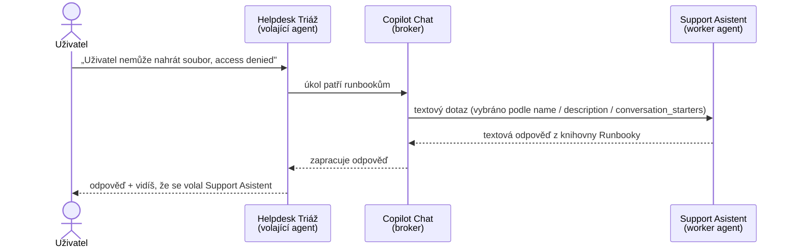

# Lab · Agent volající agenta (`worker_agents`)

> Modul: agents-toolkit · Odhad: 25–30 min · Režim: **studenti hands-on** (navazuje na [`lab-toolkit-agent.md`](lab-toolkit-agent.md)); když tlačí čas, instruktorské demo · Publikum: **správci**
> Scénář: [`../copilot-agents/scenario-support-agent.md`](../copilot-agents/scenario-support-agent.md)

## Cíl

Propojit dva deklarativní agenty: nový **Helpdesk Triáž** deleguje dotazy na runbooky na **Support Asistenta** z předchozího labu. Pochopit, podle čeho Copilot vybírá volaného agenta a co to znamená pro správu (vlastnictví, závislosti, registr).

> [!IMPORTANT] Rozsah — pořád jen manifest
> Žádný kód, žádné API, žádné Azure. Propojení je **jedna vlastnost v manifestu** (`worker_agents`). Funkce je **preview**.

## Předpoklady

- Hotový a provisionovaný **Support Asistent** z [`lab-toolkit-agent.md`](lab-toolkit-agent.md).
- VS Code + Agents Toolkit, přihlášení do M365, povolené *Upload custom apps*.

## Jak to funguje



- Volající agent má v manifestu `worker_agents` se **title ID** volaného agenta.
- Copilot Chat je **broker**: vybírá volaného agenta podle jeho `name`, `description` a textu `conversation_starters`. Mezi agenty jde **jen text**.
- Volaný agent pracuje ve vlastním kontextu — proto má smysl dělit velké agenty na menší.

## Kroky

### Část A — připrav volaného agenta (5 min)

1. V projektu **Support Asistenta** zkontroluj `description` a přidej 3 `conversation_starters` s různou formulací (např. „access denied", „nejde nahrát soubor", „chyba oprávnění v knihovně"). **Podle nich ho Copilot vybírá.**
2. **Provision** znovu. Z výstupu Provision si zapiš **title ID** (formát `P_<GUID>`). Alternativa: developer mode v Copilotu ukáže title ID v debug kartě.

### Část B — postav volajícího agenta (10 min)

3. Toolkit → **Create a New Agent/App** → **Declarative Agent** → **bez akce**, název **Helpdesk Triáž**.
4. V `declarativeAgent.json` ověř verzi schématu — `worker_agents` vyžaduje **1.6 nebo novější** (aktuální je 1.9). Pokud šablona vygenerovala starší, uprav `$schema` a `version`.
5. Napiš `instructions`: agent třídí požadavky helpdesku (priorita, kategorie), na postupy z runbooků **nemá vlastní knowledge** — deleguje.
6. Přidej:

   ```json
   "worker_agents": [
     { "id": "P_<title ID tvého Support Asistenta>" }
   ]
   ```

7. **Provision**.

### Část C — testy (10 min)

| # | Dotaz v Helpdesk Triáž | Očekávání |
|---|---|---|
| 1 | „Uživatel hlásí access denied při uploadu do knihovny, co s tím?" | **delegace** na Support Asistenta, odpověď z runbooku |
| 2 | „Jakou prioritu dát výpadku e-mailu pro celou firmu?" | **bez delegace** — třídění zvládne sám |
| 3 | Uprav `description` Support Asistenta na něco vágního („pomocník"), Provision, zopakuj dotaz 1 | delegace selže nebo je nespolehlivá — **popis je rozhraní** |

8. U každého testu zapiš, zda a jak bylo vidět volání Support Asistenta. Po testu 3 vrať `description` zpět.

### Část D — governance reflexe (5 min)

9. Odpověz do MD poznámky:
   - Kdo **vlastní** kterého agenta a kdo smí změnit `description` volaného agenta? (Test 3 ukázal, že tím rozbije volajícího.)
   - Co se stane uživateli, který volaného agenta **nemá nainstalovaného**?
   - Kde to uvidí admin — **registr agentů** (zítra D5 `copilot-admin`).
   - Proč je změna `worker_agents` v gitu (diff, review) bezpečnější než klikání?

## Ověření

- [ ] Helpdesk Triáž má schéma ≥ 1.6 a `worker_agents` s title ID tvého Support Asistenta.
- [ ] Test 1 delegoval, test 2 ne; výsledek testu 3 zapsaný.
- [ ] `description` Support Asistenta vrácený do původního stavu.
- [ ] Governance reflexe má 4 odpovědi.

## Fallback

- Provision nebo volání neprojde (registr agentů / preview): části A a B (manifest) jsou plnohodnotný deliverable; instruktor pustí testy na svém přípravném páru agentů, studenti predikují výsledek testů 1–3 a pak se ověří.

## Zdroje (Microsoft)

[Connect to other agents from a declarative agent](https://learn.microsoft.com/en-us/microsoft-365/copilot/extensibility/declarative-agent-connected-agent) · [Declarative agent manifest 1.9 — worker agent object](https://learn.microsoft.com/en-us/microsoft-365/copilot/extensibility/declarative-agent-manifest-1.9) · [Agent registry](https://learn.microsoft.com/en-us/microsoft-365/admin/manage/agent-registry)
