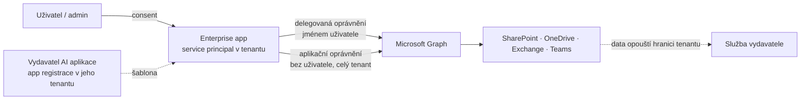
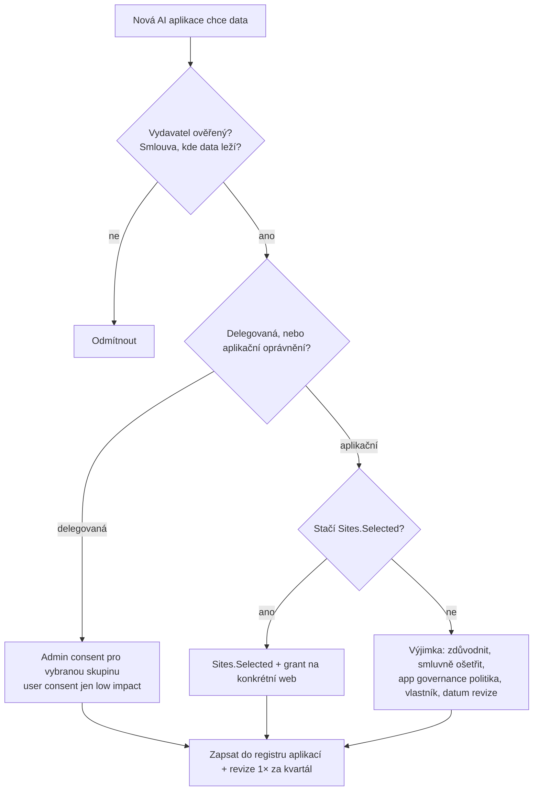

# Přístup jiných AI k datům tenantu — aplikace, consent, agent identity

> Typ: povinný · Den: 4 · Odhad: 25 min výklad + 30 min lab · Kdo: **studenti audit (Global Reader) + instruktorské demo**
> Prostředí: [`../../environment.md`](../../environment.md) · Názvosloví: [`../../GLOSSARY.md`](../../GLOSSARY.md)
> Převzato a rozšířeno z kurzu GOC223 (*automation-strategy*, *security-hardening*, *permission-discovery*) · Deep-dive: [`explainer-app-registrations-enterprise-apps.md`](explainer-app-registrations-enterprise-apps.md)

## Cíle

- Rozlišíte **app registraci** (šablonu) a **Enterprise application** (service principal v tenantu) a víte, že AI aplikace třetí strany se ve vašem tenantu objeví právě jako Enterprise app po **consentu**.
- Rozlišíte **delegovaná** a **aplikační** oprávnění a poznáte oprávnění, která dávají AI přístup k datům celého tenantu (`Sites.Read.All`, `Files.Read.All`, `Mail.Read`…).
- Znáte páky správce: **user consent policy**, **admin consent workflow**, **`Sites.Selected`**, **Conditional Access pro workload identity**, audit Enterprise apps, **app governance** a **agent identity** (Entra Agent ID).
- Provedete audit Enterprise apps a zapíšete rizika s nápravou.

## Proč se tím správce SharePointu zabývá

Dosud jste v kurzu pracovali s AI, která běží uvnitř Microsoft 365: Copilot, Cowork, Code a agenti. Všechny tyto nástroje pracují s právy přihlášeného uživatele — ukážou jen to, k čemu má uživatel přístup. Kvalitu oprávnění v SharePointu jste proto řešili v D3 přes SharePoint Advanced Management.

K datům tenantu se ale umí dostat i AI mimo Microsoft 365: konektor chatbota k SharePointu a OneDrivu, AI poznámkovač schůzek, MCP server nebo vlastní skript s jazykovým modelem. Tyto aplikace nejdou přes uživatelská práva v SharePointu, ale přes **identitu aplikace v Entra ID** a **oprávnění k Microsoft Graph**. Pokud jim někdo udělí široké aplikační oprávnění, uvidí data celého tenantu bez ohledu na to, jak pečlivě máte nastavené weby. Tento modul vysvětlí, jak takový přístup vzniká, a dá vám páky, kterými ho řídíte.

## Kudy se cizí AI dostane k datům tenantu

Copilot a agenti z Microsoft 365 běží uvnitř hranice služby Microsoft 365 a respektují práva uživatele. **Cizí AI** potřebuje k datům dvě věci, které jí někdo musí dát: **identitu aplikace v Entra ID** a **oprávnění k Microsoft Graph**. Diagram ukazuje celou cestu — od consentu po službu vydavatele:

### App registrace vs. Enterprise application

Každá aplikace má v Entra ID dvě podoby. **App registrace** je šablona aplikace — žije v domovském tenantu vydavatele a definuje, o jaká oprávnění aplikace žádá a jakými credentials se prokazuje. **Enterprise application** (service principal) je lokální instance téže aplikace ve vašem tenantu; nese to, co bylo **u vás skutečně odsouhlaseno** (udělený consent), komu je aplikace přiřazená a její přihlášení.

Pro audit z toho plyne podstatná věc: multi-tenant aplikace třetí strany má ve vašem tenantu **jen** Enterprise app. App registraci nevidíte, protože patří vydavateli ([Apps & service principals](https://learn.microsoft.com/en-us/entra/identity-platform/app-objects-and-service-principals)). Když tedy hledáte, které cizí AI mají přístup k datům, díváte se do **Enterprise apps**, ne do App registrations. Podrobnosti včetně rozdílu single-tenant a multi-tenant najdete v [explaineru](explainer-app-registrations-enterprise-apps.md).

### Delegovaná vs. aplikační oprávnění

Oprávnění k Microsoft Graph existují ve dvou typech a liší se tím, *čí* práva aplikace používá:

- **Delegovaná oprávnění** — aplikace jedná **jménem přihlášeného uživatele** a vidí jen to, co on. Když uživatel nemá přístup k webu HR, nedostane se tam ani aplikace.
- **Aplikační oprávnění** — aplikace běží **bez uživatele** a vidí, co jí oprávnění dovolí, typicky **celý tenant**. Aplikační `Sites.Read.All` znamená čtení všech webů, bez ohledu na oprávnění v SharePointu. Aplikační oprávnění vždy uděluje admin.

Prakticky: u delegovaných oprávnění vás chrání kvalita oprávnění v SharePointu, kterou jste řešili v D3. U aplikačních oprávnění vás nechrání — rozhoduje jen to, co aplikace dostala.

### Data sovereignty

Jakmile má cizí AI `Files.Read.All` nebo `Sites.Read.All`, data můžou odcházet z hranice tenantu do služby vydavatele. Uvnitř Microsoft 365 platí smluvní a datové závazky Microsoftu (EU Data Boundary, viz D5 [`copilot-admin`](../../day-5/copilot-admin/explainer-ai-subprocessors.md)); u cizí aplikace platí smlouva s jejím vydavatelem. Otázka „kde data skončí" proto patří ke každému consentu stejně jako otázka „jaká oprávnění aplikace chce".

## Consent — kdo smí otevřít dveře

Consent je okamžik, kdy někdo aplikaci oprávnění udělí. Ve výchozím stavu smějí uživatelé odsouhlasit aplikacím oprávnění, která nevyžadují admina (např. přístup k vlastní poště). To je pohodlné, ale otevírá to útok typu *illicit consent grant*: útočník podvrhne aplikaci, uživatel klikne na „Accept" a aplikace získá přístup k jeho datům. Microsoft proto doporučuje povolit user consent **jen pro ověřené vydavatele** ([Configure user consent](https://learn.microsoft.com/en-us/entra/identity/enterprise-apps/configure-user-consent)).

Nastavení najdete v Entra admin centru v **Enterprise apps → Consent and permissions → User consent settings**. Na výběr jsou tři volby:

| Volba | ID politiky | Kdy |
|---|---|---|
| Do not allow user consent | — | nejpřísnější; každá aplikace přes admina |
| Allow user consent for apps from verified publishers, for selected permissions | `microsoft-user-default-low` | doporučeno; jen oprávnění klasifikovaná jako *low impact* |
| Allow user consent for apps | `microsoft-user-default-legacy` | volný user consent — vektor *illicit consent grant* útoku |

Přísnější nastavení samo o sobě uživatele zablokuje. Doplňuje ho proto **admin consent workflow**: když uživatel aplikaci odsouhlasit nesmí, může **požádat o schválení** a správce žádost posoudí ([Admin consent workflow](https://learn.microsoft.com/en-us/entra/identity/enterprise-apps/configure-admin-consent-workflow)). Uživatel tak má legitimní cestu, jak aplikaci získat, a správce má přehled o tom, co se v tenantu chce používat.

Všimněte si jedné pasti: **změna nastavení platí jen pro nové consenty**. Granty, které už byly uděleny, zůstávají. Pokud tenant dřív měl volný user consent, přepnutí na přísnější volbu nic neuklidí — staré granty musíte **auditovat a odvolat** ([Review permissions](https://learn.microsoft.com/en-us/entra/identity/enterprise-apps/manage-application-permissions)). Právě to dělá lab.

## Least privilege pro aplikace — `Sites.Selected`

Pokud aplikace opravdu potřebuje aplikační přístup do SharePointu, rozhoduje, jaké oprávnění dostane:

| Oprávnění | Po consentu aplikace vidí |
|---|---|
| `Sites.Read.All` / `Files.Read.All` (aplikační) | **všechny** weby a soubory v tenantu |
| **`Sites.Selected`** | **nic** — dokud správce neudělí přístup ke konkrétnímu webu |

`Sites.Selected` (a novější `Lists.SelectedOperations.Selected`, `ListItems…`, `Files…`) je jediný model, který se chová jako least privilege. Funguje ve dvou krocích: consent sám aplikaci nedá přístup k ničemu, a teprve správce jí udělí grant na konkrétní web. AI aplikace tak dostane klíč od **jedné kanceláře**, ne od celé budovy. Proto „dal jsem consent a aplikace nic nevidí" je u `Sites.Selected` správné chování, ne chyba.

Má to i stinnou stránku: granty per web **nejsou vidět v admin centru**, inventura se dělá jen web po webu (v kurzu GOC223 modul *permission-discovery*). Přesto `Sites.Selected` požadujte po každém dodavateli AI aplikace, který chce aplikační přístup ([Selected permissions overview](https://learn.microsoft.com/en-us/graph/permissions-selected-overview)). V instruktorském demu uvidíte celý postup na jednom testovacím webu.

## Další páky správce

Consent a `Sites.Selected` jsou hlavní páky. Kolem nich existuje několik dalších nástrojů — každý ale míří na jiný typ aplikace, a proto je důležité vědět, kde které platí.

### Conditional Access pro workload identity

Conditional Access znáte z přihlašování uživatelů. Lze ho cílit i na service principal, tedy na aplikaci místo člověka. Má ale tři omezení: politiku je nutné přiřadit **přímo** service principalu (ne přes skupinu), politika **nepokrývá** multi-tenant SaaS aplikace ani managed identity a vyžaduje licenci Workload Identities Premium ([CA for workload identities](https://learn.microsoft.com/en-us/entra/identity/conditional-access/workload-identity)).

Důsledek je zásadní: **CA pro workload identity je použitelné jen pro vlastní (single-tenant) aplikace.** Na AI aplikace třetích stran (multi-tenant SaaS) nedosáhne. U nich vám zbývá consent, `Sites.Selected`, app governance a smlouva s vydavatelem. Pokud v labu navrhujete nápravu pro cizí AI aplikaci, CA pro workload identity mezi ně nepatří.

### Credentials

U vlastních aplikací volíte, čím se aplikace prokazuje. Pořadí podle bezpečnosti: managed identity → certifikát → client secret (jen dev/test). Při ztrátě klíče se odvolává **credential**, ne oprávnění — aplikace dál potřebuje svá oprávnění, jen jí vyměníte klíč ([Migrate away from secrets](https://learn.microsoft.com/en-us/entra/identity/enterprise-apps/migrate-applications-from-secrets)).

### App governance

App governance je součást Microsoft Defender for Cloud Apps. Dává přehled všech OAuth aplikací třetích stran registrovaných v Entra ID: jaká mají oprávnění, kdo je odsouhlasil, a politiky, které rizikové aplikace omezí; alerty se zobrazují v Defender XDR ([App governance](https://learn.microsoft.com/en-us/defender-cloud-apps/app-governance-manage-app-governance)). Na rozdíl od CA pro workload identity tedy míří právě na aplikace třetích stran. Vyžaduje licenci Defender for Cloud Apps — ověřit.

### Agent identity (Microsoft Entra Agent ID)

S nástupem agentů přibyl nový typ identity, odlišný od service principalu: **agent identity**. Agenti z **Copilot Studia** ji dostávají a mají **sponzora** (tvůrce), tedy člověka, který za agenta odpovídá. Přihlášení agenta se v logu zobrazí jako AI agent, ne jako běžná aplikace, a v Entra admin centru je pro ně karta **Agent identities**. Agent ID je dostupné všem zákazníkům Entra; rozšíření bezpečnostních funkcí Entra na agenty vyžaduje **Agent 365** ([What are agent identities](https://learn.microsoft.com/en-us/entra/agent-id/what-are-agent-identities)). Kartu Agent identities hledáte v labu; k agentům se vrátíte odpoledne a v D5.

### Audit

Kdo co dělá, zjistíte na dvou místech. Přihlášení aplikací ukazují Entra sign-in logs (service principal sign-ins). Interakce s AI aplikacemi zachycuje Purview audit v událostech `AIAppInteraction` a `ConnectedAIAppInteraction` — podrobně v D5 [`monitoring`](../../day-5/monitoring/README.md).

## Pořadí rozhodování (kontrolní seznam správce)

Když přijde požadavek na novou AI aplikaci, pomůže projít páky v pevném pořadí. Nejdřív vydavatel a smlouva — pokud nevíte, kde data skončí, další kroky nemají smysl. Pak typ oprávnění, a u aplikačních oprávnění otázka, zda stačí `Sites.Selected`. Každá schválená aplikace končí v registru aplikací s pravidelnou revizí:

Výjimka (aplikační oprávnění na celý tenant) není zakázaná, ale musí mít zdůvodnění, vlastníka a datum revize. Registr aplikací znovu potkáte v závěrečném projektu jako položku registru rizik.

## Klíčové rozlišení

- **App registrace ≠ Enterprise app.** Šablona vs. instance s uděleným consentem. Cizí AI máte v tenantu jen jako Enterprise app.
- **Delegované ≠ aplikační oprávnění.** Delegované = práva uživatele; aplikační = celý tenant bez uživatele.
- **Copilot ≠ cizí AI.** Copilot a agenti M365 pracují uvnitř hranice služby a s právy uživatele; cizí AI s aplikačními oprávněními data z tenantu vynáší podle smlouvy s vydavatelem.
- **Odvolat credential ≠ odebrat oprávnění.** Ztracený klíč řeší smazání credentialu; přebytečná oprávnění řeší audit.
- **Změna consent policy ≠ úklid.** Nová politika neodvolá staré granty.
- **CA pro workload identity ≠ ochrana před cizí AI.** Platí jen pro vlastní single-tenant aplikace; na multi-tenant SaaS nedosáhne.

## Naše prostředí

- Máte roli **Global Reader** — Entra admin center vidíte **jen pro čtení** (Enterprise apps, oprávnění, user consent settings). Registraci aplikace a granty předvede instruktor.
- V tenantu jsou aplikace z týdne: PnP aplikace pro skripty kurzu (single-tenant), agenti z Agent Builderu a Toolkitu (D4), případně Copilot Studio agenti (D5) — vhodné objekty k auditu.
- Repo kurzu je veřejné, proto do poznámek ani do repa nepatří tenant ID, client ID ani secrety. V labu pracujete s portálem, ne s identifikátory.

## Shrnutí

- Cizí AI se k datům tenantu dostane přes Enterprise app a oprávnění k Microsoft Graph, která jí někdo udělil consentem.
- Aplikační oprávnění typu `Sites.Read.All` obchází oprávnění v SharePointu a dávají přístup k celému tenantu; `Sites.Selected` začíná na nule a přístup se uděluje web po webu.
- User consent omezte na ověřené vydavatele, zapněte admin consent workflow — a staré granty auditujte, nová politika je neodvolá.
- CA pro workload identity chrání jen vlastní single-tenant aplikace; na AI aplikace třetích stran platí consent, `Sites.Selected`, app governance a smlouva.
- Agenti dostávají vlastní typ identity (Entra Agent ID) se sponzorem.

## Lab

[`lab-ai-app-audit.md`](lab-ai-app-audit.md) — audit Enterprise apps a consent nastavení (Global Reader) + instruktorské demo: aplikace se `Sites.Selected`, blokovaný user consent → žádost o admin consent.

## Zdroje (Microsoft)

- **Aplikace a consent:** [Apps & service principals](https://learn.microsoft.com/en-us/entra/identity-platform/app-objects-and-service-principals) · [Configure user consent](https://learn.microsoft.com/en-us/entra/identity/enterprise-apps/configure-user-consent) · [Admin consent workflow](https://learn.microsoft.com/en-us/entra/identity/enterprise-apps/configure-admin-consent-workflow) · [Review permissions granted to enterprise apps](https://learn.microsoft.com/en-us/entra/identity/enterprise-apps/manage-application-permissions)
- **Least privilege:** [Selected permissions overview](https://learn.microsoft.com/en-us/graph/permissions-selected-overview)
- **Další páky:** [CA for workload identities](https://learn.microsoft.com/en-us/entra/identity/conditional-access/workload-identity) · [Migrate away from secrets](https://learn.microsoft.com/en-us/entra/identity/enterprise-apps/migrate-applications-from-secrets) · [App governance](https://learn.microsoft.com/en-us/defender-cloud-apps/app-governance-manage-app-governance)
- **Agent identity:** [What are agent identities](https://learn.microsoft.com/en-us/entra/agent-id/what-are-agent-identities)

## Stav produktu / delta

> [!WARNING] Ověřit k datu běhu — stav k 2026-11.
>
> - **Entra Agent ID** a licenční vazba na Agent 365 se vyvíjí — ověřte, kde v Entra admin centru je karta *Agent identities* a co vyžaduje licenci.
> - **Licence:** požadavek app governance (Defender for Cloud Apps) a Workload Identities Premium ověřte.
> - **User consent:** názvy voleb se v portálu mohou lišit od ID politik; výchozí nastavení nových tenantů se zpřísňuje.
> - **`*.Selected` scopes** se rozšiřují — sledujte Graph beta.
