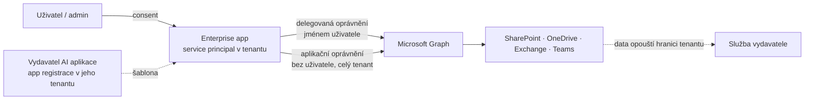
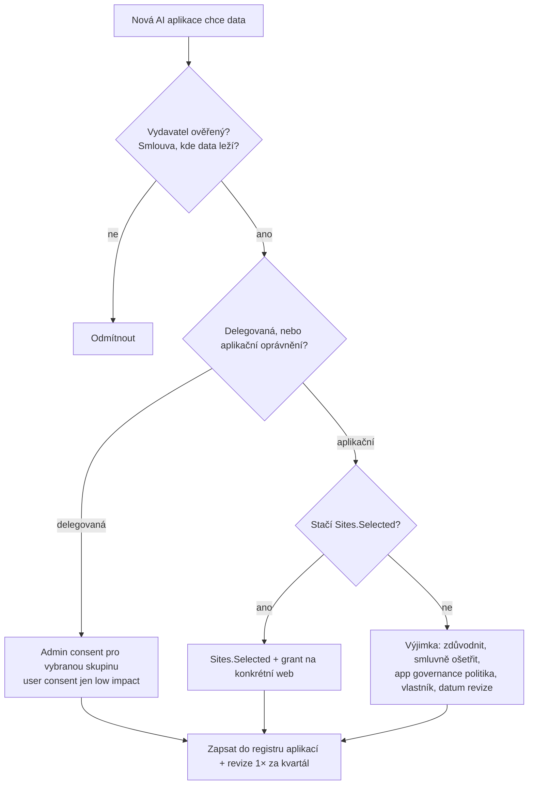

# Přístup jiných AI k datům tenantu — aplikace, consent, agent identity

> Typ: povinný · Den: 4 · Odhad: 25 min výklad + 30 min lab · Kdo: **studenti audit (Global Reader) + instruktorské demo**
> Prostředí: viz [`../../environment.md`](../../environment.md) · Názvosloví: [`../../GLOSSARY.md`](../../GLOSSARY.md)
> Převzato a rozšířeno z kurzu GOC223 (*automation-strategy*, *security-hardening*, *permission-discovery*) · Deep-dive: [`explainer-app-registrations-enterprise-apps.md`](explainer-app-registrations-enterprise-apps.md)

## Cíle

- Student rozliší **app registraci** (šablona) a **Enterprise application** (service principal v tenantu) a ví, že AI aplikace třetí strany se v tenantu objeví právě jako Enterprise app po **consentu**.
- Student rozliší **delegovaná** a **aplikační** oprávnění a pozná oprávnění, která dávají AI přístup k datům celého tenantu (`Sites.Read.All`, `Files.Read.All`, `Mail.Read`…).
- Student zná páky správce: **user consent policy**, **admin consent workflow**, **`Sites.Selected`**, **Conditional Access pro workload identity**, audit Enterprise apps, **app governance** a **agent identity** (Entra Agent ID).
- Student provede audit Enterprise apps a zapíše rizika s nápravou.

## Výklad

### Kudy se cizí AI dostane k datům tenantu

Copilot a agenti z Microsoft 365 běží uvnitř hranice služby Microsoft 365 a respektují práva uživatele. **Cizí AI** — konektor chatbota k SharePointu a OneDrivu, AI poznámkovač schůzek, MCP server, vlastní skript s LLM — potřebuje k datům **identitu aplikace v Entra ID** a **oprávnění k Microsoft Graph**, která jí někdo udělil.

- **App registrace vs. Enterprise application** — šablona v domovském tenantu vydavatele vs. lokální instance s **uděleným consentem** ve vašem tenantu. Multi-tenant aplikace třetí strany má ve vašem tenantu **jen** Enterprise app ([Apps & service principals](https://learn.microsoft.com/en-us/entra/identity-platform/app-objects-and-service-principals)). Detail: [explainer](explainer-app-registrations-enterprise-apps.md).
- **Delegovaná oprávnění** — aplikace jedná **jménem přihlášeného uživatele** a vidí jen to, co on. **Aplikační oprávnění** — aplikace běží **bez uživatele** a vidí, co jí oprávnění dovolí, typicky **celý tenant**. Aplikační oprávnění vždy uděluje admin.
- **Data sovereignty:** jakmile má cizí AI `Files.Read.All` nebo `Sites.Read.All`, data můžou odcházet z hranice tenantu do služby vydavatele. Uvnitř M365 platí smluvní a datové závazky Microsoftu (EU Data Boundary, D5 [`copilot-admin`](../../day-5/copilot-admin/explainer-ai-subprocessors.md)); u cizí aplikace platí smlouva s jejím vydavatelem.

### Consent — kdo smí otevřít dveře

- **Výchozí stav:** uživatelé smějí odsouhlasit aplikacím oprávnění, která nevyžadují admina (např. přístup k vlastní poště). MS doporučuje povolit user consent **jen pro ověřené vydavatele** ([Configure user consent](https://learn.microsoft.com/en-us/entra/identity/enterprise-apps/configure-user-consent)).
- **Volby** (Entra admin center → **Enterprise apps → Consent and permissions → User consent settings**):

  | Volba | ID politiky | Kdy |
  |---|---|---|
  | Do not allow user consent | — | nejpřísnější; každá aplikace přes admina |
  | Allow user consent for apps from verified publishers, for selected permissions | `microsoft-user-default-low` | doporučeno; jen oprávnění klasifikovaná jako *low impact* |
  | Allow user consent for apps | `microsoft-user-default-legacy` | volný user consent — vektor *illicit consent grant* útoku |

- **Admin consent workflow** — když uživatel aplikaci odsouhlasit nesmí, může **požádat o schválení**; správce žádost posoudí ([Admin consent workflow](https://learn.microsoft.com/en-us/entra/identity/enterprise-apps/configure-admin-consent-workflow)).
- **Změna nastavení platí jen pro nové consenty.** Už udělené granty zůstávají — musíš je **auditovat a odvolat** ([Review permissions](https://learn.microsoft.com/en-us/entra/identity/enterprise-apps/manage-application-permissions)).

### Least privilege pro aplikace — `Sites.Selected`

| Oprávnění | Po consentu aplikace vidí |
|---|---|
| `Sites.Read.All` / `Files.Read.All` (aplikační) | **všechny** weby a soubory v tenantu |
| **`Sites.Selected`** | **nic** — dokud správce neudělí přístup ke konkrétnímu webu |

`Sites.Selected` (a novější `Lists.SelectedOperations.Selected`, `ListItems…`, `Files…`) je jediný model, který se chová jako least privilege: AI aplikace dostane klíč od **jedné kanceláře**, ne od celé budovy. Granty per web ale **nejsou vidět v admin centru** — inventura jen web po webu (GOC223 *permission-discovery*). Požaduj ho po každém dodavateli AI aplikace, který chce aplikační přístup ([Selected permissions overview](https://learn.microsoft.com/en-us/graph/permissions-selected-overview)).

### Další páky správce

- **Conditional Access pro workload identity** — CA lze cílit i na service principal, ale jen **přiřazením přímo** (ne přes skupinu); multi-tenant SaaS aplikace a managed identity politika **nepokrývá**; vyžaduje licenci Workload Identities Premium ([CA for workload identities](https://learn.microsoft.com/en-us/entra/identity/conditional-access/workload-identity)). **Použitelné jen pro vlastní (single-tenant) aplikace** — na AI aplikace třetích stran (multi-tenant SaaS) CA pro workload identity nedosáhne; tam zbývá consent, `Sites.Selected`, app governance a smlouva.
- **Credentials** — u vlastních aplikací: managed identity → certifikát → client secret (jen dev/test). Při ztrátě se odvolává **credential**, ne oprávnění ([Migrate away from secrets](https://learn.microsoft.com/en-us/entra/identity/enterprise-apps/migrate-applications-from-secrets)).
- **App governance** (Microsoft Defender for Cloud Apps) — přehled všech OAuth aplikací třetích stran registrovaných v Entra ID, jejich oprávnění, kdo je odsouhlasil, a politiky, které rizikové aplikace omezí; alerty v Defender XDR ([App governance](https://learn.microsoft.com/en-us/defender-cloud-apps/app-governance-manage-app-governance)). Vyžaduje licenci Defender for Cloud Apps — ověřit.
- **Agent identity (Microsoft Entra Agent ID)** — nový typ identity pro AI agenty, odlišný od service principalu. Agenti z **Copilot Studia** dostávají agent identity se **sponzorem** (tvůrcem); přihlášení se logují jako AI agent; v Entra admin centru je karta **Agent identities**. Agent ID je dostupné všem zákazníkům Entra; rozšíření bezpečnostních funkcí Entra na agenty vyžaduje **Agent 365** ([What are agent identities](https://learn.microsoft.com/en-us/entra/agent-id/what-are-agent-identities)).
- **Audit** — přihlášení aplikací v Entra sign-in logs (service principal sign-ins); interakce s AI aplikacemi v Purview (`AIAppInteraction`, `ConnectedAIAppInteraction` — D5 [`monitoring`](../../day-5/monitoring/README.md)).

### Pořadí rozhodování (kontrolní seznam správce)

## Klíčové rozlišení

- **App registrace ≠ Enterprise app.** Šablona vs. instance s uděleným consentem. Cizí AI máš v tenantu jen jako Enterprise app.
- **Delegované ≠ aplikační oprávnění.** Delegované = práva uživatele; aplikační = celý tenant bez uživatele.
- **Copilot ≠ cizí AI.** Copilot a agenti M365 pracují uvnitř hranice služby a s právy uživatele; cizí AI s aplikačními oprávněními data z tenantu vynáší podle smlouvy s vydavatelem.
- **Odvolat credential ≠ odebrat oprávnění.** Ztracený klíč řeší smazání credentialu; přebytečná oprávnění řeší audit.
- **Změna consent policy ≠ úklid.** Nová politika neodvolá staré granty.

## Naše prostředí

- Studenti mají **Global Reader** — Entra admin center vidí **jen pro čtení** (Enterprise apps, oprávnění, user consent settings). Registraci aplikace a granty předvede instruktor.
- V tenantu jsou aplikace z týdne: PnP aplikace pro skripty kurzu (single-tenant), agenti z Agent Builderu a Toolkitu (D4), případně Copilot Studio agenti (D5) — vhodné objekty k auditu.
- **Žádné tenant ID, client ID ani secrety do repa** (repo je veřejné) — v labu se pracuje s portálem, ne s identifikátory.

## Lab

[`lab-ai-app-audit.md`](lab-ai-app-audit.md) — audit Enterprise apps a consent nastavení (Global Reader) + instruktorské demo: aplikace se `Sites.Selected`, blokovaný user consent → žádost o admin consent.

## Zdroje (Microsoft)

[Apps & service principals](https://learn.microsoft.com/en-us/entra/identity-platform/app-objects-and-service-principals) · [Configure user consent](https://learn.microsoft.com/en-us/entra/identity/enterprise-apps/configure-user-consent) · [Admin consent workflow](https://learn.microsoft.com/en-us/entra/identity/enterprise-apps/configure-admin-consent-workflow) · [Review permissions granted to enterprise apps](https://learn.microsoft.com/en-us/entra/identity/enterprise-apps/manage-application-permissions) · [Selected permissions overview](https://learn.microsoft.com/en-us/graph/permissions-selected-overview) · [CA for workload identities](https://learn.microsoft.com/en-us/entra/identity/conditional-access/workload-identity) · [Migrate away from secrets](https://learn.microsoft.com/en-us/entra/identity/enterprise-apps/migrate-applications-from-secrets) · [App governance](https://learn.microsoft.com/en-us/defender-cloud-apps/app-governance-manage-app-governance) · [What are agent identities](https://learn.microsoft.com/en-us/entra/agent-id/what-are-agent-identities)

## Stav produktu / delta

> [!WARNING] Ověřit k datu běhu — stav k 2026-11.
> Entra Agent ID a licenční vazba na Agent 365 se vyvíjí — ověřit, kde v Entra admin centru je karta *Agent identities* a co vyžaduje licenci. Licenční požadavek app governance (Defender for Cloud Apps) a Workload Identities Premium ověřit. Názvy voleb user consent se v portálu mohou lišit od ID politik; výchozí nastavení nových tenantů se zpřísňuje. Rozšiřování `*.Selected` scopes sledovat v Graph beta.
