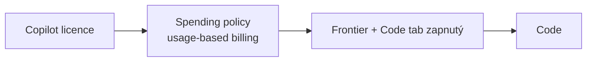

# Code — Copilot, který staví

> Typ: povinný · Den: 4 · Odhad: 20 min výklad + 30 min lab · Kdo: **studenti hands-on** (Frontier)
> Prostředí: viz [`../../environment.md`](../../environment.md) · Názvosloví: [`../../GLOSSARY.md`](../../GLOSSARY.md)
> Navazuje na: [`../cowork/`](../cowork/README.md) (tři režimy nového Copilota, kdy co)

## Cíle

- Víte, co Code umí a kde postavená aplikace žije (**Copilot Managed Runtime**).
- Znáte brány přístupu: licence → spending policy → **Frontier + zapnutý Code tab**.
- Postavíte malou aplikaci nad SharePoint daty a zjistíte, kolik stála.
- Umíte pojmenovat governance body: kde aplikace běží, komu je sdílená, kdo platí za běh a kde ji správce spravuje.

## Proč se Code zabývat

Cowork vám pomáhá s prací — napíše dokument, shrne podklady, připraví tabulku. Code jde o krok dál: **vyrobí software**. Uživatel bez programátorských znalostí si popíše dashboard nebo interní nástroj a za pár minut ho má hotový, včetně napojení na data organizace.

Pro správce SharePointu to znamená novou kategorii otázek. Dosud jste řešili, kdo smí vytvořit web nebo seznam. Teď řešíte, kdo smí vytvořit *aplikaci*, kde ta aplikace poběží, ke kterým datům se dostane, komu ji autor zpřístupní a kdo zaplatí za to, že ji ostatní používají. Modul proto stojí na dvou otázkách: **Kudy se uživatel do Code dostane?** a **Co se stane s aplikací, když ji autor pustí dál?**

## Co je Code

Code je třetí režim nového Copilota (vedle Chatu a Cowork). Pracuje se s ním konverzačně: popíšete výsledek — dashboard, interní nástroj, statický web, transformaci dat nebo skript — a Code ho postaví. Během práce vidíte **živý náhled**, takže výsledek průběžně kontrolujete a upřesňujete dalšími pokyny. K předchozí verzi se lze vrátit, takže nepovedená změna nic nezničí.

Code může běžet lokálně (desktop aplikace) nebo v cloudu. Hotovou aplikaci jde publikovat do **Copilot Managed Runtime** pro organizaci; statické aplikace jde sdílet jako odkaz omezený na organizaci (org-scoped). Celý Code je zatím ve fázi **Frontier preview**, tedy dostupný jen organizacím zapojeným do programu Frontier ([Copilot Code](https://learn.microsoft.com/en-us/copilot/code/), [Use Copilot Code](https://learn.microsoft.com/en-us/copilot/code/use-code)).

V labu to vyzkoušíte na HR scénáři: z listu `Zaměstnanci` postavíte přehled propadajících certifikací, přidáte filtr, vrátíte se k předchozí verzi a zjistíte cenu.

## Brány přístupu

Do Code se uživatel nedostane jen proto, že má Copilot. Musí projít třemi branami za sebou — a pokud kterákoli chybí, Code nepoužije (v labu se to projeví tak, že karta Code chybí).

1. **Licence** — uživatel potřebuje Microsoft Copilot licenci a organizace musí mít zapnutý Code tab. Copilot Credits licenci nenahrazují, jen k ní přidávají spotřebu ([Code requirements](https://learn.microsoft.com/en-us/copilot/code/code-requirements)).
2. **Spending policy** — Code patří mezi služby usage-based billingu. Spending policy v Cost management určuje, kdo Code smí používat, a nastavuje každému uživateli limit; spotřeba se počítá proti jeho nároku. Kdo v policy není, Code nepoužije. Uživatel svou útratu zjistí příkazem `/cost` přímo v Code (ověřeno v tenantu 2026-11).
3. **Frontier + admin politiky** — správce rozhoduje, kde Code běží (ve výchozím stavu **jen v cloudu**), zda smí pracovat s daty organizace a zda smí připojit GitHub (ve výchozím stavu **vypnuto**) ([Manage Copilot Code](https://learn.microsoft.com/en-us/copilot/code/code-admin)).

Všimněte si, že první dvě brány znáte z modulu [`licensing`](../../day-1/licensing/README.md) — licence plus spending policy je společný vzorec pro Cowork, Code i Advanced work v SharePointu. Třetí brána je specifická pro Code: správce tu neurčuje *kdo*, ale *jak* — kde se kód spouští a kam smí sahat.

## Kde aplikace žije — Copilot Managed Runtime

Dokud aplikaci jen stavíte, existuje ve vašem projektu v Code. Jakmile ji publikujete, přesune se do **Copilot Managed Runtime** (preview). Je to prostředí, které hostuje Microsoft: uživatelé se přihlašují přes Entra ID a na aplikace se vztahují governance politiky tenantu. Stejným místem procházejí i aplikace publikované z Cowork App skillu, z Copilot Studia nebo z CLI — Managed Runtime je tedy společný cíl, ne specialita Code. Uživatelé publikované aplikace najdou na `managedapps.cloud.microsoft` ([What is Copilot Managed Runtime](https://learn.microsoft.com/en-us/microsoft-365/managed-apps/)).

Proč to správce zajímá: každá publikovaná aplikace je nový objekt v tenantu, který má vlastníka, okruh uživatelů, přístup k datům a průběžné náklady. Managed Runtime proto přináší vlastní správu, vazbu na Power Platform a vlastní model plateb.

### Správa

Inventář všech aplikací najdete v **M365 AC → Apps → All apps**. Politiky se nastavují v **M365 AC → Apps → Settings → Environment groups** — tam se určuje routing, povolené konektory a MCP servery, pravidla sdílení a content security policy. Detailní pravidla prostředí a DLP se spravují v **Power Platform admin center**. Oba admin centry ukazují tutéž konfiguraci, takže nejde o dvě oddělená nastavení, ale o dva pohledy na jedno ([Governance settings](https://learn.microsoft.com/en-us/microsoft-365/admin/manage/apps/governance)).

### Vazba na Power Platform

Managed Runtime je napojený na Power Platform, a proto přebírá i její pojmy a role. Spravuje ho Global Admin nebo **Power Platform Administrator**, pracuje se s environments a environment groups a platí existující **DLP a advanced connector policies** — když se politiky liší, vyhrává přísnější. Výchozí politika povoluje jen 18 first-party konektorů s Entra ID, které drží data v tenantu ([Governance settings](https://learn.microsoft.com/en-us/microsoft-365/admin/manage/apps/governance)).

Prakticky: pokud vaše organizace už má nastavené DLP v Power Platform, vztahuje se automaticky i na aplikace z Code. Pokud nemá, výchozí politika aspoň zajistí, že aplikace nepošle data přes konektor mimo tenant.

### Náklady

Tady je nejčastější omyl. Stavbu aplikace platí tvůrce z jeho spending policy pro Code. **Běh ale platí každý uživatel, který aplikaci otevře**, a to ze samostatné spending policy *Copilot Managed Runtime*. Autor tedy nemůže „zaplatit aplikaci pro celé oddělení" — každý čtenář musí mít vlastní krytí. V preview uživatel bez krytí ztratí přístup po 20 operacích nebo 5 minutách ([Admin overview](https://learn.microsoft.com/en-us/microsoft-365/admin/manage/apps/)).

Správu Managed Runtime v admin centru projdete v D5 v labu [`copilot-admin`](../../day-5/copilot-admin/lab-copilot-admin-tour.md).

## Aplikace z Code a SharePoint

Typický požadavek z praxe: oddělení si v Code postaví přehled a chce ho mít „na svém SharePoint webu". Možnosti jsou tři a liší se tím, co aplikace umí a kdo platí běh.

- **Odkaz ze SharePointu** (Quick links, tlačítko, navigace, HTML page) — doporučená cesta. Aplikace dál běží v Managed Runtime a SharePoint na ni jen odkazuje. Pokud odkaz umístíte do HTML page, otevře se jen tehdy, když je `managedapps.cloud.microsoft` v HTML Field Security webu.
- **Vložení jako iframe nedělat.** Výchozí content security policy aplikace obsahuje `frame-ancestors 'self' <platform>`, takže vložení do cizí stránky zablokuje. Správce by musel politiku rozšířit pro celou environment group a Microsoft takový scénář nedokumentuje ([CSP](https://learn.microsoft.com/en-us/microsoft-365/admin/manage/apps/governance#content-security-policy)).
- **Read-only přehled jako HTML page.** Výstup z Code můžete vzít jako jeden HTML soubor a nahrát ho do Site Pages jako **HTML page**. Nevznikají běhové náklady a čtenář nepotřebuje Copilot licenci — zato stránka neumí zapisovat data ani používat konektory ([HTML pages](https://support.microsoft.com/en-us/sharepoint/create-edit-publish-html-pages)).

Volba tedy závisí na tom, co přehled musí umět. Statický přehled pro čtení patří do HTML page, interaktivní aplikace se zápisem nebo konektory do Managed Runtime s odkazem ze SharePointu. Srovnání všech cest (Managed Runtime, HTML page, SPFx, Copilot UX components) najdete v modulu [`procode-vs-lowcode`](../procode-vs-lowcode/README.md#aplikace-pro-uživatele--kde-žije-a-kdo-platí).

## Klíčové rozlišení

- **Aplikace ≠ agent.** Aplikace ukáže přehled nad daty; agent dává konverzační odpověď v kontextu. Analytický dotaz „komu propadá certifikát" vyřeší dashboard v Code dřív než agent v Agent Builderu — tentýž dotaz uvidíte odpoledne jako agenta a můžete porovnat.
- **Stavba ≠ běh.** Stavbu platí tvůrce, běh každý uživatel — každý z jiné spending policy.
- **Licence ≠ permissions.** Aplikace čte data **s právy uživatele**, který ji otevře. Sdílením aplikace se nesdílejí data: kolega bez přístupu k HR webu v přehledu neuvidí data, ke kterým nemá oprávnění.

## Naše prostředí

- Studentské účty mají **Copilot licenci**, spending policy pro Code a tenant je ve Frontier.
- **GitHub connection zůstává vypnutá.** Připojení repozitáře by mohlo vynést tenant data mimo hranici tenantu (data sovereignty). Berte to jako vědomé governance rozhodnutí, ne jako chybu — přesně takové rozhodnutí budete jako správci dělat i u sebe.

## Shrnutí

- Code staví aplikace z popisu, s živým náhledem a verzemi; je ve Frontier preview.
- Přístup vyžaduje licenci, spending policy i zapnutý Code tab ve Frontier; správce navíc určuje místo běhu, práci s daty organizace a GitHub.
- Publikované aplikace žijí v Copilot Managed Runtime, spravují se v M365 AC → Apps a v Power Platform admin center a podléhají DLP.
- Stavbu platí tvůrce, běh každý uživatel ze samostatné spending policy *Copilot Managed Runtime*.
- Do SharePointu aplikaci odkazujte, nevkládejte; read-only přehled může žít jako HTML page bez běhových nákladů.

## Lab

[`lab-code.md`](lab-code.md) — dashboard nad listem `Zaměstnanci` (HR scénář), `/cost` a governance checklist.

## Zdroje (Microsoft)

- **Code:** [Copilot Code](https://learn.microsoft.com/en-us/copilot/code/) · [Use Copilot Code](https://learn.microsoft.com/en-us/copilot/code/use-code) · [Copilot Code requirements](https://learn.microsoft.com/en-us/copilot/code/code-requirements) · [Manage Copilot Code](https://learn.microsoft.com/en-us/copilot/code/code-admin)
- **Copilot Managed Runtime:** [What is Copilot Managed Runtime](https://learn.microsoft.com/en-us/microsoft-365/managed-apps/) · [Admin overview](https://learn.microsoft.com/en-us/microsoft-365/admin/manage/apps/) · [Governance settings](https://learn.microsoft.com/en-us/microsoft-365/admin/manage/apps/governance) · [Content security policy](https://learn.microsoft.com/en-us/microsoft-365/admin/manage/apps/governance#content-security-policy)
- **SharePoint:** [HTML pages v SharePointu](https://support.microsoft.com/en-us/sharepoint/create-edit-publish-html-pages)

## Stav produktu / delta

> [!WARNING] Ověřit k datu běhu — stav k 2026-11.
> - Code = Frontier preview — rozsah, UI a výchozí admin nastavení se mění.
> - `/cost` funguje v Code (empiricky ověřeno 2026-11); MS docs ho uvádí jen u Copilot in SharePoint.
> - Copilot Managed Runtime = preview; konkrétní lifecycle akce v *Apps → All apps* (vypnutí, smazání, změna vlastníka) ověřit v UI.
> - HTML pages v SharePointu: GA rollout 11–12/2026.
