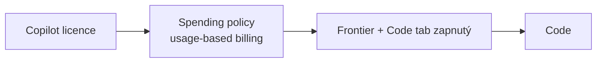

# Code — Copilot, který staví

> Typ: povinný · Den: 4 · Odhad: 20 min výklad + 30 min lab · Kdo: **studenti hands-on** (Frontier)
> Prostředí: viz [`../../environment.md`](../../environment.md) · Názvosloví: [`../../GLOSSARY.md`](../../GLOSSARY.md)
> Navazuje na: [`../cowork/`](../cowork/README.md) (tři režimy nového Copilota, kdy co)

## Cíle

- Student ví, co Code umí a kde postavená aplikace žije (**Copilot Managed Runtime**).
- Student zná brány přístupu: licence → spending policy → **Frontier + zapnutý Code tab**.
- Student postaví malou aplikaci nad SharePoint daty a zjistí, kolik stála.
- Student umí pojmenovat governance body: kde aplikace běží, komu je sdílená, kdo platí za běh, kde ji admin spravuje.

## Výklad

### Co je Code

Popíšeš výsledek (dashboard, interní nástroj, statický web, transformaci dat, skript), Code ho postaví, ukáže živý náhled a iteruje; jde se vrátit k předchozí verzi. Běží lokálně (desktop app) nebo v cloudu. Aplikace jde publikovat do **Copilot Managed Runtime** pro organizaci, statické aplikace sdílet jako org-scoped odkaz. **Frontier preview** ([Copilot Code](https://learn.microsoft.com/en-us/copilot/code/)).

### Brány přístupu

1. **Licence** — Microsoft Copilot licence + organizací zapnutý Code tab ([Code requirements](https://learn.microsoft.com/en-us/copilot/code/code-requirements)).
2. **Spending policy** — per-user limity a přístup; spotřeba se počítá proti nároku uživatele. Uživatel ji vidí přes `/cost` (ověřeno v tenantu 2026-11).
3. **Frontier + admin politiky** — kde Code běží (default **jen cloud**), zda smí použít data organizace a zda smí připojit GitHub (default **vypnuto**) ([Manage Copilot Code](https://learn.microsoft.com/en-us/copilot/code/code-admin)).

### Kde aplikace žije — Copilot Managed Runtime

Publikovaná aplikace z Code (stejně jako z Cowork App skillu, Copilot Studia nebo CLI) běží v **Copilot Managed Runtime** (preview): Microsoft-hosted prostředí s Entra přihlášením a tenantovými governance politikami. Uživatelé ji najdou na `managedapps.cloud.microsoft` ([What is Copilot Managed Runtime](https://learn.microsoft.com/en-us/microsoft-365/managed-apps/)).

- **Správa:** inventář v **M365 AC → Apps → All apps**, politiky v **M365 AC → Apps → Settings → Environment groups** (routing, konektory a MCP servery, sharing, content security policy). Detailní pravidla prostředí a DLP v **Power Platform admin center** — oba admin centry ukazují tutéž konfiguraci ([Governance settings](https://learn.microsoft.com/en-us/microsoft-365/admin/manage/apps/governance)).
- **Vazba na Power Platform:** spravuje Global Admin nebo **Power Platform Administrator**, pojmy jsou environments / environment groups, platí existující **DLP a advanced connector policies** (přísnější vyhrává). Výchozí politika povoluje jen 18 first-party konektorů s Entra ID, které drží data v tenantu.
- **Náklady:** stavbu platí tvůrce (spending policy pro Code), **běh platí každý uživatel, který aplikaci otevře** — samostatná spending policy *Copilot Managed Runtime*. V preview uživatel bez krytí po 20 operacích nebo 5 minutách ztratí přístup ([Admin overview](https://learn.microsoft.com/en-us/microsoft-365/admin/manage/apps/)). Správu projdete v D5 [`copilot-admin`](../../day-5/copilot-admin/lab-copilot-admin-tour.md).

### Aplikace z Code a SharePoint

- **Odkaz ze SharePointu** (Quick links, tlačítko, navigace, HTML page) — doporučená cesta. Z HTML page se odkaz otevře, jen když je `managedapps.cloud.microsoft` v HTML Field Security webu.
- **Vložení jako iframe nedělat** — výchozí CSP aplikace má `frame-ancestors 'self' <platform>` a admin by ho musel rozšířit pro celou environment group; Microsoft scénář nedokumentuje ([CSP](https://learn.microsoft.com/en-us/microsoft-365/admin/manage/apps/governance#content-security-policy)).
- **Read-only přehled** můžeš z Code vzít jako jeden HTML soubor a nahrát do Site Pages jako **HTML page** — bez běhových nákladů a bez Copilot licence čtenáře, ale bez zápisu a konektorů ([HTML pages](https://support.microsoft.com/en-us/sharepoint/create-edit-publish-html-pages)).
- Srovnání všech cest (Managed Runtime, HTML page, SPFx, Copilot UX components): [`procode-vs-lowcode`](../procode-vs-lowcode/README.md#aplikace-pro-uživatele--kde-žije-a-kdo-platí).

## Klíčové rozlišení

- **Aplikace ≠ agent.** Aplikace ukáže přehled nad daty; agent dává konverzační odpověď v kontextu. Analytický dotaz „komu propadá certifikát" vyřeší dashboard v Code dřív než agent v Agent Builderu.
- **Stavba ≠ běh.** Každý platí z jiné spending policy.
- **Licence ≠ permissions.** Aplikace čte data **s právy uživatele** — sdílením aplikace se nesdílejí data.

## Naše prostředí

- Studentské účty mají **Copilot licenci**, spending policy pro Code a tenant je ve Frontier.
- **GitHub connection zůstává vypnutá** — připojení repozitáře by mohlo vynést tenant data mimo hranici tenantu (data sovereignty). Ukážeme to jako governance rozhodnutí, ne jako chybu.

## Lab

[`lab-code.md`](lab-code.md) — dashboard nad listem `Zaměstnanci` (HR scénář), `/cost` a governance checklist.

## Zdroje (Microsoft)

[Copilot Code](https://learn.microsoft.com/en-us/copilot/code/) · [Use Copilot Code](https://learn.microsoft.com/en-us/copilot/code/use-code) · [Copilot Code requirements](https://learn.microsoft.com/en-us/copilot/code/code-requirements) · [Manage Copilot Code](https://learn.microsoft.com/en-us/copilot/code/code-admin) · [What is Copilot Managed Runtime](https://learn.microsoft.com/en-us/microsoft-365/managed-apps/) · [Copilot Managed Runtime — admin overview](https://learn.microsoft.com/en-us/microsoft-365/admin/manage/apps/) · [Copilot Managed Runtime — governance](https://learn.microsoft.com/en-us/microsoft-365/admin/manage/apps/governance) · [HTML pages v SharePointu](https://support.microsoft.com/en-us/sharepoint/create-edit-publish-html-pages)

## Stav produktu / delta

> [!WARNING] Ověřit k datu běhu — stav k 2026-11.
> Code = Frontier preview — rozsah, UI a výchozí admin nastavení se mění. `/cost` funguje v Code (empiricky ověřeno 2026-11, MS docs ho uvádí jen u Copilot in SharePoint). Copilot Managed Runtime = preview; konkrétní lifecycle akce v *Apps → All apps* (vypnutí, smazání, změna vlastníka) ověřit v UI. HTML pages v SharePointu: GA rollout 11–12/2026.
