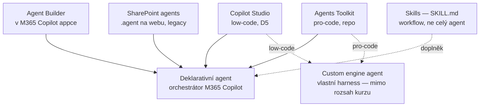
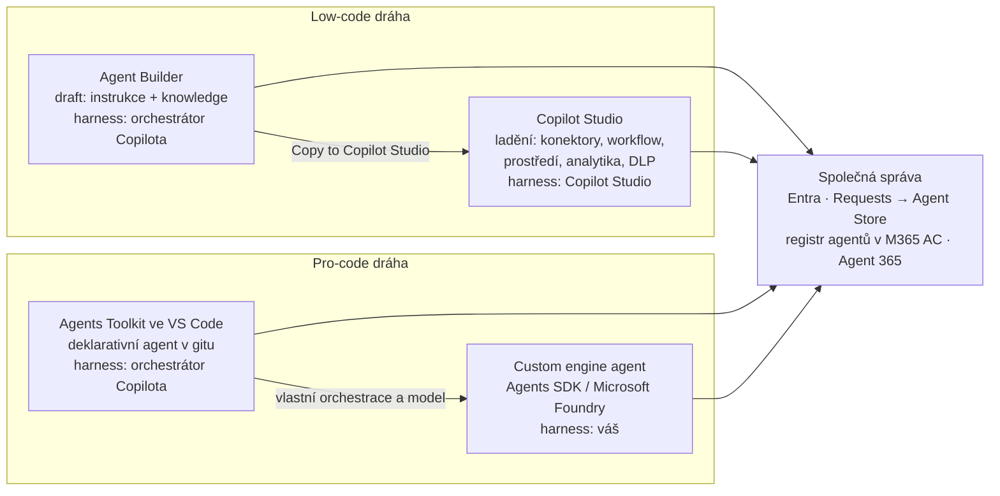

# Agenti — mapa cest tvorby (úvod)

> Typ: povinný · Den: 4 (úvod k agentním blokům) · Odhad: krátký blok — výklad + srovnání + návrhový lab
> Prostředí: viz [`../../environment.md`](../../environment.md) · Názvosloví: [`../../GLOSSARY.md`](../../GLOSSARY.md)

## Cíle

- Znáte **všechny cesty tvorby agentů** a umíte mezi nimi vybrat podle scénáře a publika.
- Vysvětlíte **dvě dráhy stavby** (low-code: Agent Builder → Copilot Studio; pro-code: deklarativní agent v Agents Toolkitu → custom engine agent) jako komplementární kroky jednoho ekosystému, ne jako konkurenty.
- Rozumíte **deklarativnímu agentovi** (instrukce + knowledge + akce) a navážete na pojmy z D2, hlavně Agent Instructions.
- Navrhnete agenta včetně **plánu vyhodnocení** (lab), který použijete v následujících nástrojových blocích.

## Proč mapa cest

Microsoft dnes nabízí pět míst, kde může vzniknout něco, čemu se říká „agent": Agent Builder přímo v aplikaci Copilot, SharePoint agents na webu, Agents Toolkit ve VS Code, Copilot Studio a do jisté míry i Skills v Copilot in SharePoint. Na první pohled to vypadá jako pět produktů. Ve skutečnosti většina z nich vede ke **stejnému výsledku** — deklarativnímu agentovi — a liší se tím, *kdo* agenta staví, *co* do něj smí připojit a *jak* se pak distribuuje a spravuje.

Pro správce z toho plyne praktická otázka: když za vámi přijde oddělení s nápadem na agenta, kterou cestou ho poslat? Špatná volba se nepozná hned. Pozná se ve chvíli, kdy agent narazí na strop nástroje (neumí list, neumí akci, nejde verzovat) nebo když ho nikdo neumí udržovat.

Tento blok je úvodem ke dvěma nástrojovým blokům: [`../agent-builder/`](../agent-builder/README.md) a [`../agents-toolkit/`](../agents-toolkit/README.md); volitelně na konci dne [SharePoint agents](../opt-sharepoint-agents/README.md), jejichž podpora končí. Navazuje na dopolední [`../cowork/`](../cowork/README.md): Cowork koná za konkrétního uživatele, kdežto agent je **sdílený a spravovaný artefakt** — má vlastní instrukce, vlastní zdroje a vlastní publikum. Tady se naučíte společný základ (deklarativní agent, mapa cest, srovnání) a navrhnete agenta včetně plánu, podle kterého poznáte, že funguje.

## Výklad

### Deklarativní agent — společný základ

**Deklarativní agent** je agent popsaný konfigurací, ne naprogramovaný. Skládá se ze tří částí:

- **Instrukce** — jak se agent chová: komu pomáhá, jakým tónem, co nedělá.
- **Knowledge** — z čeho odpovídá: weby, knihovny, listy, soubory a další zdroje.
- **Akce** — co umí udělat navenek (volání služeb). Akce jsou volitelné; mnoho agentů jen odpovídá z knowledge.

Podstatné je, *kde* agent běží. Deklarativní agent nemá vlastní server ani vlastní model — běží na **stejném orchestrátoru a modelech jako Microsoft 365 Copilot**. Proto nepotřebuje žádný vlastní hosting, **dědí ochrany dat Copilotu** a před nasazením **prochází RAI validací** (kontrola odpovědné AI) ([Declarative agents overview](https://learn.microsoft.com/en-us/microsoft-365/copilot/extensibility/overview-declarative-agent)). Pro správce to znamená, že agent nepřináší novou bezpečnostní hranici: pracuje s oprávněními uživatele, který se ho ptá, a nikdy mu neukáže víc, než by uživatel viděl sám (permission trimming). Detail najdete v [`comparison-agent-paths.md`](comparison-agent-paths.md).

Instrukce agenta znáte z D2 [`prompting-fundamentals`](../../day-2/prompting-fundamentals/README.md): jsou to **Agent Instructions** se strukturou purpose → guidelines → skills a limitem 8 000 znaků. Platí i bezpečnostní pravidlo z D2 — instrukce nepatří do knowledge zdrojů, protože obsah knowledge platforma prověřuje kvůli riziku cross-prompt injection (XPIA). Teď tyto instrukce poprvé píšete pro skutečného agenta.

Výjimkou z deklarativního modelu je **custom engine agent** s vlastním orchestrátorem, modelem a hostingem — v jazyce D2 si přináší **vlastní harness** místo půjčeného orchestrátoru Copilota. Staví se pro-code (Microsoft 365 Agents SDK, Microsoft Foundry) nebo low-code v Copilot Studiu ([Custom engine agents](https://learn.microsoft.com/en-us/microsoft-365/copilot/extensibility/overview-custom-engine-agent)); v rozsahu kurzu ho nestavíme. Kam patří, ukazuje sekce *Dvě dráhy, jeden ekosystém* níže; rozdíl low-code vs. pro-code znáte z [`../procode-vs-lowcode/`](../procode-vs-lowcode/README.md).

### Mapa cest tvorby

Diagram ukazuje, že čtyři cesty ústí do téhož deklarativního agenta. Skills stojí stranou: nejsou to celí agenti, ale workflow, které agenta (nebo Copilot in SharePoint) doplňuje.

Cesty se liší publikem, licenčními požadavky na tvorbu a tím, kam lze agenta distribuovat:

| Cesta | Pro koho | Tvorba vyžaduje | Distribuce |
|---|---|---|---|
| **[Agent Builder](../agent-builder/README.md)** | koncový uživatel | M365 Copilot licence, **nebo** tenant s PAYG pro Copilot Studio; externí akce ne → „copy to Copilot Studio" | sdílení + org katalog; **ne marketplace** |
| **[SharePoint agents](../opt-sharepoint-agents/README.md)** | vlastník obsahu | **tvorba: Copilot licence**; použití: licence NEBO PAYG; od pol. 11/2026 tvorba přes Agent Builder | jen web (sdílení do Teams chatu) |
| **[Agents Toolkit](../agents-toolkit/README.md)** | vývojář (u nás: správce, jako konfigurace) | zdarma (VS Code); bez Copilot licence (dokumentováno); repo-as-code | org katalog, marketplace |
| **Copilot Studio** (D5) | maker / power user | Copilot Studio přístup (kredity/PAYG); dva harnessy (standard / GitHub Copilot) | org katalog přes schválení, marketplace |
| **Skills** (D3) | uživatel webu | Copilot in SharePoint (GA; **Copilot licence** — PAYG nestačí, ověřeno 2026-11) + Edit | v rámci webu |

Jak tabulku číst:

- **Agent Builder** je nejnižší bariéra. Agenta postavíte za pár minut přímo v aplikaci Copilot, bez opuštění appky. Strop přichází s akcemi: do externích služeb je Agent Builder neumí a nabízí převod do Copilot Studia ([Agent Builder](https://learn.microsoft.com/en-us/microsoft-365/copilot/extensibility/agent-builder)).
- **SharePoint agents** staví vlastník obsahu přímo na webu a agent žije s webem. Jde o dobíhající cestu: od poloviny 11/2026 se tvorba přesouvá do Agent Builderu a soubory `.agent` po 03/2027 přestanou fungovat ([Upgrade SharePoint agents](https://learn.microsoft.com/en-us/sharepoint/upgrade-sharepoint-agents)). Proto je v kurzu jen jako volitelný blok.
- **Agents Toolkit** je jediná cesta, kde agent žije jako soubor v repozitáři — manifest v gitu, provisioning, publikace přes schválení. Tvorba je zdarma a Copilot licenci nevyžaduje ([Agent capabilities & licensing](https://learn.microsoft.com/en-us/microsoft-365/copilot/extensibility/prerequisites)). V kurzu ho používáte jako **správci**, ne jako vývojáři: agent je pro vás spravovaná konfigurace.
- **Copilot Studio** je nejsilnější low-code nástroj (konektory, MCP, triggery, vlastní orchestrace). Věnuje se mu D5.
- **Skills** jste poznali v D3. Nejsou plnohodnotným agentem — jde o uložený postup uvnitř Copilot in SharePoint.

Mapa se rozrůstá. Mimo tuto tabulku Microsoft nově uvádí i **Cowork plugins** a **Work IQ Dev Tools** (preview) ([Choose development tools](https://learn.microsoft.com/en-us/microsoft-365/copilot/extensibility/choose-plugin-development-tools)); podrobnosti jsou v poznámce v [`comparison-agent-paths.md`](comparison-agent-paths.md). Všimněte si také, že Skills (`SKILL.md`) nejsou vázané jen na Copilot in SharePoint: připojí je i Agent Builder, manifest deklarativního agenta (`agent_skills`) a Cowork. Formát, který jste se naučili v D3, tedy využijete i u agentů.

Tabulka výše odpovídá na otázku „kdo a za kolik". Na otázku „co agent umí" — knowledge včetně listů, akce, orchestrace, ALM a governance — odpovídá detailní srovnávací matice s rozhodovací osou v [`comparison-agent-paths.md`](comparison-agent-paths.md). Přečtěte si ji před labem; nejvýraznější rozdíly jsou u SharePoint listů, akcí a source control.

### Dvě dráhy, jeden ekosystém

Mapa ukazuje pět míst, ale Microsoft je nestaví proti sobě. Hlavní nástroje tvoří **dvě dráhy** — jednu pro makery, jednu pro vývojáře — a na konci obou čeká stejná správa. U každého kroku si všimněte, čí harness agent používá (pojem z D2 [`prompting-fundamentals`](../../day-2/prompting-fundamentals/README.md)):

**Low-code dráha: Agent Builder na draft, Copilot Studio na ladění.** Rozhodovací postup Microsoftu je jednoduchý: když scénář pokryjí instrukce, knowledge a vestavěné schopnosti Copilota, začněte v Agent Builderu. Když agent potřebuje akce do externích služeb, workflow, oddělená prostředí pro vývoj, test a provoz, analytiku nebo DLP, zkopírujte ho tlačítkem **Copy to Copilot Studio** a pokračujte tam — není potřeba ho stavět znovu ([Choose between Agent Builder and Copilot Studio](https://learn.microsoft.com/en-us/microsoft-365/copilot/extensibility/copilot-studio-experience)). Draft tak vznikne za pár minut u člověka, který proces zná, a ladění převezme maker nebo IT. Ke kopii je dobré vědět ([Copy an agent to Copilot Studio](https://learn.microsoft.com/en-us/microsoft-365/copilot/extensibility/copy-agent-to-copilot-studio)):

- Kopie je **jednorázový snímek**. Originál v Agent Builderu zůstane a jeho další úpravy se do kopie nepropisují. Po publikaci kopie rozhodněte, zda originál smazat, jinak budete mít dva agenty.
- Přenese se název, popis, instrukce, navrhované prompty, ikona, SharePoint a weby jako knowledge. **Nepřenesou se** Copilot konektory, nahrané soubory, Teams a e-mail jako knowledge ani generování obrázků — ty v Copilot Studiu nastavíte znovu, nebo nejsou podporované.
- Kopie potřebuje licenci Copilot Studio nebo Microsoft 365 Copilot a Power Platform prostředí s Dataverse. Od té chvíle agenta spravujete v Power Platform admin centru (DLP, prostředí), ne už jen v Microsoft 365 admin centru.

**Pro-code dráha: deklarativní agent na začátku, custom engine na konci.** Vývojář začíná deklarativním agentem v Agents Toolkitu: manifest v gitu, orchestrátor a modely Copilota, a tím i zděděné ochrany dat, compliance a RAI. Ke custom engine agentovi přechází, až když potřebuje to, co deklarativní model nedá: vlastní orchestraci s přesnými obchodními pravidly, vlastní nebo doménový model, proaktivní spouštění bez uživatele, spolupráci více lidí v Teams kanálu nebo kanály mimo Microsoft 365 ([Compare declarative and custom engine agents](https://learn.microsoft.com/en-us/microsoft-365/copilot/extensibility/agents-overview)). Postaví ho přes **Microsoft 365 Agents SDK**, nebo do Microsoft 365 připojí agenta z **Microsoft Foundry** — přímou publikací z Foundry portálu, nebo přes Agents Toolkit ([Custom engine agents](https://learn.microsoft.com/en-us/microsoft-365/copilot/extensibility/overview-custom-engine-agent)). Cenou je vlastní hosting (typicky Azure, za další náklady) a to, že compliance, RAI a bezpečnost už nedědíte, ale zajišťujete sami.

> [!IMPORTANT] Data sovereignty u custom engine agenta
> Deklarativní agent zpracovává data uvnitř Microsoft 365 service boundary. Custom engine agent běží na vašem hostingu (typicky Azure) — data zůstávají ve vaší správě, ale ochrany Copilotu automaticky nedědí. Region hostingu, identita aplikace a přístup k datům tenantu (D4 [`ai-app-access`](../ai-app-access/README.md)) patří do posouzení rizik ještě před stavbou.

**Proč nejde o konkurenty.**

- **Dráhy na sebe navazují.** Z Agent Builderu vede kopie do Copilot Studia; Agents Toolkit staví deklarativní i custom engine agenty a umí do Microsoft 365 připojit agenta z Foundry. Copilot Studio navíc umí custom engine agenty i low-code.
- **Kombinují se.** Microsoft sám počítá s řešením z víc nástrojů — například agent v Copilot Studiu nad službou, kterou udržuje vývojový tým ([Choose development tools](https://learn.microsoft.com/en-us/microsoft-365/copilot/extensibility/choose-plugin-development-tools)).
- **Končí ve stejné správě.** Ať agent vznikl kdekoli, publikuje se přes schválení správce do Agent Store, objeví se v registru agentů a řídí se identitou v Entra. Proto správa v D5 [`copilot-admin`](../../day-5/copilot-admin/README.md) pokrývá všechny cesty najednou.

Praktické pravidlo: **začněte nejnižším krokem, který scénář pokryje, a posuňte se, až narazíte na strop.** Každý krok dál přidává možnosti, ale i provoz, náklady a odpovědnost.

### Distribuce a governance — návaznost na copilot-admin

Agent, kterého si postavíte, je zpočátku jen váš nebo ho sdílíte s konkrétními lidmi. Pro celou organizaci ho zpřístupní až publikace přes správce. Microsoft na to má jednotný tok:

1. Tvůrce (maker) agenta publikuje do organizace.
2. Požadavek se objeví v **Requests** v admin centru.
3. Správce ho schválí (Publish) nebo zamítne (Reject).
4. Schválený agent se zobrazí v **Agent Store** v sekci „Built by your org".

Tok popisují stránky [Agent Store](https://learn.microsoft.com/en-us/microsoft-365/copilot/copilot-agent-store) a [Publish options](https://learn.microsoft.com/en-us/microsoft-365/copilot/extensibility/publish).

Smysl tohoto mezikroku je stejný jako u schvalování aplikací: správce ví, co v organizaci běží, a může to zastavit. Vedle registru agentů má admin centrum nově i **Agents › Tools › Registry / Plugins / Requests** pro plugins, skills a MCP servery — tedy pro stavební kameny, které agenti používají ([Manage plugins, skills and MCP servers](https://learn.microsoft.com/en-us/microsoft-agent-365/admin/manage-plugins-skills-mcp-servers)). Registr, blokaci a Agent 365 proberete v D5 v [`copilot-admin`](../../day-5/copilot-admin/README.md). Agenty, které dnes postavíte, budete zítra spravovat.

## Klíčové rozlišení

- **Agent vs. Skill**: Skill je uložený vícekrokový postup uvnitř Copilot in SharePoint — neumí externí systémy a nepřekročí práva uživatele. Agent je samostatná persona s instrukcemi, knowledge a případně akcemi.
- **Tvorba vs. použití** (licenčně): u SharePoint agentů uživatel na PAYG agenta *použije*, ale k jeho *tvorbě* potřebuje Copilot licenci. Jde o vzor z D1 [`licensing`](../../day-1/licensing/README.md): licence otvírá funkci, oprávnění určují obsah.
- **Kde se rozhoduje o kvalitě**: v instrukcích a v popisu agenta. Generative orchestration vybírá podle popisů, takže nejasný popis znamená, že se agent nespustí, když má. Proto lab chce evaluační plán, ne jen nápad.

## Naše prostředí — tři agentní bloky D4

Agentní část čtvrtého dne má tři navazující bloky:

1. **Agenti — mapa cest** (tento blok): výklad, srovnání a návrhový lab.
2. **[Agent Builder](../agent-builder/README.md)** — hands-on, stavíte **HR Asistenta** nad daty HR webu.
3. **[Agents Toolkit](../agents-toolkit/README.md)** — společně, agent jako spravovaná konfigurace nad knihovnou `Runbooky`.

**Skills znáte z D3, Copilot Studio je v D5.** Volitelně na konci dne: [SharePoint agents](../opt-sharepoint-agents/README.md) (legacy, podpora končí).

Celým dnem procházejí dva scénáře. **HR Asistent** ([`scenario-hr-agent.md`](scenario-hr-agent.md)) pracuje s daty — listem zaměstnanců a knihovnami certifikátů a smluv — a staví se v Agent Builderu (a volitelně jako SharePoint agent). **Support Asistent** ([`scenario-support-agent.md`](scenario-support-agent.md)) odpovídá z provozních runbooků a staví se v Agents Toolkitu. Na nich uvidíte, že tentýž požadavek narazí v každém nástroji na jinou hranu.

Od běhu 2026-11 máte Copilot licenci, takže Agent Builder i tvorbu SharePoint agenta si můžete vyzkoušet sami.

## Shrnutí

- Většina cest (Agent Builder, SharePoint agents, Agents Toolkit, Copilot Studio) vede k deklarativnímu agentovi = instrukce + knowledge + akce na orchestrátoru Microsoft 365 Copilot, bez vlastního hostingu.
- Cesty se liší tím, kdo staví, co potřebuje k tvorbě (licence, přístup) a kam agenta distribuuje; schopnosti srovnává [`comparison-agent-paths.md`](comparison-agent-paths.md).
- Nástroje tvoří dvě komplementární dráhy: low-code Agent Builder (draft) → Copilot Studio (ladění) a pro-code deklarativní agent v Agents Toolkitu → custom engine agent (Agents SDK, Microsoft Foundry). Liší se tím, čí harness agent používá; správa je pro obě společná.
- SharePoint agents jsou dobíhající cesta — tvorba se přesouvá do Agent Builderu, `.agent` po 03/2027 končí.
- Pro celou organizaci se agent publikuje přes schválení správce (Requests → Agent Store); správu proberete v D5.
- Kvalitu agenta určují instrukce a popis — proto ke každému návrhu patří plán vyhodnocení.

## Lab

- [`lab-agent-design.md`](lab-agent-design.md) — návrh agenta a plán vyhodnocení (všichni, psací úloha); návrh použijete v nástrojových blocích.
- Running examples: [`scenario-hr-agent.md`](scenario-hr-agent.md) (data/list → Agent Builder + SharePoint agent) · [`scenario-support-agent.md`](scenario-support-agent.md) (runbooky → Agents Toolkit).
- Demo playbook, podle kterého se všechny cesty staví naživo: [`guide-agent-build-demo.md`](guide-agent-build-demo.md).

## Zdroje (Microsoft)

- **Deklarativní agent a licence:** [Declarative agents overview](https://learn.microsoft.com/en-us/microsoft-365/copilot/extensibility/overview-declarative-agent) · [Agent capabilities & licensing](https://learn.microsoft.com/en-us/microsoft-365/copilot/extensibility/prerequisites)
- **Dvě dráhy:** [Choose between Agent Builder and Copilot Studio](https://learn.microsoft.com/en-us/microsoft-365/copilot/extensibility/copilot-studio-experience) · [Copy an agent to Copilot Studio](https://learn.microsoft.com/en-us/microsoft-365/copilot/extensibility/copy-agent-to-copilot-studio) · [Compare declarative and custom engine agents](https://learn.microsoft.com/en-us/microsoft-365/copilot/extensibility/agents-overview) · [Custom engine agents](https://learn.microsoft.com/en-us/microsoft-365/copilot/extensibility/overview-custom-engine-agent)
- **Cesty tvorby:** [Agent Builder](https://learn.microsoft.com/en-us/microsoft-365/copilot/extensibility/agent-builder) · [Choose development tools](https://learn.microsoft.com/en-us/microsoft-365/copilot/extensibility/choose-plugin-development-tools) · [Upgrade SharePoint agents](https://learn.microsoft.com/en-us/sharepoint/upgrade-sharepoint-agents)
- **Distribuce a governance:** [Agent Store](https://learn.microsoft.com/en-us/microsoft-365/copilot/copilot-agent-store) · [Publish options](https://learn.microsoft.com/en-us/microsoft-365/copilot/extensibility/publish) · [Manage plugins, skills and MCP servers](https://learn.microsoft.com/en-us/microsoft-agent-365/admin/manage-plugins-skills-mcp-servers)

## Stav produktu / delta

> [!WARNING] Ověřit k datu běhu — stav k 2026-11.
>
> - **SharePoint agents:** podpora listů GA ~05/2026 (dokumentace zaostává); od pol. 11/2026 tvorba přes Agent Builder, `.agent` končí po 03/2027. Tvorba vyžaduje Copilot licenci (potvrzeno).
> - **Licence:** Skills (Copilot in SharePoint GA od 30. 9. 2026) jsou license-only — preview nález „funguje i na PAYG" (2026-07-17) po GA neplatí (ověřeno 2026-11). Agents Toolkit bez Copilot licence je od 2026-09 dokumentovaný.
> - **Po Ignite (17.–20. 11. 2026)** projít mapu cest znovu: Cowork plugins, Work IQ Dev Tools, registr plugins/skills/MCP.
