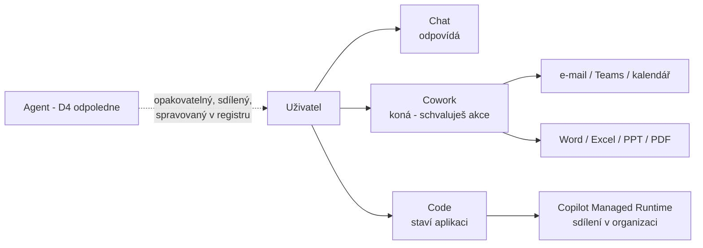
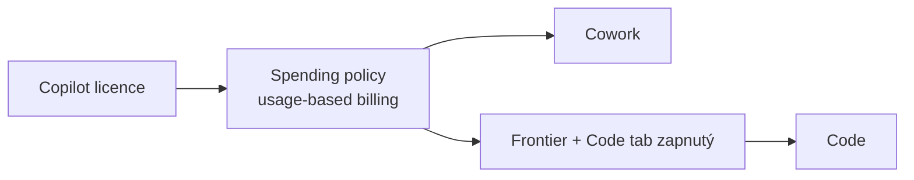

# Cowork a Code — Copilot, který koná a staví

> Typ: povinný · Den: 4 · Odhad: 15 min výklad + 2 laby po 30 min · Kdo: **studenti hands-on**
> Prostředí: viz [`../../environment.md`](../../environment.md) · Názvosloví: [`../../GLOSSARY.md`](../../GLOSSARY.md)
> Kontext: nový Copilot (Home / Code / Autopilot) → [`../../day-1/ai-landscape/`](../../day-1/ai-landscape/README.md) · licence a Copilot Credits → [`../../day-1/licensing/`](../../day-1/licensing/README.md)

## Cíle

- Student rozliší **Chat** (odpovídá), **Cowork** (koná za uživatele) a **Code** (staví software) a umí říct, kdy sáhnout po agentovi nebo Power Automate místo nich.
- Student zná **tři brány přístupu**: licence → spending policy (usage-based billing) → u Code navíc Frontier + zapnutý Code tab.
- Student si vyzkouší delegovaný úkol v Cowork se schvalováním akcí a postaví malou aplikaci v Code nad SharePoint daty.
- Student umí pojmenovat governance body: kdo akci schvaluje, kde aplikace běží, komu je sdílená, co to stálo.

## Výklad

### Tři režimy nového Copilota

- **Chat** — rychlé dotazy a odpovědi. Nic za uživatele nedělá.
- **Cowork** — popíšeš úkol, Cowork ho rozloží na kroky a provede: pošle e-mail, naplánuje schůzku, vytvoří Word/Excel/PowerPoint/PDF, postne do Teams, spravuje soubory v OneDrivu a SharePointu. **Každou citlivou akci uživatel schvaluje** (tlačítko pojmenované akcí — *Send*, *Post*, *Create*; u medium/high rizika indikátor). Umí i plánované prompty a event-driven úlohy (tab *Automations*). GA pro pracovní účty ([Cowork overview](https://learn.microsoft.com/en-us/copilot/cowork/)).
- **Code** — popíšeš výsledek (dashboard, interní nástroj, statický web, transformaci dat, skript), Code ho postaví, ukáže živý náhled a iteruje. Aplikace jde publikovat do **Copilot Managed Runtime** pro organizaci, statické aplikace sdílet jako org-scoped odkaz. **Frontier preview** ([Copilot Code](https://learn.microsoft.com/en-us/copilot/code/)).

Cowork je podle MS **„agentic system", ne agent** — nestavíš ho, nesdílíš ho, nepublikuješ do katalogu. Rozšiřuje se **skills** (vlastní, až 50) a **pluginy** z Microsoft 365 App Store. Stejný formát `SKILL.md` uvidíš v D5 `skills`.

### Tři brány přístupu

1. **Licence** — Cowork i Code vyžadují Microsoft 365 Copilot licenci ([Cowork get started](https://learn.microsoft.com/en-us/copilot/cowork/get-started), [Code requirements](https://learn.microsoft.com/en-us/copilot/code/code-requirements)). Copilot Credits PAYG licenci **nenahrazují**.
2. **Spending policy** — Cowork a Code běží na usage-based billingu; spending policy (M365 AC → **Copilot → Cost management**) řídí **přístup i strop** ([Usage-based billing](https://learn.microsoft.com/en-us/microsoft-365/copilot/usage-based-billing-overview-copilot-credits)). Bez policy uživatel službu nepoužije, ani s licencí.
3. **Frontier + Code tab** — jen pro Code (a App skill v Cowork). Admin navíc řídí, kde Code běží (default **jen cloud**), zda smí použít data organizace a zda smí připojit GitHub (default **vypnuto**) ([Manage Copilot Code](https://learn.microsoft.com/en-us/copilot/code/code-admin)).

### Kdy co

| Potřeba | Nástroj | Proč |
|---|---|---|
| Jednorázový úkol „udělej to za mě" | **Cowork** | žádná stavba, schvaluješ akce |
| Opakovaný dotaz nad stejnými zdroji pro tým | **Agent** (odpoledne) | sdílený, verzovaný, spravovaný v registru (D5) |
| Spolehlivý proces bez člověka (trigger → kroky) | **Power Automate** (D3) | deterministický, auditovatelný, bez LLM rozhodování |
| Přehled / nástroj nad daty | **Code** | aplikace, kterou lze sdílet a znovu otevřít |

### Kde aplikace žije — Copilot Managed Runtime

Publikovaná aplikace z Code (stejně jako z Cowork App skillu, Copilot Studia nebo CLI) běží v **Copilot Managed Runtime** (preview): Microsoft-hosted prostředí s Entra přihlášením a tenantovými governance politikami. Uživatelé ji najdou na `managedapps.cloud.microsoft` ([What is Copilot Managed Runtime](https://learn.microsoft.com/en-us/microsoft-365/managed-apps/)).

- **Správa:** inventář v **M365 AC → Apps → All apps**, politiky v **M365 AC → Apps → Settings → Environment groups** (routing, konektory a MCP servery, sharing, content security policy). Detailní pravidla prostředí a DLP v **Power Platform admin center** — oba admin centry ukazují tutéž konfiguraci ([Governance settings](https://learn.microsoft.com/en-us/microsoft-365/admin/manage/apps/governance)).
- **Vazba na Power Platform:** spravuje Global Admin nebo **Power Platform Administrator**, pojmy jsou environments / environment groups, platí existující **DLP a advanced connector policies** (přísnější vyhrává). Výchozí politika povoluje jen 18 first-party konektorů s Entra ID, které drží data v tenantu.
- **Náklady:** stavbu platí tvůrce (spending policy pro Code / Cowork), **běh platí každý uživatel, který aplikaci otevře** — samostatná spending policy *Copilot Managed Runtime*. V preview uživatel bez krytí po 20 operacích nebo 5 minutách ztratí přístup ([Admin overview](https://learn.microsoft.com/en-us/microsoft-365/admin/manage/apps/)). Správu projdete v D5 [`copilot-admin`](../../day-5/copilot-admin/lab-copilot-admin-tour.md).

## Klíčové rozlišení

- **Chat ≠ Cowork.** Chat odpovídá, Cowork koná — a čerpá Copilot Credits **navíc** k licenci.
- **Cowork ≠ agent.** Cowork je osobní pracovní relace; agent je sdílený artefakt s vlastníkem, lifecyclem a správou v registru. Cowork v M365 AC **Agents** nevypneš — přístup řídí spending policy (viz D5 [`copilot-admin`](../../day-5/copilot-admin/README.md)).
- **Plánovaný prompt v Cowork ≠ flow.** Obojí běží samo, ale prompt rozhoduje LLM; flow je deterministický. Na procesy s auditní stopou patří flow.
- **Licence ≠ permissions.** Cowork i Code pracují **s právy uživatele** — co nevidíš, nepošleš ani nezobrazíš v aplikaci.

## Naše prostředí

- Studentské účty mají od tohoto běhu **Copilot licenci** a jsou ve spending policy pro Cowork i Code (s per-user stropem). Tenant je zapsaný ve Frontier.
- **GitHub connection v Code zůstává vypnutá** — připojení repozitáře by mohlo vynést tenant data mimo hranici tenantu (data sovereignty). Ukážeme to jako governance rozhodnutí, ne jako chybu.
- EU Data Boundary: Cowork v EU tenantu nabízí **jen GPT modely** ([Cowork models](https://learn.microsoft.com/en-us/copilot/cowork/cowork-models)); detail v D5 [`explainer-ai-subprocessors.md`](../../day-5/copilot-admin/explainer-ai-subprocessors.md).

## Lab

- [`lab-cowork.md`](lab-cowork.md) — delegovaný úkol nad knihovnou `Vzorky` (D2): dokument + zpráva, schvalování akcí, plánovaný prompt.
- [`lab-code.md`](lab-code.md) — dashboard nad listem `Zaměstnanci` (HR scénář) a governance checklist.

## Zdroje (Microsoft)

[Cowork overview](https://learn.microsoft.com/en-us/copilot/cowork/) · [Get started with Cowork](https://learn.microsoft.com/en-us/copilot/cowork/get-started) · [Cowork models](https://learn.microsoft.com/en-us/copilot/cowork/cowork-models) · [Copilot Code](https://learn.microsoft.com/en-us/copilot/code/) · [Copilot Code requirements](https://learn.microsoft.com/en-us/copilot/code/code-requirements) · [Manage Copilot Code](https://learn.microsoft.com/en-us/copilot/code/code-admin) · [What is Copilot Managed Runtime](https://learn.microsoft.com/en-us/microsoft-365/managed-apps/) · [Copilot Managed Runtime — admin overview](https://learn.microsoft.com/en-us/microsoft-365/admin/manage/apps/) · [Copilot Managed Runtime — governance](https://learn.microsoft.com/en-us/microsoft-365/admin/manage/apps/governance) · [Usage-based billing](https://learn.microsoft.com/en-us/microsoft-365/copilot/usage-based-billing-overview-copilot-credits) · [Introducing the new Copilot](https://blogs.microsoft.com/blog/2026/09/25/introducing-the-new-copilot-with-home-code-and-autopilot/)

## Stav produktu / delta

> [!WARNING] Ověřit k datu běhu — stav k 2026-11.
> Cowork GA (pracovní účty), App skill v Cowork = Frontier. Code = Frontier preview — rozsah, UI a výchozí admin nastavení se mění. Sazby Copilot Credits za Cowork/Code tu záměrně neuvádíme — ověřit v Cost management. `/cost` funguje v Code (empiricky ověřeno 2026-11, MS docs ho uvádí jen u Copilot in SharePoint). Copilot Managed Runtime = preview; konkrétní lifecycle akce v *Apps → All apps* (vypnutí, smazání, změna vlastníka) ověřit v UI. Po Ignite (17.–20. 11. 2026) projet znovu (Cowork plugins, Autopilot).
