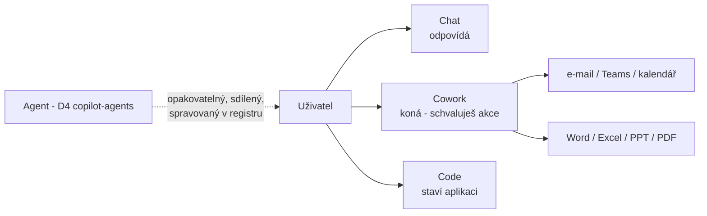

# Cowork — Copilot, který koná

> Typ: povinný · Den: 4 · Odhad: 15 min výklad + 30 min lab
> Prostředí: [`../../environment.md`](../../environment.md) · Názvosloví: [`../../GLOSSARY.md`](../../GLOSSARY.md)
> Kontext: nový Copilot (Home / Code / Autopilot) → [`../../day-1/ai-landscape/`](../../day-1/ai-landscape/README.md) · licence a Copilot Credits → [`../../day-1/licensing/`](../../day-1/licensing/README.md) · navazuje: [`../code/`](../code/README.md)

## Cíle

- Rozlišíte **Chat** (odpovídá), **Cowork** (koná za uživatele) a **Code** (staví software) a umíte říct, kdy místo nich sáhnout po agentovi nebo Power Automate.
- Znáte brány přístupu ke Cowork: licence → spending policy (usage-based billing).
- Vyzkoušíte si delegovaný úkol v Cowork se schvalováním akcí a zjistíte, kolik stál.
- Umíte pojmenovat governance body: kdo akci schvaluje, co běží bez člověka a co to stálo.

## Proč Cowork

Až dosud jste s Copilotem pracovali hlavně tak, že jste se ptali a on odpovídal — v chatu, v SharePointu, přes Skills. Výsledek jste pak sami zkopírovali do dokumentu, sami poslali e-mailem, sami založili schůzku. Cowork tenhle poslední krok přebírá: místo rady „takhle by to šlo" úkol skutečně provede v Microsoft 365 za vás.

Pro správce to mění otázky. U chatu stačilo řešit, *co Copilot uvidí*. U Cowork přibývá, *co Copilot udělá*, *kdo to odsouhlasil* a *kolik to stálo* — Cowork se totiž neplatí z licence, ale z Copilot Credits. Modul proto spojuje uživatelský pohled (jak delegovat úkol) se správcovským (kdo k Cowork pustí koho a za kolik).

## Tři režimy nového Copilota

Nový Copilot (viz D1 [`ai-landscape`](../../day-1/ai-landscape/README.md)) nabízí na kartě **Home** přepínač mezi Chatem a Cowork; Code je samostatná oblast. Liší se tím, co je výsledkem vaší práce s nimi:

- **Chat** — rychlé dotazy a odpovědi. Výsledkem je text; nic za vás nedělá.
- **Cowork** — popíšete úkol, Cowork ho rozloží na kroky a postupně je provede: pošle e-mail, naplánuje schůzku, vytvoří Word, Excel, PowerPoint nebo PDF, napíše do Teams, spravuje soubory v OneDrivu a SharePointu. Pro pracovní účty je v GA.
- **Code** — staví aplikace, dashboardy a skripty. Věnuje se mu samostatný modul [`../code/`](../code/README.md).

### Jak Cowork pracuje

Typický průběh vypadá takto: zadáte úkol (ideálně s připojenými soubory), Cowork ho rozloží na kroky a v bočním panelu ukazuje, co právě dělá a které **skills** si k tomu načetl — například *Word*, *Email* nebo *Enterprise Search*. Do práce mu můžete kdykoli vstoupit, upřesnit zadání nebo ho pozastavit.

Klíčový bezpečnostní prvek je **schvalování akcí**. Než Cowork provede citlivou akci, zastaví se a ukáže náhled. Tlačítko nese název té akce — *Send*, *Post*, *Create* — takže víte, co přesně odsouhlasíte. U akcí se středním a vysokým rizikem se navíc zobrazí indikátor rizika. Vedle tlačítka je volba, kterou lze další dotazy na podobné akce přeskočit; tato volba platí jen pro aktuální relaci ([Cowork overview](https://learn.microsoft.com/en-us/copilot/cowork/), [Use Cowork](https://learn.microsoft.com/en-us/copilot/cowork/use-cowork)). V labu ji schválně nepoužijete — chcete vidět každou akci.

Cowork umí i práci, u které nesedíte: **plánované prompty** (úkol se spustí v daný čas, třeba každé pondělí ráno) a **event-driven úlohy** (úkol se spustí, když přijde určitý e-mail nebo zpráva v Teams). Spravují se na kartě *Automations*. Pozor na to, že každý takový běh čerpá kredity, i když u něj nejste.

### Cowork není agent

Microsoft Cowork označuje jako **„agentic system", ne agent**. Rozdíl je praktický: agenta stavíte, sdílíte a publikujete do katalogu, má vlastníka a životní cyklus. Cowork nestavíte — je to vaše osobní pracovní relace s Copilotem ([Manage Cowork](https://learn.microsoft.com/en-us/copilot/cowork/cowork-admin-governance)).

Rozšířit ho ale můžete, a to dvěma způsoby:

- **Vlastní skills** — až 50 vlastních skills uložených v OneDrivu ve složce `/Documents/Cowork/skills/`. Používají stejný formát `SKILL.md`, který znáte z D3 [`skills`](../../day-3/skills/README.md); dovednost napsat dobrý skill je tedy přenositelná.
- **Pluginy** z Microsoft 365 App Store, které přidávají další skills a konektory.

Zdroje: [Cowork overview](https://learn.microsoft.com/en-us/copilot/cowork/), [Use Cowork — custom skills](https://learn.microsoft.com/en-us/copilot/cowork/use-cowork).

## Brány přístupu

Z D1 [`licensing`](../../day-1/licensing/README.md) znáte tři brány: licence, oprávnění a spending policy. Cowork patří mezi služby usage-based billingu, takže uživatel musí projít všemi:

1. **Licence** — Cowork vyžaduje Microsoft 365 Copilot licenci ([Cowork get started](https://learn.microsoft.com/en-us/copilot/cowork/get-started)). Copilot Credits PAYG licenci **nenahrazují**; platí se navíc k ní.
2. **Spending policy** — spending policy v M365 admin center (**Copilot → Cost management**) řídí u Cowork **přístup i strop**. Kdo v policy není, Cowork nepoužije, ani když má licenci. Limited budget v policy je tvrdý strop: po jeho vyčerpání uživatel službu do konce měsíce nepoužije ([Usage-based billing](https://learn.microsoft.com/en-us/microsoft-365/copilot/usage-based-billing-overview-copilot-credits)).
3. **App skill** (stavba aplikací přímo v Cowork) navíc vyžaduje účast ve **Frontier** programu ([Cowork overview](https://learn.microsoft.com/en-us/copilot/cowork/)).

Častá past: v M365 admin center se v sekci **Agents** objevuje i položka Cowork. Ta ale přístup neřídí — Cowork tam nevypnete. Jediný skutečný vypínač je spending policy ([Manage Cowork](https://learn.microsoft.com/en-us/copilot/cowork/cowork-admin-governance)). Podrobněji v D5 [`copilot-admin`](../../day-5/copilot-admin/README.md).

### Co se platí a kde to uvidíte

Kredity se čerpají za odpovědi modelu, volání nástrojů a skills, generování obrázků i úlohy v prohlížeči ([Usage-based billing](https://learn.microsoft.com/en-us/microsoft-365/copilot/usage-based-billing-overview-copilot-credits)). Delší úkol s mnoha kroky tedy stojí víc než jednoduchý dotaz — i proto v labu snížíte reasoning effort.

Cenu konkrétního úkolu se můžete pokusit zjistit příkazem `/cost` v konverzaci. V Code funguje; u Cowork ho dokumentace Microsoftu neuvádí, takže v labu zjistíte, co se stane. Spolehlivý pohled má správce v Cost management, kde je vidět spotřeba po uživatelích (s určitým zpožděním).

## Kdy co

Cowork je silný na jednorázovou práci, ale není odpověď na všechno. Tabulka shrnuje, kdy sáhnout po čem:

| Potřeba | Nástroj | Proč |
|---|---|---|
| Jednorázový úkol „udělej to za mě" | **Cowork** | žádná stavba, schvalujete akce |
| Opakovaný dotaz nad stejnými zdroji pro tým | **Agent** (D4 [`copilot-agents`](../copilot-agents/README.md)) | sdílený, verzovaný, spravovaný v registru (D5) |
| Spolehlivý proces bez člověka (trigger → kroky) | **Power Automate** (D4 [`power-automate-invoices`](../power-automate-invoices/README.md)) | deterministický, auditovatelný, bez LLM rozhodování |
| Přehled / nástroj nad daty | **Code** ([`../code/`](../code/README.md)) | aplikace, kterou lze sdílet a znovu otevřít |

Rozhodující otázky jsou dvě: *Bude se úkol opakovat pro víc lidí?* Pak patří do agenta. *Musí proces proběhnout pokaždé stejně a s auditní stopou?* Pak patří do flow. Cowork je nejlepší tam, kde jde o jednu konkrétní práci jednoho člověka.

## Klíčové rozlišení

- **Chat ≠ Cowork.** Chat odpovídá, Cowork koná — a čerpá Copilot Credits **navíc** k licenci.
- **Cowork ≠ agent.** Cowork je osobní pracovní relace; agent je sdílený artefakt s vlastníkem, lifecyclem a správou v registru. Cowork v M365 AC **Agents** nevypnete — přístup řídí spending policy (viz D5 [`copilot-admin`](../../day-5/copilot-admin/README.md)).
- **Plánovaný prompt v Cowork ≠ flow.** Obojí běží samo, ale u promptu o krocích rozhoduje LLM, flow je deterministický. Procesy s auditní stopou patří do flow.
- **Licence ≠ permissions.** Cowork pracuje **s právy uživatele** — co nevidíte, to ani nepošlete.

## Naše prostředí

- Studentské účty mají od běhu 2026-11 **Copilot licenci** a jsou ve spending policy pro Cowork s per-user stropem. Pokud strop vyčerpáte, Cowork vám do konce měsíce přestane fungovat — proto v labu šetříte kredity a nenecháváte žádné naplánované úlohy.
- Kurzovní tenant je uvnitř EU Data Boundary, a tam Cowork nabízí **jen GPT modely** ([Cowork models](https://learn.microsoft.com/en-us/copilot/cowork/cowork-models)). Proč to tak je, vysvětluje D5 [`explainer-ai-subprocessors.md`](../../day-5/copilot-admin/explainer-ai-subprocessors.md).
- Data pro lab máte z D2: knihovnu `Vzorky` na vlastním webu.

## Shrnutí

- Chat odpovídá, Cowork úkol provede za vás, Code staví aplikace.
- Každou citlivou akci Cowork schvalujete; plánované a event-driven úlohy běží bez vás a čerpají kredity.
- Přístup ke Cowork = Copilot licence **a** spending policy v Cost management; položka v Agents nic nevypíná.
- Cowork není agent: nestavíte ho ani nesdílíte, rozšiřujete ho skills (`SKILL.md`) a pluginy.
- Opakovanou týmovou práci dejte do agenta, deterministický proces do Power Automate.

## Lab

[`lab-cowork.md`](lab-cowork.md) — delegovaný úkol nad knihovnou `Vzorky` (D2): dokument + zpráva, schvalování akcí, plánovaný prompt, cena.

## Zdroje (Microsoft)

- **Cowork:** [Cowork overview](https://learn.microsoft.com/en-us/copilot/cowork/) · [Get started with Cowork](https://learn.microsoft.com/en-us/copilot/cowork/get-started) · [Use Cowork](https://learn.microsoft.com/en-us/copilot/cowork/use-cowork) · [Cowork FAQ](https://learn.microsoft.com/en-us/copilot/cowork/cowork-faq) · [Cowork models](https://learn.microsoft.com/en-us/copilot/cowork/cowork-models)
- **Správa a náklady:** [Manage Cowork](https://learn.microsoft.com/en-us/copilot/cowork/cowork-admin-governance) · [Usage-based billing](https://learn.microsoft.com/en-us/microsoft-365/copilot/usage-based-billing-overview-copilot-credits)
- **Nový Copilot:** [Introducing the new Copilot](https://blogs.microsoft.com/blog/2026/09/25/introducing-the-new-copilot-with-home-code-and-autopilot/)

## Stav produktu / delta

> [!WARNING] Ověřit k datu běhu — stav k 2026-11.
>
> - Cowork je v GA pro pracovní účty; App skill je ve Frontier.
> - Sazby Copilot Credits za Cowork tu záměrně neuvádíme — ověřte v Cost management / Copilot Credit Estimator.
> - Po Ignite (17.–20. 11. 2026) projít znovu (Cowork plugins, Autopilot).
