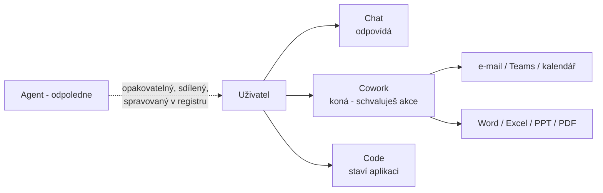

# Cowork — Copilot, který koná

> Typ: povinný · Den: 4 · Odhad: 15 min výklad + 30 min lab · Kdo: **studenti hands-on**
> Prostředí: viz [`../../environment.md`](../../environment.md) · Názvosloví: [`../../GLOSSARY.md`](../../GLOSSARY.md)
> Kontext: nový Copilot (Home / Code / Autopilot) → [`../../day-1/ai-landscape/`](../../day-1/ai-landscape/README.md) · licence a Copilot Credits → [`../../day-1/licensing/`](../../day-1/licensing/README.md) · navazuje: [`../code/`](../code/README.md)

## Cíle

- Student rozliší **Chat** (odpovídá), **Cowork** (koná za uživatele) a **Code** (staví software) a umí říct, kdy sáhnout po agentovi nebo Power Automate místo nich.
- Student zná brány přístupu k Cowork: licence → spending policy (usage-based billing).
- Student si vyzkouší delegovaný úkol v Cowork se schvalováním akcí a zjistí, kolik stál.
- Student umí pojmenovat governance body: kdo akci schvaluje, co běží bez člověka, co to stálo.

## Výklad

### Tři režimy nového Copilota

- **Chat** — rychlé dotazy a odpovědi. Nic za uživatele nedělá.
- **Cowork** — popíšeš úkol, Cowork ho rozloží na kroky a provede: pošle e-mail, naplánuje schůzku, vytvoří Word/Excel/PowerPoint/PDF, postne do Teams, spravuje soubory v OneDrivu a SharePointu. **Každou citlivou akci uživatel schvaluje** (tlačítko pojmenované akcí — *Send*, *Post*, *Create*; u medium/high rizika indikátor). Umí i plánované prompty a event-driven úlohy (tab *Automations*). GA pro pracovní účty ([Cowork overview](https://learn.microsoft.com/en-us/copilot/cowork/)).
- **Code** — staví aplikace, dashboardy a skripty; samostatný modul [`../code/`](../code/README.md).

Cowork je podle MS **„agentic system", ne agent** — nestavíš ho, nesdílíš ho, nepublikuješ do katalogu. Rozšiřuje se **skills** (vlastní, až 50 — v OneDrivu `/Documents/Cowork/skills/`) a **pluginy** z Microsoft 365 App Store. Stejný formát `SKILL.md` znáš z D3 [`skills`](../../day-3/skills/README.md).

### Brány přístupu

1. **Licence** — Cowork vyžaduje Microsoft 365 Copilot licenci ([Cowork get started](https://learn.microsoft.com/en-us/copilot/cowork/get-started)). Copilot Credits PAYG licenci **nenahrazují**.
2. **Spending policy** — Cowork běží na usage-based billingu; spending policy (M365 AC → **Copilot → Cost management**) řídí **přístup i strop** ([Usage-based billing](https://learn.microsoft.com/en-us/microsoft-365/copilot/usage-based-billing-overview-copilot-credits)). Bez policy uživatel Cowork nepoužije, ani s licencí. Položka Cowork v M365 AC **Agents** přístup neřídí ([Manage Cowork](https://learn.microsoft.com/en-us/copilot/cowork/cowork-admin-governance)).
3. **App skill** (stavba aplikací v Cowork) navíc vyžaduje **Frontier**.

Placené jsou model responses, tool a skill calls, generování obrázků i úlohy v prohlížeči. Uživatel si cenu zkusí zjistit přes `/cost` (v Code ověřeno, u Cowork docs neuvádí), admin ji vidí v Cost management.

### Kdy co

| Potřeba | Nástroj | Proč |
|---|---|---|
| Jednorázový úkol „udělej to za mě" | **Cowork** | žádná stavba, schvaluješ akce |
| Opakovaný dotaz nad stejnými zdroji pro tým | **Agent** (odpoledne) | sdílený, verzovaný, spravovaný v registru (D5) |
| Spolehlivý proces bez člověka (trigger → kroky) | **Power Automate** (dopoledne) | deterministický, auditovatelný, bez LLM rozhodování |
| Přehled / nástroj nad daty | **Code** | aplikace, kterou lze sdílet a znovu otevřít |

## Klíčové rozlišení

- **Chat ≠ Cowork.** Chat odpovídá, Cowork koná — a čerpá Copilot Credits **navíc** k licenci.
- **Cowork ≠ agent.** Cowork je osobní pracovní relace; agent je sdílený artefakt s vlastníkem, lifecyclem a správou v registru. Cowork v M365 AC **Agents** nevypneš — přístup řídí spending policy (viz D5 [`copilot-admin`](../../day-5/copilot-admin/README.md)).
- **Plánovaný prompt v Cowork ≠ flow.** Obojí běží samo, ale prompt rozhoduje LLM; flow je deterministický. Na procesy s auditní stopou patří flow.
- **Licence ≠ permissions.** Cowork pracuje **s právy uživatele** — co nevidíš, nepošleš.

## Naše prostředí

- Studentské účty mají od běhu 2026-11 **Copilot licenci** a jsou ve spending policy pro Cowork (s per-user stropem).
- EU Data Boundary: Cowork v EU tenantu nabízí **jen GPT modely** ([Cowork models](https://learn.microsoft.com/en-us/copilot/cowork/cowork-models)); detail v D5 [`explainer-ai-subprocessors.md`](../../day-5/copilot-admin/explainer-ai-subprocessors.md).

## Lab

[`lab-cowork.md`](lab-cowork.md) — delegovaný úkol nad knihovnou `Vzorky` (D2): dokument + zpráva, schvalování akcí, plánovaný prompt, cena.

## Zdroje (Microsoft)

[Cowork overview](https://learn.microsoft.com/en-us/copilot/cowork/) · [Get started with Cowork](https://learn.microsoft.com/en-us/copilot/cowork/get-started) · [Cowork FAQ](https://learn.microsoft.com/en-us/copilot/cowork/cowork-faq) · [Manage Cowork](https://learn.microsoft.com/en-us/copilot/cowork/cowork-admin-governance) · [Cowork models](https://learn.microsoft.com/en-us/copilot/cowork/cowork-models) · [Usage-based billing](https://learn.microsoft.com/en-us/microsoft-365/copilot/usage-based-billing-overview-copilot-credits) · [Introducing the new Copilot](https://blogs.microsoft.com/blog/2026/09/25/introducing-the-new-copilot-with-home-code-and-autopilot/)

## Stav produktu / delta

> [!WARNING] Ověřit k datu běhu — stav k 2026-11.
> Cowork GA (pracovní účty), App skill = Frontier. Sazby Copilot Credits za Cowork tu záměrně neuvádíme — ověřit v Cost management / Copilot Credit Estimator. Po Ignite (17.–20. 11. 2026) projet znovu (Cowork plugins, Autopilot).
