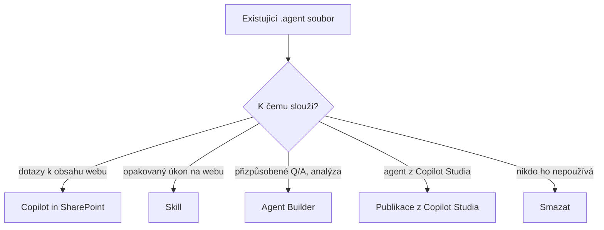

# SharePoint agents

> Typ: **volitelný** (podpora `.agent` končí) · Den: 4 (konec dne) · Odhad: 20 min — instruktorské demo
> Prostředí: viz [`../../environment.md`](../../environment.md) · Názvosloví: [`../../GLOSSARY.md`](../../GLOSSARY.md)

## Cíle

- Vysvětlíte, co je SharePoint agent (`.agent` soubor) a čím se liší od ostatních cest ke stavbě agentů.
- Pochopíte jeho praktický limit — jeden zdroj znalostí — a proč se do něj HR scénář nevejde.
- Rozlišíte licenci pro **tvorbu** a pro **použití** SharePoint agenta.
- Víte, co se s formátem `.agent` děje, a umíte zákazníkovi doporučit jednu ze čtyř cest upgradu.

## Proč se zabývat končícím formátem

SharePoint agents jsou cesta, která právě končí. Přesto má smysl ji znát: u zákazníků dnes existují `.agent` soubory, které někdo vytvořil, sdílel do Teams a používá. Správce SharePointu je musí najít, posoudit a převést dřív, než přestanou odpovídat. A navíc na nich dobře uvidíte dvě obecné lekce kurzu — že licence a oprávnění jsou dvě různé brány a že dokumentace Microsoftu někdy zaostává za tím, co se v tenantu skutečně děje.

Společný základ (deklarativní agent, mapa cest, srovnání nástrojů) najdete v modulu [`copilot-agents`](../copilot-agents/README.md); tento blok na něj navazuje a nic dalšího na něm nestojí.

## Co je SharePoint agent

SharePoint agent je agent, kterého staví **vlastník obsahu přímo na SharePoint webu**, aniž by web opustil. Výsledkem je soubor `.agent` uložený v knihovně webu. Protože jde o obyčejný soubor, agent **žije s webem**: dědí jeho oprávnění (kdo vidí soubor, může agenta použít) i jeho životní cyklus (smažete-li web, zmizí i agent).

To je zásadní rozdíl oproti ostatním cestám v D4. U Agent Builderu, Agents Toolkitu nebo Copilot Studia je tvůrcem maker nebo vývojář a agent je samostatný objekt spravovaný mimo web. SharePoint agent je jediná cesta, kde tvůrcem je ten, komu obsah patří — třeba personalistka, která spravuje knihovnu smluv.

## Limit: 1 zdroj a nic jiného (empiricky)

V kurzovním tenantu jsme v 07/2026 ověřili, že přidání dalšího zdroje znalostí **odstranilo** ty předchozí — agent tedy pracuje vždy jen s jedním zdrojem. Pozorovali jsme to v souvislosti s podporou listů jako zdroje (MC1255409). Dokumentace Microsoftu takový limit **neuvádí**; support článek o tvorbě agenta žádný strop počtu zdrojů nezmiňuje ([Create an agent in SharePoint](https://support.microsoft.com/sharepoint/copilot-in-sharepoint/create-an-agent-in-sharepoint), [MC1255409](https://mc.merill.net/message/MC1255409)). Berte to proto jako empirické pozorování, které je potřeba před použitím ověřit živě.

Pro HR scénář z modulu `copilot-agents` to má jasný důsledek. Scénář pracuje s listem a dvěma knihovnami, a to se do **jednoho** SharePoint agenta nevejde. Máte dvě možnosti: zúžit agenta na jediný zdroj (například knihovnu `Smlouvy`), nebo postavit agentů víc. Právě proto je tento blok v kurzu — omezení samo ukazuje, kdy SharePoint agent nestačí a kdy sáhnout po jiné cestě.

## Licence: tvorba vs. použití

U SharePoint agenta se licence liší podle toho, zda agenta **tvoříte**, nebo **používáte**:

- **Tvorba** vyžaduje Copilot licenci. Microsoft Learn to tak uvádí a v tenantu jsme to ověřili. Support článek ale připouští i variantu „licence nebo PAYG" — Microsoft si tu sám odporuje.
- **Použití** je možné s licencí **nebo** přes PAYG (Copilot Credits). Měření spotřeby funguje i pro uživatele bez licence, ovšem jen pro `.agent` soubory.

Jde o stejný vzor, který znáte z D1 ([`licensing`](../../day-1/licensing/README.md)): **licence gate-uje funkci, oprávnění gate-ují obsah**. I uživatel s licencí se od agenta dozví jen to, co smí vidět v podkladovém zdroji.

## Distribuce

SharePoint agent se šíří jen přes web, na kterém vznikl, a lze ho sdílet do chatu nebo kanálu v Teams. Neexistuje pro něj organizační katalog, marketplace ani správa ve zdrojovém kódu. Pro malý tým nad jednou knihovnou to stačí; pro agenta, kterého má najít celá firma, ne.

## Konec formátu `.agent` a cesty upgradu

Microsoft nekončí s agenty v SharePointu jako takovými, končí jen **formát `.agent`**. Harmonogram je dvoufázový:

1. **Od poloviny listopadu 2026** otevře tlačítko „Create agent" na webu **Agent Builder** a nový agent se už jako `.agent` soubor neuloží. Ve stávajícím editoru se objeví volba upgradu.
2. **Po březnu 2027** stávající `.agent` soubory přestanou odpovídat — v SharePointu, v Teams i v aplikaci Copilot.

Automatický upgrade neexistuje; o cestě rozhoduje vlastník agenta nebo webu. Microsoft nabízí čtyři cesty podle toho, k čemu agent slouží ([Upgrade SharePoint agents](https://learn.microsoft.com/en-us/sharepoint/upgrade-sharepoint-agents)):

| Co agent dnes dělá | Doporučená cesta |
|---|---|
| hlavně odpovídá na dotazy k obsahu webu | použít přímo **Copilot in SharePoint** |
| provádí opakovaný úkon nebo postup na webu | převést agenta na **skill** |
| poskytuje přizpůsobené Q&A, vyhledávání nebo analýzu | upgradovat přes **Agent Builder** |
| je custom engine agent z Copilot Studia publikovaný do SharePointu | publikovat agenta z **Copilot Studia** do aplikace Copilot |

Dvě změny po upgradu stojí za zdůraznění. Zaprvé **sdílení**: upgradovaný agent se sdílí na úrovni agenta (lidem, skupinám), ne přes oprávnění SharePointu — agent tedy přestane „žít s webem". Zadruhé **licence**: PAYG pro SharePoint agents platí jen pro `.agent` soubory; po upgradu se použití bez licence řídí PAYG modelem aplikace Copilot. Cesty Copilot in SharePoint a skill navíc vyžadují Copilot licenci u každého uživatele — bez ní na PAYG nefungují (viz [`skills`](../../day-3/skills/README.md)).

## Klíčové rozlišení

- **SharePoint agent ≠ Copilot in SharePoint / Skills.** SharePoint agent je samostatný `.agent` soubor na webu; Copilot in SharePoint a Skills (D3) jsou funkce Copilota. Mate to tím víc, že jedna z cest upgradu je právě „převést agenta na skill".
- **Tvorba ≠ použití.** Tvorba chce Copilot licenci; použití jde s licencí nebo přes PAYG.
- **Končí formát, ne scénář.** Agenti nad obsahem SharePointu dál existují — vznikají v Agent Builderu a sdílejí se jinak.
- **Empirický limit ≠ dokumentovaný limit.** „Jeden zdroj" jsme pozorovali v tenantu, Microsoft ho nedokumentuje.

## Naše prostředí

Demo běží na webu `/sites/hr-demo` nad knihovnou `Smlouvy` a listem `Zaměstnanci` z HR scénáře ([`scenario-hr-agent.md`](../copilot-agents/scenario-hr-agent.md)). Studenti mají od běhu 2026-11 Copilot licenci, takže by agenta vytvořit mohli; protože jde o končící cestu, staví ho jen instruktor a vy sledujete a předpovídáte chování. Běh kurzu (D4 = 5. 11. 2026) je ještě před přechodem na Agent Builder, demo tedy ukazuje původní chování `.agent`.

## Shrnutí

- SharePoint agent je `.agent` soubor, který na webu tvoří vlastník obsahu; dědí oprávnění a životní cyklus webu.
- Prakticky zvládne jen jeden zdroj znalostí (empiricky, nedokumentováno) — HR scénář se do jednoho agenta nevejde.
- Tvorba vyžaduje Copilot licenci, použití jde s licencí nebo přes PAYG (jen pro `.agent`).
- Od poloviny 11/2026 tvorba přes Agent Builder, po 03/2027 `.agent` přestanou odpovídat; pro existující agenty volíte jednu ze čtyř cest upgradu.

## Lab

[`lab-sharepoint-agent.md`](lab-sharepoint-agent.md) — instruktorské demo: limit jednoho zdroje naživo. Scénář: [`../copilot-agents/scenario-hr-agent.md`](../copilot-agents/scenario-hr-agent.md).

## Zdroje (Microsoft)

- **SharePoint agents:** [SharePoint agents](https://learn.microsoft.com/en-us/sharepoint/get-started-sharepoint-agents) · [Create an agent in SharePoint (support)](https://support.microsoft.com/sharepoint/copilot-in-sharepoint/create-an-agent-in-sharepoint)
- **Upgrade a konec `.agent`:** [Upgrade SharePoint agents](https://learn.microsoft.com/en-us/sharepoint/upgrade-sharepoint-agents)
- **Message center:** [MC1255409 — Lists as knowledge source](https://mc.merill.net/message/MC1255409)

## Stav produktu / delta

> [!WARNING] Ověřit k datu běhu — stav k 2026-11.
>
> - **Přechod na Agent Builder** (pol. 11/2026) a konec `.agent` (po 03/2027) — ověřte, zda „Create agent" ještě vytváří `.agent` soubor.
> - **Podpora listů** jako zdroje je podle MC1255409 v GA od ~05/2026, admin dokumentace to ale nereflektuje; limit „1 zdroj" je empirický.
> - **Licence tvorby:** Learn uvádí Copilot licenci, support článek připouští licenci nebo PAYG — Microsoft si odporuje.
