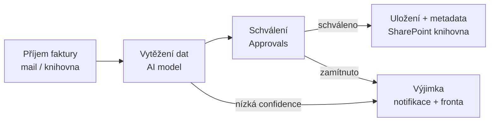

# Power Automate — příchozí faktury

> Typ: povinný · Den: 4 (otvírák) · Odhad: krátký AM blok — **jen výklad + demo, bez labu**
> Prostředí: [`../../environment.md`](../../environment.md) · Názvosloví: [`../../GLOSSARY.md`](../../GLOSSARY.md)

## Cíle

- Načrtnete end-to-end flow příchozí faktury: příjem → vytěžení → schválení → uložení s metadaty.
- Rozlišíte tři cesty vytěžování (AI Builder, Document processing, **Azure AI Document Intelligence**) a pro konkrétní situaci umíte vybrat.
- Víte, kde flow provozně bolí: výjimky, limity, deprecated triggery.

## Proč faktury a proč Power Automate

Příchozí faktura je učebnicový případ procesu, který kombinuje všechno, čím se kurz zabývá: dokument v SharePoint knihovně, AI, která z něj vytáhne data, člověka, který rozhoduje, a metadata, podle kterých se dokument dál hledá a spravuje. V D2 [`document-processing`](../../day-2/document-processing/) jste viděli, jak AI vyplní sloupce knihovny. Tady jdete o krok dál: vytěžená data nejsou cílem, ale vstupem do **procesu** se schválením a výjimkami. Proces řídí Power Automate.

Modul je výkladový. Nestavíte flow klik po kliku — potřebujete pochopit jeho anatomii a rozhodnutí, která za ním stojí, protože na ně hned navazuje další blok.

## Kam flow patří — environmenty (úvod před prvním Power Platform blokem)

Dřív než vznikne první flow, je potřeba rozhodnout, *kde* poběží. **Environment** je kontejner Power Platformy pro aplikace, flows, agenty a data a zároveň governance hranice: určuje security, DLP pravidla, billing i životní cyklus. Pro správce SharePointu se hodí analogie: environment je pro Power Platform tím, čím je site collection pro SharePoint — jednotkou správy a izolace.

Doporučená strategie zní: výchozí (default) environment používat jen pro osobní produktivitu, makery přesměrovat přes environment routing a pro reálná řešení zakládat vyhrazené environmenty. V kurzovním tenantu navíc narazíte na předprovisionovaný „Microsoft 365 sandbox", který je artefaktem CDX demo tenantu, ne produktem. Podrobný výklad typů environmentů, strategie a zacházení s tímto artefaktem najdete v [`explainer-environments.md`](explainer-environments.md).

Rozhodnutí z tohoto úvodu — vyhrazený environment `GOC224-lab` a k němu připojená billing policy — je **předpokladem pátečního Copilot Studio labu** (D5 [`copilot-studio`](../../day-5/copilot-studio/)). Demo flow tohoto modulu běží také v něm, ne v defaultu.

## Anatomie flow

Každý fakturový flow, ať ho postavíte jakkoli, má stejnou kostru: něco ho spustí, AI vytěží data, člověk rozhodne a výsledek se uloží. Podstatná je čtvrtá cesta, na kterou se snadno zapomíná — **výjimka**.

Všimněte si, že do větve výjimek vedou dvě šipky. Zamítnutí schvalovatelem je obchodní rozhodnutí; nízká confidence je technický signál, že AI si výsledkem není jistá. Obě situace musí skončit u člověka, ne tiše v metadatech.

### Trigger

Flow startuje ve chvíli, kdy faktura dorazí — e-mailem, nebo nahráním do SharePoint knihovny. Pro knihovnu použijte trigger **„When a file is created (properties only)"**. Triggery s koncovkou „...in a folder" jsou **deprecated**, v designeru je ale stále uvidíte a nabízejí se k výběru. Flow postavený na nich dnes funguje, ale stavíte na něčem, co Microsoft dál nepodporuje ([SharePoint connector triggers](https://learn.microsoft.com/en-us/sharepoint/dev/business-apps/power-automate/sharepoint-connector-actions-triggers)).

### Schválení

Schválení zajišťuje konektor Approvals, typicky akcí **Start and wait for an approval**. Schvalovatel odpovídá z e-mailu, z Teams nebo z mobilní aplikace, flow mezitím čeká. Čekání má ale strop: pokud může schvalování trvat déle než 30 dní, použijte **„Create an approval (v2)"** a odpovědi zpracujte druhým flow, který na ně reaguje ([Approvals](https://learn.microsoft.com/en-us/power-automate/modern-approvals)). Stejný konektor jste potkali v D3 [`esignature`](../../day-3/esignature/) ve vzoru *schválit → podepsat*.

### Výjimky a mantinely

Robustní flow počítá s tím, že něco selže. Potřebuje větev pro nízkou confidence, nastavenou retry policy pro akce, které mohou dočasně selhat, a respekt k limitům služeb. AI Builder má limit **360 volání na environment za 60 sekund**, sdílený napříč modely pro zpracování dokumentů včetně prebuilt modelu faktur ([prebuilt invoice model](https://learn.microsoft.com/en-us/ai-builder/prebuilt-invoice-processing)). Při dávkovém nahrání stovek faktur do knihovny na něj narazíte. Jak takové situace sledovat a řešit provozně, probírá runbook v D5 [`monitoring`](../../day-5/monitoring/README.md).

## Tři cesty vytěžení — a proč akcentujeme Azure

Vytěžit data z faktury umí v ekosystému Microsoftu tři různé služby. Liší se tím, kde žijí, jak se platí a kolik kontroly vám dávají.

| Cesta | Co to je | Kdy |
|---|---|---|
| **AI Builder — invoice processing** | prebuilt model v Power Platform, low-code, umí **češtinu i slovenštinu**, ~30 polí vč. DIČ (`VendorTaxId`), IBAN ([prebuilt invoice model](https://learn.microsoft.com/en-us/ai-builder/prebuilt-invoice-processing)) | rychlý start uvnitř flow; AI Builder kredity → od 11/2026 Copilot Credits (viz delta) |
| **Document processing for M365** | SharePoint-native (prebuilt/structured/unstructured modely, D2) | metadata v knihovně, bez flow logiky |
| **Azure AI Document Intelligence** | `prebuilt-invoice` v4.0 GA, 27 jazyků, až 2 000 stran, plná kontrola přes API ([prebuilt-invoice](https://learn.microsoft.com/en-us/azure/ai-services/document-intelligence/prebuilt/invoice)) | **doporučená cesta pro objem a robustnost** — verzované API, vyšší limity, nezávislost na Power Platform kreditech |

**AI Builder** je nejkratší cesta: model vložíte jako akci do flow a výstupní pole rovnou mapujete. Ke každému poli vrací confidence score, takže větev výjimek postavíte jednoduchou podmínkou. Dokumentace Microsoftu ukazuje i vzor, kdy se při nízké confidence (v příkladu pod 0,65) zavolá druhý, vlastní model ([prebuilt invoice model](https://learn.microsoft.com/en-us/ai-builder/prebuilt-invoice-processing)). Daní za pohodlí je vázanost na kredity a limity Power Platformy.

**Document processing for Microsoft 365** znáte z D2. Pracuje přímo v knihovně a výsledkem jsou vyplněné sloupce. Neumí ale proces — žádné schválení, žádné větvení. Hodí se tam, kde stačí, aby faktura měla správná metadata; schvalovací logiku by pak stejně musel doplnit flow.

**Azure AI Document Intelligence** je samostatná Azure služba, kterou flow volá přes API. Dává vám verzované API, vyšší limity a nezávislost na Power Platform kreditech — proto ji pro objem a robustnost doporučujeme. Napojení na flow přes vlastní akci je přesně scénář A labu v navazujícím bloku.

> [!IMPORTANT] Názvosloví
> „Azure Cognitive Services" je zastaralý brand: Form Recognizer → **Azure AI Document Intelligence** (2023), dnes pod deštníkem **Microsoft Foundry** („Foundry Tools"). Oficiální název na overview stránce je k 2026-10 „**Azure Document Intelligence in Foundry Tools**" (bez „AI"); v materiálech zatím používáme zavedený název Azure AI Document Intelligence ([overview](https://learn.microsoft.com/en-us/azure/ai-services/document-intelligence/overview)).

Pro náklady si zapamatujte: Document Intelligence se účtuje přes Azure subscription. Je to **třetí kategorie** vedle obou M365 PAYG modelů (Document processing a Copilot Credits) — viz [`GLOSSARY.md`](../../GLOSSARY.md) a D1 [`licensing`](../../day-1/licensing/).

## Klíčové rozlišení

- **AI Builder vs. Document Intelligence**: stejná úloha, jiný kontrakt — AI Builder = kredity (nově Copilot Credits) + limity Power Platformy, low-code; Document Intelligence = Azure služba s SLA, verzemi API a cenou za stránku. Pro 20 faktur/měsíc AI Builder stačí; pro účtárnu s tisícovkami je Azure robustnější.
- **Vytěžení vs. schválení**: AI dává *návrh dat s confidence*; rozhodnutí zůstává na člověku (Approvals). Nízkou confidence nikdy nepouštějte rovnou do metadat.
- **Document processing vs. flow**: Document processing vyplní metadata v knihovně, ale proces (schválení, výjimky) neřídí; to je práce flow.

## Naše prostředí

Modul nemá lab. Uvidíte demo flow v environmentu `GOC224-lab`: trigger na knihovně → vytěžení AI Builderem → schválení → zápis metadat. Na testovacích fakturách uvidíte i rozdíl v confidence mezi čistým a horším dokumentem a schvalovací notifikaci v Teams a e-mailu. Demo flow využijete hned v dalším bloku jako podklad pro návrh rozšíření.

## Shrnutí

- Fakturový flow má čtyři kroky (příjem → vytěžení → schválení → uložení) a povinnou větev výjimek pro zamítnutí i nízkou confidence.
- Trigger na knihovně: „When a file is created (properties only)"; triggery „...in a folder" jsou deprecated.
- AI Builder je nejrychlejší start uvnitř flow; Azure AI Document Intelligence je doporučená cesta pro objem a robustnost; Document processing řeší metadata, ne proces.
- Flow stavějte ve vyhrazeném environmentu (`GOC224-lab`), ne v defaultu.

## Lab

Tento modul lab nemá — je to výklad a demo. Na demo flow navazuje lab v D4 [`procode-vs-lowcode`](../procode-vs-lowcode/): [`lab-flow-extension.md`](../procode-vs-lowcode/lab-flow-extension.md) — návrh rozšíření flow o vlastní akci (mimo jiné nahrazení AI Builderu voláním Azure AI Document Intelligence).

## Zdroje (Microsoft)

- **Power Automate:** [Approvals v Power Automate](https://learn.microsoft.com/en-us/power-automate/modern-approvals) · [SharePoint connector — triggery a akce](https://learn.microsoft.com/en-us/sharepoint/dev/business-apps/power-automate/sharepoint-connector-actions-triggers)
- **AI Builder:** [AI Builder invoice processing](https://learn.microsoft.com/en-us/ai-builder/prebuilt-invoice-processing) · [End of AI Builder credits](https://learn.microsoft.com/en-us/ai-builder/endofaibcredits) · [Partner Center — říjen 2026](https://learn.microsoft.com/en-us/partner-center/announcements/2026-october)
- **Azure AI Document Intelligence:** [Overview](https://learn.microsoft.com/en-us/azure/ai-services/document-intelligence/overview) · [Prebuilt invoice model](https://learn.microsoft.com/en-us/azure/ai-services/document-intelligence/prebuilt/invoice)

## Stav produktu / delta

> [!WARNING] Ověřit k datu běhu — stav k 2026-11.
>
> - **AI Builder kredity:** k 1. 11. 2026 konec prodeje capacity add-onů (i v CSP) a konec seeded kreditů v nových licencích; stávající kredity lze čerpat do konce aktuálního termínu, pak AI Builder funkce čerpají **Copilot Credits** ([Partner Center, říjen 2026](https://learn.microsoft.com/en-us/partner-center/announcements/2026-october), [End of AI Builder credits](https://learn.microsoft.com/en-us/ai-builder/endofaibcredits)).
> - **„Foundry Tools" rebrand** je čerstvý — stránky Microsoftu míchají názvy Azure Document Intelligence / Foundry. Sjednocení názvu v materiálech po Ignite (17.–20. 11. 2026).
> - **Deprecated triggery** „...in a folder" jsou stále v designeru.
> - **Document Intelligence API:** v4.0 GA; v2.1 konec podpory 2027-09 ([overview](https://learn.microsoft.com/en-us/azure/ai-services/document-intelligence/overview)).
