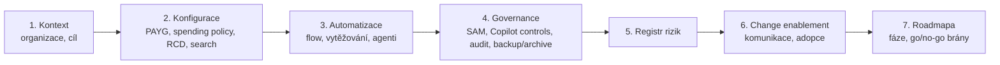

# Závěrečný projekt a další kroky

> Typ: povinný · Den: 5 (závěr) · Odhad: PM blok
> Prostředí: viz [`../../environment.md`](../../environment.md) · Názvosloví: [`../../GLOSSARY.md`](../../GLOSSARY.md)

## Cíle

- Sestavíte **rollout blueprint** — design dokument nasazení Copilotu a obsahových služeb pro svou organizaci.
- Blueprint obhájíte: konfiguraci, automatizaci, governance, rizika, change enablement a roadmapu.
- Odejdete s mapou dalších kroků (adopce, zdroje Microsoftu, co ověřit doma).

## Proč blueprint, a ne další stavba

Celý týden jste stavěli a klikali: nastavovali PAYG, zapínali vytěžování, psali skripty, navrhovali a stavěli agenty, procházeli admin centra. Každý modul přitom řešil jeden výsek. Ve vlastní organizaci ale nebudete rozhodovat po modulech — budete muset odpovědět na otázku „jak to celé nasadíme, kolik to bude stát a co se může pokazit".

Závěrečný projekt proto nic nového nestaví. Skládá poznatky z týdne do **rozhodovacího dokumentu**, který si odnesete domů. Kurzovní tenant sloužil jako důkaz, že jednotlivé kroky jdou provést; blueprint z nich dělá plán pro vaši firmu. Píšete ho v Markdownu — formátu, který znáte z modulu [`formats`](../../day-1/formats/).

Žádná sekce blueprintu nestojí na volitelných modulech. Všechno, co potřebujete, jste probrali v povinných blocích D1–D5.

## Efektivní nástroj, ne AI za každou cenu

Celý týden jste viděli, co AI umí, a dnes je moderní dávat ji všude. Cílem vašeho blueprintu ale není najít co nejvíc míst pro AI — cílem je **najít pro každou práci nejefektivnější nástroj**. AI není samospasitelná technologie. Spousta osvědčených řešení ke svému běhu žádnou AI nepotřebuje: pohled a filtr v listu, vypočítaný sloupec, formulář s validací, flow s podmínkami, schvalovací proces, report. Bývají levnější, rychlejší a předvídatelnější.

AI má přitom v tomhle příběhu důležitou roli — jen často jinde, než se čeká. Mnoho uživatelů právě díky Copilotu objevuje, co jejich data, aplikace a automatizace vůbec umí. AI vám pomůže **řešení najít a postavit** (Copilot navrhne flow, Code napíše aplikaci, Cowork připraví podklady), ale hotové řešení pak může běžet bez AI. Rozlišujte proto **AI při stavbě** a **AI za běhu**: první zaplatíte jednou, druhou při každém spuštění.

U každého use casu si položte tři otázky:

1. **Dá se to vyřešit bez AI se srovnatelnou užitnou hodnotou?** Pak to řešte bez AI (NOAI).
2. **Kolik stojí jeden běh a kolikrát poběží?** Flow nebo pohled listu nestojí za spuštění nic navíc; AI za běhu čerpá Copilot Credits (nebo PAYG Document processing) pokaždé znovu — u procesu, který běží tisíckrát měsíčně, to rozhoduje.
3. **Musí výsledek vyjít pokaždé stejně?** Jazykový model je nedeterministický — na stejný vstup může odpovědět pokaždé trochu jinak, a když se splete, splete se přesvědčivě. Výpočty, termíny, schvalování podle limitu a cokoli s auditní stopou patří do pravidla nebo flow.

| Use case potřebuje | Cesta bez AI | Kde AI dává smysl |
|---|---|---|
| Stejný výsledek pro stejný vstup (výpočet, termín, schválení podle limitu) | podmínka ve flow, vypočítaný sloupec, pravidlo | nikde — tady AI jen přidává riziko |
| Auditní stopu a vysvětlitelné rozhodnutí | flow s historií běhů, schvalování | jen jako návrh; rozhoduje pravidlo nebo člověk |
| Přesná data z pevného zdroje | filtrovaný pohled listu, dotaz, report | formulace odpovědi nad už spočítaným výsledkem |
| Práci s volným textem: shrnutí, návrh, hledání v nestrukturovaném obsahu, vytěžení z dokumentu | často žádná rozumná | Copilot, agent, Document processing |

Pravidlo pro blueprint: **AI za běhu musí své místo obhájit** — co přináší navíc oproti řešení bez AI, kolik stojí za měsíc provozu, jak ověříte, že se nemýlí (evaluace), a co se stane, když se splete. Rozhodnutí „tady AI nepotřebujeme" je plnohodnotný a často nejlepší výsledek.

Nejčastěji vyjde hybrid: deterministická kostra a AI jen tam, kde pracuje s volným textem. Faktury z D4 ([`power-automate-invoices`](../../day-4/power-automate-invoices/)) jsou přesně takové — AI vytěží údaje z dokumentu, ale o schválení rozhoduje podmínka ve flow a člověk, ne model. Stejný rozdíl jste viděli v D4 [`cowork`](../../day-4/cowork/): plánovaný prompt není flow, procesy s auditní stopou patří do flow.

Kriticky se podívejte i na vlastní lab z dnešního dopoledne. HR Asistent počítal propadající certifikace, ale v provozu by stejný seznam dal filtrovaný pohled listu Zaměstnanci nebo flow s upozorněním manažerovi — zadarmo a pokaždé stejně. Agent má smysl až tam, kde se manažer ptá přirozeným jazykem a potřebuje odpověď nad směrnicí a daty dohromady.

## Sedm sekcí blueprintu

Blueprint má sedm sekcí v pevném pořadí. Pořadí není náhodné: nejdřív víte, *kde* jste (kontext), pak *co* nastavíte (konfigurace), *co* tím získáte (automatizace), *jak* to uhlídáte (governance), *co* se může pokazit (rizika), *jak* to lidem podáte (change) a *kdy* co pustíte (roadmapa).

Každá sekce má oporu v konkrétních modulech kurzu. Blueprint je tak rekapitulace týdne v jazyce vaší firmy. Následující přehled ukazuje, odkud ke každé sekci čerpat.

### 1. Kontext

Čtyři řádky: velikost organizace (lidé, weby), licenční stav, cíl nasazení jednou větou a hlavní rizikové místo. Licenční stav popisujete pojmy z modulu [`licensing`](../../day-1/licensing/): kolik máte Copilot licencí, zda zapnete PAYG a zda budete řídit Copilot Credits spending policy. Kontext určuje všechno další — organizace s 30 licencemi a 60 weby řeší jiné otázky než firma, kde licenci dostanou všichni.

### 2. Konfigurace

Tady zúročíte modul [`configuration`](../../day-2/configuration/) a jeho pevné pořadí kroků. Rozhodujete o čtyřech věcech:

- **Licence vs. PAYG** — kdo dostane licenci a komu stačí Copilot Chat a agenti přes PAYG. Připomeňte si tři brány z [`licensing`](../../day-1/licensing/): licence, oprávnění, spending policy.
- **Copilot Credits** — kterou správní plochu použijete, jaký strop nastavíte a zda necháte zapnuté *Auto-apply new services* (podrobně u rizik níže).
- **Kde Copilot nesmí** — weby, které Copilot ani vyhledávání nemají groundovat. Nástrojem je Restricted Content Discovery (RCD) ze SharePoint Advanced Management, viz [`advanced-management`](../../day-3/advanced-management/).
- **Autoritativní obsah** — které weby a zdroje má vyhledávání upřednostnit (krok 3 v [`configuration`](../../day-2/configuration/)).

Konkrétní rozhodnutí vypadá jako „spending policy pro skupinu pilotu, tvrdý strop, Auto-apply vypnuté" — ne „zapneme Copilota".

### 3. Automatizace

Vyberete jeden proces a jednoho agenta. Vzorem pro proces jsou příchozí faktury z D4 ([`power-automate-invoices`](../../day-4/power-automate-invoices/)): příjem → vytěžení → schválení → uložení, s větví výjimek. Pro vytěžení metadat v knihovně zvažte [`document-processing`](../../day-2/document-processing/); jeho PAYG je jiný model než Copilot Credits a v blueprintu ho tak i veďte.

Agenta převezmete ze svého návrhu z labu v [`copilot-agents`](../../day-4/copilot-agents/) a doplníte, jakou cestou ho postavíte ([`agent-builder`](../../day-4/agent-builder/), [`agents-toolkit`](../../day-4/agents-toolkit/) nebo [`copilot-studio`](../copilot-studio/)) a kdo ho bude udržovat. Vezměte s sebou i evaluační plán — agent bez plánu vyhodnocení se v provozu nedá obhájit.

U procesu i agenta uveďte, **jakou cestu bez AI jste zvážili a proč nestačí**, a v procesu vyznačte, kde rozhoduje pravidlo nebo člověk a kde jen AI navrhuje (viz sekce *Efektivní nástroj, ne AI za každou cenu* výše). Pokud cesta bez AI stačí, je to plnohodnotný výsledek sekce, ne prohra.

### 4. Governance

Governance je nejširší sekce, protože skládá celou nit „nástroje pro správu":

- **Weby a sdílení** — politiky SAM (neaktivní weby, Restricted Access Control, DAG reporty) z [`advanced-management`](../../day-3/advanced-management/). Pamatujte na rozlišení: RAC bere přístup lidem, RCD jen viditelnost pro Copilot.
- **Ochrana dat** — backup policy z [`backup`](../../day-3/backup/) a archivní strategie z [`archive`](../../day-3/archive/). Archiv je levnější místo pro nepoužívaná data, ne druhá kopie; záloha bez drilu nemá ověřené RTO.
- **Cizí AI a aplikace** — kdo smí udělovat consent a jak auditujete Enterprise apps, viz [`ai-app-access`](../../day-4/ai-app-access/).
- **Copilot a agenti** — kdo má roli AI Administrator, jak schvalujete publikaci agentů a kde spravujete aplikace z Code a Cowork. Mapu míst v M365 admin centru (Copilot → Settings, Cost management, Agents, Apps) máte z [`copilot-admin`](../copilot-admin/).
- **Audit a provoz** — Purview Audit a váš runbook z [`monitoring`](../monitoring/). Runbook je jedna podsekce governance, ne samostatný dokument vedle blueprintu.

U každého řádku uvádějte konkrétní politiku a portál, kde se nastavuje.

### 5. Registr rizik

Formát je jednoduchý: riziko → dopad → pravděpodobnost → mitigace → vlastník. Mitigace musí být **nástroj z kurzu** (například „RCD na weby HR a Finance"), ne obecná fráze typu „školení" nebo „hlídat". Vlastníkem je role, ne jméno.

Pět kategorií je povinných, protože každou kurz pokryl konkrétním nástrojem:

| Riziko | Kde v kurzu najdete mitigaci |
|---|---|
| Oversharing | D3 [`advanced-management`](../../day-3/advanced-management/) — DAG, RAC, RCD |
| Náklady PAYG a Copilot Credits | D1 [`licensing`](../../day-1/licensing/), D2 [`configuration`](../../day-2/configuration/) — spending policy, strop |
| Ztráta dat | D3 [`backup`](../../day-3/backup/), [`archive`](../../day-3/archive/) |
| Nekontrolovaní agenti | D5 [`copilot-admin`](../copilot-admin/), [`monitoring`](../monitoring/) — registr, schvalování, audit |
| Adopční selhání | D2 [`configuration`](../../day-2/configuration/) — change management a komunikace |

U nákladů nezapomeňte na dvě rizika, která přinesl nový model Copilot Credits. Prvním jsou **dvě správní plochy**: původní PAYG, kde rozpočet jen upozorní, a Cost management se spending policy, která umí tvrdý strop. Kdo hlídá jen jednu, druhou přehlédne. Druhým je **Auto-apply new services**, které je ve spending policy ve výchozím stavu zapnuté: nové služby usage-based billingu (Cowork, Code…) se do policy přidají samy a začnou čerpat kredity. Mitigací je vypnout Auto-apply u policies, kde se nové služby mají schvalovat ([Usage-based billing](https://learn.microsoft.com/en-us/microsoft-365/copilot/usage-based-billing-overview-copilot-credits)).

### 6. Change enablement

Tři komunikační kroky — co, komu, kdy. Navazujete na krok 4 modulu [`configuration`](../../day-2/configuration/), kde je komunikační plán součástí konfigurace, ne dodatkem. Typicky jde o oznámení pilotu, vysvětlení nákladových pravidel uživatelům a kanál pro zpětnou vazbu.

### 7. Roadmapa

Tři fáze (pilot, rozšíření, plný provoz) a u každé **go/no-go brána**. Brána musí být měřitelná, například „DAG report bez kritických nálezů → pustit Copilot na další weby". Přesně takhle jel celý kurz: tripwire ověřit, teprve pak pokračovat. Pro měření adopce použijete usage report z [`copilot-admin`](../copilot-admin/), pro důkaz incidentů audit z [`monitoring`](../monitoring/).

## Co dělá blueprint dobrým

Dobrý blueprint poznáte podle čtyř věcí. Každá sekce jmenuje konkrétní nástroj, politiku nebo parametr z kurzu. Každé použití AI má zdůvodnění, proč nestačí cesta bez AI. Každé riziko má mitigaci nástrojem a vlastníka jako roli. A roadmapa má brány, které jde změřit. Fráze, které by se hodily do libovolné prezentace („zvýšíme produktivitu", „zajistíme bezpečnost"), jsou signál, že sekce ještě není hotová.

Funkce, které jsou v preview nebo jejichž stav se rychle mění, označte v blueprintu poznámkou „ověřit při realizaci". Blueprint budete realizovat za týdny až měsíce a mezitím se může změnit název, cena i dostupnost.

## Klíčové rozlišení

- **AI při stavbě vs. AI za běhu.** AI vám pomůže řešení objevit a postavit (jednorázově); AI za běhu platíte při každém spuštění a nese nedeterminismus. Co jde provozovat bez AI — pohled listu, pravidlo, flow — provozujte bez AI.
- **Blueprint vs. runbook.** Runbook (D5 [`monitoring`](../monitoring/)) říká, *co dělat, když hoří*; blueprint říká, *co postavit, aby nehořelo*. Runbook je jedna podsekce blueprintu (governance a provoz).
- **Roadmapa s branami vs. harmonogram.** Harmonogram říká *kdy*; brána říká *za jakých podmínek*. Každá fáze má měřitelné go/no-go kritérium.
- **Mitigace nástrojem vs. mitigace frází.** „RCD na weby HR" je rozhodnutí; „hlídat oversharing" je přání.

## Naše prostředí

- Blueprint píšete pro **vlastní organizaci** — ne pro kurzovní tenant. Kurzovní tenant sloužil jako důkaz proveditelnosti.
- Nemáte vlastní organizaci (konzultant, student)? Lab nabízí fiktivní firmu Contoso Strojírny.
- Názvy a čísla z vlastní firmy anonymizujte — dokument je váš, ale vzniká v kurzovním prostředí. Hotový blueprint si uložte mimo kurzovní prostředí.

## Další kroky po kurzu

Blueprint je začátek, ne konec. Pro samotné nasazení nabízí Microsoft tři ucelené zdroje:

- **Copilot Success Kit** je implementační průvodce rozdělený podle publika: vedení, user enablement, technical readiness a scénáře. Vedle něj existuje samostatný success kit pro agenty ([Success Kit](https://adoption.microsoft.com/en-us/copilot/success-kit/)).
- **Enablement guide** na Learn vede v pěti krocích: připravenost organizace → licence → aplikace a síť → nastavení → uvítání a zpětná vazba. Hodí se jako kontrolní seznam k vaší roadmapě ([Enablement resources](https://learn.microsoft.com/en-us/microsoft-365/copilot/microsoft-365-copilot-enablement-resources)).
- **Adoption hub** nabízí Champion Playbook pro budování sítě ambasadorů a Prompt Gallery s ukázkovými prompty ([Copilot adoption hub](https://adoption.microsoft.com/en-us/copilot/)).

## Shrnutí

- Závěrečný projekt je design dokument, ne stavba: skládá poznatky z D1–D5 do plánu nasazení pro vaši organizaci.
- AI není samospasitelná: cílem je nejefektivnější pracovní nástroj, ne AI za každou cenu. Řešení bez AI bývají levnější a předvídatelnější; AI za běhu nasaďte jen tam, kde přináší hodnotu, kterou pravidlo, pohled listu nebo flow nedá.
- Blueprint má sedm sekcí; každá stojí na konkrétních povinných modulech kurzu.
- Registr rizik pokrývá pět povinných kategorií a každé riziko mitiguje nástrojem z kurzu s vlastníkem v roli.
- U nákladů hlídejte obě správní plochy Copilot Credits a Auto-apply new services.
- Roadmapa má tři fáze s měřitelnými go/no-go branami.

## Lab

[`lab-capstone-blueprint.md`](lab-capstone-blueprint.md) — rollout blueprint podle šablony a tříminutová obhajoba.

## Zdroje (Microsoft)

- **Copilot Credits:** [Usage-based billing](https://learn.microsoft.com/en-us/microsoft-365/copilot/usage-based-billing-overview-copilot-credits)
- **Správa Copilotu:** [Copilot controls overview](https://learn.microsoft.com/en-us/microsoft-365/copilot/copilot-controls/copilot-controls-overview)
- **Adopce a enablement:** [Copilot Success Kit](https://adoption.microsoft.com/en-us/copilot/success-kit/) · [Copilot enablement resources](https://learn.microsoft.com/en-us/microsoft-365/copilot/microsoft-365-copilot-enablement-resources) · [Copilot adoption hub](https://adoption.microsoft.com/en-us/copilot/)

## Stav produktu / delta

> [!WARNING] Ověřit k datu běhu — stav k 2026-11.
>
> - „Copilot Control System" se dnes jmenuje **Copilot controls** a jde o rámec, ne stránku v admin centru ([Copilot controls overview](https://learn.microsoft.com/en-us/microsoft-365/copilot/copilot-controls/copilot-controls-overview)).
> - Dostupnost Copilot in SharePoint se po GA neřídí `KnowledgeAgentScope`, ale licencemi, RCD a Site AI settings — blueprinty podle toho.
> - Success Kit se průběžně aktualizuje; datum poslední verze a dostupnost v češtině ověřit.
