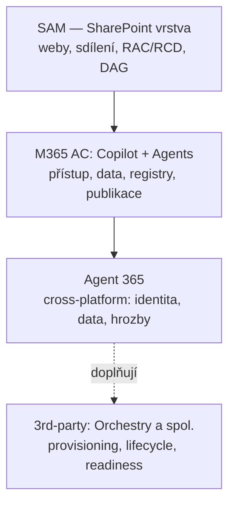

# Nástroje pro správu Copilotu a agentů

> Typ: povinný · Den: 5 (otvírák — správa agentů postavených v D4) · Odhad: AM blok — jádro nitě „nástroje pro správu"
> Prostředí: viz [`../../environment.md`](../../environment.md) · Názvosloví: [`../../GLOSSARY.md`](../../GLOSSARY.md)

## Cíle

- Zorientujete se v **sekci Copilot** (Settings a Cost management) a **sekci Agents** M365 admin centra a zasadíte je do rámce **Copilot controls**.
- Víte, co přidává **Agent 365** a kdy sáhnout po nástroji třetí strany.
- Umíte mapu vrstev správy: SAM × admin centrum × Agent 365 × 3rd-party — a víte, kam patří aplikace postavené v Code.

## Proč se správou Copilotu zabývat

Ve čtvrtek jste agenty a aplikace **stavěli** — v Agent Builderu, v Agents Toolkitu, v Code — a dnes dopoledne v Copilot Studiu. Teď se díváte na druhou stranu: jak to všechno vidí a řídí správce. Každý agent je nový objekt v tenantu s vlastníkem, okruhem uživatelů a přístupem k datům; každá AI služba na spotřebu je nová položka v rozpočtu. Kdo to nemá zmapované, neví, co v organizaci běží, kdo za to platí a co se stane, když autor odejde.

Potíž je v tom, že správa není na jednom místě. SharePoint má svou vrstvu (SAM z D3), M365 admin centrum má zvlášť sekce pro Copilot, agenty a aplikace, nad tím stojí Agent 365 a vedle toho nástroje třetích stran. Modul proto staví na jedné otázce, kterou si položíte u každého správního požadavku: **Kde se tohle řeší — a kdo to smí změnit?**

## 1. Sekce Copilot — Settings a Cost management

> [!IMPORTANT] Názvosloví
> „Copilot Control System" (CCS) se dnes jmenuje **Copilot controls** — a není to název stránky v admin centru, ale **rámec**.

Starší materiály mluví o „Copilot Control System", jako by šlo o jednu konzoli. Ve skutečnosti je Copilot controls rámec se třemi pilíři — *security & governance*, *management controls* a *measurement & reporting* — a jeho ovládací prvky jsou rozprostřené napříč M365 admin centrem, Power Platform admin centrem, Copilot Studiem a Purview ([Copilot controls overview](https://learn.microsoft.com/en-us/microsoft-365/copilot/copilot-controls/copilot-controls-overview)). Když tedy v admin centru hledáte stránku „Copilot controls", nenajdete ji; najdete sekci **Copilot**, která pokrývá jen část rámce. Zbytek (audit, DLP, agenti ve Studiu) leží jinde a potkáte ho v dalších blocích.

### Copilot → Settings

Stránka **Copilot → Settings** v M365 admin centru řídí, *jak se Copilot chová a s jakými daty pracuje*. Nastavení jsou rozdělená do tabů ([Configure Copilot settings](https://learn.microsoft.com/en-us/microsoft-365/copilot/configure-copilot-admin-center)):

- **User access** — self-service nákupy, **Copilot pay-as-you-go billing** (odkaz na Billing & usage), **Copilot Frontier**, Copilot v admin centrech a připnutí Chatu. Tady se rozhoduje, kdo se ke Copilotu vůbec dostane a jakými cestami.
- **Data access** — **Agents**, web search a dvě skupiny AI poskytovatelů: **AI providers operating as Microsoft subprocessors** (OpenAI, Anthropic) a **AI providers operating as independent processors** (např. xAI, Anthropic models with Data Retention). Rozdíl mezi subprocesorem a nezávislým procesorem je právní: u subprocesoru platí smluvní závazky Microsoftu, u nezávislého procesoru vlastní podmínky poskytovatele. Pro datovou suverenitu a EU Data Boundary je to klíčové nastavení — podrobný výklad najdete v [`explainer-ai-subprocessors.md`](explainer-ai-subprocessors.md).
- **Copilot actions** a **Other settings** — image generation, screen sharing, Teams meetings, custom dictionary a diagnostika.

Všimněte si i role modelu. Copilot spravuje role **AI Administrator** a číst nastavení může **Global Reader** — Global Admin na to potřeba není. Je to posun k principu nejmenších oprávnění: správce Copilotu nemusí mít klíče od celého tenantu. Nově existuje i role **AI Reader**, která dává read-only přístup k Copilotu a agentům ([Agent roles](https://learn.microsoft.com/en-us/microsoft-agent-365/admin/agent-roles-perms)).

### Copilot → Cost management

Druhá stránka sekce, **Copilot → Cost management**, řídí *kolik AI stojí a kdo smí služby na spotřebu používat*. Spravují se tu spending policies pro usage-based billing — Cowork, Advanced work in SharePoint, Code, Work IQ API a další. U každé policy nastavujete scope (kdo), služby (co), tvrdý strop (kolik) a volbu **Auto-apply new services**, která je ve výchozím stavu zapnutá: nové služby, které Microsoft do usage-based billingu přidá, se do policy zařadí samy. Global Reader a AI Reader vidí dashboardy read-only ([Usage-based billing](https://learn.microsoft.com/en-us/microsoft-365/copilot/usage-based-billing-overview-copilot-credits)).

Spending policy tu funguje jako vypínač přístupu — kdo v ní není, službu nepoužije, i když má licenci. Proč Copilot Credits spravují dvě plochy (původní PAYG vs. Cost management) a čím se liší, vysvětluje D1 [`licensing`](../../day-1/licensing/README.md) a glosář. V labu tu dohledáte vlastní spotřebu z labů D4.

## 2. Sekce Agents — Agent Registry

Zatímco sekce Copilot řídí zážitek a data Copilotu, sekce **Agents** v M365 admin centru řídí *inventář agentů* — které agenty v tenantu máte, kdo je smí používat a co se publikuje do organizace ([Manage agents](https://learn.microsoft.com/en-us/microsoft-365/admin/manage/manage-copilot-agents-integrated-apps)):

- **Registry** — enable, disable, assign, block a remove agentů. Najdete tu agenty různých typů: publikované organizací (org-published), sdílené tvůrcem (shared-by-creator), agenty Microsoftu, partnerů a **Frontier agents**.
- **Requests** — schvalování publikace agentů do organizačního katalogu. Tvůrce (maker) agenta odešle, požadavek čeká (pending) a správce ho publikuje (Publish) nebo zamítne (Reject). Je to tentýž tok, který jste z pohledu tvůrce viděli v D4 [`copilot-agents`](../../day-4/copilot-agents/README.md).
- **Overview** — dashboard s počty agentů, aktivními uživateli, **run-time hodinami**, **ownerless agents** a agenty v riziku ([Agents overview](https://learn.microsoft.com/en-us/microsoft-365/admin/manage/agent-365-overview)). Ownerless agent je governance dluh: agent dál běží, ale nikdo za něj neodpovídá.

Několik případů se chová jinak, než byste čekali:

- **Researcher a Analyst** jsou součástí Copilot licence (Premium) ([Service description](https://learn.microsoft.com/en-us/office365/servicedescriptions/office-365-platform-service-description/microsoft-365-copilot)). Správce je může blokovat, ale Researcher zůstává v nabídce Tools i při vypnutých agentech — ověřit v tenantu.
- **Cowork** je „agentic system", ne agent. V sekci Agents sice má položku, ta ale nemá efekt; přístup řídí spending policy v Cost management ([Cowork](https://learn.microsoft.com/en-us/copilot/cowork/)). Stejnou past znáte z D4 [`cowork`](../../day-4/cowork/README.md).
- **Agenti z SPFx balíčků** — od SPFx 1.24 může `.sppkg` z tenant **App Catalogu** (*Add to Teams*) nebo SharePoint Store dodat deklarativního agenta s **Copilot UX components** ([SPFx 1.24](https://learn.microsoft.com/en-us/sharepoint/dev/spfx/release-1.24.0)). Je to další zdroj agentů mimo Agent Builder a Copilot Studio. Kdo smí nasazovat do App Catalogu, je tedy i otázka governance agentů — oprávnění k App Catalogu fakticky rozhoduje o tom, kdo smí do tenantu přinést agenta. Jak se tito agenti zobrazí v Registry, ověřit v tenantu.

## 3. Agent 365 — control plane

**Agent 365** je vrstva nad tím vším: řídicí rovina (control plane), která agenty *pozoruje, řídí a zabezpečuje* (observe / govern / secure) **bez ohledu na platformu, na které vznikli** — Microsoft, open-source i třetí strany. Propojuje M365 admin center (registry, Agent Map), **Entra** (identita agenta), **Purview** (data) a **Defender** (hrozby) ([Agent 365 overview](https://learn.microsoft.com/en-us/microsoft-agent-365/overview)).

Agent 365 je v GA od 1. 5. 2026 a licencuje se **na uživatele**, ne na agenta — licenci potřebuje ten, kdo s agenty pracuje, spravuje je nebo je sponzoruje (viz glosář). Je také součástí **E7** (E5 + Copilot + Entra Suite + Agent 365) ([Compare E3/E5/E7](https://learn.microsoft.com/en-us/microsoft-365/copilot/compare-copilot-e3-e5-e7)). Ceny najdete v D1 [`licensing`](../../day-1/licensing/README.md).

Důležitá otázka pro plánování zní: *potřebuji Agent 365, abych vůbec viděl a řídil své agenty?* Ne. Základní inventář a governance jsou v běžných M365 plánech; Agent 365 přidává politiky, monitoring a bezpečnostní vrstvu. Rozdělení podle service description ([Service description](https://learn.microsoft.com/en-us/office365/servicedescriptions/microsoft-agent-365/microsoft-agent-365)):

| V M365 plánech (Enterprise/Business/EDU/F) | Vyžaduje Agent 365 nebo E7 |
|---|---|
| inventář agentů v Agent Registry | policy templates pro agenty |
| základní governance (publish, deploy, block, delete, approve, assign, reassign owner) | observability a monitoring aktivity agentů |
| automatizace lifecycle podle pravidel | řízení, k jakým nástrojům (vč. MCP serverů) agenti smí |
| sync agentů z externích platforem do registry | Entra (access packages, conditional access), Purview (audit, DLP, DSPM), Defender, Intune pro agenty |

Prakticky: pokud potřebujete agenty jen evidovat, schvalovat a blokovat, vystačíte si se sekcí Agents. Jakmile chcete agentům přidělovat identitu s podmíněným přístupem, hlídat jejich aktivitu nebo omezovat, ke kterým nástrojům a MCP serverům sahají, jste v Agent 365.

## 4. Mapa vrstev — co čím spravuješ

Všechny předchozí plochy dohromady tvoří vrstvy. Spodní vrstva (SAM) určuje, co Copilot v SharePointu vůbec *vidí*; admin centrum určuje, kdo Copilot a agenty smí používat a s jakými daty; Agent 365 přidává bezpečnost a identitu napříč platformami; nástroje třetích stran doplňují provisioning a lifecycle.

Mapu nejlépe použijete obráceně — od otázky k nástroji:

| Otázka | Nástroj |
|---|---|
| Co Copilot *vidí* v SharePointu? | SAM (RCD, RAC, DAG) — D3 |
| Kdo má Copilot a jaká data mu tečou? | Copilot → Settings |
| Kolik AI stojí a kdo smí pokročilé služby? | Copilot → Cost management |
| Které agenty kdo smí používat/publikovat? | Agents Registry |
| Kde uvidím aplikace z Code a co smí? | M365 AC → Apps (detail DLP v Power Platform admin center) — kapitola 5 |
| Identita, bezpečnost a audit agentů napříč platformami? | Agent 365 |
| Provisioning, lifecycle, readiness score? | 3rd-party (viz [`opt-orchestry`](../opt-orchestry/README.md)) |

Poslední řádek mapy rozvádí volitelný modul [`opt-orchestry`](../opt-orchestry/README.md).

## 5. Aplikace z Code — sekce Apps

Kromě agentů vznikají v tenantu i aplikace — v D4 [`code`](../../day-4/code/README.md) jste postavili *HR přehled*. Publikované aplikace běží v **Copilot Managed Runtime** a správce je najde v M365 admin centru: inventář v **Apps → All apps**, politiky v **Apps → Settings → Environment groups** (routing, povolené konektory a MCP servery, pravidla sdílení, content security policy). Detailní pravidla prostředí a DLP se spravují v **Power Platform admin center**; oba admin centry ukazují tutéž konfiguraci ([Governance settings](https://learn.microsoft.com/en-us/microsoft-365/admin/manage/apps/governance)).

S náklady to souvisí přes Cost management: stavbu aplikace platí tvůrce ze spending policy pro Code, běh platí každý uživatel aplikace ze samostatné spending policy *Copilot Managed Runtime* ([Admin overview](https://learn.microsoft.com/en-us/microsoft-365/admin/manage/apps/)). Podrobný výklad je v modulu `code`; v labu si tyto plochy projdete v admin centru.

## Observabilita použití

Správce chce vědět nejen *co* v tenantu běží, ale i *kdo to reálně používá*. Na to slouží usage reporty. **Reports → Usage → Microsoft Copilot → Copilot** ukazuje povolené a aktivní uživatele, prompty a adopci po aplikacích. Data mají zpoždění zhruba 48 hodin a detaily jsou ve výchozím stavu anonymizované ([Copilot usage report](https://learn.microsoft.com/en-us/microsoft-365/admin/activity-reports/microsoft-365-copilot-usage)). Adopce agentů je v samostatném reportu **Agents** (preview), kde data dorazí řádově do hodiny ([Agents report](https://learn.microsoft.com/en-us/microsoft-365/admin/activity-reports/microsoft-365-copilot-agents-new)).

Usage report ale není auditní stopa. Odpovídá na otázku „jak se nám daří adopce", ne „kdo kdy co udělal". Pro compliance audit platí Purview, který probíráte v dalším bloku [`monitoring`](../monitoring/README.md).

## Klíčové rozlišení

- **Copilot → Settings vs. Agent Registry**: Copilot sekce řídí *zážitek a data* Copilotu; Agents sekce řídí *inventář agentů*. Dvě různá místa, často zaměňovaná.
- **Agent 365 vs. Agents sekce**: Registry (vč. syncu agentů z externích platforem a základní governance) je v M365 plánech i bez Agent 365; Agent 365 přidává policy templates, observability, řízení nástrojů/MCP a Entra/Purview/Defender/Intune ochranu agentů.
- **Usage report ≠ audit log**: usage = adopční metriky (anonymizovatelné, ~48h zpoždění); audit = důkazní stopa (Purview, další blok).

## Naše prostředí

Jako **Global Reader** vidíte sekce Copilot (Settings, Cost management), Agents i Apps read-only — tlačítka pro změny jsou šedá nebo chybí. Lab je proto živá prohlídka: dohledáváte, kde se která otázka řeší, a čtete aktuální stav. Změny (blokace agenta, schválení publikace) uvidíte jako instruktorské demo.

## Shrnutí

- Copilot controls je rámec, ne stránka; v M365 admin centru ho zastupuje sekce Copilot (Settings = přístup a data, Cost management = spending policies).
- Sekce Agents je inventář agentů: Registry, Requests a Overview. Cowork tu nevypnete a agenti mohou přicházet i z SPFx balíčků v App Catalogu.
- Registry a základní governance jsou v M365 plánech; Agent 365 přidává politiky, observabilitu a ochranu přes Entra, Purview, Defender a Intune.
- Aplikace z Code spravujete v sekci Apps (a v Power Platform admin center).
- Usage report měří adopci, auditní stopu dává Purview.

## Lab

Viz [`lab-copilot-admin-tour.md`](lab-copilot-admin-tour.md) — admin tour: Copilot, Agents a aplikace.

## Zdroje (Microsoft)

- **Copilot controls a nastavení:** [Copilot controls overview](https://learn.microsoft.com/en-us/microsoft-365/copilot/copilot-controls/copilot-controls-overview) · [Configure Copilot settings](https://learn.microsoft.com/en-us/microsoft-365/copilot/configure-copilot-admin-center) · [Microsoft 365 Copilot page](https://learn.microsoft.com/en-us/microsoft-365/copilot/microsoft-365-copilot-page) · [Agent roles](https://learn.microsoft.com/en-us/microsoft-agent-365/admin/agent-roles-perms)
- **Náklady:** [Usage-based billing](https://learn.microsoft.com/en-us/microsoft-365/copilot/usage-based-billing-overview-copilot-credits)
- **Agenti:** [Manage Copilot agents](https://learn.microsoft.com/en-us/microsoft-365/admin/manage/manage-copilot-agents-integrated-apps) · [Agents overview / Agent 365 v admin centru](https://learn.microsoft.com/en-us/microsoft-365/admin/manage/agent-365-overview) · [Copilot service description](https://learn.microsoft.com/en-us/office365/servicedescriptions/office-365-platform-service-description/microsoft-365-copilot) · [Cowork](https://learn.microsoft.com/en-us/copilot/cowork/) · [SPFx 1.24](https://learn.microsoft.com/en-us/sharepoint/dev/spfx/release-1.24.0)
- **Agent 365:** [Microsoft Agent 365](https://learn.microsoft.com/en-us/microsoft-agent-365/overview) · [Agent 365 service description](https://learn.microsoft.com/en-us/office365/servicedescriptions/microsoft-agent-365/microsoft-agent-365) · [Compare E3/E5/E7](https://learn.microsoft.com/en-us/microsoft-365/copilot/compare-copilot-e3-e5-e7)
- **Aplikace (Copilot Managed Runtime):** [Governance settings](https://learn.microsoft.com/en-us/microsoft-365/admin/manage/apps/governance) · [Admin overview](https://learn.microsoft.com/en-us/microsoft-365/admin/manage/apps/)
- **Reporty:** [Copilot usage report](https://learn.microsoft.com/en-us/microsoft-365/admin/activity-reports/microsoft-365-copilot-usage) · [Agents report](https://learn.microsoft.com/en-us/microsoft-365/admin/activity-reports/microsoft-365-copilot-agents-new)

## Stav produktu / delta

> [!WARNING] Ověřit k datu běhu — stav k 2026-11.
>
> - **UI se mění po měsících:** taby Copilot Settings, Cost management, sekce Agents i dashboard Agent 365 mohou vypadat jinak než v tomto textu.
> - **Registry sync** s platformami mimo Microsoft je součástí M365 plánů (bez preview štítku); Frontier preview je jen sběr observability dat.
> - **Reporty:** Copilot usage report ~48 h zpoždění; agenti v samostatném reportu Agents (preview).
> - **Po Ignite** (17.–20. 11. 2026) projít znovu.
