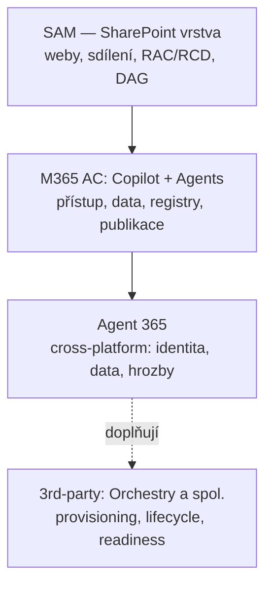

# Nástroje pro správu Copilotu a agentů

> Typ: povinný · Den: 5 (otvírák — správa agentů postavených v D4) · Odhad: AM blok — jádro nitě „nástroje pro správu"
> Prostředí: viz [`../../environment.md`](../../environment.md) · Názvosloví: [`../../GLOSSARY.md`](../../GLOSSARY.md)

## Cíle

- Student se orientuje v **sekci Copilot** (Settings + Cost management) a **sekci Agents** M365 admin centra a zasadí je do rámce **Copilot controls**.
- Student ví, co přidává **Agent 365** a kdy sáhnout po 3rd-party nástroji.
- Student umí mapu vrstev správy: SAM × admin centrum × Agent 365 × 3rd-party.

## Výklad

### 1. Sekce Copilot — Settings a Cost management

> [!IMPORTANT] Názvosloví
> „Copilot Control System" (CCS) se dnes jmenuje **Copilot controls** — a není to název stránky v admin centru, ale **rámec** se třemi pilíři (security & governance · management controls · measurement & reporting) napříč M365 admin centrem, Power Platform admin centrem, Copilot Studiem a Purview ([Copilot controls overview](https://learn.microsoft.com/en-us/microsoft-365/copilot/copilot-controls/copilot-controls-overview)).

M365 admin center → **Copilot → Settings** ([Configure Copilot settings](https://learn.microsoft.com/en-us/microsoft-365/copilot/configure-copilot-admin-center)):

- **User access** — self-service nákupy, **Copilot pay-as-you-go billing** (odkaz na Billing & usage), **Copilot Frontier**, Copilot v admin centrech, připnutí Chatu.
- **Data access** — **Agents**, web search, **AI providers operating as Microsoft subprocessors** (OpenAI, Anthropic) a **AI providers operating as independent processors** (např. xAI, Anthropic models with Data Retention). Datová suverenita / EU Data Boundary / subprocesor vs. nezávislý procesor: [`explainer-ai-subprocessors.md`](explainer-ai-subprocessors.md).
- **Copilot actions** a **Other settings** — image generation, screen sharing, Teams meetings, custom dictionary, diagnostika.
- **Role model:** spravuje **AI Administrator**, čte **Global Reader** — Global Admin na tohle není potřeba (least privilege posun). Nově i role **AI Reader** (read-only nad Copilotem a agenty, [Agent roles](https://learn.microsoft.com/en-us/microsoft-agent-365/admin/agent-roles-perms)).

M365 admin center → **Copilot → Cost management** — spending policies pro usage-based billing (Cowork, Advanced work in SharePoint, Code, Work IQ API…): scope, služby, tvrdý strop, **Auto-apply new services** (default ON); Global Reader a AI Reader vidí dashboardy read-only ([Usage-based billing](https://learn.microsoft.com/en-us/microsoft-365/copilot/usage-based-billing-overview-copilot-credits)). Dvě plochy Copilot Credits (PAYG vs. Cost management) viz glosář a D1 licensing.

### 2. Sekce Agents — Agent Registry

M365 admin center → **Agents** ([Manage agents](https://learn.microsoft.com/en-us/microsoft-365/admin/manage/manage-copilot-agents-integrated-apps)):

- **Registry**: enable/disable/assign/block/remove agentů; typy: org-published, shared-by-creator, Microsoft, partner, **Frontier agents**.
- **Requests**: schvalování publikace agentů do org katalogu (maker → pending → admin Publish/Reject).
- **Overview** dashboard: počty agentů, aktivní uživatelé, **run-time hodiny**, **ownerless agents**, agents at risk ([Agents overview](https://learn.microsoft.com/en-us/microsoft-365/admin/manage/agent-365-overview)).
- Pozor: **Researcher a Analyst** jsou součást Copilot licence (Premium, [Service description](https://learn.microsoft.com/en-us/office365/servicedescriptions/office-365-platform-service-description/microsoft-365-copilot)); admin je může blokovat, ale Researcher zůstává v nabídce Tools i při vypnutých agentech — ověřit v tenantu.
- **Cowork** je „agentic system", ne agent: jeho položka v Agents nemá efekt, přístup řídí spending policy v Cost management ([Cowork](https://learn.microsoft.com/en-us/copilot/cowork/)).

### 3. Agent 365 — control plane

**Agent 365** = vrstva nad tím vším: observe / govern / secure pro agenty **bez ohledu na platformu vzniku** (Microsoft, open-source, 3rd-party). Propojuje M365 admin center (registry, Agent Map), **Entra** (identita agenta), **Purview** (data), **Defender** (hrozby) ([Agent 365 overview](https://learn.microsoft.com/en-us/microsoft-agent-365/overview)). GA 1. 5. 2026; per-user licence (viz glosář — licencuje se uživatel, ne agent); součást **E7** (E5 + Copilot + Entra Suite + Agent 365).

Co je v M365 plánech **bez** Agent 365 a co ho vyžaduje ([Service description](https://learn.microsoft.com/en-us/office365/servicedescriptions/microsoft-agent-365/microsoft-agent-365)):

| V M365 plánech (Enterprise/Business/EDU/F) | Vyžaduje Agent 365 nebo E7 |
|---|---|
| inventář agentů v Agent Registry | policy templates pro agenty |
| základní governance (publish, deploy, block, delete, approve, assign, reassign owner) | observability a monitoring aktivity agentů |
| automatizace lifecycle podle pravidel | řízení, k jakým nástrojům (vč. MCP serverů) agenti smí |
| sync agentů z externích platforem do registry | Entra (access packages, conditional access), Purview (audit, DLP, DSPM), Defender, Intune pro agenty |

### 4. Mapa vrstev — co čím spravuješ

| Otázka | Nástroj |
|---|---|
| Co Copilot *vidí* v SharePointu? | SAM (RCD, RAC, DAG) — D3 |
| Kdo má Copilot a jaká data mu tečou? | Copilot → Settings |
| Kolik AI stojí a kdo smí pokročilé služby? | Copilot → Cost management |
| Které agenty kdo smí používat/publikovat? | Agents Registry |
| Identita, bezpečnost a audit agentů napříč platformami? | Agent 365 |
| Provisioning, lifecycle, readiness score? | 3rd-party (viz [`opt-orchestry`](../opt-orchestry/README.md)) |

### Observabilita použití

**Reports → Usage → Microsoft Copilot → Copilot**: enabled/active users, prompty, adopce po aplikacích; data do ~48 h, detaily default anonymizované ([Copilot usage report](https://learn.microsoft.com/en-us/microsoft-365/admin/activity-reports/microsoft-365-copilot-usage)). Adopce agentů je v samostatném **Agents** reportu (preview, data řádově do hodiny; [Agents report](https://learn.microsoft.com/en-us/microsoft-365/admin/activity-reports/microsoft-365-copilot-agents-new)). Pro compliance audit ale platí Purview (další blok) — usage report není auditní stopa.

## Klíčové rozlišení

- **Copilot → Settings vs. Agent Registry**: Copilot sekce řídí *zážitek a data* Copilotu; Agents sekce řídí *inventář agentů*. Dvě různá místa, často zaměňovaná.
- **Agent 365 vs. Agents sekce**: Registry (vč. syncu agentů z externích platforem a základní governance) je v M365 plánech i bez Agent 365; Agent 365 přidává policy templates, observability, řízení nástrojů/MCP a Entra/Purview/Defender/Intune ochranu agentů.
- **Usage report ≠ audit log**: usage = adopční metriky (anonymizovatelné, ~48h zpoždění); audit = důkazní stopa (Purview, další blok).

## Naše prostředí

- Studenti jako **Global Reader** sekce Copilot (Settings, Cost management) i Agents vidí read-only — lab je živá prohlídka. Změny (blokace agenta, publikace) = instruktorské demo.

## Lab

Viz [`lab-copilot-admin-tour.md`](lab-copilot-admin-tour.md) — admin tour: Copilot & Agents.

## Zdroje (Microsoft)

[Copilot controls overview](https://learn.microsoft.com/en-us/microsoft-365/copilot/copilot-controls/copilot-controls-overview) · [Configure Copilot settings](https://learn.microsoft.com/en-us/microsoft-365/copilot/configure-copilot-admin-center) · [Microsoft 365 Copilot page](https://learn.microsoft.com/en-us/microsoft-365/copilot/microsoft-365-copilot-page) · [Usage-based billing](https://learn.microsoft.com/en-us/microsoft-365/copilot/usage-based-billing-overview-copilot-credits) · [Agent 365 service description](https://learn.microsoft.com/en-us/office365/servicedescriptions/microsoft-agent-365/microsoft-agent-365) · [Agents report](https://learn.microsoft.com/en-us/microsoft-365/admin/activity-reports/microsoft-365-copilot-agents-new) · [Manage Copilot agents](https://learn.microsoft.com/en-us/microsoft-365/admin/manage/manage-copilot-agents-integrated-apps) · [Agents overview / Agent 365 v admin centru](https://learn.microsoft.com/en-us/microsoft-365/admin/manage/agent-365-overview) · [Microsoft Agent 365](https://learn.microsoft.com/en-us/microsoft-agent-365/overview) · [Copilot usage report](https://learn.microsoft.com/en-us/microsoft-365/admin/activity-reports/microsoft-365-copilot-usage)

## Stav produktu / delta

> [!WARNING] Ověřit k datu běhu — stav k 2026-10.
> Tahle oblast se hýbe nejrychleji z celého kurzu: Copilot Settings taby, Cost management, Agents sekce i Agent 365 dashboard se mění po měsících — před během proklikat živý tenant a srovnat se slidy. „Copilot Control System" → „Copilot controls" (rámec, ne stránka). Registry sync s mimo-MS platformami je součástí M365 plánů (bez preview štítku); Frontier preview je jen sběr observability dat. Usage report ~48 h, agenti v samostatném Agents reportu (preview). Po Ignite (17.–20. 11. 2026) projet znovu.
