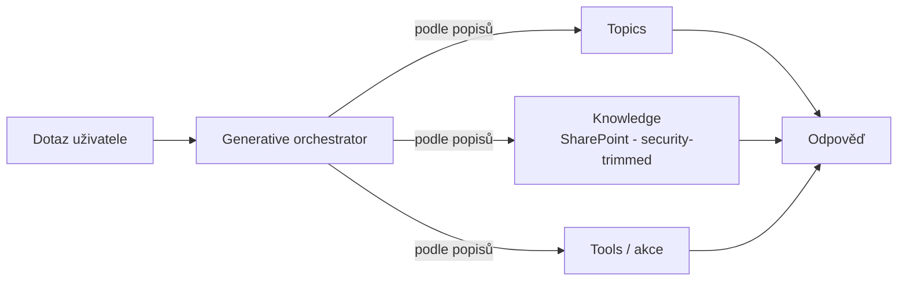

# Copilot Studio — stavba nad SharePointem

> Typ: povinný · Den: 5 · Odhad: PM blok
> Prostředí: viz [`../../environment.md`](../../environment.md) · Názvosloví: [`../../GLOSSARY.md`](../../GLOSSARY.md)

## Cíle

- Student postaví základního agenta s **SharePoint knowledge** a rozumí, proč odpovědi respektují práva.
- Student ví, že agent běží na **harnessu** (standard vs. GitHub Copilot harness), a rozliší generative vs. classic orchestraci standard harnessu.
- Student zná bezpečnostní zábrany (DLP) a licenční model (Copilot Credits).

## Výklad

### Nástroj

**Copilot Studio** = grafická low-code stavba **agentů a agent flows**; samostatná appka copilotstudio.microsoft.com ([What is Copilot Studio](https://learn.microsoft.com/en-us/microsoft-copilot-studio/fundamentals-what-is-copilot-studio)). Oproti Agent Builderu (včerejší `copilot-agents` blok, D4): plná kontrola nad topics, akcemi, kanály a publikací.

### Harness — na čem agent běží (novinka 2026)

Všechno v Copilot Studiu běží na **harnessu** — runtime mezi agentem a modelem, který určuje, kdy volat model a jaké nástroje ([Harnesses](https://learn.microsoft.com/en-us/microsoft-copilot-studio/harnesses-overview)):

| | **Standard harness** („classic", *Other ways to build*) | **GitHub Copilot harness** (nová zkušenost) |
|---|---|---|
| K čemu | rule-based agenti, topics, agent flows — předvídatelné odpovědi | vícekrokové procesy: rozloží cíl na kroky, pracuje se soubory, skills, memory |
| Orchestrace | generative / classic (viz níže) | harness si kroky plánuje sám |
| Billing | dle [licensing pro standard harness](https://learn.microsoft.com/en-us/microsoft-copilot-studio/billing-licensing); účtuje se **až po publikaci**; zero-rating pro uživatele s Copilot licencí | Copilot Credits za tokeny, nástroje i harness **od začátku stavby** — vč. testování a evaluací ([Usage-based billing](https://learn.microsoft.com/en-us/microsoft-copilot-studio/agents-experience/billing-credit-overview)) |

Třetí je **Customer Conversation harness** (zákaznický chat/hlas, contact center) — mimo rozsah kurzu. **Lab jede na standard harnessu** ([Access standard agents](https://learn.microsoft.com/en-us/microsoft-copilot-studio/agents-experience/switch-experiences)) — obsah níže (topics, generative orchestration, DLP) platí pro něj.

### SharePoint jako knowledge

- Dvě varianty: plná **SharePoint integrace** (weby + listy, real-time) vs. upload souborů se sync ([SharePoint knowledge](https://learn.microsoft.com/en-us/microsoft-copilot-studio/knowledge-add-sharepoint)).
- **Security-trimmed**: uživatel bez Read práv na zdroj dostane „no response" — hranice práv drží i v agentovi. Sensitivity labels podporované.
- Limity k zapamatování: **Restricted SharePoint Search blokuje SharePoint knowledge úplně**; listy max ~10 na agenta, nad 35 000 řádků degraduje kvalita.

### Orchestrace: generative vs. classic (standard harness)

- **Generative orchestration je default** pro nové agenty na standard harnessu: agent vybírá topics/tools/knowledge podle jejich **popisů**, umí zřetězit víc kroků v jednom tahu a doptat se na chybějící vstupy ([Generative orchestration](https://learn.microsoft.com/en-us/microsoft-copilot-studio/advanced-generative-actions)).
- **Classic**: trigger fráze → jeden topic. Předvídatelnější, ale tupější.
- Důsledek pro autory: **kvalita popisů = kvalita routingu** — návrat k D2 (psaní instrukcí a popisů je disciplína, ne detail).

### Bezpečnostní zábrany — DLP

Data policies v **Power Platform admin centru** (konektory Business/Non-business/Blocked); enforcement **povinný pro všechny tenanty od začátku 2025**. Blokovat lze: neautentizovaný chat, typy knowledge (SharePoint, web, dokumenty), HTTP node, konektory-as-tools, publikační kanály ([DLP for Copilot Studio](https://learn.microsoft.com/en-us/microsoft-copilot-studio/admin-data-loss-prevention)). Porušení = Publish tlačítko nejede.

### Licence — Copilot Credits

- Od 1. 9. 2025 je měnou **Copilot Credits** („message packs" jsou mrtvý pojem): balíčky 25 000 kreditů/měsíc (nepřenášejí se), **PAYG přes Azure**, nebo roční prepurchase ([Billing & licensing](https://learn.microsoft.com/en-us/microsoft-copilot-studio/billing-licensing)).
- **Zero-rating** (standard harness): uživatelé s M365 Copilot licencí nečerpají kredity za classic/generative odpovědi a tenant graph grounding — studenti mají od 2026-11 Copilot licenci, takže zero-rating se na ně vztahuje; uživatelé bez licence platí kreditové sazby za všechno (viz glosář, Copilot Credits PAYG). GitHub Copilot harness čerpá kredity za vše, včetně stavby a testování.
- Copilot Studio spending lze volitelně řídit i v M365 admin centru (**Copilot → Cost management**, resource-based policy pro prostředí/agenty); jinak platí kontroly v Power Platform admin centru ([Manage Copilot Studio costs](https://learn.microsoft.com/en-us/microsoft-365/copilot/usage-based-billing-manage-copilot-studio-costs)).

## Klíčové rozlišení

- **Copilot Studio vs. Agent Builder**: stejný deklarativní základ; Studio přidává topics, akce/konektory, kanály, ALM — a s tím DLP povinnosti a kreditové účtování. Builder = rychlý osobní agent; Studio = spravovaný firemní agent. Úplná rozdílová matice všech cest: [`../../day-4/copilot-agents/comparison-agent-paths.md`](../../day-4/copilot-agents/comparison-agent-paths.md).
- **Knowledge vs. topic**: knowledge = odkud čerpá fakta (grounding); topic = co má *udělat* (dialog/akce). Nacpat FAQ do topics je anti-pattern — patří do knowledge.
- **Kredity vs. Document processing PAYG**: podruhé a naposledy — dva různé metry (glosář); agent nad SharePointem čerpá **Copilot Credits**.

## Naše prostředí

- Studenti staví agenta nad **vlastním webem** (SharePoint knowledge). Přístup do Copilot Studia přes tenant PAYG — go/no-go instruktora. Lab jede na **standard harnessu**, kde MS účtuje až po publikaci — testovací panel by kredity čerpat neměl (ověřit v tenantu na stránce Monitor). Na GitHub Copilot harnessu by každý test kredity stál. Disciplína zůstává: evaluační plán ze včerejšího `copilot-agents` labu = 5 testů, ne 50.

## Lab

Viz [`lab-basic-copilot.md`](lab-basic-copilot.md) — postavte základního copilota.

## Zdroje (Microsoft)

[Copilot Studio overview](https://learn.microsoft.com/en-us/microsoft-copilot-studio/fundamentals-what-is-copilot-studio) · [Harnesses](https://learn.microsoft.com/en-us/microsoft-copilot-studio/harnesses-overview) · [Usage-based billing (GitHub Copilot harness)](https://learn.microsoft.com/en-us/microsoft-copilot-studio/agents-experience/billing-credit-overview) · [Access standard agents](https://learn.microsoft.com/en-us/microsoft-copilot-studio/agents-experience/switch-experiences) · [SharePoint knowledge](https://learn.microsoft.com/en-us/microsoft-copilot-studio/knowledge-add-sharepoint) · [Generative orchestration](https://learn.microsoft.com/en-us/microsoft-copilot-studio/advanced-generative-actions) · [Data loss prevention](https://learn.microsoft.com/en-us/microsoft-copilot-studio/admin-data-loss-prevention) · [Billing & licensing](https://learn.microsoft.com/en-us/microsoft-copilot-studio/billing-licensing)

## Stav produktu / delta

> [!WARNING] Ověřit k datu běhu — stav k 2026-10.
> Copilot Studio má tři harnessy; „nová zkušenost" = GitHub Copilot harness (účtuje od stavby), klasika = standard harness. Při „New agent" ověřit, kam tenant defaultně vede, a lab vést na standard harness. Stav „Workflows" (dříve public preview) a konec klasických chatbotů v Teams appce (červen 2026) — ověřit. Kreditové sazby a zero-rating tabulku ověřit proti licensing guide (odkaz na billing stránce). Po Ignite (17.–20. 11. 2026) projet znovu.
