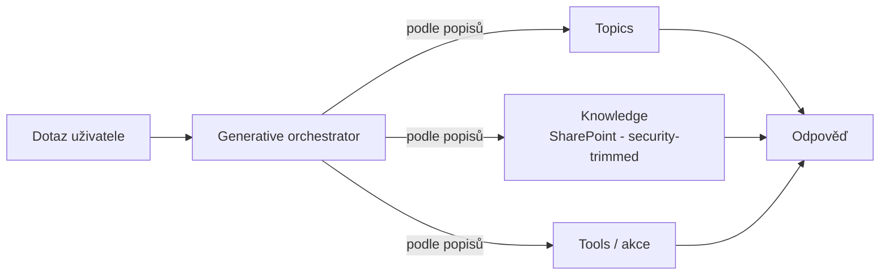

# Copilot Studio — stavba nad SharePointem

> Typ: povinný · Den: 5 · Odhad: PM blok
> Prostředí: viz [`../../environment.md`](../../environment.md) · Názvosloví: [`../../GLOSSARY.md`](../../GLOSSARY.md)

## Cíle

- Postavíte základního agenta se **SharePoint knowledge** a vysvětlíte, proč jeho odpovědi respektují oprávnění uživatele.
- Vysvětlíte, že agent běží na **harnessu** (standard vs. GitHub Copilot harness), a u standard harnessu rozlišíte generative a classic orchestraci.
- Poznáte bezpečnostní zábrany (DLP) a licenční model (Copilot Credits) a víte, kdy a za co se platí.

## Proč Copilot Studio

Ve čtvrtek jste v [`agent-builder`](../../day-4/agent-builder/README.md) postavili agenta HR Asistent a narazili na strop: Builder zdroje jen prioritizuje, neumí filtrovat ani počítat a nic nevykoná v jiných systémech. Copilot Studio je místo, kam Microsoft pro tyto potřeby odkazuje — agenta z Builderu lze do něj zkopírovat a rozšířit.

Pro správce SharePointu je Copilot Studio zajímavé i z druhé strany. Agent postavený ve Studiu je **spravovaný firemní agent**: běží v Power Platform prostředí, podléhá DLP politikám, publikuje se do kanálů a čerpá Copilot Credits. Modul vám dá tři věci, které u takového agenta musíte umět posoudit: na čem běží (harness), z čeho odpovídá a komu co ukáže (SharePoint knowledge), a kdo hlídá hranice a náklady (DLP, kredity).

## Výklad

### Nástroj

**Copilot Studio** je grafický low-code nástroj pro stavbu **agentů a agent flows**. Je to samostatná aplikace na adrese copilotstudio.microsoft.com, nikoli funkce uvnitř Microsoft 365 Copilot appky jako Agent Builder ([What is Copilot Studio](https://learn.microsoft.com/en-us/microsoft-copilot-studio/fundamentals-what-is-copilot-studio)).

Oproti Agent Builderu (D4, [`copilot-agents`](../../day-4/copilot-agents/README.md) a `agent-builder`) získáte plnou kontrolu nad tím, z čeho se agent skládá a kam se dostane:

- **topics** — autorem navržené dialogy a postupy,
- **akce a nástroje** — konektory, agent flows, HTTP volání,
- **kanály** — Teams, Microsoft 365 Copilot, SharePoint, web a další,
- **publikace** — řízený proces, který prochází DLP kontrolou.

Builderovým backendem je přitom Copilot Studio: Builder je zjednodušený vstup do stejné platformy, Studio je plný editor.

### Harness — na čem agent běží

Všechno, co v Copilot Studiu postavíte, běží na **harnessu**. Harness je runtime mezi vaším agentem a jazykovým modelem: rozhoduje, kdy zavolat model, co mu poslat, jak vyložit odpověď a které nástroje spustit. Model dodává „uvažování", harness určuje, jak se z něj stane práce. Volba harnessu proto ovlivňuje tři věci najednou — jak agent pracuje, co umí a **jak se účtuje** ([Harnesses](https://learn.microsoft.com/en-us/microsoft-copilot-studio/harnesses-overview)).

Pro kurz jsou podstatné dva harnessy:

| | **Standard harness** („classic", *Other ways to build*) | **GitHub Copilot harness** (nová zkušenost) |
|---|---|---|
| K čemu | rule-based agenti, topics, agent flows — předvídatelné odpovědi | vícekrokové procesy: rozloží cíl na kroky, pracuje se soubory, skills, memory |
| Orchestrace | generative / classic (viz níže) | harness si kroky plánuje sám |
| Billing | dle [licensing pro standard harness](https://learn.microsoft.com/en-us/microsoft-copilot-studio/billing-licensing); účtuje se **až po publikaci**; zero-rating pro uživatele s Copilot licencí (viz *Licence*) | Copilot Credits za tokeny, nástroje i harness **od začátku stavby** — vč. testování a evaluací ([Usage-based billing](https://learn.microsoft.com/en-us/microsoft-copilot-studio/agents-experience/billing-credit-overview)) |

Jak to číst: standard harness dělá to, co mu autor navrhne — topics, pravidla, cesty. Hodí se tam, kde chcete konzistentní odpověď na dobře známý dotaz, například interní helpdesk. GitHub Copilot harness dostane cíl a sám si naplánuje kroky, umí vytvářet a upravovat soubory a zotavit se z chyby. Za tuto schopnost se platí od první věty, kterou při stavbě napíšete. Název neznamená, že data jdou do služby GitHub Copilot — jde o rámec Copilot Studia, který s GitHub Copilotem sdílí technologii.

Třetí je **Customer Conversation harness** pro zákaznický chat a hlas (contact center) — mimo rozsah kurzu.

**Lab jede na standard harnessu.** Nové agenty na něm založíte přes **Other ways to build** na domovské stránce; pokud se ocitnete v nové zkušenosti, přepnete se přes **⋯** dole v bočním panelu → **Open classic experience** ([Access standard agents](https://learn.microsoft.com/en-us/microsoft-copilot-studio/agents-experience/switch-experiences)). Vše, co níže píšeme o topics, generative orchestraci a DLP, platí pro standard harness.

### SharePoint jako knowledge

Knowledge je to, z čeho agent čerpá fakta. SharePoint je v Copilot Studiu nejpřirozenější zdroj, protože firemní dokumenty a listy už v něm leží a mají nastavená oprávnění.

**Dvě položky SharePoint v dialogu Add knowledge.** Dialog nabízí SharePoint na dvou místech a každé dělá něco jiného ([SharePoint knowledge](https://learn.microsoft.com/en-us/microsoft-copilot-studio/knowledge-add-sharepoint)):

- **Featured → SharePoint** je plná SharePoint integrace: vložíte URL webu nebo složky a agent prohledává tuto adresu a všechny podřízené cesty, nikdy nadřazené ani sousední weby. V labu ji použijete pro test hranice práv (krok 8).
- **Upload file → SharePoint** slouží k nahrání jednotlivých souborů a složek se synchronizací — a zároveň tudy vybíráte **SharePoint listy** (**Browse items** → **My Lists** / **Recent Lists**). V labu tudy přidáte list Zaměstnanci (krok 5). Pokud list v **Recent Lists** nevidíte, otevřete ho v SharePointu a zkuste znovu.

**Security trimming.** Agent ukáže jen obsah, ke kterému má přihlášený uživatel aspoň **Read** oprávnění. Když práva nemá, dostane „no response" — agent neodhalí ani to, že obsah existuje. Hranice práv, kterou celý týden stavíte v SharePointu, tedy drží i v agentovi; agent není způsob, jak ji obejít. Sensitivity labels se respektují stejně. Výjimkou jsou soubory chráněné šifrováním (šifrující label, DKE, heslo): agent nad nimi neumí groundovat, i když je uživatel otevřít smí, a zdroj se přesto může tvářit jako *Ready*.

**Listy na standard harnessu.** Vybrané listy se ingestují do Dataverse a indexují; spojení se zdrojem je real-time, takže agent pracuje s aktuálními daty a uživatel se ověřuje svými SharePoint právy. Microsoft doporučuje nejvýš 10 listů na agenta a upozorňuje, že listy nad 35 000 řádků zhoršují kvalitu a latenci.

**Analytika nad listy — poctivé rozlišení.** Dotazy typu „kolik / komu / průměr" (agregace a filtry nad celým listem) Microsoft výslovně dokumentuje **pro GitHub Copilot harness**: tam stránka slibuje analytické a agregační dotazy, listy do 120 000 řádků a nejvýš 10 listů na agenta — ve stavu public preview a s kredity čerpanými už od stavby a testování ([SharePoint lists (GitHub Copilot)](https://learn.microsoft.com/en-us/microsoft-copilot-studio/agents-experience/knowledge-sharepoint-lists)). Pro standard harness Microsoft agregace nedokumentuje — ani je neslibuje, ani nevylučuje. Lab běží na standard harnessu, takže testy 2 a 3 (filtr a počet nad listem Zaměstnanci) nejsou ověřením slíbené funkce, ale **experimentem**: zjistíte, jak dobře standard harness nad listem agreguje. Neúplný výčet je legitimní výsledek, ne chyba vašeho postupu.

**Restricted SharePoint Search.** Pokud je v tenantu zapnuté Restricted SharePoint Search (RSS, známé z D2–D3), použití SharePointu jako knowledge je zablokované úplně. Je to jedna z prvních věcí, které zkontrolovat, když SharePoint zdroj nevrací nic.

### Orchestrace: generative vs. classic (standard harness)

Orchestrace rozhoduje, *co* agent na dotaz udělá — který topic spustí, který nástroj zavolá, ve kterém zdroji bude hledat. Standard harness umí dva režimy ([Generative orchestration](https://learn.microsoft.com/en-us/microsoft-copilot-studio/advanced-generative-actions)):

- **Generative orchestration je výchozí** pro nové agenty. Agent vybírá topics, nástroje, knowledge a další agenty podle jejich **popisů**. Umí v jednom tahu zřetězit víc kroků (dotaz „otevírací doba a nejbližší pobočka" obslouží dvěma topics za sebou), sám se doptá na chybějící vstupy a z výsledků sestaví odpověď.
- **Classic orchestration** spustí jeden topic, jehož **trigger fráze** nejlépe odpovídají dotazu; knowledge použije jen jako fallback. Je předvídatelnější, ale musíte předem vymyslet, jak se uživatel zeptá, a každou otázku i odpověď napsat sami.

Důsledek pro autory: **kvalita popisů = kvalita routingu**. Nejdůležitějším faktorem výběru je popis topicu, nástroje nebo zdroje. Navazujete tím na D2 ([`prompting-fundamentals`](../../day-2/prompting-fundamentals/README.md)) — psaní instrukcí a popisů je disciplína, ne detail. V labu proto popis agenta i popis zdroje Zaměstnanci vyplňujete pečlivě a v iteraci zkoušíte, co změna popisu udělá s výsledkem.

### Bezpečnostní zábrany — DLP

Agent ve Studiu se umí připojit k mnoha službám, včetně externích. Správce proto potřebuje mechanismus, který určí, co agent smí — a tím jsou **data policies (DLP)** v **Power Platform admin centru**. Konektory Copilot Studia se v nich třídí do skupin Business / Non-business / Blocked; konektory, které spolu sdílejí data, musí být ve stejné skupině ([DLP for Copilot Studio](https://learn.microsoft.com/en-us/microsoft-copilot-studio/admin-data-loss-prevention)).

Od začátku roku 2025 je enforcement **povinný pro všechny tenanty** a výjimky pro jednotlivé agenty už nejsou podporované. Typické zábrany:

- **neautentizovaný chat** — zablokováním konektoru *Chat without Microsoft Entra ID authentication* vynutíte přihlášení uživatele,
- **HTTP node** — zákaz libovolných HTTP volání (nebo jemněji endpoint filtering),
- **konektory jako nástroje** — včetně nástrojů z MCP serverů, které na konektorech stojí,
- **publikační kanály** — Teams + Microsoft 365, SharePoint, Direct Line (web) a další,
- **event triggery**.

U SharePointu a veřejných webů jako knowledge lze přes **endpoint filtering** povolit nebo zakázat konkrétní adresy.

Jak to vypadá pro autora: zablokovaná funkce je v editoru zašedlá a po najetí myší ukáže důvod. Když agent politiku poruší, objeví se chybový banner a **tlačítko Publish je nedostupné** — agent se do kanálu nedostane, dokud se porušení neodstraní.

### Licence — Copilot Credits

**Copilot Credits** jsou společnou měnou Copilot Studia. Od 1. 9. 2025 nahradily dřívější „messages" (pojem „message packs" už neplatí); objem v předplacených balíčcích ani PAYG sazba se tím nezměnily ([Billing & licensing](https://learn.microsoft.com/en-us/microsoft-copilot-studio/billing-licensing)). Kredity lze získat třemi způsoby:

- **předplacené balíčky** (Copilot Credit pack) — kapacita se vynucuje měsíčně a nevyčerpané kredity se do dalšího měsíce nepřenášejí,
- **PAYG přes Azure** — prostředí se billing policy v Power Platform admin centru propojí s Azure předplatným a platí se skutečná spotřeba za měsíc,
- **roční prepurchase** (Copilot Credit Commit Units) — předplacený pool v Azure portálu.

**Kdy se platí na standard harnessu.** Standard harness začíná účtovat **až po publikaci**; GitHub Copilot harness účtuje od stavby, včetně testů a evaluací ([Usage-based billing](https://learn.microsoft.com/en-us/microsoft-copilot-studio/agents-experience/billing-credit-overview)). Nepublikovaný agent v labu se tedy kredity platit nemá — to je důvod, proč lab jede na standard harnessu a agenta nepublikuje. Kolik agent skutečně spotřeboval, ukazuje jeho stránka **Monitor**.

**Zero-rating.** Uživatel s licencí Microsoft 365 Copilot neplatí za classic a generative odpovědi ani za tenant graph grounding, pokud agenta používá v **Copilot Chatu, Teams nebo SharePointu** pod svou identitou. Spotřeba se pak v reportech objeví jako nefakturované kredity. Zero-rating se tedy týká publikovaného agenta v těchto kanálech, ne testovacího panelu ve Studiu. Uživatelé bez licence platí kreditové sazby za vše (viz glosář, Copilot Credits PAYG). GitHub Copilot harness čerpá kredity za vše včetně stavby a testování a Copilot licence ho nekryje.

**Kde se útrata řídí.** Spotřebu Copilot Studia lze volitelně řídit i v M365 admin centru (**Copilot → Cost management**, resource-based policy pro prostředí nebo agenty); jinak platí kontroly v Power Platform admin centru ([Manage Copilot Studio costs](https://learn.microsoft.com/en-us/microsoft-365/copilot/usage-based-billing-manage-copilot-studio-costs)). Jde o stejnou plochu, kterou znáte z D1 ([`licensing`](../../day-1/licensing/README.md)).

## Klíčové rozlišení

- **Copilot Studio vs. Agent Builder**: Builder je zjednodušený vstup do Copilot Studia pro koncového uživatele; Studio přidává topics, akce a konektory, kanály a ALM — a s tím DLP povinnosti a kreditové účtování. Builder = rychlý osobní agent; Studio = spravovaný firemní agent. Úplná rozdílová matice všech cest: [`../../day-4/copilot-agents/comparison-agent-paths.md`](../../day-4/copilot-agents/comparison-agent-paths.md).
- **Knowledge vs. topic**: knowledge = odkud agent čerpá fakta (grounding); topic = co má *udělat* (dialog, akce). Nacpat FAQ do topics je anti-pattern — patří do knowledge.
- **Standard vs. GitHub Copilot harness**: standard = autorem navržené chování, účtuje po publikaci; GitHub Copilot harness = agent si plánuje sám, účtuje od stavby. Analytika nad listy je dokumentovaná jen pro GitHub Copilot harness.
- **Kredity vs. Document processing PAYG**: dva různé metry (glosář); agent nad SharePointem čerpá **Copilot Credits**.

## Naše prostředí

Pracujete pod svým účtem `user.NN` s licencí Microsoft 365 Copilot v prostředí `GOC224-lab` (Sandbox založený v D4, viz [`explainer-environments.md`](../../day-4/power-automate-invoices/explainer-environments.md)), nikoli v defaultním prostředí. Stavíte agenta **HR Analytik NN** nad stejným listem **Zaměstnanci** z HR webu kurzu, nad kterým jste v D4 stavěli HR Asistenta — datový model popisuje [`scenario-hr-agent.md`](../../day-4/copilot-agents/scenario-hr-agent.md), adresy webů najdete v [`environment.md`](../../environment.md). Jako druhý zdroj přidáte web spolužáka (`/sites/user.MM`), ke kterému nemáte přístup, a ověříte na něm hranici práv.

Lab jede na **standard harnessu** a agenta nepublikujete, takže by neměl čerpat kredity. Kdo omylem staví v nové zkušenosti (GitHub Copilot harness), platí za každý test. Disciplína proto zůstává: pět promyšlených testů z evaluačního plánu (D4 `copilot-agents`) a jedna iterace, ne padesát pokusů.

## Shrnutí

- Copilot Studio je plný editor agentů (topics, akce, kanály, publikace); Agent Builder je jeho zjednodušený vstup.
- Každý agent běží na harnessu: standard harness účtuje po publikaci, GitHub Copilot harness od stavby. Lab jede na standard harnessu.
- SharePoint knowledge je security-trimmed — bez Read práv uživatel dostane „no response". RSS blokuje SharePoint knowledge úplně. Agregace nad listy MS dokumentuje jen pro GitHub Copilot harness; na standard harnessu je ověřujete experimentem.
- Generative orchestration vybírá podle popisů — kvalita popisů = kvalita routingu.
- DLP v Power Platform admin centru je povinné; porušení zablokuje Publish. Měnou jsou Copilot Credits, zero-rating platí pro licencované uživatele v Copilot Chatu, Teams a SharePointu.

## Lab

[`lab-basic-copilot.md`](lab-basic-copilot.md) — HR Analytik v Copilot Studiu: agent nad listem Zaměstnanci na standard harnessu, pět testů (lookup, filtr, počet, negativní, hranice práv), srovnání s D4 a jedna iterace.

## Zdroje (Microsoft)

- **Nástroj a harnessy:** [Copilot Studio overview](https://learn.microsoft.com/en-us/microsoft-copilot-studio/fundamentals-what-is-copilot-studio) · [Harnesses](https://learn.microsoft.com/en-us/microsoft-copilot-studio/harnesses-overview) · [Access standard agents](https://learn.microsoft.com/en-us/microsoft-copilot-studio/agents-experience/switch-experiences)
- **Knowledge:** [SharePoint knowledge](https://learn.microsoft.com/en-us/microsoft-copilot-studio/knowledge-add-sharepoint) · [SharePoint lists (GitHub Copilot harness)](https://learn.microsoft.com/en-us/microsoft-copilot-studio/agents-experience/knowledge-sharepoint-lists)
- **Orchestrace:** [Generative orchestration](https://learn.microsoft.com/en-us/microsoft-copilot-studio/advanced-generative-actions)
- **Governance:** [Data loss prevention](https://learn.microsoft.com/en-us/microsoft-copilot-studio/admin-data-loss-prevention)
- **Licence a náklady:** [Billing & licensing](https://learn.microsoft.com/en-us/microsoft-copilot-studio/billing-licensing) · [Usage-based billing (GitHub Copilot harness)](https://learn.microsoft.com/en-us/microsoft-copilot-studio/agents-experience/billing-credit-overview) · [Manage Copilot Studio costs](https://learn.microsoft.com/en-us/microsoft-365/copilot/usage-based-billing-manage-copilot-studio-costs)

## Stav produktu / delta

> [!WARNING] Ověřit k datu běhu — stav k 2026-11.
>
> - **Harnessy:** přehledová stránka uvádí tři, stránka *Access standard agents* mluví o čtyřech (navíc „Copilot chat harness"). Analytika nad listy na GitHub Copilot harnessu je v public preview.
> - **Stav „Workflows"** (dříve public preview) a konec klasických chatbotů v Teams appce (červen 2026) — ověřit.
> - **Kreditové sazby a zero-rating** ověřit proti licensing guide (odkaz na billing stránce).
> - Po Ignite (17.–20. 11. 2026) projít znovu.
