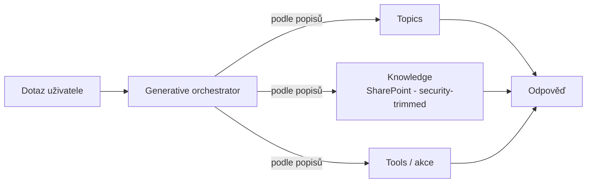

# Copilot Studio — stavba nad SharePointem

> Typ: povinný · Den: 5 · Odhad: celé dopoledne (~3 h: výklad 35 min + Copilot Credits 20 min + lab 100 min + rozbor)
> Prostředí: viz [`../../environment.md`](../../environment.md) · Názvosloví: [`../../GLOSSARY.md`](../../GLOSSARY.md)

## Cíle

- Postavíte agenta s knowledge, **nástrojem nad SharePoint listem**, **skillem** a **evaluací** a vysvětlíte, čí identitou agent data čte.
- Popíšete aktuální stav Copilot Studia: čtyři **harnessy**, co který umí a jak se účtuje; u standard harnessu rozlišíte generative a classic orchestraci.
- Poznáte bezpečnostní zábrany (DLP, maker credentials) a víte, kdy a za co se platí Copilot Credits — detail v [`explainer-copilot-credits.md`](explainer-copilot-credits.md).

## Proč Copilot Studio

Ve čtvrtek jste v [`agent-builder`](../../day-4/agent-builder/README.md) postavili agenta HR Asistent a narazili na strop: Builder zdroje jen prioritizuje, neumí filtrovat ani počítat a nic nevykoná v jiných systémech. Copilot Studio je místo, kam Microsoft pro tyto potřeby odkazuje — agenta z Builderu lze do něj zkopírovat a rozšířit.

Pro správce SharePointu je Copilot Studio zajímavé i z druhé strany. Agent postavený ve Studiu je **spravovaný firemní agent**: běží v Power Platform prostředí, podléhá DLP politikám, publikuje se do kanálů a čerpá Copilot Credits. Modul vám dá tři věci, které u takového agenta musíte umět posoudit: na čem běží (harness), z čeho odpovídá a komu co ukáže (SharePoint knowledge), a kdo hlídá hranice a náklady (DLP, kredity).

## Výklad

### Nástroj

**Copilot Studio** je grafický low-code nástroj pro stavbu **agentů a agent flows**. Je to samostatná aplikace na adrese copilotstudio.microsoft.com, nikoli funkce uvnitř Microsoft 365 Copilot appky jako Agent Builder ([What is Copilot Studio](https://learn.microsoft.com/en-us/microsoft-copilot-studio/fundamentals-what-is-copilot-studio)).

Oproti Agent Builderu (D4, [`copilot-agents`](../../day-4/copilot-agents/README.md) a `agent-builder`) získáte plnou kontrolu nad tím, z čeho se agent skládá a kam se dostane:

- **topics** — autorem navržené dialogy a postupy,
- **akce a nástroje** — konektory, agent flows, HTTP volání,
- **kanály** — Teams, Microsoft 365 Copilot, SharePoint, web a další,
- **publikace** — řízený proces, který prochází DLP kontrolou.

Builderovým backendem je přitom Copilot Studio: Builder je zjednodušený vstup do stejné platformy, Studio je plný editor.

### Harness — na čem agent běží

Všechno, co v Copilot Studiu postavíte, běží na **harnessu**. Harness je runtime mezi vaším agentem a jazykovým modelem: rozhoduje, kdy zavolat model, co mu poslat, jak vyložit odpověď a které nástroje spustit. Model dodává „uvažování", harness určuje, jak se z něj stane práce. Volba harnessu proto ovlivňuje tři věci najednou — jak agent pracuje, co umí a **jak se účtuje** ([Harnesses](https://learn.microsoft.com/en-us/microsoft-copilot-studio/harnesses-overview)).

Copilot Studio má k listopadu 2026 **čtyři harnessy**:

| Harness | K čemu | Jak se účtuje |
|---|---|---|
| **GitHub Copilot harness** | vícekrokové procesy: rozloží cíl na kroky, volá nástroje, pracuje se soubory Word/Excel/PowerPoint/PDF, má skills a memory, zotaví se z chyby | Copilot Credits za tokeny, nástroje i harness **od začátku stavby** (Preview, evaluace); licence M365 Copilot nekryje |
| **Standard harness** | rule-based agenti, topics, agent flows — předvídatelné odpovědi | **až po publikaci**; licencovaní uživatelé v kanálech M365 mají fair use |
| **Copilot Chat harness** | rozšíření Copilot Chatu o firemní knowledge, jen pro interní uživatele | podle spotřeby, nebo v rámci licence M365 Copilot |
| **Customer Conversation harness** | zákaznický chat a hlas s předáním na operátora (contact center) — mimo rozsah kurzu | Copilot Credits |

Zdroje: [Harnesses](https://learn.microsoft.com/en-us/microsoft-copilot-studio/harnesses-overview), [Compare harnesses (Learn module)](https://learn.microsoft.com/en-us/training/modules/explore-copilot-studio-agent-harnesses/3-compare-agent-harnesses), [Usage-based billing](https://learn.microsoft.com/en-us/microsoft-copilot-studio/agents-experience/billing-credit-overview).

**Stav.** GitHub Copilot harness je od **3. 8. 2026 obecně dostupný** (GA) pro produkční použití. Microsoft zároveň potvrzuje, že standard a Copilot Chat harness dál podporuje pro stávající i nové agenty ([Copilot Studio blog](https://techcommunity.microsoft.com/blog/copilot-studio-blog/more-powerful-agents-and-workflows-for-autonomous-business-processes-introducing/4542969)). Některé funkce nového harnessu — evaluace, memory, generování agenta z popisu — jsou stále v preview.

> [!IMPORTANT] Názvosloví
> Microsoft blog (aktualizace 3. 11. 2026) uvádí: „The GitHub Copilot harness is now the **Microsoft Copilot harness**." Dokumentace na Learn k datu běhu pořád používá „GitHub Copilot harness", proto ho tak píšeme i v kurzu. Název v žádném případě neznamená, že data jdou do služby GitHub Copilot — jde o rámec Copilot Studia, který s GitHub Copilotem sdílí technologii.

**Co nový harness (zatím) nemá.** GitHub Copilot harness není nadmnožina standard harnessu. Podle srovnávací tabulky Microsoftu ([Agents powered by GitHub Copilot harness](https://learn.microsoft.com/en-us/microsoft-copilot-studio/agents-experience/overview)):

- **topics** nahrazují **hooks** (workflow spuštěné v určitém bodě života agenta) a nástroj **Prompt** nahrazují **skills**,
- nepodporuje kanál **SharePoint**, WhatsApp ani Dynamics 365 Contact Center — Teams, Microsoft 365 a web ano,
- nemá Azure AI Search jako knowledge, vlastní entity ani manuální autentizaci; computer use je plánovaný,
- orchestraci nelze nastavit, harness ji řídí sám,
- agenta nelze převést mezi harnessy — volí se při založení.

**Jak volit.** Microsoft doporučuje standard harness pro krátké, ohraničené úlohy, strukturované konverzace a tam, kde záleží na zavedených kanálech; GitHub Copilot harness pro dlouhé, vícekrokové procesy přes víc systémů a souborů. Funkčního agenta na standard harnessu **nepřevádějte jen proto, že existuje nový harness** — migrace je přestavba a má mít obchodní důvod, protože u jednoduché úlohy nový harness přidá latenci a kredity bez lepšího výsledku ([Compare harnesses](https://learn.microsoft.com/en-us/microsoft-copilot-studio/guidance/choose-harness)).

**Lab jede na GitHub Copilot harnessu**, protože jen ten má skills a evaluaci v jednom editoru. Agenta na něm založíte volbou **Agent** na domovské stránce. Standard harness najdete pod **Other ways to build**, případně **⋯** dole v bočním panelu → **Open classic experience** ([Access standard agents](https://learn.microsoft.com/en-us/microsoft-copilot-studio/agents-experience/switch-experiences)).

### SharePoint jako knowledge

Knowledge je to, z čeho agent čerpá fakta. SharePoint je v Copilot Studiu nejpřirozenější zdroj, protože firemní dokumenty a listy už v něm leží a mají nastavená oprávnění.

**Dvě položky SharePoint v dialogu Add knowledge.** Dialog nabízí SharePoint na dvou místech a každé dělá něco jiného ([SharePoint knowledge](https://learn.microsoft.com/en-us/microsoft-copilot-studio/knowledge-add-sharepoint)):

- **Featured → SharePoint** je plná SharePoint integrace: vložíte URL webu nebo složky a agent prohledává tuto adresu a všechny podřízené cesty, nikdy nadřazené ani sousední weby. V labu ji použijete pro test hranice práv (krok 11).
- **Upload file → SharePoint** slouží k nahrání jednotlivých souborů a složek se synchronizací — a zároveň tudy vybíráte **SharePoint listy** (**Browse items** → **My Lists** / **Recent Lists**). Pokud list v **Recent Lists** nevidíte, otevřete ho v SharePointu a zkuste znovu.

(Popis dialogu vychází ze standard harnessu; na GitHub Copilot harnessu je SharePoint knowledge také podporovaný, rozložení dialogu se může lišit.)

**Security trimming.** Agent ukáže jen obsah, ke kterému má přihlášený uživatel aspoň **Read** oprávnění. Když práva nemá, dostane „no response" — agent neodhalí ani to, že obsah existuje. Hranice práv, kterou celý týden stavíte v SharePointu, tedy drží i v agentovi; agent není způsob, jak ji obejít. Sensitivity labels se respektují stejně. Výjimkou jsou soubory chráněné šifrováním (šifrující label, DKE, heslo): agent nad nimi neumí groundovat, i když je uživatel otevřít smí, a zdroj se přesto může tvářit jako *Ready*.

**Listy na standard harnessu.** Vybrané listy se ingestují do Dataverse a indexují; spojení se zdrojem je real-time, takže agent pracuje s aktuálními daty a uživatel se ověřuje svými SharePoint právy. Microsoft doporučuje nejvýš 10 listů na agenta a upozorňuje, že listy nad 35 000 řádků zhoršují kvalitu a latenci.

**Analytika nad listy.** Dotazy typu „kolik / komu / průměr" (agregace a filtry nad celým listem) Microsoft výslovně dokumentuje **pro GitHub Copilot harness**: listy do 120 000 řádků a nejvýš 10 listů na agenta, ve stavu public preview ([SharePoint lists (GitHub Copilot)](https://learn.microsoft.com/en-us/microsoft-copilot-studio/agents-experience/knowledge-sharepoint-lists)). Pro standard harness agregace nedokumentuje — ani je neslibuje, ani nevylučuje.

### Nástroj vs. knowledge — čí identitou agent čte

List lze agentovi dát dvěma způsoby. Jako **knowledge** ho agent prohledává a odpovídá z něj. Jako **nástroj** (konektor SharePoint, akce **Get items**) si agent data explicitně načte, když je podle popisu nástroje potřebuje — a v aktivitě je vidět, že nástroj zavolal. Lab používá nástroj, protože tak postupuje i oficiální lab Microsoftu: politika je knowledge, aktuální data přicházejí z nástroje.

Pro správce je u nástroje zásadní jedna věc: **pod čí identitou běží**. Security trimming popsaný výše platí pro knowledge. Konektorový nástroj může tvůrce nastavit dvěma způsoby ([Control maker-provided credentials](https://learn.microsoft.com/en-us/microsoft-copilot-studio/configure-no-maker-authentication)):

- **End-user credentials** — každý uživatel se přihlásí svým účtem a nástroj vidí jen to, co smí on.
- **Maker-provided credentials** — nástroj běží pod připojením tvůrce. Uživatel tak může získat data nebo provést akci, kterou by sám nesměl. Microsoft to výslovně označuje za riziko oversharingu.

Výchozí stav: **povolené jsou obě možnosti**. Správce Power Platform může v PPAC (prostředí nebo skupina prostředí → **Settings** → **Product** → **Features** → *Control maker credential options*) maker credentials zakázat. Změna platí okamžitě pro všechny agenty v prostředí; autonomní agenti, kteří se spoléhají na uložené přihlášení tvůrce, pak přestanou fungovat, protože každé volání nástroje vyžaduje živé přihlášení uživatele.

**Restricted SharePoint Search.** Pokud je v tenantu zapnuté Restricted SharePoint Search (RSS, známé z D2–D3), použití SharePointu jako knowledge je zablokované úplně. Je to jedna z prvních věcí, které zkontrolovat, když SharePoint zdroj nevrací nic.

### Orchestrace: generative vs. classic (standard harness)

Orchestrace rozhoduje, *co* agent na dotaz udělá — který topic spustí, který nástroj zavolá, ve kterém zdroji bude hledat. Standard harness umí dva režimy ([Generative orchestration](https://learn.microsoft.com/en-us/microsoft-copilot-studio/advanced-generative-actions)):

- **Generative orchestration je výchozí** pro nové agenty. Agent vybírá topics, nástroje, knowledge a další agenty podle jejich **popisů**. Umí v jednom tahu zřetězit víc kroků (dotaz „otevírací doba a nejbližší pobočka" obslouží dvěma topics za sebou), sám se doptá na chybějící vstupy a z výsledků sestaví odpověď.
- **Classic orchestration** spustí jeden topic, jehož **trigger fráze** nejlépe odpovídají dotazu; knowledge použije jen jako fallback. Je předvídatelnější, ale musíte předem vymyslet, jak se uživatel zeptá, a každou otázku i odpověď napsat sami.

Důsledek pro autory: **kvalita popisů = kvalita routingu**. Nejdůležitějším faktorem výběru je popis topicu, nástroje nebo zdroje. Navazujete tím na D2 ([`prompting-fundamentals`](../../day-2/prompting-fundamentals/README.md)) — psaní instrukcí a popisů je disciplína, ne detail.

Na GitHub Copilot harnessu orchestraci nastavit nelze, ale princip platí stejně: harness vybírá knowledge, nástroje a skills podle jejich popisů.

### Skills a evaluace (GitHub Copilot harness)

**Skill** je balíček instrukcí pro určitý typ úlohy: má **název**, **popis** a instrukce v Markdownu. Skill se nahrává jako soubor, vytváří od nuly, nebo generuje pomocí AI. Harness ho aktivuje, když dotaz uživatele odpovídá **popisu** skillu — přesně jako u topics a nástrojů tedy rozhoduje popis. Skill může agentovi říct, který nástroj a zdroj použít a v jakém pořadí. Microsoft staví skills na otevřené specifikaci agent skills a odlišuje je od nástrojů: nástroj se připojuje k externí službě, skill je soběstačný postup ([Skills overview](https://learn.microsoft.com/en-us/microsoft-copilot-studio/agents-experience/skills-overview)). Harness má navíc vestavěné skills pro práci se soubory (CSV, Word, Excel, PowerPoint, PDF, Markdown, HTML).

Se Skills v SharePointu z D3 ([`skills`](../../day-3/skills/README.md)) má skill v Copilot Studiu společnou myšlenku — postup zapsaný v Markdownu s názvem a popisem — ale jde o jinou plochu s vlastní dokumentací.

**Evaluace** (karta **Evaluate**) spustí sadu testovacích konverzací proti agentovi a ohodnotí odpovědi, například metodou *General quality* (relevance, úplnost). Je to strojová verze evaluačního plánu z D4 ([`copilot-agents`](../../day-4/copilot-agents/README.md)). Na GitHub Copilot harnessu každý běh evaluace čerpá kredity.

### Bezpečnostní zábrany — DLP

Agent ve Studiu se umí připojit k mnoha službám, včetně externích. Správce proto potřebuje mechanismus, který určí, co agent smí — a tím jsou **data policies (DLP)** v **Power Platform admin centru**. Konektory Copilot Studia se v nich třídí do skupin Business / Non-business / Blocked; konektory, které spolu sdílejí data, musí být ve stejné skupině ([DLP for Copilot Studio](https://learn.microsoft.com/en-us/microsoft-copilot-studio/admin-data-loss-prevention)).

Od začátku roku 2025 je enforcement **povinný pro všechny tenanty** a výjimky pro jednotlivé agenty už nejsou podporované. Typické zábrany:

- **neautentizovaný chat** — zablokováním konektoru *Chat without Microsoft Entra ID authentication* vynutíte přihlášení uživatele,
- **HTTP node** — zákaz libovolných HTTP volání (nebo jemněji endpoint filtering),
- **konektory jako nástroje** — včetně nástrojů z MCP serverů, které na konektorech stojí,
- **publikační kanály** — Teams + Microsoft 365, SharePoint, Direct Line (web) a další,
- **event triggery**.

U SharePointu a veřejných webů jako knowledge lze přes **endpoint filtering** povolit nebo zakázat konkrétní adresy.

Jak to vypadá pro autora: zablokovaná funkce je v editoru zašedlá a po najetí myší ukáže důvod. Když agent politiku poruší, objeví se chybový banner a **tlačítko Publish je nedostupné** — agent se do kanálu nedostane, dokud se porušení neodstraní.

### Licence — Copilot Credits

**Copilot Credits** jsou společnou měnou Copilot Studia. Od 1. 9. 2025 nahradily dřívější „messages" (pojem „message packs" už neplatí) ([Billing & licensing](https://learn.microsoft.com/en-us/microsoft-copilot-studio/billing-licensing)). Zda a kdy se platí, určuje harness:

- **Standard harness** účtuje **až po publikaci**. Uživatel s licencí Microsoft 365 Copilot, který agenta používá v kanálech Microsoft 365 pod svou identitou, neplatí za classic a generative odpovědi ani za tenant graph grounding (fair use). Uživatelé bez licence a kanály mimo M365 platí podle sazebníku ([Billing rates](https://learn.microsoft.com/en-us/microsoft-copilot-studio/requirements-messages-management)).
- **GitHub Copilot harness** účtuje **všechno a od začátku**: stavbu, Preview, evaluace i provoz, za tokeny, nástroje i samotný harness. Licence M365 Copilot ho nekryje ([Usage-based billing](https://learn.microsoft.com/en-us/microsoft-copilot-studio/agents-experience/billing-credit-overview)). Microsoft odhaduje 100–300 kreditů na lehký úkol.

Kredity se účtují **prostředí**, ve kterém agent běží. Řídí se v Power Platform admin centru (alokace prostředí, PAYG billing plan, měsíční limit agenta se **Stop usage**), nebo volitelně resource-based politikou v M365 admin centru, která má přednost ([Manage Copilot Studio costs](https://learn.microsoft.com/en-us/microsoft-365/copilot/usage-based-billing-manage-copilot-studio-costs)). Kolik agent spotřeboval, ukazuje jeho karta **Monitor**.

Podrobný výklad — co kryje licence, dvě admin centra, proč se spotřeba v Azure objeví později než v M365 AC a kolik stojí dnešní lab — je v [`explainer-copilot-credits.md`](explainer-copilot-credits.md).

## Klíčové rozlišení

- **Copilot Studio vs. Agent Builder**: Builder je zjednodušený vstup do Copilot Studia pro koncového uživatele; Studio přidává topics, akce a konektory, kanály a ALM — a s tím DLP povinnosti a kreditové účtování. Builder = rychlý osobní agent; Studio = spravovaný firemní agent. Úplná rozdílová matice všech cest: [`../../day-4/copilot-agents/comparison-agent-paths.md`](../../day-4/copilot-agents/comparison-agent-paths.md).
- **Knowledge vs. topic**: knowledge = odkud agent čerpá fakta (grounding); topic = co má *udělat* (dialog, akce). Nacpat FAQ do topics je anti-pattern — patří do knowledge.
- **Standard vs. GitHub Copilot harness**: standard = autorem navržené chování, účtuje po publikaci; GitHub Copilot harness = agent si plánuje sám, má skills a memory, účtuje od stavby a nemá kanál SharePoint. Analytika nad listy je dokumentovaná jen pro GitHub Copilot harness.
- **Knowledge vs. nástroj**: knowledge je security-trimmed podle uživatele; nástroj (konektor) běží pod end-user, nebo pod maker credentials — u maker credentials vidí uživatel tolik, kolik tvůrce.
- **Skill vs. nástroj**: skill = postup (instrukce v Markdownu), nástroj = připojení k službě. Skill často říká, který nástroj použít.
- **Kredity vs. Document processing PAYG**: dva různé metry (glosář); agent nad SharePointem čerpá **Copilot Credits**.

## Naše prostředí

Pracujete pod svým účtem `user.NN` v prostředí `GOC224-lab` (Sandbox založený v D4, viz [`explainer-environments.md`](../../day-4/power-automate-invoices/explainer-environments.md)), nikoli v defaultním prostředí. Stavíte agenta **HR Asistent NN** na **GitHub Copilot harnessu** nad stejným listem **Zaměstnanci** z HR webu kurzu, nad kterým jste v D4 stavěli HR Asistenta v Agent Builderu — datový model popisuje [`scenario-hr-agent.md`](../../day-4/copilot-agents/scenario-hr-agent.md), adresy webů najdete v [`environment.md`](../../environment.md). Agent dostane fiktivní HR směrnici jako knowledge, list jako nástroj, skill na kontrolu certifikací a evaluaci. Jako druhý zdroj knowledge přidáte web spolužáka (`/sites/user.MM`), ke kterému nemáte přístup, a ověříte na něm hranici práv.

Lab **čerpá Copilot Credits od první věty** a licence Microsoft 365 Copilot to nekryje. Instruktor proto nastavil limit na agenta. Disciplína: jen dotazy z návodu, každý v nové konverzaci, jeden běh evaluace. Agenta nepublikujete a nemažete — odpoledne ho uvidíte z pohledu správce v [`copilot-admin`](../copilot-admin/README.md).

## Shrnutí

- Copilot Studio je plný editor agentů (knowledge, nástroje, skills, kanály, publikace); Agent Builder je jeho zjednodušený vstup.
- Harnessy jsou čtyři. GitHub Copilot harness (GA od 8/2026, možná přejmenovaný na Microsoft Copilot harness) má skills a memory a účtuje od stavby; standard harness zůstává podporovaný a účtuje po publikaci.
- SharePoint knowledge je security-trimmed; konektorový nástroj může běžet pod maker credentials a hranici práv obejít — správce to vypíná v PPAC.
- Knowledge, nástroje i skills se vybírají podle popisů — kvalita popisů = kvalita routingu.
- DLP v Power Platform admin centru je povinné; porušení zablokuje Publish. Kredity se účtují prostředí a strop dává limit na agenta.

## Lab

[`lab-hr-agent-studio.md`](lab-hr-agent-studio.md) — HR Asistent na GitHub Copilot harnessu: HR směrnice jako knowledge, list Zaměstnanci přes nástroj Get items, šest testů včetně hranice práv, skill s laděním popisu, evaluace a kontrola spotřeby kreditů. Před labem projděte [`explainer-copilot-credits.md`](explainer-copilot-credits.md).

## Zdroje (Microsoft)

- **Nástroj a harnessy:** [Copilot Studio overview](https://learn.microsoft.com/en-us/microsoft-copilot-studio/fundamentals-what-is-copilot-studio) · [Harnesses](https://learn.microsoft.com/en-us/microsoft-copilot-studio/harnesses-overview) · [Compare harnesses (guidance)](https://learn.microsoft.com/en-us/microsoft-copilot-studio/guidance/choose-harness) · [Compare harnesses (Learn module)](https://learn.microsoft.com/en-us/training/modules/explore-copilot-studio-agent-harnesses/3-compare-agent-harnesses) · [Agents powered by GitHub Copilot harness](https://learn.microsoft.com/en-us/microsoft-copilot-studio/agents-experience/overview) · [Access standard agents](https://learn.microsoft.com/en-us/microsoft-copilot-studio/agents-experience/switch-experiences) · [GA oznámení (Copilot Studio blog)](https://techcommunity.microsoft.com/blog/copilot-studio-blog/more-powerful-agents-and-workflows-for-autonomous-business-processes-introducing/4542969)
- **Knowledge, nástroje, skills:** [SharePoint knowledge](https://learn.microsoft.com/en-us/microsoft-copilot-studio/knowledge-add-sharepoint) · [SharePoint lists (GitHub Copilot harness)](https://learn.microsoft.com/en-us/microsoft-copilot-studio/agents-experience/knowledge-sharepoint-lists) · [Skills overview](https://learn.microsoft.com/en-us/microsoft-copilot-studio/agents-experience/skills-overview)
- **Orchestrace:** [Generative orchestration](https://learn.microsoft.com/en-us/microsoft-copilot-studio/advanced-generative-actions)
- **Governance:** [Data loss prevention](https://learn.microsoft.com/en-us/microsoft-copilot-studio/admin-data-loss-prevention) · [Control maker-provided credentials](https://learn.microsoft.com/en-us/microsoft-copilot-studio/configure-no-maker-authentication)
- **Licence a náklady:** [Billing & licensing](https://learn.microsoft.com/en-us/microsoft-copilot-studio/billing-licensing) · [Usage-based billing (GitHub Copilot harness)](https://learn.microsoft.com/en-us/microsoft-copilot-studio/agents-experience/billing-credit-overview) · [Manage Copilot Studio costs](https://learn.microsoft.com/en-us/microsoft-365/copilot/usage-based-billing-manage-copilot-studio-costs)

## Stav produktu / delta

> [!WARNING] Ověřit k datu běhu — stav k 2026-11.
>
> - **Harnessy:** čtyři (GitHub Copilot, standard, Copilot Chat, Customer Conversation); přehledová stránka Learn popisuje tři, Copilot Chat harness je v *Access standard agents* a v Learn modulu. Přejmenování na „Microsoft Copilot harness" (blog 3. 11. 2026) zatím Learn nepřevzal.
> - **Preview funkce GitHub Copilot harnessu:** evaluace, memory, generování agenta z popisu, analytika nad listy — ověřit dostupnost v tenantu.
> - **Kreditové sazby a fair use** ověřit proti licensing guide (detail v [`explainer-copilot-credits.md`](explainer-copilot-credits.md)).
> - Po Ignite (17.–20. 11. 2026) projít znovu.
