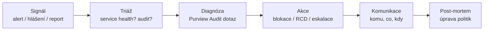

# Provozní monitoring a compliance

> Typ: povinný · Den: 5 · Odhad: PM blok
> Prostředí: [`../../environment.md`](../../environment.md) · Názvosloví: [`../../GLOSSARY.md`](../../GLOSSARY.md)

## Cíle

- Najdete auditní stopu Copilot interakce v Purview a víte, co v ní je.
- Znáte zdroje provozního signálu: audit, alerty, service health a usage reporty.
- Napíšete incident runbook (lab) — deliverable modulu.

## Proč monitoring

Během týdne jste Copilota a agenty nastavovali, stavěli a pouštěli k datům. V provozu ale přijde otázka, na kterou konfigurace sama neodpoví: *„Copilot mi ukázal smlouvu, kterou jsem neměl vidět — jak se to stalo a kdo to vyřeší?"* Na takovou otázku potřebujete dvě věci. Zaprvé **signál a důkaz** — odkud se o problému dozvíte a kde dohledáte, co se skutečně stalo. Zadruhé **postup** — kdo v jakém pořadí co udělá, i když u toho nebudete vy.

Modul proto prochází zdroje signálu od nejpodrobnějšího (auditní záznam jedné interakce) po nejširší (zdraví celé služby) a končí kostrou runbooku, který je spojí.

## Výklad

### Auditní stopa — Purview Audit

**Purview Audit** je místo, kde Microsoft 365 zapisuje, *kdo, kdy a co* v tenantu udělal — včetně interakcí s Copilotem. Najdete ho v Purview portálu na kartě **Audit**. Vyhledávání neběží jako okamžitý dotaz, ale jako **asynchronní úloha (search job)**: zadáte kritéria, úloha běží na pozadí i po zavření prohlížeče a výsledky se drží 30 dní. Pro skriptování a opakované dotazy je k dispozici PowerShell cmdlet `Search-UnifiedAuditLog`.

Jak daleko do minulosti můžete hledat, určuje licence: **180 dní u Audit Standard, 1 rok u Audit Premium** (E5). Pro incident to znamená, že s Audit Standard musíte událost dohledat do půl roku, jinak stopa zmizí ([Audit search](https://learn.microsoft.com/en-us/purview/audit-search)).

**Copilot eventy.** Copilot interakce se **logují automaticky** už v Audit Standard — nic nezapínáte. Microsoft je rozděluje do tří typů záznamu (RecordType):

- **CopilotInteraction** — Microsoft Copilot, **Cowork**, Security Copilot a další Microsoft aplikace,
- **AIAppInteraction** a **ConnectedAIAppInteraction** — AI aplikace mimo vlastní Copilot, na které jste narazili v D4 [`ai-app-access`](../../day-4/ai-app-access/README.md).

Hodnota záznamu je v tom, co nese. Nejdůležitější pole pro správce:

| Pole | Co prozradí |
|---|---|
| **AccessedResources** | ke kterým souborům a webům Copilot při odpovědi přistoupil, včetně jejich sensitivity labelů |
| `XPIADetected` | detekce *cross-prompt injection* — přistoupený zdroj obsahoval pokyny, které se snažily Copilota přesměrovat |
| `JailbreakDetected` | pokus uživatele obejít ochrany modelu |
| AgentId / AgentName | který agent interakci obsloužil |
| **`ModelTransparencyDetails`** | poskytovatel modelu — důležité, pokud máte zapnuté Anthropic nebo OpenAI jako subprocesora; u Cowork zatím chybí |
| `BingWebSearch` | odpověď využila web grounding, ne jen data tenantu |

Zdroj: [Copilot audit](https://learn.microsoft.com/en-us/purview/audit-copilot).

Všimněte si, že právě **AccessedResources** odpovídá na úvodní otázku o smlouvě: ukáže, ze kterého dokumentu Copilot čerpal. Proč k němu uživatel měl přístup, už audit neřekne — to je otázka oprávnění a vede zpět k nástrojům z D3.

Agenti z Copilot Studia se zapisují také v rámci Audit Standard. Výjimkou je audit **ne-Microsoft AI aplikací**, který se platí jako PAYG za záznam — počítejte s tím při plánování nákladů.

V labu budete hledat vlastní záznamy `CopilotInteraction` z labů D1–D4.

### Data security posture — DSPM

Audit odpovídá na otázku *„co se stalo"*. **Data Security Posture Management (DSPM)** se dívá dopředu: *„kde hrozí, že se něco stane"*. Původní **DSPM for AI** je v Purview dnes označené jako **(classic)** a nahrazuje ho nové **Data Security Posture Management**, které pokrývá AI aplikace i agenty ([DSPM for AI (classic)](https://learn.microsoft.com/en-us/purview/dspm-for-ai), [DSPM](https://learn.microsoft.com/en-us/purview/data-security-posture-management-learn-about)).

Pro kurz jsou podstatné dvě funkce. **Oversharing assessment** nad top 100 weby ukáže, kde je obsah zpřístupněný šíř, než by měl — to je stejná otázka, kterou v D3 řešíte přes SAM a reporty Data Access Governance (DAG) a kterou řeší Restricted Content Discovery (RCD). **Activity explorer** pak zobrazí Copilot interakce, takže riziko a skutečné použití vidíte na jednom místě.

### Alerty a zdraví služby

**Alert policies** upozorní správce automaticky, když v tenantu nastane podezřelé chování. Žijí v **Microsoft Defender portálu** (Email & collaboration → Policies & rules → Alert policy), už ne v Purview compliance portálu — kdo je hledá na starém místě, nenajde je. Výchozí politiky hlídají mimo jiné eskalaci admin práv, malware kampaně a neobvyklé mazání nebo externí sdílení ([Alert policies](https://learn.microsoft.com/en-us/defender-xdr/alert-policies)).

**Service health** odpovídá na otázku, zda problém není na straně Microsoftu. Najdete ho v admin centru pod **Health → Service health**. Když nefunguje ani přihlášení do admin centra, použijte veřejnou stránku **status.cloud.microsoft**. Plánovaná údržba se v Service health neobjevuje — ta je v **Message center** ([View service health](https://learn.microsoft.com/en-us/microsoft-365/enterprise/view-service-health)).

### Usage reporty

Vedle důkazů a alertů potřebujete i **adopční metriku** — kolik lidí Copilota a agenty skutečně používá. Tu dávají usage reporty v admin centru: Copilot usage report pro Copilot a samostatný Agents report pro agenty ([Copilot usage report](https://learn.microsoft.com/en-us/microsoft-365/admin/activity-reports/microsoft-365-copilot-usage), [Agents report](https://learn.microsoft.com/en-us/microsoft-365/admin/activity-reports/microsoft-365-copilot-agents-new)). Usage reporty a audit slouží jinému účelu a navzájem se nezastupují — viz *Klíčové rozlišení*.

### Runbook — kostra

Jednotlivé zdroje signálu jsou k ničemu, pokud v incidentu nikdo neví, kterým začít. **Runbook** je psaný postup, který incident provede od prvního signálu až po poučení:

- **Signál** — odkud se o problému dozvíte: alert, hlášení uživatele, report.
- **Triáž** — nejdřív ověřit Service health (je to Microsoft?), teprve pak hledat u sebe.
- **Diagnóza** — konkrétní auditní dotaz: typ záznamu, uživatel, období.
- **Akce** — nástroj z kurzu: oprava oprávnění, RCD, blokace agenta nebo eskalace.
- **Komunikace** — kdo komu co a kdy sdělí.
- **Post-mortem** — kterou politiku změnit, aby se incident neopakoval.

V runbooku se potkávají provozní signály z celého týdne: PAYG spotřeba (D2), DAG reporty (D3), backup drilly (D3) a agent dashboard (D5, [`copilot-admin`](../copilot-admin/)). Nástroje už znáte; runbook určuje, *v jakém pořadí je použít a kdo to udělá*. Dobrý runbook proto pracuje s rolemi, ne se jmény, a s odkazy, ne s pamětí — musí ho zvládnout i kolega, který vás nezná.

## Klíčové rozlišení

- **Audit vs. usage report.** Audit je důkaz: kdo, kdy a k čemu přistoupil, včetně Copilota. Usage report je adopční metrika. Microsoft výslovně doporučuje nestavět usage reporting na auditním logu — a platí to i obráceně.
- **Alert vs. budget alert.** Alert policies v Defenderu hlídají *chování* (sdílení, malware). Budget alerty hlídají *útratu*: Azure budget a billing policy původního PAYG jen upozorní, tvrdý strop umí až spending policy v Copilot → Cost management (D1 [`licensing`](../../day-1/licensing/README.md)). Jde o dva oddělené systémy a incident runbook potřebuje oba.
- **Service health vs. vlastní problém.** První krok triáže je otázka „je to Microsoft, nebo my?" Nejdřív Service health, teprve potom audit.

## Naše prostředí

Pokud vám prostředí kurzu zpřístupní audit search (viz předpoklady labu), vyzkoušíte si ho nad vlastními Copilot interakcemi z týdne — na reálných datech z labů D1–D4, ne na ukázkových záznamech. Počítejte se zpožděním: auditní záznamy se neobjevují okamžitě, takže interakce z předchozích dnů uvidíte spolehlivěji než ty z dnešního rána.

## Shrnutí

- Purview Audit zaznamenává Copilot interakce automaticky už v Audit Standard; retence je 180 dní, s Audit Premium 1 rok.
- Pole **AccessedResources** ukáže, ze kterých zdrojů Copilot čerpal; proč k nim uživatel měl přístup, řeší oprávnění a nástroje z D3.
- DSPM hledá riziko oversharingu dopředu, audit dokládá, co se stalo.
- Alert policies jsou v Defender portálu; Service health (a status.cloud.microsoft) je první krok každé triáže.
- Runbook spojuje signály týdne do postupu Signál → Triáž → Diagnóza → Akce → Komunikace → Post-mortem.

## Lab

[`lab-monitoring-runbook.md`](lab-monitoring-runbook.md) — provozní monitoring: audit search nad vlastní stopou a incident runbook.

## Zdroje (Microsoft)

- **Audit:** [Audit log search](https://learn.microsoft.com/en-us/purview/audit-search) · [Audit Copilot interactions](https://learn.microsoft.com/en-us/purview/audit-copilot)
- **DSPM:** [DSPM for AI (classic)](https://learn.microsoft.com/en-us/purview/dspm-for-ai) · [DSPM](https://learn.microsoft.com/en-us/purview/data-security-posture-management-learn-about)
- **Alerty a zdraví služby:** [Alert policies (Defender)](https://learn.microsoft.com/en-us/defender-xdr/alert-policies) · [Service health](https://learn.microsoft.com/en-us/microsoft-365/enterprise/view-service-health)
- **Usage reporty:** [Copilot usage report](https://learn.microsoft.com/en-us/microsoft-365/admin/activity-reports/microsoft-365-copilot-usage) · [Agents report](https://learn.microsoft.com/en-us/microsoft-365/admin/activity-reports/microsoft-365-copilot-agents-new)

## Stav produktu / delta

> [!WARNING] Ověřit k datu běhu — stav k 2026-11.
>
> - **Audit:** CopilotInteraction nově zahrnuje Cowork; přibyla pole `ModelTransparencyDetails` a `XPIADetected`. Retence 180 dní / 1 rok dle licence — kurz jede na Business Basic, počítejte se 180 dny. Sazby PAYG auditu ne-Microsoft AI aplikací ověřte.
> - **DSPM:** DSPM for AI přešlo na classic, nahrazuje ho nové DSPM.
> - **Usage reporty:** Copilot usage report má zpoždění ~48 h; agenti jsou v samostatném Agents reportu (preview).
> - **Alert policies:** dokumentace se přestěhovala pod Defender XDR — ověřte aktuální cestu v portálu.
