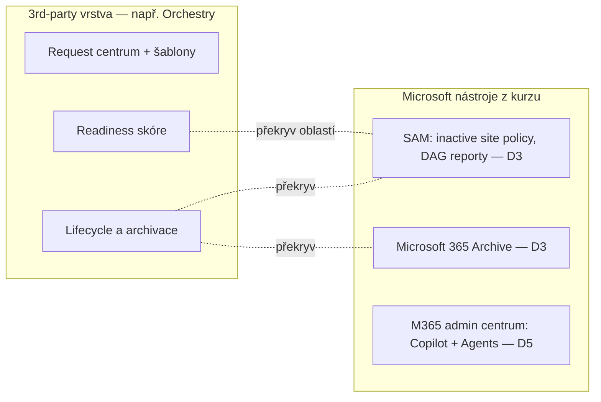

# Orchestry — možnosti řízení Copilotu (volitelný)

> Typ: **volitelný (V)** · Den: 5 (po monitoringu) · Odhad: krátký blok
> Prostředí: viz [`../../environment.md`](../../environment.md) · Názvosloví: [`../../GLOSSARY.md`](../../GLOSSARY.md)

Modul je volitelný a nic dalšího v kurzu na něm nestojí — Závěrečný projekt ho nepředpokládá, takže kdo ho vynechá, o nic nepřijde. Navazuje na poslední řádek mapy vrstev z modulu [`copilot-admin`](../copilot-admin/README.md), kde jsou „provisioning, lifecycle, readiness score" přiřazené nástrojům třetích stran.

## Cíle

- Vysvětlíte, co governance vrstva třetí strany přidává nad nástroje Microsoftu z kurzu (SAM, Copilot a Agents v Microsoft 365 admin centru, Agent 365).
- Umíte formulovat kritéria „kdy nekupovat" — kdy Microsoft stack stačí.

## Proč se dívat na nástroj třetí strany

Celý týden jste se učili nástroje Microsoftu: v D3 SharePoint Advanced Management (SAM) a Microsoft 365 Archive, v D5 sekce Copilot a Agents v Microsoft 365 admin centru a Agent 365. Tyto nástroje odpovídají hlavně na otázku *co a kdo smí* — kdo má Copilot, co Copilot vidí, které agenty kdo používá. Ve větší organizaci ale brzy narazíte na jinou otázku: *jak vznikají nové týmy a weby, kdo je schvaluje a jak poznáme, že je tenant připravený na Copilot?* Na tuhle provozní vrstvu se zaměřují nástroje třetích stran.

Orchestry tu slouží jako **příklad kategorie**, ne jako doporučení konkrétního výrobce. Podobné funkce nabízejí i další nástroje pro správu Microsoft 365; jde o to naučit se, jak takový nástroj posoudit. Všechna tvrzení o Orchestry v tomto modulu pocházejí z webu výrobce, nikoli z dokumentace Microsoftu — jde o marketingové materiály a podle toho je čtěte.

## Co Orchestry přidává

### Provisioning se šablonami a schvalováním

Bez nástroje třetí strany zakládá týmy a weby buď kdokoli (a vzniká živelný růst), nebo jen IT (a vzniká fronta požadavků). Orchestry nabízí třetí cestu: uživatelé si workspace (Teams, SharePoint, Viva Engage) **sami vyžádají** přes průvodce žádostí a požadavek projde **jedno- nebo vícestupňovým schvalováním**, případně složitějším flow v Power Automate. Workspace vzniká ze **šablony**, která rovnou nastaví výchozí vlastnictví, oprávnění a sensitivity label. Governance se tak uplatní už při vzniku, ne dodatečně ([orchestry.com — Provisioning & Templates](https://www.orchestry.com/platform/microsoft-365-provisioning-templates), [orchestry.com — Copilot readiness](https://www.orchestry.com/microsoft-365-copilot/copilot-readiness)).

V labu tuto vrstvu označujeme jako **request centrum**: místo, kam žádosti přicházejí a kde se podle šablony rozhoduje, kdo je schvaluje a s jakými výchozími hodnotami workspace vznikne.

### Lifecycle a archivace

Druhá oblast je stárnutí workspaces. Web, který před rokem sloužil projektu, dnes nikdo nepoužívá, ale jeho obsah dál vidí vyhledávání i Copilot. Orchestry uvádí mezi oblastmi platformy správu životního cyklu a archivaci, správu oprávnění a hostů a delegaci správy na vlastníky obsahu — vlastníci mají sami uklízet své týmy a weby s menší účastí IT ([orchestry.com — governance](https://www.orchestry.com/microsoft-365-governance)). Konkrétní podobu revizí oprávnění a hostů (četnost, průběh) web výrobce nepopisuje; před rozhodnutím ji ověřte u výrobce.

### Copilot Readiness Dashboard

Třetí oblast míří přímo na Copilot rollout. **Copilot Readiness Dashboard** podle výrobce vyhodnocuje **13 signálů** v tenantu a shrnuje je do jednoho skóre připravenosti. Výrobce celý seznam signálů nezveřejňuje; jako příklady uvádí přesdílený a citlivý obsah dostupný Copilotu, zastaralá data, sdílecí odkazy typu „Anyone" a nespravované nové workspaces ([orchestry.com — Copilot readiness](https://www.orchestry.com/microsoft-365-copilot/copilot-readiness)).

Smysl takového skóre je převést otázku „jsme připravení pustit Copilota?" na číslo, kterému rozumí i management. Signály tohoto typu typicky sledují to, co znáte z D3: přesdílení, rozbité dědění oprávnění, chybějící sensitivity labely nebo weby bez vlastníka. V labu si sami vyberete, které z nich jsou pro modelovou firmu nejdůležitější.

## Kam patří v mapě vrstev (z copilot-admin)

Microsoft nástroje řídí *co a kdo smí*; Orchestry a podobné nástroje přidávají *proces a přehled*: šablonový vznik, workflow žádostí a skóre připravenosti. Překryv přitom existuje a je dobré ho vidět:

Lifecycle se překrývá s inactive site policy v SAM, archivace s Microsoft 365 Archive, readiness skóre s DAG reporty. Nástroj třetí strany tu nepřidává novou schopnost, ale jednotné uživatelské rozhraní, delegaci na vlastníky a hotový proces — a platí se za to licencí navíc. Naopak u šablonového zakládání se schvalováním žádný hotový ekvivalent v Microsoft nástrojích z kurzu nemáte; řešili byste ho vlastním formulářem a flow (D4).

## Klíčové rozlišení

- **Kupovat vs. nekupovat.** Malý tenant s IT kapacitou si vystačí se SAM, Microsoft 365 admin centrem (Copilot, Agents) a skripty. Velká organizace se samoobslužným zakládáním workspaces ušetří nástrojem třetí strany provozní práci. Rozhoduje objem žádostí a to, kdo je vyřizuje — ne délka seznamu funkcí.
- **Readiness skóre vs. DAG reporty.** Pokrývají překrývající se oblasti (přesdílení, sdílecí odkazy), ale jinak je podávají: DAG reporty jsou podrobné přehledy pro správce, readiness skóre je agregát pro management. Obojí stojí na tom, co jste se naučili v D3.
- **Funkce vs. přidaná hodnota.** Část funkcí třetí strany jen přebaluje to, co už v Microsoft nástrojích máte. Skutečnou přidanou hodnotu najdete tam, kde Microsoft nástroj chybí a jinak byste sahali po ručním procesu.
- **Nástroj třetí strany je další aplikace v tenantu.** Před nákupem se ptejte, jaká aplikační oprávnění a consent v tenantu potřebuje a kde zpracovává data tenantu — viz D4 [`ai-app-access`](../../day-4/ai-app-access/README.md). U nástroje, který čte oprávnění a obsah celého tenantu, je to stejně důležité jako jeho funkce.

## Naše prostředí

Do kurzovního tenantu se nic neinstaluje. Modul stojí na výkladu a veřejných materiálech výrobce; lab je papírový a nepotřebuje tenant ani instalaci.

## Shrnutí

- Microsoft nástroje řídí *co a kdo smí*; governance nástroje třetích stran přidávají *proces a přehled*.
- Orchestry je příklad kategorie: provisioning se šablonami a schvalováním, lifecycle a archivace, Copilot Readiness Dashboard.
- Lifecycle, archivace a readiness se překrývají se SAM, Microsoft 365 Archive a DAG reporty; pro šablonový vznik se schvalováním mezi nástroji z kurzu hotový ekvivalent nemáte.
- O nákupu rozhoduje objem žádostí a kapacita IT, ne seznam funkcí — a vždy i to, jaká oprávnění nástroj v tenantu potřebuje.

## Lab

Viz [`lab-orchestry-policy-plan.md`](lab-orchestry-policy-plan.md) — plán politik (simulace).

## Zdroje (Microsoft)

- **Microsoft nástroje, se kterými se Orchestry překrývá:** [SharePoint Advanced Management](https://learn.microsoft.com/en-us/sharepoint/advanced-management) · [Microsoft 365 Archive](https://learn.microsoft.com/en-us/microsoft-365/archive/archive-overview) · [Copilot controls overview](https://learn.microsoft.com/en-us/microsoft-365/copilot/copilot-controls/copilot-controls-overview) · [Microsoft Agent 365](https://learn.microsoft.com/en-us/microsoft-agent-365/overview)
- **Orchestry — třetí strana, ne Microsoft (marketingové stránky výrobce):** [Microsoft 365 governance](https://www.orchestry.com/microsoft-365-governance) · [Provisioning & Templates](https://www.orchestry.com/platform/microsoft-365-provisioning-templates) · [Copilot readiness](https://www.orchestry.com/microsoft-365-copilot/copilot-readiness)

## Stav produktu / delta

> [!WARNING] Ověřit k datu běhu — stav k 2026-11.
>
> - Funkce a ceny nástrojů třetích stran se mění rychleji než dokumentace Microsoftu; před během projděte orchestry.com.
> - Počet signálů Copilot Readiness Dashboardu (13) a podobu schvalování žádostí uvádí jen výrobce — ověřte aktuální stav.
> - Překryv se mění i z druhé strany: s každým rozšířením SAM a Microsoft 365 admin centra se zmenšuje prostor, kde 3rd-party přidává.
